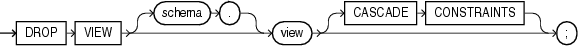

Purpose

Use the `DROP` `VIEW` statement to remove a view or an object view from the database. You can change the definition of a view by dropping and re-creating it.

See Also:

[CREATE VIEW](statements_8004.md) and [ALTER VIEW](statements_4004.md) for information on creating and modifying a view

Prerequisites

The view must be in your own schema or you must have the `DROP` `ANY` `VIEW` system privilege.

Syntax

drop\_view::=



> ```
> DROP VIEW [ schema. ] view [ CASCADE CONSTRAINTS ] ;
> ```
  

Semantics

schema

Specify the schema containing the view. If you omit `schema`, then Oracle Database assumes the view is in your own schema.

view

Specify the name of the view to be dropped.

Oracle Database does not drop views, materialized views, and synonyms that are dependent on the view but marks them `INVALID`. You can drop them or redefine views and synonyms, or you can define other views in such a way that the invalid views and synonyms become valid again.

If any subviews have been defined on `view`, then the database invalidates the subviews as well. To determine whether the view has any subviews, query the `SUPERVIEW_NAME` column of the `USER_`, `ALL_`, or `DBA_VIEWS` data dictionary views.

See Also:

- [CREATE TABLE](statements_7002.md) and [CREATE SYNONYM](statements_7001.md)
- [ALTER MATERIALIZED VIEW](statements_2002.md) for information on revalidating invalid materialized views

CASCADE CONSTRAINTS

Specify `CASCADE` `CONSTRAINTS` to drop all referential integrity constraints that refer to primary and unique keys in the view to be dropped. If you omit this clause, and such constraints exist, then the `DROP` statement fails.

Examples

Dropping a View: Example The following statement drops the `emp_view` view, which was created in ["Creating a View: Example"](statements_8004.md):

```
DROP VIEW emp_view;
```