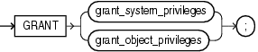
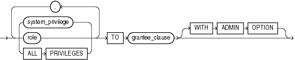
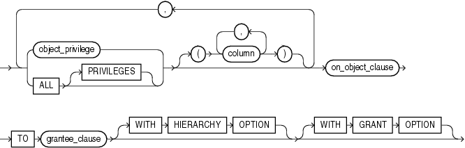
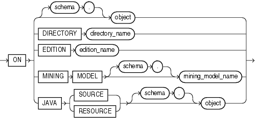
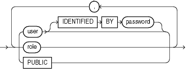

Purpose

Use the `GRANT` statement to grant:

- Roles to users and roles. The granted roles can be either user-defined (local or external) or predefined. For a list of predefined roles, refer to [Oracle Database Security Guide](https://docs.oracle.com/cd/E11882_01/network.112/e36292/authorization.htm#DBSEG4414).
- System privileges to users and roles. Table 18-1 lists the system privileges (organized by the database object operated upon).
- Object privileges for a particular object to users, roles, and `PUBLIC`. Table 18-2 lists object privileges (organized by the database object operated upon).

Note:

Global roles (created with `IDENTIFIED` `GLOBALLY`) are granted through enterprise roles and cannot be granted using the `GRANT` statement.

Notes on Authorizing Database Users You can authorize database users through means other than the database and the `GRANT` statement.

- Many Oracle Database privileges are granted through supplied PL/SQL and Java packages. For information on those privileges, refer to the documentation for the appropriate package.
- Some operating systems have facilities that let you grant roles to Oracle Database users with the initialization parameter `OS_ROLES`. If you choose to grant roles to users through operating system facilities, then you cannot also grant roles to users with the `GRANT` statement, although you can use the `GRANT` statement to grant system privileges to users and system privileges and roles to other roles.

Note on Oracle Automatic Storage Management A user authenticated `AS` `SYSASM` can use this statement to grant the system privileges `SYSASM`, `SYSOPER`, and `SYSDBA` to a user in the Oracle ASM password file of the current node.

Note on Editionable Objects

A `GRANT` operation to grant object privileges on an editionable object actualizes the object in the current edition. See [Oracle Database Advanced Application Developer's Guide](https://docs.oracle.com/cd/E11882_01/appdev.112/e41502/adfns_editions.htm#ADFNS99922) for more information about editions and editionable objects.

See Also:

- [CREATE USER](statements_8003.md) and [CREATE ROLE](statements_6012.md) for definitions of local, global, and external privileges
- [Oracle Database Security Guide](https://docs.oracle.com/cd/E11882_01/network.112/e36292/authentication.htm#DBSEG003) for information about other authorization methods and for information about [privileges](https://docs.oracle.com/cd/E11882_01/network.112/e36292/authorization.htm#DBSEG004)
- [REVOKE](statements_9020.md) for information on revoking grants

Prerequisites

To grant a system privilege, one of the following conditions must be met:

- You must have been granted the `GRANT` `ANY` `PRIVILEGE` system privilege. In this case, if you grant the system privilege to a role, then a user to whom the role has been granted does not have the privilege unless the role is enabled in user's session.
- You must have been granted the system privilege with the `ADMIN` `OPTION`. In this case, if you grant the system privilege to a role, then a user to whom the role has been granted has the privilege regardless whether the role is enabled in the user's session.

To grant a role, you must either have been granted the role with the `ADMIN` `OPTION` or have been granted the `GRANT` `ANY` `ROLE` system privilege, or you must have created the role.

To grant an object privilege, you must own the object, or the owner of the object must have granted you the object privileges with the `GRANT` `OPTION`, or you must have been granted the `GRANT` `ANY` `OBJECT` `PRIVILEGE` system privilege. If you have the `GRANT` `ANY` `OBJECT` `PRIVILEGE`, then you can grant the object privilege only if the object owner could have granted the same object privilege. In this case, the `GRANTOR` column of the `DBA_TAB_PRIVS` view displays the object owner rather than the user who issued the `GRANT` statement.

Syntax

grant::=



> ```
> GRANT { grant_system_privileges
>       | grant_object_privileges
>       } ;
> ```
  
  

(grant\_system\_privileges::=, grant\_object\_privileges::=)

grant\_system\_privileges::=



> ```
> { system_privilege
> | role
> | ALL PRIVILEGES
> }
>   [, { system_privilege
>      | role
>      | ALL PRIVILEGES
>      }
>   ]...
> TO grantee_clause
>   [ WITH ADMIN OPTION ]
> ```
  
  

(grantee\_clause::=)

grant\_object\_privileges::=



> ```
> { object_privilege | ALL [ PRIVILEGES ] }
>   [ (column [, column ]...) ]
>     [, { object_privilege | ALL [ PRIVILEGES ] }
>        [ (column [, column ]...) ]
>     ]...
> on_object_clause
> TO grantee_clause
>   [ WITH HIERARCHY OPTION ]
>   [ WITH GRANT OPTION ]
> ```
  
  

(on\_object\_clause::=, grantee\_clause::=)

on\_object\_clause::=



> ```
> ON { [ schema. ] object 
>    | DIRECTORY directory_name
>    | EDITION edition_name
>    | MINING MODEL [schema.] mining_model_name
>    | JAVA { SOURCE | RESOURCE } [ schema. ] object
>    }
> ```
  
  

grantee\_clause::=



> ```
> { user [ IDENTIFIED BY password ]
> | role
> | PUBLIC
> }
>   [, { user [ IDENTIFIED BY password ]
>      | role
>      | PUBLIC
>      } 
>   ]...
> ```
  

Semantics

grant\_system\_privileges

Use these clauses to grant system privileges.

system\_privilege

Specify the system privilege you want to grant. Table 18-1 lists the system privileges, organized by the database object operated upon.

- If you grant a privilege to a user, then the database adds the privilege to the user's privilege domain. The user can immediately exercise the privilege. Oracle recommends that you only grant the `ANY` privileges to trusted users.
- If you grant a privilege to a role, then the database adds the privilege to the privilege domain of the role. Users who have been granted and have enabled the role can immediately exercise the privilege. Other users who have been granted the role can enable the role and exercise the privilege.
- If you grant a privilege to `PUBLIC`, then the database adds the privilege to the privilege domains of each user. All users can immediately perform operations authorized by the privilege. Oracle recommends against granting system privileges to `PUBLIC`.

Oracle Database provides the `ALL` `PRIVILEGES` shortcut for granting all the system privileges listed in Table 18-1, except the `SELECT` `ANY` `DICTIONARY`, `ALTER` `DATABASE` `LINK`, and `ALTER` `PUBLIC` `DATABASE` `LINK` privileges.

role

Specify the role you want to grant. You can grant an Oracle Database predefined role or a user-defined role.

- If you grant a role to a user, then the database makes the role available to the user. The user can immediately enable the role and exercise the privileges in the privilege domain of the role.
	In the case of a secure application role, you need not grant such a role directly to the user. You can let the associated PL/SQL package do this, assuming the user passes appropriate security policies. For more information, see the `CREATE` `ROLE` semantics for [USING package](statements_6012.md) and [Oracle Database Security Guide](https://docs.oracle.com/cd/E11882_01/network.112/e36292/app_devs.htm#DBSEG005)
- If you grant a role to another role, then the database adds the privilege domain of the granted role to the privilege domain of the grantee role. Users who have been granted the grantee role can enable it and exercise the privileges in the granted role's privilege domain.
- If you grant a role to `PUBLIC`, then the database makes the role available to all users. All users can immediately enable the role and exercise the privileges in the privilege domain of the role.

See Also:

- [Oracle Database Security Guide](https://docs.oracle.com/cd/E11882_01/network.112/e36292/authorization.htm#DBSEG4414) for information on the Oracle predefined roles
- "Granting a Role to a Role: Example"
- [CREATE ROLE](statements_6012.md) for information on creating a user-defined role

IDENTIFIED BY Clause

This clause is valid only when granting system privileges, not when granting object privileges. Use the `IDENTIFIED` `BY` clause to specify a new password for an existing user or to create a nonexistent user. This clause is not valid if the grantee is a role or `PUBLIC`. If the user specified in the `grantee_clause` does not exist, then the database creates the user with the password and with the privileges and roles specified in this clause.

See Also:

[CREATE USER](statements_8003.md) for restrictions on usernames and passwords

WITH ADMIN OPTION

Specify `WITH` `ADMIN` `OPTION` to enable the grantee to:

- Grant the privilege or role to another user or role, unless the role is a `GLOBAL` role
- Revoke the privilege or role from another user or role
- Alter the privilege or role to change the authorization needed to access it
- Drop the privilege or role

If you grant a system privilege or role to a user without specifying `WITH` `ADMIN` `OPTION`, and then subsequently grant the privilege or role to the user `WITH` `ADMIN` `OPTION`, then the user has the `ADMIN` `OPTION` on the privilege or role.

To revoke the `ADMIN` `OPTION` on a system privilege or role from a user, you must revoke the privilege or role from the user altogether and then grant the privilege or role to the user without the `ADMIN` `OPTION`.

See Also:

"Granting a Role with the Admin Option: Example"

grantee\_clause

`TO` `grantee_clause` identifies users or roles to which the system privilege, role, or object privilege is granted.

Restriction on Grantees A user, role, or `PUBLIC` cannot appear more than once in the `TO` `grantee_clause.`

PUBLIC

Specify `PUBLIC` to grant the privileges to all users. Oracle recommends against granting system privileges to `PUBLIC`.

Restrictions on Granting System Privileges and Roles Privileges and roles are subject to the following restrictions:

- A privilege or role cannot appear more than once in the list of privileges and roles to be granted.
- You cannot grant a role to itself.
- You cannot grant a role `IDENTIFIED` `GLOBALLY` to anything.
- You cannot grant a role `IDENTIFIED` `EXTERNALLY` to a global user or global role.
- You cannot grant roles circularly. For example, if you grant the role `banker` to the role `teller`, then you cannot subsequently grant `teller` to `banker`.
- You cannot grant an `IDENTIFIED` `BY` role, `IDENTIFIED` `USING` role, or `IDENTIFIED` `EXTERNALLY` role to another role.

grant\_object\_privileges

Use these clauses to grant object privileges.

object\_privilege

Specify the object privilege you want to grant. Table 18-2 lists the object privileges, organized by the type of object on which they can be granted. When you grant an object privilege on a editionable object, either to a user or to a role, the object is actualized in the edition in which the grant is made. Refer to [CREATE EDITION](statements_5009.md) for information on editionable object types and editions.

Note:

To grant `SELECT` on a view to another user, either you must own all of the objects underlying the view or you must have been granted the `SELECT` object privilege `WITH` `GRANT` `OPTION` on all of those underlying objects. This is true even if the grantee already has `SELECT` privileges on those underlying objects.

Restriction on Object Privileges A privilege cannot appear more than once in the list of privileges to be granted.

ALL \[PRIVILEGES\]

Specify `ALL` to grant all the privileges for the object that you have been granted with the `GRANT` `OPTION`. The user who owns the schema containing an object automatically has all privileges on the object with the `GRANT` `OPTION`. The keyword `PRIVILEGES` is provided for semantic clarity and is optional.

column

Specify the table or view column on which privileges are to be granted. You can specify columns only when granting the `INSERT`, `REFERENCES`, or `UPDATE` privilege. If you do not list columns, then the grantee has the specified privilege on all columns in the table or view.

For information on existing column object grants, query the `USER_`, `ALL_`, or `DBA_COL_PRIVS` data dictionary view.

See Also:

[Oracle Database Reference](https://docs.oracle.com/cd/E11882_01/server.112/e40402/toc.htm) for information on the data dictionary views and "Granting Multiple Object Privileges on Individual Columns: Example"

on\_object\_clause

The `on_object_clause` identifies the object on which the privileges are granted. Directory schema objects, editions, data mining models, and Java source and resource schema objects are identified separately because they reside in separate namespaces.

If you can make this grant only because you have the `GRANT` `ANY` `OBJECT` `PRIVILEGE` system privilege—that is, you are not the owner of `object`, nor do you have `object_privilege` on `object` `WITH` `GRANT` `OPTION` —then the effect of this grant is that you are acting on behalf of the object owner. The `*_TAB_PRIVS` data dictionary views will reflect that this grant was made by the owner of `object`.

See Also:

- "Granting Object Privileges to a Role: Example"
- ["Revoke Operations that Use GRANT ANY OBJECT PRIVILEGE: Example"](statements_9020.md) for more information on using the `GRANT` `ANY` `OBJECT` `PRIVILEGE` system privilege for revoke operations

WITH GRANT OPTION

Specify `WITH` `GRANT` `OPTION` to enable the grantee to grant the object privileges to other users and roles.

If you grant an object privilege to a user without specifying `WITH` `GRANT` `OPTION`, and then subsequently grant the privilege to the user `WITH` `GRANT` `OPTION`, then the user has the `GRANT` `OPTION` on the privilege.

To revoke the `GRANT` `OPTION` on an object privilege from a user, you must revoke the privilege from the user altogether and then grant the privilege to the user without the `GRANT` `OPTION`.

Restriction on Granting WITH GRANT OPTION You can specify `WITH` `GRANT` `OPTION` only when granting to a user or to `PUBLIC`, not when granting to a role.

WITH HIERARCHY OPTION

Specify `WITH` `HIERARCHY` `OPTION` to grant the specified object privilege on all subobjects of `object`, such as subviews created under a view, including subobjects created subsequent to this statement.

This clause is meaningful only in combination with the `SELECT` object privilege.

object Specify the schema object on which the privileges are to be granted. If you do not qualify `object` with `schema`, then the database assumes the object is in your own schema. The object can be one of the following types:

- Table, view, or materialized view
- Sequence
- Procedure, function, or package
- User-defined type
- Synonym for any of the preceding items
- Directory, library, operator, or indextype
- Java source, class, or resource

You cannot grant privileges directly to a single partition of a partitioned table.

DIRECTORY directory\_name Specify a directory schema object on which privileges are to be granted. You cannot qualify `directory_name` with a schema name.

JAVA SOURCE | RESOURCE The `JAVA` clause lets you specify a Java source or resource schema object on which privileges are to be granted.

See Also:

[CREATE JAVA](statements_5014.md)

Listings of System and Object Privileges

Note:

When you grant a privilege on `ANY` object, such as `CREATE` `ANY` `CLUSTER`, the result is determined by the value of the `O7_DICTIONARY_ACCESSIBILITY` initialization parameter. By default, this parameter is set to `FALSE`, so that `ANY` privileges give the grantee access to that type of object in all schemas except the `SYS` schema. If you set `O7_DICTIONARY_ACCESSIBILITY` to `TRUE`, then the `ANY` privileges also give the grantee access, in the `SYS` schema, to all objects except Oracle Scheduler objects. For security reasons, Oracle recommends that you use this setting only with great caution.

Table 18-1 System Privileges (Organized by the Database Object Operated Upon)

| System Privilege Name | Operations Authorized |
| --- | --- |
| Advisor Framework Privileges: All of the advisor framework privileges are part of the DBA role. | — |
| `ADVISOR` | Access the advisor framework through PL/SQL packages such as `DBMS_ADVISOR` and `DBMS_SQLTUNE`.  Refer to [Oracle Database PL/SQL Packages and Types Reference](https://docs.oracle.com/cd/E11882_01/appdev.112/e40758/toc.htm) for information on these packages. |
| `ADMINISTER SQL TUNING SET` | Create, drop, select (read), load (write), and delete a SQL tuning set owned by the grantee through the `DBMS_SQLTUNE` package. |
| `ADMINISTER ANY SQL TUNING SET` | Create, drop, select (read), load (write), and delete a SQL tuning set owned by any user through the `DBMS_SQLTUNE` package. |
| `CREATE ANY SQL PROFILE` | Accept a SQL Profile recommended by the SQL Tuning Advisor, which is accessed through Enterprise Manager or by the `DBMS_SQLTUNE` package.  Note: This privilege has been deprecated in favor of `ADMINISTER` `SQL` `MANAGEMENT` `OBJECT`. |
| `ALTER ANY SQL PROFILE` | Alter the attributes of an existing SQL Profile.  Note: This privilege has been deprecated in favor of `ADMINISTER` `SQL` `MANAGEMENT` `OBJECT`. |
| `DROP ANY SQL PROFILE` | Drop an existing SQL Profile.  Note: This privilege has been deprecated in favor of `ADMINISTER` `SQL` `MANAGEMENT` `OBJECT`. |
| `ADMINISTER SQL MANAGEMENT OBJECT` | Create, alter, and drop a SQL Profile owned by any user through the `DBMS_SQLTUNE` package. |
| CLUSTERS: | — |
| `CREATE CLUSTER` | Create clusters in the grantee's schema. |
| `CREATE ANY CLUSTER` | Create a cluster in any schema. Behaves similarly to `CREATE` `ANY` `TABLE`. |
| `ALTER ANY CLUSTER` | Alter clusters in any schema. |
| `DROP ANY CLUSTER` | Drop clusters in any schema. |
| CONTEXTS: | — |
| `CREATE ANY CONTEXT` | Create any context namespace. |
| `DROP ANY CONTEXT` | Drop any context namespace. |
| DATA REDACTION: | — |
| `EXEMPT REDACTION POLICY` | Bypass any existing Oracle Data Redaction policies and view actual data from tables or views on which Data Redaction policies are defined.  Note: This privilege is available starting with Oracle Database 11g Release 2 (11.2.0.4). |
| DATABASE: | — |
| `ALTER DATABASE` | Alter the database. |
| `ALTER SYSTEM` | Issue `ALTER` `SYSTEM` statements. |
| `AUDIT SYSTEM` | Issue `AUDIT` statements. |
| DATABASE LINKS: | — |
| `CREATE DATABASE LINK` | Create private database links in the grantee's schema. |
| `CREATE PUBLIC DATABASE LINK` | Create public database links. |
| `ALTER` `DATABASE` `LINK` | Modify a fixed-user database link when the password of the connection or authentication user changes. |
| `ALTER` `PUBLIC` `DATABASE` `LINK` | Modify a public fixed-user database link when the password of the connection or authentication user changes. |
| `DROP PUBLIC DATABASE LINK` | Drop public database links. |
| DEBUGGING: | — |
| `DEBUG` `CONNECT` `SESSION` | Connect the current session to a debugger. |
| `DEBUG` `ANY` `PROCEDURE` | Debug all PL/SQL and Java code in any database object. Display information on all SQL statements executed by the application.  Note: Granting this privilege is equivalent to granting the `DEBUG` object privilege on all applicable objects in the database. |
| DICTIONARIES: | — |
| `ANALYZE` `ANY` `DICTIONARY` | Analyze any data dictionary object. |
| DIMENSIONS: | — |
| `CREATE DIMENSION` | Create dimensions in the grantee's schema. |
| `CREATE ANY DIMENSION` | Create dimensions in any schema. |
| `ALTER ANY DIMENSION` | Alter dimensions in any schema. |
| `DROP ANY DIMENSION` | Drop dimensions in any schema. |
| DIRECTORIES: | — |
| `CREATE ANY DIRECTORY` | Create directory database objects. |
| `DROP ANY DIRECTORY` | Drop directory database objects. |
| EDITIONS: | — |
| `CREATE ANY EDITION` | Create editions. |
| `DROP ANY EDITION` | Drop editions. |
| FLASHBACK DATA ARCHIVES: | — |
| `FLASHBACK` `ARCHIVE` `ADMINISTER` | Create, alter, or drop any flashback data archive. |
| INDEXES: | — |
| `CREATE ANY INDEX` | Create in any schema a domain index or an index on any table in any schema. |
| `ALTER ANY INDEX` | Alter indexes in any schema. |
| `DROP ANY INDEX` | Drop indexes in any schema. |
| INDEXTYPES: | — |
| `CREATE INDEXTYPE` | Create an indextype in the grantee's schema. |
| `CREATE ANY INDEXTYPE` | Create an indextype in any schema and create a comment on an indextype in any schema. |
| `ALTER ANY INDEXTYPE` | Modify indextypes in any schema. |
| `DROP ANY INDEXTYPE` | Drop an indextype in any schema. |
| `EXECUTE ANY INDEXTYPE` | Reference an indextype in any schema. |
| JOB SCHEDULER OBJECTS: | The following privileges are needed to execute procedures in the `DBMS_SCHEDULER` package. This privileges do not apply to lightweight jobs, which are not database objects. Refer to [Oracle Database Administrator's Guide](https://docs.oracle.com/cd/E11882_01/server.112/e25494/schedadmin.htm#ADMIN035) for more information about lightweight jobs. |
| `CREATE JOB` | Create jobs, schedules, or programs in the grantee's schema. |
| `CREATE ANY JOB` | Create, alter, or drop jobs, chains, schedules, programs, or credentials in any schema except `SYS`.  Caution: This extremely powerful privilege allows the grantee to execute code as any other user. It should be granted with caution. |
| `CREATE EXTERNAL JOB` | Create in the grantee's schema an executable scheduler job that runs on the operating system. |
| `EXECUTE ANY PROGRAM` | Use any program in a job in the grantee's schema. |
| `EXECUTE ANY CLASS` | Specify any job class in a job in the grantee's schema. |
| `MANAGE SCHEDULER` | Create, alter, or drop any job class, window, or window group. |
| LIBRARIES: | Caution: `CREATE` `LIBARARY`, `CREATE` `ANY` `LIBRARY`, `ALTER` `ANY` `LIBRARY`, and `EXECUTE` `ANY` `LIBRARY` are extremely powerful privileges that should be granted only to trusted users. Refer to [Oracle Database Security Guide](https://docs.oracle.com/cd/E11882_01/network.112/e36292/guidelines.htm#DBSEG499) before granting these privileges. |
| `CREATE LIBRARY` | Create external procedure or function libraries in the grantee's schema. |
| `CREATE ANY LIBRARY` | Create external procedure or function libraries in any schema. |
| `ALTER ANY LIBRARY` | Alter external procedure or function libraries in any schema. |
| `DROP ANY LIBRARY` | Drop external procedure or function libraries in any schema. |
| `EXECUTE ANY LIBRARY` | Use external procedure or function libraries in any schema. |
| MATERIALIZED VIEWS: | — |
| `CREATE MATERIALIZED VIEW` | Create a materialized view in the grantee's schema. |
| `CREATE ANY MATERIALIZED VIEW` | Create materialized views in any schema. |
| `ALTER ANY MATERIALIZED VIEW` | Alter materialized views in any schema. |
| `DROP ANY MATERIALIZED VIEW` | Drop materialized views in any schema. |
| `QUERY REWRITE` | This privilege has been deprecated. No privileges are needed for a user to enable rewrite for a materialized view that references tables or views in the user's own schema. |
| `GLOBAL QUERY REWRITE` | Enable rewrite using a materialized view when that materialized view references tables or views in any schema. |
| `ON COMMIT REFRESH` | Create a refresh-on-commit materialized view on any table in the database.  Alter a refresh-on-demand materialized on any table in the database to refresh-on-commit. |
| `FLASHBACK ANY TABLE` | Issue a SQL Flashback Query on any table, view, or materialized view in any schema. This privilege is not needed to execute the `DBMS_FLASHBACK` procedures. |
| MINING MODELS: | — |
| `CREATE MINING MODEL` | Create mining models in the grantee's schema using the `DBMS_DATA_MINING.CREATE_MODEL` procedure. |
| `CREATE ANY MINING MODEL` | Create mining models in any schema using the `DBMS_DATA_MINING.CREATE_MODEL` procedure. |
| `ALTER ANY MINING MODEL` | Change the mining model name or the associated cost matrix of any model in any schema by using the applicable `DBMS_DATA_MINING` procedures. |
| `DROP ANY MINING MODEL` | Drop any mining model in any schema by using the `DBMS_DATA_MINING.DROP_MODEL` procedure. |
| `SELECT ANY MINING MODEL` | Score or view any model in any schema. Scoring is done either with the `PREDICTION` family of SQL functions or with the `DBMS_DATA_MINING.APPLY` procedure. Viewing the model is done with the `DBMS_DATA_MINING.GET_MODEL_DETAILS_*` procedures. |
| `COMMENT ANY MINING MODEL` | Create a comment on any model in any schema using the SQL `COMMENT` statement. |
| OLAP CUBES: | The following privileges are valid when you are using Oracle Database with the OLAP option. |
| `CREATE CUBE` | Create an OLAP cube in the grantee's schema. |
| `CREATE ANY CUBE` | Create an OLAP cube in any schema. |
| `ALTER ANY CUBE` | Alter an OLAP cube in any schema. |
| `DROP ANY CUBE` | Drop any OLAP cube in any schema. |
| `SELECT ANY CUBE` | Query or view any OLAP cube in any schema. |
| `UPDATE ANY CUBE` | Update any cube in any schema. |
| OLAP CUBE MEASURE FOLDERS: | The following privileges are valid when you are using Oracle Database with the OLAP option. |
| `CREATE MEASURE FOLDER` | Create an OLAP measure folder in the grantee's schema. |
| `CREATE ANY MEASURE FOLDER` | Create an OLAP measure folder in any schema. |
| `DELETE ANY MEASURE FOLDER` | Delete from any OLAP measure folder in any schema. |
| `DROP ANY MEASURE FOLDER` | Drop any measure folder in any schema. |
| `INSERT ANY MEASURE FOLDER` | Insert a measure into any measure folder in any schema. |
| OLAP CUBE DIMENSIONS: | The following privileges are valid when you are using Oracle Database with the OLAP option. |
| `CREATE CUBE DIMENSION` | Create an OLAP cube dimension in the grantee's schema. |
| `CREATE ANY CUBE DIMENSION` | Create an OLAP cube dimension in any schema. |
| `ALTER ANY CUBE DIMENSION` | Alter an OLAP cube dimension in any schema. |
| `DELETE ANY CUBE DIMENSION` | Delete from an OLAP cube dimension in any schema. |
| `DROP ANY CUBE DIMENSION` | Drop an OLAP cube dimension in any schema. |
| `INSERT ANY CUBE DIMENSION` | Insert into an OLAP cube dimension in any schema. |
| `SELECT ANY CUBE DIMENSION` | View or query an OLAP cube dimension in any schema. |
| `UPDATE ANY CUBE DIMENSION` | Update an OLAP cube dimension in any schema. |
| OLAP CUBE BUILD PROCESSES: | — |
| `CREATE CUBE BUILD PROCESS` | Create an OLAP cube build process in the grantee's schema. |
| `CREATE ANY CUBE BUILD PROCESS` | Create an OLAP cube build process in any schema. |
| `DROP ANY CUBE BUILD PROCESS` | Drop an OLAP cube build process in any schema. |
| `UPDATE ANY CUBE BUILD PROCESS` | Update an OLAP cube build process in any schema. |
| OPERATORS: | — |
| `CREATE OPERATOR` | Create an operator and its bindings in the grantee's schema. |
| `CREATE ANY OPERATOR` | Create an operator and its bindings in any schema and create a comment on an operator in any schema. |
| `ALTER ANY OPERATOR` | Modify an operator in any schema. |
| `DROP ANY OPERATOR` | Drop an operator in any schema. |
| `EXECUTE ANY OPERATOR` | Reference an operator in any schema. |
| OUTLINES: | — |
| `CREATE ANY OUTLINE` | Create public outlines that can be used in any schema that uses outlines. |
| `ALTER ANY OUTLINE` | Modify outlines. |
| `DROP ANY OUTLINE` | Drop outlines. |
| PLAN MANAGEMENT: | — |
| `ADMINISTER SQL MANAGEMENT OBJECT` | Perform controlled manipulation of plan history and SQL plan baselines maintained for various SQL statements. |
| PROCEDURES: | — |
| `CREATE PROCEDURE` | Create stored procedures, functions, and packages in the grantee's schema. |
| `CREATE ANY PROCEDURE` | Create stored procedures, functions, and packages in any schema. |
| `ALTER ANY PROCEDURE` | Alter stored procedures, functions, or packages in any schema. |
| `DROP ANY PROCEDURE` | Drop stored procedures, functions, or packages in any schema. |
| `EXECUTE ANY PROCEDURE` | Execute procedures or functions, either standalone or packaged.  Reference public package variables in any schema. |
| PROFILES: | — |
| `CREATE PROFILE` | Create profiles. |
| `ALTER PROFILE` | Alter profiles. |
| `DROP PROFILE` | Drop profiles. |
| ROLES: | — |
| `CREATE ROLE` | Create roles. |
| `ALTER ANY ROLE` | Alter any role in the database. |
| `DROP ANY ROLE` | Drop roles. |
| `GRANT ANY ROLE` | Grant any role in the database. |
| ROLLBACK SEGMENTS: | — |
| `CREATE ROLLBACK SEGMENT` | Create rollback segments. |
| `ALTER ROLLBACK SEGMENT` | Alter rollback segments. |
| `DROP ROLLBACK SEGMENT` | Drop rollback segments. |
| SEQUENCES: | — |
| `CREATE SEQUENCE` | Create sequences in the grantee's schema. |
| `CREATE ANY SEQUENCE` | Create sequences in any schema. |
| `ALTER ANY SEQUENCE` | Alter any sequence in the database. |
| `DROP ANY SEQUENCE` | Drop sequences in any schema. |
| `SELECT ANY SEQUENCE` | Reference sequences in any schema. |
| SESSIONS: | — |
| `CREATE SESSION` | Connect to the database. |
| `ALTER RESOURCE COST` | Set costs for session resources. |
| `ALTER SESSION` | Enable and disable the SQL trace facility. |
| `RESTRICTED SESSION` | Logon after the instance is started using the SQL\*Plus `STARTUP` `RESTRICT` statement. |
| SNAPSHOTS: | See `MATERIALIZED` `VIEWS` |
| SYNONYMS: | Caution: `CREATE` `PUBLIC` `SYNONYM` and `DROP` `PUBLIC` `SYNONYM` are extremely powerful privileges that should be granted only to trusted users. Refer to [Oracle Database Security Guide](https://docs.oracle.com/cd/E11882_01/network.112/e36292/guidelines.htm#DBSEG499) before granting these privileges. |
| `CREATE SYNONYM` | Create synonyms in the grantee's schema. |
| `CREATE ANY SYNONYM` | Create private synonyms in any schema. |
| `CREATE PUBLIC SYNONYM` | Create public synonyms. |
| `DROP ANY SYNONYM` | Drop private synonyms in any schema. |
| `DROP PUBLIC SYNONYM` | Drop public synonyms. |
| TABLES: | Note: For external tables, the only valid privileges are `CREATE` `ANY` `TABLE`, `ALTER` `ANY` `TABLE`, `DROP` `ANY` `TABLE`, and `SELECT` `ANY` `TABLE`. |
| `CREATE TABLE` | Create a table in the grantee's schema. |
| `CREATE ANY TABLE` | Create a table in any schema. The owner of the schema containing the table must have space quota on the tablespace to contain the table. |
| `ALTER ANY TABLE` | Alter any table or view in any schema. |
| `BACKUP ANY TABLE` | Use the Export utility to incrementally export objects from the schema of other users. |
| `DELETE ANY TABLE` | Delete rows from tables, table partitions, or views in any schema. |
| `DROP ANY TABLE` | Drop or truncate tables or table partitions in any schema. |
| `INSERT ANY TABLE` | Insert rows into tables and views in any schema. |
| `LOCK ANY TABLE` | Lock tables and views in any schema. |
| `SELECT ANY TABLE` | Query tables, views, or materialized views in any schema. |
| `FLASHBACK ANY TABLE` | Issue a SQL Flashback Query on any table, view, or materialized view in any schema. This privilege is not needed to execute the `DBMS_FLASHBACK` procedures. |
| `UPDATE ANY TABLE` | Update rows in tables and views in any schema. |
| TABLESPACES: | — |
| `CREATE TABLESPACE` | Create tablespaces. |
| `ALTER TABLESPACE` | Alter tablespaces. |
| `DROP TABLESPACE` | Drop tablespaces. |
| `MANAGE TABLESPACE` | Take tablespaces offline and online and begin and end tablespace backups. |
| `UNLIMITED TABLESPACE` | Use an unlimited amount of any tablespace. This privilege overrides any specific quotas assigned. If you revoke this privilege from a user, then the user's schema objects remain but further tablespace allocation is denied unless authorized by specific tablespace quotas. You cannot grant this system privilege to roles. |
| TRIGGERS: | — |
| `CREATE TRIGGER` | Create a database trigger in the grantee's schema. |
| `CREATE ANY TRIGGER` | Create database triggers in any schema. |
| `ALTER ANY TRIGGER` | Enable, disable, or compile database triggers in any schema. |
| `DROP ANY TRIGGER` | Drop database triggers in any schema. |
| `ADMINISTER DATABASE TRIGGER` | Create a trigger on `DATABASE`. You must also have the `CREATE` `TRIGGER` or `CREATE` `ANY` `TRIGGER` system privilege. |
| TYPES: | — |
| `CREATE TYPE` | Create object types and object type bodies in the grantee's schema. |
| `CREATE ANY TYPE` | Create object types and object type bodies in any schema. |
| `ALTER ANY TYPE` | Alter object types in any schema. |
| `DROP ANY TYPE` | Drop object types and object type bodies in any schema. |
| `EXECUTE ANY TYPE` | Use and reference object types and collection types in any schema, and invoke methods of an object type in any schema if you make the grant to a specific user. If you grant `EXECUTE` `ANY` `TYPE` to a role, then users holding the enabled role will not be able to invoke methods of an object type in any schema. |
| `UNDER ANY TYPE` | Create subtypes under any nonfinal object types. |
| USERS: | — |
| `CREATE USER` | Create users. This privilege also allows the creator to:  - Assign quotas on any tablespace. - Set default and temporary tablespaces. - Assign a profile as part of a `CREATE` `USER` statement. |
| `ALTER USER` | Alter any user. This privilege authorizes the grantee to:  - Change another user's password or authentication method. - Assign quotas on any tablespace. - Set default and temporary tablespaces. - Assign a profile and default roles. |
| `DROP USER` | Drop users |
| VIEWS: | — |
| `CREATE VIEW` | Create views in the grantee's schema. |
| `CREATE ANY VIEW` | Create views in any schema. |
| `DROP ANY VIEW` | Drop views in any schema. |
| `UNDER ANY VIEW` | Create subviews under any object views. |
| `FLASHBACK ANY TABLE` | Issue a SQL Flashback Query on any table, view, or materialized view in any schema. This privilege is not needed to execute the `DBMS_FLASHBACK` procedures. |
| `MERGE ANY VIEW` | If a user has been granted the `MERGE` `ANY` `VIEW` privilege, then for any query issued by that user, the optimizer can use view merging to improve query performance without performing the checks that would otherwise be performed to ensure that view merging does not violate any security intentions of the view creator. See also Oracle Database Reference for information on the [`OPTIMIZER_SECURE_VIEW_MERGING`](https://docs.oracle.com/cd/E11882_01/server.112/e40402/initparams172.htm#REFRN10262) parameter and [Oracle Database Performance Tuning Guide](https://docs.oracle.com/cd/E11882_01/server.112/e41573/optimops.htm#PFGRF001) for information on view merging. |
| MISCELLANEOUS: | — |
| `ANALYZE ANY` | Analyze any table, cluster, or index in any schema. |
| `AUDIT ANY` | Audit any object in any schema using `AUDIT` `schema_objects` statements. |
| `BECOME` `USER` | Allows users of the Data Pump Import utility (impdp) and the original Import utility (imp) to assume the identity of another user in order to perform operations that cannot be directly performed by a third party (for example, loading objects such as object privilege grants).  Allows Streams administrators to create or alter capture users and apply users in a Streams environment. By default this privilege is part of the DBA role. Database Vault removes this privileges from the DBA role. Therefore, this privilege is needed by Streams only in an environment where Database Vault is installed. |
| `CHANGE` `NOTIFICATION` | Create a registration on queries and receive database change notifications in response to DML or DDL changes to the objects associated with the registered queries. Refer to [Oracle Database Advanced Application Developer's Guide](https://docs.oracle.com/cd/E11882_01/appdev.112/e41502/adfns_cqn.htm#ADFNS018) for more information on database change notification. |
| `COMMENT ANY TABLE` | Comment on any table, view, or column in any schema. |
| `EXEMPT ACCESS POLICY` | Bypass fine-grained access control.  Caution: This is a very powerful system privilege, as it lets the grantee bypass application-driven security policies. Database administrators should use caution when granting this privilege. |
| `FORCE ANY TRANSACTION` | Force the commit or rollback of any in-doubt distributed transaction in the local database.  Induce the failure of a distributed transaction. |
| `FORCE TRANSACTION` | Force the commit or rollback of the grantee's in-doubt distributed transactions in the local database. |
| `GRANT` `ANY` `OBJECT` `PRIVILEGE` | Grant any object privilege that the object owner is permitted to grant.  Revoke any object privilege that was granted by the object owner or by some other user with the `GRANT` `ANY` `OBJECT` `PRIVILEGE` privilege. |
| `GRANT ANY PRIVILEGE` | Grant any system privilege. |
| `RESUMABLE` | Enable resumable space allocation. |
| `SELECT ANY DICTIONARY` | Query any data dictionary object in the `SYS` schema. This privilege lets you selectively override the default `FALSE` setting of the `O7_DICTIONARY_ACCESSIBILITY` initialization parameter. |
| `SELECT ANY TRANSACTION` | Query the contents of the `FLASHBACK_TRANSACTION_QUERY` view.  Caution: This is a very powerful system privilege, as it lets the grantee view all data in the database, including past data. This privilege should be granted only to users who need to use the Oracle Flashback Transaction Query feature. |
| `SYSDBA` | Perform `STARTUP` and `SHUTDOWN` operations.  `ALTER` `DATABASE`: open, mount, back up, or change character set.  `CREATE` `DATABASE`.  `ARCHIVELOG` and `RECOVERY`.  `CREATE` `SPFILE`.  Includes the `RESTRICTED` `SESSION` privilege. |
| `SYSOPER` | Perform `STARTUP` and `SHUTDOWN` operations.  `ALTER` `DATABASE`: open, mount, or back up.  `ARCHIVELOG` and `RECOVERY`.  `CREATE` `SPFILE`.  Includes the `RESTRICTED` `SESSION` privilege. |

Table 18-2 Object Privileges (Organized by the Database Object Operated Upon)

| Object Privilege Name | Operations Authorized |
| --- | --- |
| DIRECTORY PRIVILEGES | The following directory privileges provide secured access to the files stored in the operating system directory to which the directory object serves as a pointer. The directory object contains the full path name of the operating system directory where the files reside. Because the files are actually stored outside the database, Oracle Database server processes also need to have appropriate file permissions on the file system server. Granting object privileges on the directory database object to individual database users, rather than on the operating system, allows the database to enforce security during file operations. |
| `READ ` | Read files in the directory. |
| `WRITE` | Write files in the directory. This privilege is useful only in connection with external tables. It allows the grantee to determine whether the external table agent can write a log file or a bad file to the directory.  Restriction: This privilege does not allow the grantee to write to a `BFILE`. |
| `EXECUTE` | Execute a preprocessor program that resides in the directory. A preprocessor program converts data to a supported format when loading data records from an external table with the `ORACLE_LOADER` access driver. Refer to [Oracle Database Utilities](https://docs.oracle.com/cd/E11882_01/server.112/e22490/et_params.htm#SUTIL1385) for more information. This privilege does not implicitly allow READ access on the external table data. |
| EDITION PRIVILEGE | The following edition privilege authorizes the use of an edition. |
| `USE` | Use an edition. |
| INDEXTYPE PRIVILEGE | The following indextype privilege authorizes operations on indextypes. |
| `EXECUTE` | Reference an indextype. |
| FLASHBACK DATA ARCHIVE PRIVILEGE | The following flashback data archive privilege authorizes operations on flashback data archives. |
| `FLASHBACK ARCHIVE` | Enable or disable historical tracking for a table. |
| LIBRARY PRIVILEGE | The following library privilege authorizes operations on a library. |
| `EXECUTE` | Use and reference the specified object and invoke its methods.  Caution: This extremely powerful privilege should be granted only to trusted users. Refer to [Oracle Database Security Guide](https://docs.oracle.com/cd/E11882_01/network.112/e36292/guidelines.htm#DBSEG499) before granting this privilege. |
| MATERIALIZED VIEW PRIVILEGES | The following materialized view privileges authorize operations on a materialized view. The `DELETE`, `INSERT`, and `UPDATE` privileges can be granted only to updatable materialized views. |
| `ON COMMIT REFRESH` | Create a refresh-on-commit materialized view on the specified table. |
| `QUERY REWRITE` | Create a materialized view for query rewrite using the specified table. |
| `SELECT ` | Query the materialized view with the `SELECT` statement. |
| MINING MODEL PRIVILEGES | The following mining model privileges authorize operations on a mining model. These privileges are not required for models within the users own schema. |
| `ALTER ` | Change the mining model name or the associated cost matrix using the applicable `DBMS_DATA_MINING` procedures. |
| `SELECT ` | Score or view the mining model. Scoring is done with the `PREDICTION` family of SQL functions or with the `DBMS_DATA_MINING.APPLY` procedure. Viewing the model is done with the `DBMS_DATA_MINING.GET_MODEL_DETAILS_*` procedures. |
| OBJECT TYPE PRIVILEGES | The following object type privileges authorize operations on a database object type. |
| `DEBUG ` | Access, through a debugger, all public and nonpublic variables, methods, and types defined on the object type.  Place a breakpoint or stop at a line or instruction boundary within the type body. |
| `EXECUTE` | Use and reference the specified object and invoke its methods.  Access, through a debugger, public variables, types, and methods defined on the object type. |
| `UNDER` | Create a subtype under this type. You can grant this object privilege only if you have the `UNDER` `ANY` `TYPE` privilege `WITH` `GRANT` `OPTION` on the immediate supertype of this type. |
| OLAP PRIVILEGES | The following object privileges are valid if you are using Oracle Database with the OLAP option. |
| `INSERT` | Insert members into the OLAP cube dimension or measures into the measures folder. |
| `ALTER` | Change the definition of the OLAP cube dimension or cube. |
| `DELETE` | Delete members from the OLAP cube dimension or measures from the measures folder. |
| `SELECT` | View or query the OLAP cube or cube dimension. |
| `UPDATE` | Update measure values of the OLAP cube or attribute values of the cube dimension. |
| OPERATOR PRIVILEGE | The following operator privilege authorizes operations on user-defined operators. |
| `EXECUTE` | Reference an operator. |
| PROCEDURE, FUNCTION, PACKAGE PRIVILEGES | The following procedure, function, and package privileges authorize operations on procedures, functions, and packages. These privileges also apply to Java sources, classes, and resources, which Oracle Database treats as though they were procedures for purposes of granting object privileges. |
| `DEBUG ` | Access, through a debugger, all public and nonpublic variables, methods, and types defined on the object.  Place a breakpoint or stop at a line or instruction boundary within the procedure, function, or package. This privilege grants access to the declarations in the method or package specification and body. |
| `EXECUTE` | Execute the procedure or function directly, or access any program object declared in the specification of a package, or compile the object implicitly during a call to a currently invalid or uncompiled function or procedure. This privilege does not allow the grantee to explicitly compile using `ALTER PROCEDURE` or `ALTER FUNCTION`. For explicit compilation you need the appropriate `ALTER` system privilege.  Access, through a debugger, public variables, types, and methods defined on the procedure, function, or package. This privilege grants access to the declarations in the method or package specification only.  Job scheduler objects are created using the `DBMS_SCHEDULER` package. After these objects are created, you can grant the `EXECUTE` object privilege on job scheduler classes and programs. You can also grant `ALTER` privilege on job scheduler jobs, programs, and schedules.  Note: Users do not need this privilege to execute a procedure, function, or package indirectly. |
| SCHEDULER PRIVILEGES | Job scheduler objects are created using the `DBMS_SCHEDULER` package. After these objects are created, you can grant the following privileges. |
| `EXECUTE` | Operations on job classes, programs, chains, and credentials. |
| `ALTER` | Modifications to jobs, programs, chains, credentials, and schedules. |
| SEQUENCE PRIVILEGES | The following sequence privileges authorize operations on a sequence. |
| `ALTER ` | Change the sequence definition with the `ALTER` `SEQUENCE` statement. |
| `SELECT ` | Examine and increment values of the sequence with the `CURRVAL` and `NEXTVAL` pseudocolumns. |
| SYNONYM PRIVILEGES | Synonym privileges are the same as the privileges for the target object. Granting a privilege on a synonym is equivalent to granting the privilege on the base object. Similarly, granting a privilege on a base object is equivalent to granting the privilege on all synonyms for the object. If you grant to a user a privilege on a synonym, then the user can use either the synonym name or the base object name in the SQL statement that exercises the privilege. |
| TABLE PRIVILEGES | The following table privileges authorize operations on a table. Any one of following object privileges allows the grantee to lock the table in any lock mode with the `LOCK` `TABLE` statement.  Note: For external tables, the only valid object privileges are `ALTER` and `SELECT`. |
| `ALTER ` | Change the table definition with the `ALTER` `TABLE` statement. |
| `DEBUG` | Access, through a debugger:  - PL/SQL code in the body of any triggers defined on the table - Information on SQL statements that reference the table directly |
| `DELETE ` | Remove rows from the table with the `DELETE` statement.  Note: You must grant the `SELECT` privilege on the table along with the `DELETE` privilege if the table is on a remote database. |
| `INDEX ` | Create an index on the table with the `CREATE` `INDEX` statement. |
| `INSERT ` | Add new rows to the table with the `INSERT` statement.  Note: You must grant the `SELECT` privilege on the table along with the `INSERT` privilege if the table is on a remote database. |
| `REFERENCES ` | Create a constraint that refers to the table. You cannot grant this privilege to a role. |
| `SELECT ` | Query the table with the `SELECT` statement. |
| `UPDATE ` | Change data in the table with the `UPDATE` statement.  Note: You must grant the `SELECT` privilege on the table along with the `UPDATE` privilege if the table is on a remote database. |
| VIEW PRIVILEGES | The following view privileges authorize operations on a view. Any one of the following object privileges allows the grantee to lock the view in any lock mode with the `LOCK` `TABLE` statement.  To grant a privilege on a view, you must have that privilege with the `GRANT` `OPTION` on all of the base tables of the view. |
| `DEBUG` | Access, through a debugger:  - PL/SQL code in the body of any triggers defined on the view - Information on SQL statements that reference the view directly |
| `DELETE ` | Remove rows from the view with the `DELETE` statement. |
| `INSERT ` | Add new rows to the view with the `INSERT` statement. |
| `MERGE` `VIEW` | This object privilege has the same behavior as the system privilege `MERGE ANY VIEW`, except that the privilege is limited to the views specified in the `ON` clause. For any query issued by the grantee on the specified views, the optimizer can use view merging to improve query performance without performing the checks that would otherwise be performed to ensure that view merging does not violate any security intentions of the view creator. |
| `REFERENCES` | Define foreign key constraints on the view. |
| `SELECT ` | Query the view with the `SELECT` statement.  See Also: object\_privilege for additional information on granting this object privilege on a view |
| `UNDER` | Create a subview under this view. You can grant this object privilege only if you have the `UNDER` `ANY` `VIEW` privilege `WITH` `GRANT` `OPTION` on the immediate superview of this view. |
| `UPDATE ` | Change data in the view with the `UPDATE` statement. |

Examples

Granting a System Privilege to a User: Example To grant the `CREATE` `SESSION` system privilege to the sample user `hr`, allowing `hr` to log on to Oracle Database, issue the following statement:

```
GRANT CREATE SESSION 
   TO hr;
```

Granting System Privileges to a Role: Example The following statement grants appropriate system privileges to a data warehouse manager role, which was created in the ["Creating a Role: Example"](statements_6012.md):

```
GRANT
     CREATE ANY MATERIALIZED VIEW
   , ALTER ANY MATERIALIZED VIEW
   , DROP ANY MATERIALIZED VIEW
   , QUERY REWRITE
   , GLOBAL QUERY REWRITE
   TO dw_manager
   WITH ADMIN OPTION;
```

The `dw_manager` privilege domain now contains the system privileges related to materialized views.

Granting a Role with the Admin Option: Example To grant the `dw_manager` role with the `ADMIN` `OPTION` to the sample user `sh`, issue the following statement:

```
GRANT dw_manager 
   TO sh 
   WITH ADMIN OPTION;
```

User `sh` can now perform the following operations with the `dw_manager` role:

- Enable the role and exercise any privileges in the privilege domain of the role, including the `CREATE` `MATERIALIZED` `VIEW` system privilege
- Grant and revoke the role to and from other users
- Drop the role

Granting Object Privileges to a Role: Example The following example grants the `SELECT` object privileges to a data warehouse user role, which was created in the ["Creating a Role: Example"](statements_6012.md):

```
GRANT SELECT ON sh.sales TO warehouse_user;
```

Granting a Role to a Role: Example The following statement grants the `warehouse_user` role to the `dw_manager` role. Both roles were created in the ["Creating a Role: Example"](statements_6012.md):

```
GRANT warehouse_user TO dw_manager;
```

The `dw_manager` role now contains all of the privileges in the domain of the `warehouse_user` role.

Granting an Object Privilege on a Directory: Example To grant `READ` on directory `bfile_dir` to user `hr`, with the `GRANT` `OPTION`, issue the following statement:

```
GRANT READ ON DIRECTORY bfile_dir TO hr
   WITH GRANT OPTION;
```

Granting Object Privileges on a Table to a User: Example To grant all privileges on the table `oe.bonuses`, which was created in ["Merging into a Table: Example"](statements_9016.md), to the user `hr` with the `GRANT` `OPTION`, issue the following statement:

```
GRANT ALL ON bonuses TO hr 
   WITH GRANT OPTION;
```

The user `hr` can subsequently perform the following operations:

- Exercise any privilege on the `bonuses` table
- Grant any privilege on the `bonuses` table to another user or role

Granting Object Privileges on a View: Example To grant `SELECT` and `UPDATE` privileges on the view `emp_view`, which was created in ["Creating a View: Example"](statements_8004.md), to all users, issue the following statement:

```
GRANT SELECT, UPDATE 
   ON emp_view TO PUBLIC;
```

All users can subsequently query and update the view of employee details.

Granting Object Privileges to a Sequence in Another Schema: Example To grant `SELECT` privilege on the `customers_seq` sequence in the schema `oe` to the user `hr`, issue the following statement:

```
GRANT SELECT 
   ON oe.customers_seq TO hr;
```

The user `hr` can subsequently generate the next value of the sequence with the following statement:

```
SELECT oe.customers_seq.NEXTVAL 
   FROM DUAL;
```

Granting Multiple Object Privileges on Individual Columns: Example To grant to user `oe` the `REFERENCES` privilege on the `employee_id` column and the `UPDATE` privilege on the `employee_id`, `salary`, and `commission_pct` columns of the `employees` table in the schema `hr`, issue the following statement:

```
GRANT REFERENCES (employee_id), 
      UPDATE (employee_id, salary, commission_pct) 
   ON hr.employees
   TO oe;
```

The user `oe` can subsequently update values of the `employee_id`, `salary`, and `commission_pct` columns. User `oe` can also define referential integrity constraints that refer to the `employee_id` column. However, because the `GRANT` statement lists only these columns, `oe` cannot perform operations on any of the other columns of the `employees` table.

For example, `oe` can create a table with a constraint:

```
CREATE TABLE dependent 
   (dependno   NUMBER, 
    dependname VARCHAR2(10), 
    employee   NUMBER 
   CONSTRAINT in_emp REFERENCES hr.employees(employee_id) );
```

The constraint `in_emp` ensures that all dependents in the `dependent` table correspond to an employee in the `employees` table in the schema `hr`.