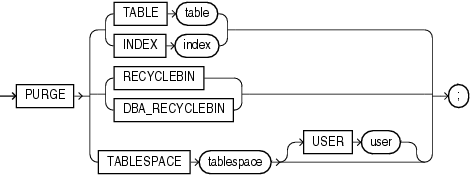

Purpose

Use the `PURGE` statement to remove a table or index from your recycle bin and release all of the space associated with the object, or to remove the entire recycle bin, or to remove part of all of a dropped tablespace from the recycle bin.

Caution:

You cannot roll back a `PURGE` statement, nor can you recover an object after it is purged.

To see the contents of your recycle bin, query the `USER_RECYCLEBIN` data dictionary view. You can use the `RECYCLEBIN` synonym instead. The following two statements return the same rows:

```
SELECT * FROM RECYCLEBIN;
SELECT * FROM USER_RECYCLEBIN;
```

See Also:

- [Oracle Database Administrator's Guide](https://docs.oracle.com/cd/E11882_01/server.112/e25494/tables.htm#ADMIN01511) for information on the recycle bin and naming conventions for objects in the recycle bin
- [FLASHBACK TABLE](statements_9012.md) for information on retrieving dropped tables from the recycle bin
- [Oracle Database Reference](https://docs.oracle.com/cd/E11882_01/server.112/e40402/initparams208.htm#REFRN10264) for information on using the `RECYCLEBIN` initialization parameter to control whether dropped tables go into the recycle bin

Prerequisites

The database object must reside in your own schema or you must have the `DROP` `ANY`... system privilege for the type of object to be purged, or you must have the `SYSDBA` system privilege.

Syntax

purge::=



> ```
> PURGE { { TABLE table | INDEX index }
>       | { RECYCLEBIN | DBA_RECYCLEBIN }
>       | TABLESPACE tablespace [ USER username ]
>       } ;
> ```
  

Semantics

TABLE or INDEX

Specify the name of the table or index in the recycle bin that you want to purge. You can specify either the original user-specified name or the system-generated name Oracle Database assigned to the object when it was dropped.

- If you specify the user-specified name, and if the recycle bin contains more than one object of that name, then the database purges the object that has been in the recycle bin the longest.
- System-generated recycle bin object names are unique. Therefore, if you specify the system-generated name, then the database purges that specified object.

When the database purges a table, all table partitions, LOBs and LOB partitions, indexes, and other dependent objects of that table are also purged.

RECYCLEBIN

Use this clause to purge the current user's recycle bin. Oracle Database will remove all objects from the user's recycle bin and release all space associated with objects in the recycle bin.

DBA\_RECYCLEBIN

This clause is valid only if you have `SYSDBA` system privilege. It lets you remove all objects from the system-wide recycle bin, and is equivalent to purging the recycle bin of every user. This operation is useful, for example, before backward migration.

TABLESPACE tablespace

Use this clause to purge all the objects residing in the specified tablespace from the recycle bin.

USER user Use this clause to reclaim space in a tablespace for a specified user. This operation is useful when a particular user is running low on disk quota for the specified tablespace.

Examples

Remove a File From Your Recycle Bin: Example The following statement removes the table `test` from the recycle bin. If more than one version of test resides in the recycle bin, then Oracle Database removes the version that has been there the longest:

```
PURGE TABLE test;
```

To determine system-generated name of the table you want removed from your recycle bin, issue a `SELECT` statement on your recycle bin. Using that object name, you can remove the table by issuing a statement similar to the following statement. (The system-generated name will differ from the one shown in the example.)

```
PURGE TABLE RB$$33750$TABLE$0;
```

Remove the Contents of Your Recycle Bin: Example To remove the entire contents of your recycle bin, issue the following statement:

```
PURGE RECYCLEBIN;
```