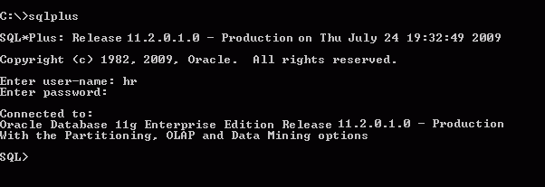

## 1 SQL\*Plus User Interface

This chapter describes the SQL\*Plus command-line user interface. It contains the following topics:

- The Command-line Screen
- Changing the Command-line Font and Font Size

## The Command-line Screen

The following image shows the SQL\*Plus command-line interface.

The SQL\*Plus command-line interface is standard on all operating systems.



> The cmdline2.gif image shows command-line SQL\*Plus starting. The normal starting information, the date and time, the SQL\*Plus version and copyright information, is displayed. The last line shows the default SQL\*Plus prompt, SQL>, waiting for you to enter SQL, PL/SQL or SQL\*Plus commands.
>
> Copyright © 1996, 2013, Oracle and/or its affiliates. All rights reserved.  
> [Legal Notices](https://docs.oracle.com/cd/E11882_01/dcommon/html/cpyr.htm)
  
  

When SQL\*Plus starts, it displays the date and time, the SQL\*Plus version and copyright information before the SQL\*Plus prompt appears. The default prompt for SQL\*Plus command-line is:

```
SQL>
```

## Changing the Command-line Font and Font Size

In Windows, from a Command Prompt, open the Command Prompt Properties dialog to set the font and font size used in the SQL\*Plus command-line interface.

To Change the Command-line Interface Font and Font Size

1. Right click in the command-line interface title bar.
2. Click Properties. The Window Preview box displays the current window's relative size on your monitor based on your font and font size selections. The Selected Font: box displays a sample of the current font.
3. Click the Font tab.
4. Select the font size to use from the Size box. Raster font sizes are shown as width by height in pixels. TrueType font sizes are shown as height in pixels.
5. Select the font to use from the Font box.
6. Select the Bold Fonts check box if you want to use a bold version of the font.

For more information about changing Command Prompt properties, see Windows Help or click Help in the Command Prompt Properties dialog.