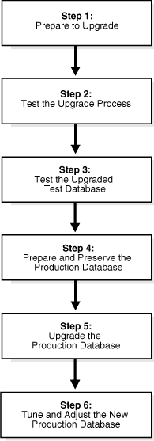
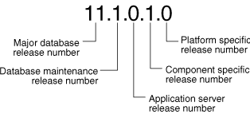

## 1 Introduction to the Upgrade Process for Oracle Database

Oracle provides upgrade options that are tailored to your database environment and tools that automate the process for upgrading Oracle Database.

This chapter contains the following topics:

## Where to Find the Latest Information About Upgrading Oracle Database

Oracle provides late-breaking updates, discussions, and best practices about pre-upgrade, post-upgrade, compatibility, and interoperability on the My Oracle Support Web site at `https://support.oracle.com`. You can search on note IDs or key words like "Database Upgrade."

- For the complete knowledge base and latest information about patch sets, go to My Oracle Support at `https://support.oracle.com` and enter your search criteria.
- For information about upgrading to Oracle Database 11g Release 2, see Oracle Upgrade Companion [ID 785351.1](https://support.oracle.com/CSP/main/article?cmd=show&type=NOT&doctype=REFERENCE&id=785351.1) at My Oracle Support at `https://support.oracle.com`. Other upgrade companions are also available for upgrading to earlier releases.
- For information about downloading and running the pre-upgrade information tool, see Oracle Database Pre-Upgrade Utility [ID 884522.1](https://support.oracle.com/CSP/main/article?cmd=show&type=NOT&doctype=HOWTO&id=884522.1) at My Oracle Support at `https://support.oracle.com`.

## Overview of Oracle Database Upgrade Tools and Processes

The upgrade procedure transforms an existing Oracle Database system (including associated applications) into an Oracle Database 11g Release 2 (11.2) system. The upgrade steps apply to all operating systems, with the possible exception of a few operating system-specific details identified in your operating system-specific Oracle documentation.

Oracle Database 11g Release 2 (11.2) supports the following tools and methods for upgrading a database to the new release:

- Database Upgrade Assistant (DBUA)
	Provides a graphical user interface that guides you through the upgrade of a database. DBUA can be launched during installation with the Oracle Universal Installer, or you can launch DBUA as a standalone tool at any time in the future.
	Note:
	DBUA is the recommended method for performing a major release upgrade or patch release upgrade.
- Manual upgrade using SQL scripts and utilities
	Enables upgrades to be performed at the command line with SQL scripts and utilities.
- Export and Import utilities
	Uses Oracle Data Pump utilities, or the native Export and Import features within Oracle Database. These utilities perform a full or partial export from your database, followed by a full or partial import into the new Oracle Database 11g. Export/Import can copy a subset of the data, leaving the database unchanged.
- `CREATE TABLE AS` SQL statement
	Copies data from a database into a new Oracle Database 11g database. Data copying can copy a subset of the data, leaving the database unchanged.

See Also:

["Choose an Upgrade Method for Upgrading Oracle Database"](preup.md) for more details about the upgrade tools and methods

## Major Steps in the Upgrade Process for Oracle Database

Detailed instructions for upgrading an existing Oracle database to the new Oracle Database 11g release are provided in the appropriate chapters in [Oracle Database Upgrade Guide](toc.md).

The following steps outline the major procedures performed during the upgrade process:

- Step 1: Prepare to Upgrade
- Step 2: Test the Upgrade Process
- Step 3: Test the Upgraded Test Database
- Step 4: Prepare and Preserve the Production Database
- Step 5: Upgrade the Production Database
- Step 6: Tune and Adjust the New Production Database

Step 1: Prepare to Upgrade

- Become familiar with the features of the new Oracle Database 11g release.
- Determine the upgrade path to the new release.
- Choose an upgrade method.
- Choose an Oracle home directory for the new release.
- Develop a testing plan.
- Prepare a backup strategy.
	Note:
	During the upgrade, consider running multiple releases of the database software so you can use the existing release as your production environment while you test the new release. See "About Running Multiple Oracle Releases".

Step 2: Test the Upgrade Process

- Perform a test upgrade using a test database. The test upgrade should be conducted in an environment created for testing and should not interfere with the actual production database.

Step 3: Test the Upgraded Test Database

- Perform the tests you planned in Step 1 on the test database and on the test database that was upgraded to the new Oracle Database 11g release.
- Compare results, noting anomalies between test results on the test database and on the upgraded database.
- Investigate ways to correct any anomalies you find and then implement the corrections.
- Repeat Step 1, Step 2, and the first parts of Step 3, as necessary, until the test upgrade is completely successful and works with any required applications.

[Chapter 2, "Preparing to Upgrade Oracle Database"](preup.md) provides detailed information about Steps 1 through 3.

Step 4: Prepare and Preserve the Production Database

- Prepare the current production database as appropriate to ensure the upgrade to the new Oracle Database 11g release is successful.
- Schedule the downtime required for backing up and upgrading the production database.
- Back up the current production database. Perform a full or an incremental backup, as necessary, to ensure your database is protected against data loss.

Step 5: Upgrade the Production Database

- Upgrade the production database to the new Oracle Database 11g release.
- After the upgrade, perform a full backup of the production database and perform other post-upgrade tasks.

[Chapter 3, "Upgrading to the New Release of Oracle Database"](upgrade.md) describes Steps 4 and 5 when using DBUA or when performing a manual upgrade. [Chapter 4, "Post-Upgrade Tasks for Oracle Database"](afterup.md) describes the backup procedure for Step 5 after the upgrade, and other post-upgrade tasks for Step 6.

Step 6: Tune and Adjust the New Production Database

- Tune the new Oracle Database 11g production database. The new production database should perform to the same standards, or better than, the database before the upgrade.
	[Chapter 4, "Post-Upgrade Tasks for Oracle Database"](afterup.md) describes these adjustments.
- Determine which features of the new Oracle Database 11g release you want to use, and update your applications accordingly.
- Develop new database administration procedures as needed.
- Do not upgrade production users to the new release until all applications have been tested and operate properly.
	[Chapter 5, "Upgrading Applications After Upgrading Oracle Database"](app.md) describes considerations for updating applications.

Figure 1-1 illustrates the major steps in the upgrade process.

Figure 1-1 Upgrade Steps



> The following list describes the upgrade steps shown in upgrd001.gif:
>
> 1. Prepare to upgrade.
> 2. Test the upgrade process.
> 3. Test the upgraded test database.
> 4. Prepare and preserve the production database.
> 5. Upgrade the production database.
> 6. Tune and adjust the new Oracle production database.
>
> Copyright © 2002, 2014, Oracle and/or its affiliates. All rights reserved.  
> [Legal Notices](https://docs.oracle.com/cd/E11882_01/dcommon/html/cpyr.htm)
  

## About Oracle Database Release Numbers

[Oracle Database Upgrade Guide](toc.md) describes moving between different releases of Oracle Database. Starting with Oracle9i Release 2 (9.2), maintenance releases of Oracle Database are denoted by a change to the second digit of a release number. In earlier releases, the third digit indicated a particular maintenance release.

Figure 1-2 illustrates each part of a release number and what it represents.

Figure 1-2 Example of an Oracle Release Number



> The release number 11.1.0.1.0 is displayed. The significance of each number (reading from left to right) is described in the following list:
>
> - 11 Major database release number
> - 1 Database maintenance release number
> - 0 Application server release number
> - 1 Component specific release number (or patch set release)
> - 0 Platform specific release number
  

More information about release numbers are contained in these topics:

- Convention for Referring to Release Numbers in Oracle Database Upgrade Guide
- About Running Multiple Oracle Releases

See Also:

[Oracle Database Administrator's Guide](https://docs.oracle.com/cd/E11882_01/server.112/e25494/toc.htm) for more information about Oracle release numbers

### Convention for Referring to Release Numbers in Oracle Database Upgrade Guide

When a statement is made in Oracle Database Upgrade Guide about a major database release number, the statement applies to all releases within that major database release. References to Oracle Database 11g include Oracle Database 11g Release 1 (11.1) and Oracle Database 11g Release 2 (11.2). References to Oracle Database 10g include Oracle Database 10g Release 1 (10.1) and Oracle Database 10g Release 2 (10.2), and references to Oracle9i include Oracle9i Release 1 (9.0.1) and Oracle9i Release 2 (9.2) and so forth.

Similarly, when a statement is made in Oracle Database Upgrade Guide about a maintenance release, the statement applies to all component-specific and platform-specific releases (also referred to as patchset releases) within that maintenance release. Therefore, a statement about Oracle Database 11g Release 2 (11.2) applies to releases 11.2.0.1, 11.2.0.2, and 11.2.0.3, and all other platform-specific releases within Oracle Database 11g Release 2 (11.2).

### About Running Multiple Oracle Releases

You can run different releases of Oracle Database on the same computer at the same time. However, you must observe the following conditions when simultaneously using multiple releases:

- An Oracle Database release must be installed in a new Oracle home that is separate from earlier releases of Oracle.
	There cannot be multiple releases for each Oracle home. Oracle recommends that you adopt an Optimal Flexible Architecture (OFA) when creating multiple Oracle homes.
	See Also:
	"Optimal Flexible Architecture (OFA) in Oracle Database"
- Each database server can access only a database that is consistent with its release number.
	For example, if you have Oracle9i and Oracle Database 11g installed on the same computer, then the Oracle9i database server can access Oracle9i databases but not Oracle Database 11g databases, and the Oracle Database 11g database server can access Oracle Database 11g databases but not Oracle9i databases.

See Also:

Your operating system-specific Oracle documentation for more information about running multiple releases of Oracle Database on your operating system and any restrictions that may apply

The following topics provide general information about running multiple releases of Oracle Database:

- Databases in Multiple Oracle Homes on the Same Computer
- Databases in Multiple Oracle Homes on Separate Computers
- About Earlier Oracle Database Releases and Upgrading to the Current Release
- About Upgrading Clients to the Current Release of Oracle Database

#### Databases in Multiple Oracle Homes on the Same Computer

You may not be able to install earlier releases of Oracle Database on the same computer system and have clients connect to these databases. For example, you cannot have Oracle8i, Oracle9i, Oracle Database 10g, and Oracle Database 11g databases in multiple (or separate) Oracle homes on the same computer and have Oracle8i, Oracle9i, Oracle Database 10g, and Oracle Database 11g clients connecting to any or all of the databases. You may be able to have a combination of some releases on one system. However, be sure to obtain the latest information on compatibility and supported configurations.

See Also:

Note 207303.1 "Client / Server / Interoperability Support Between Different Oracle Versions" on My Oracle Support at `https://support.oracle.com`

#### Databases in Multiple Oracle Homes on Separate Computers

You can install Oracle8i, Oracle9i, Oracle Database 10g, and Oracle Database 11g databases in multiple (separate) Oracle homes on separate computers and have Oracle8i, Oracle9i, Oracle Database 10g, and Oracle Database 11g clients connecting to any or all of the databases.

#### About Earlier Oracle Database Releases and Upgrading to the Current Release

You can upgrade an Oracle8i, Oracle9i, Oracle Database 10g, or Oracle Database 11g database to the new Oracle Database 11g release and have Oracle8i, Oracle9i, Oracle Database 10g, and Oracle Database 11g clients connecting to the upgraded database. Be sure to obtain the latest information on compatibility and supported configurations.

#### About Upgrading Clients to the Current Release of Oracle Database

You can upgrade any or all of your Oracle8i, Oracle9i, Oracle Database 10g, or Oracle Database 11g clients to the new Oracle Database 11g release. The new Oracle Database 11g release client can access your Oracle8i, Oracle9i, Oracle Database 10g, and Oracle Database 11g databases.

## Compatibility and Interoperability Between Oracle Database Releases

Compatibility and interoperability issues may arise because of differences between Oracle Database releases. These differences might affect general database administration and existing applications.

The following topics discuss compatibility and interoperability:

- What Is Compatibility for Oracle Database?
- What Is Interoperability for Oracle Database?

See Also:

[Appendix A, "Behavior Changes After Upgrading Oracle Database"](changes.md) for more information on compatibility and interoperability for specific releases

### What Is Compatibility for Oracle Database?

Databases from different releases of Oracle Database software are compatible if they support the same features and those features perform the same way. When you upgrade to a new release of Oracle Database, certain new features might make your database incompatible with your earlier release.

Your upgraded database becomes incompatible with your earlier release under the following conditions:

- A new feature stores any data on disk (including data dictionary changes) that cannot be processed with your earlier release.
- An existing feature behaves differently in the new environment as compared to the old environment.

The following topics contain more information about compatibility:

- The COMPATIBLE Initialization Parameter in Oracle Database
- Default, Minimum, and Maximum Values of the COMPATIBLE Initialization Parameter for Oracle
- Considerations for Downgrading Oracle Database and Compatibility
- How the COMPATIBLE Initialization Parameter Operates in Oracle Database
- Checking the Compatibility Level of Oracle Database
- When to Set the COMPATIBLE Initialization Parameter in Oracle Database

#### The COMPATIBLE Initialization Parameter in Oracle Database

Oracle Database enables you to control the compatibility of your database with the `COMPATIBLE` initialization parameter. By default, when the `COMPATIBLE` initialization parameter is not set in your parameter file, it defaults to `11.2.0` for Oracle Database 11g Release 2 (11.2). You cannot use new Oracle Database 11g Release 2 (11.2) features that would make your upgraded database incompatible unless the `COMPATIBLE` initialization parameter is set to this value.

Note:

- Before upgrading to Oracle Database 11g Release 2 (11.2), the `COMPATIBLE` initialization parameter must be set to at least `10.0.0`, which is the lowest possible setting for Oracle Database 11g Release 2 (11.2).
- Oracle recommends increasing the `COMPATIBLE` parameter only after thorough testing of the upgraded database has been performed.

See Also:

[Oracle Database Administrator's Guide](https://docs.oracle.com/cd/E11882_01/server.112/e25494/create.htm#ADMIN00202) for information about managing initialization parameters

#### Default, Minimum, and Maximum Values of the COMPATIBLE Initialization Parameter for Oracle

Table 1-1 lists the default, minimum, and maximum values of the `COMPATIBLE` initialization parameter in Oracle Database 11g Release 2 (11.2) and in each release supported for upgrading to Oracle Database 11g Release 2 (11.2).

Table 1-1 The COMPATIBLE Initialization Parameter

| Oracle Database Release | Default Value | Minimum Value | Maximum Value |
| --- | --- | --- | --- |
| Oracle9i Release 2 (9.2) | `8.1.0` | `8.1.0.0.0` | `9.2.0.``n``.``n` |
| Oracle Database 10g Release 1 (10.1) | `10.0.0` | `9.2.0.0.0` | `10.1.0.``n``.``n` |
| Oracle Database 10g Release 2 (10.2) | `10.2.0` | `9.2.0.0.0` | `10.2.0.``n``.``n` |
| Oracle Database 11g Release 1 (11.1) | `11.0.0` | `10.0.0.0.0` | `11.1.0.``n``.``n` |
| Oracle Database 11g Release 2 (11.2) | `11.2.0` | `10.0.0.0.0` | `11.2.0.``n``.``n` |

#### Considerations for Downgrading Oracle Database and Compatibility

Before upgrading to Oracle Database 11g Release 2 (11.2), the `COMPATIBLE` initialization parameter must be set to at least `10.0.0`. Only a subset of Oracle Database 11g Release 2 (11.2) features are available while the `COMPATIBLE` initialization parameter is set to this value.

After upgrading to Oracle Database 11g Release 2 (11.2), you can set the `COMPATIBLE` initialization parameter to match the release number of the new release. Doing so enables you to use all features of the new release, but prevents you from downgrading to your earlier release.

If, after upgrading, you want to downgrade, then the `COMPATIBLE` initialization parameter must be set as follows after the upgrade:

- Keep the setting at `10.1.0` if you upgraded from Oracle Database 10g Release 1 (10.1)
- Set to `10.2.0` or 10.1.0 if you upgraded from Oracle Database 10g Release 2 (10.2)
- Set to `11.1.0`, `10.2.0`, or `10.1.0` if you upgraded from Oracle Database 11g Release 1 (11.1)

Important:

After you increase the `COMPATIBLE` parameter, the database cannot subsequently be downgraded to releases earlier than what is set for compatibility.

See Also:

[Chapter 6, "Downgrading Oracle Database to an Earlier Release"](downgrade.md) for more information about downgrading

#### How the COMPATIBLE Initialization Parameter Operates in Oracle Database

The `COMPATIBLE` initialization parameter operates in the following way:

- It controls the behavior of your database. For example, if you run an Oracle Database 11g Release 2 (11.2) database with the `COMPATIBLE` initialization parameter set to `10.1.0`, then it generates database structures on disk that are compatible with Oracle Database 10g Release 1 (10.1). Therefore, the `COMPATIBLE` initialization parameter enables or disables the use of features. If you try to use any new features that make the database incompatible with the `COMPATIBLE` initialization parameter, then an error is displayed. However, any new features that do not make incompatible changes on disk are enabled.
- It makes sure that the database is compatible with its setting. If the database becomes incompatible with its setting, then the database does not start and terminates with an error. If this happens, then you must set the `COMPATIBLE` initialization parameter to an appropriate value for the database.

See Also:

[Oracle Database Concepts](https://docs.oracle.com/cd/E11882_01/server.112/e40540/intro.htm#CNCPT001) for more information about database structures

#### Checking the Compatibility Level of Oracle Database

The compatibility level of your database corresponds to the value of the `COMPATIBLE` initialization parameter. For example, if you set the `COMPATIBLE` initialization parameter to `11.2.0`, then the database runs at release 11.2.0 compatibility level.

To check the current value of the COMPATIBLE initialization parameter

- Enter the following SQL statement:
	```
	SQL> SELECT name, value FROM v$parameter
	         WHERE name = 'compatible';
	```

#### When to Set the COMPATIBLE Initialization Parameter in Oracle Database

Oracle recommends increasing the `COMPATIBLE` parameter only after complete testing of the upgraded database has been performed. After the upgrade is complete, you can increase the setting of the `COMPATIBLE` initialization parameter to the maximum level for the new Oracle Database 11g release. However, after you increase the `COMPATIBLE` parameter, the database cannot subsequently be downgraded.

### What Is Interoperability for Oracle Database?

In Oracle Database, interoperability is the ability of different releases of Oracle Database to communicate and work in a distributed environment. A distributed database system can comprise different releases of Oracle Database, and all supported releases of Oracle Database can participate in the distributed database system. However, the applications that work with a distributed database must also be able to interoperate with the features and functions that are available at each node in the system.

Interoperability across disperate operating systems and operating system versions might be a problem (especially during rolling upgrades) because the minimum requirements for the new Oracle Database 11g release might require you to upgrade the operating systems on some or all of your hosts. Therefore, you must check for compatibilities between drivers, network, and storage for all the interim states of the system during the rolling upgrade.

Note:

Because [Oracle Database Upgrade Guide](toc.md) discusses upgrading and downgrading between different releases of Oracle Database, the definition of interoperability is for Oracle Database releases. Other Oracle documentation might use a broader definition of the term interoperability. For example interoperability might in some cases describe communication between different hardware platforms and operating systems.

See Also:

Note ID 207303.1 "Client / Server / Interoperability Support Between Different Oracle Versions" on My Oracle Support at `https://support.oracle.com`

## Optimal Flexible Architecture (OFA) in Oracle Database

Oracle recommends the Optimal Flexible Architecture (OFA) standard for Oracle Database installations. The OFA standard is a set of configuration guidelines for efficient and reliable Oracle databases, which results in more streamlined maintenance.

OFA provides the following benefits:

- Organizes large amounts of complicated software and data on disk to avoid device bottlenecks and poor performance
- Facilitates routine administrative tasks, such as software and data backup functions, which are often vulnerable to data corruption
- Alleviates switching among multiple Oracle databases
- Adequately manages and administers database growth
- Helps to eliminate fragmentation of free space in the data dictionary, isolates other fragmentation, and minimizes resource contention

If you are not currently using the OFA standard, then switching to the OFA standard involves modifying your directory structure and relocating your database files.

See Also:

- Your operating system-specific Oracle documentation for more information about OFA
- [Oracle Database Administrator's Guide](https://docs.oracle.com/cd/E11882_01/server.112/e25494/dfiles.htm#ADMIN012) for information about modifying your directory structure and relocating database files

## Converting Databases to 64-bit Oracle Database Software

If you are installing 64-bit Oracle Database 11g software but were previously using a 32-bit Oracle Database installation, the database is automatically converted to 64-bit during a patch release or major release upgrade to the new Oracle Database 11g release.

To complete the conversion, you must manually perform the following post-upgrade tasks:

- Increase initialization parameters affecting the system global area, such as `SGA_TARGET` and `SHARED_POOL_SIZE`, to support 64-bit operations.
- Reconnect after starting up the database so that a new session is created with the appropriate 64-bit initialization. For example:
	```
	CONNECT  AS SYSDBA
	STARTUP UPGRADE
	CONNECT  AS SYSDBA
	SPOOL UPGRADE.LOG
	@catupgrd.sql
	```

See Also:

- [Oracle Database Installation Guide](http://www.oracle.com/pls/topic/lookup?ctx=db112&id=GINST) for your platform-specific information about 64-bit software installations
- Note 341880.1 "How to convert a 32-bit database to a 64-bit database on Linux" on My Oracle Support at `http://support.oracle.com`

Troubleshooting 32-bit to 64-bit Conversion for Oracle Database

When migrating a 32-bit database to 64-bit, when running the `utlrp.sql` script, there is a known error, ORA-07445.

ORA-07445: exception encountered: core dump `[_intel_new_memcpy()+2132] [ACCESS_VIOLATION] [ADDR:0x11D1F0F67] [PC:0x621BEA4] [UNABLE_TO_READ] []`

The `utlrp.sql` script, which is located in the `ORACLE_HOME` `/rdbms/admin` directory, is used to recompile stored PL/SQL and Java code. This error and workaround are described in Note 341880.1 "How to convert a 32-bit database to a 64-bit database on Linux" on My Oracle Support at `http://support.oracle.com`.

## About Rolling Upgrades for Oracle Database

The rolling upgrade process supports Oracle Automatic Storage Management (Oracle ASM) instances in an Oracle Real Application Clusters (Oracle RAC) environment one at a time, without stopping the database. Depending on the method you choose to perform a rolling upgrade, you can upgrade the Oracle Database software or Oracle ASM instances, apply patchsets, or apply individual patches (sometimes referred to as one-off patches), incurring little or no database downtime. Database instance rolling upgrade is not supported.

See Also:

- [Oracle Database High Availability Best Practices](https://docs.oracle.com/cd/E11882_01/server.112/e10803/schedule_outage.htm#HABPT02323) for help choosing a method to perform database upgrades
- "Summary of Methods for Performing Rolling Upgrades for Oracle Database"

### Summary of Methods for Performing Rolling Upgrades for Oracle Database

Oracle provides different methods and options for performing rolling upgrades depending on your environment and applications. Table 1-2 summarizes the various methods for performing rolling upgrades and provides cross-references to the appropriate documentation.

Table 1-2 Methods for Performing Rolling Upgrades for Oracle Database

| Method | Description | Reference |
| --- | --- | --- |
| Oracle Data Guard SQL Apply | Use SQL Apply and logical standby databases to upgrade Oracle Database software and patchsets. | ["About Upgrading Using Standby Databases"](upgrade.md) |
| Oracle Data Guard Physical Standby Database | Use an existing physical standby database to perform a rolling database upgrade by temporarily converting it to a logical standby database. | ["About Upgrading Using Standby Databases"](upgrade.md) |
| Oracle Streams | By using Oracle Streams source and destination databases, you can upgrade to a new release of Oracle Database software, migrate an Oracle database to a different operating system and/or character set, upgrade user-created applications, and apply Oracle Database patches. | [Oracle Streams Concepts and Administration](https://docs.oracle.com/cd/E11882_01/server.112/e17069/ap_strup.htm#STRMS140) |
| Oracle RAC with the OPatch Utility | Use the OPatch Utility to perform rolling patch upgrades with Oracle RAC. You can use the OPatch utility only to apply individual patches, not patchset releases.  This method enables some instances of the Oracle RAC to remain available during the patch upgrade. Only the Oracle RAC instance being patched must be brought down; the other instances can continue to remain available. The OPatch Utility enables you to apply the patch successively to the different instances of Oracle RAC. | [Oracle Universal Installer and OPatch User's Guide for Windows and UNIX](https://docs.oracle.com/cd/E11882_01/em.112/e12255/oui7_opatch.htm#OUICG342)  [Oracle Database High Availability Best Practices](https://docs.oracle.com/cd/E11882_01/server.112/e10803/schedule_outage.htm#HABPT00403) |
| Oracle Clusterware and Oracle Universal Installer (OUI) | Use OUI and Oracle Clusterware to perform a rolling upgrade to apply patchset releases of Oracle Clusterware.This method enables some instances of the Oracle RAC to remain available during the patchset upgrades. Only the node that is currently being patched must be brought down; the other instances remain available. OUI enables you to apply the patchset successively to the different instances of the cluster. | [Oracle Grid Infrastructure Installation Guide](http://www.oracle.com/pls/topic/lookup?ctx=db112&id=CWGEN)  [Oracle Universal Installer and OPatch User's Guide for Windows and UNIX](http://www.oracle.com/pls/topic/lookup?ctx=db112&id=OUICG008) |
| Oracle Automatic Storage Management (Oracle ASM) | Use Oracle ASM to independently upgrade or patch clustered Oracle ASM instances. This method allows all of the features of a clustered Oracle ASM environment to continue to function even while one or more Oracle ASM instances run different software versions.  Note: An Oracle ASM rolling upgrade to Oracle Database 11g Release 2 (11.2) moves the Oracle ASM instance to an Oracle Grid Infrastructure home. | [Oracle Grid Infrastructure Installation Guide](http://www.oracle.com/pls/topic/lookup?ctx=db112&id=CWGEN)  "Using Oracle ASM Rolling Upgrade" in [Oracle Database Storage Administrator's Guide](https://docs.oracle.com/cd/E11882_01/server.112/e18951/asminst.htm#OSTMG02400) |

## Moving From Standard Edition to Enterprise Edition of Oracle Database

If you have Oracle Database Standard Edition at a release earlier than the new Oracle Database 11g release, then you can change it to Oracle Database Enterprise Edition by installing Oracle Enterprise Edition software and subsequently following the normal upgrade procedures, as described in [Chapter 3, "Upgrading to the New Release of Oracle Database."](upgrade.md).

Caution:

Performing this procedure deinstalls the Standard Edition software and results in deleting database files that exist under the Oracle home. Therefore, you must back up any database files under the current Oracle home that you need to keep. This is explained in steps [^1] and [^2]. Also refer to "Known Issue with the Deinstallation Tool for Release 11.2.0.4".

To change your existing Standard Edition database to an Enterprise Edition database

Your database is now upgraded to Enterprise Edition.

### Known Issue with the Deinstallation Tool for Release 11.2.0.4

Deinstallation of the Oracle home in the earlier release of Oracle Database may result in the deletion of the old Oracle base that was associated with it

Cause: After upgrading from Oracle Database release 11.2.0.1 or 11.2.0.2 to release 11.2.0.4, deinstallation of the Oracle home in the earlier release of Oracle Database may result in the deletion of the old Oracle base that was associated with it. This may also result in the deletion of data files, audit files, etc., which are stored under the old Oracle base. Important Note: This issue is applicable for upgrades from release 11.2.0.1 or 11.2.0.2 to 11.2.0.4, but is not applicable for upgrading from release 11.2.0.3 to 11.2.0.4.

Action: Before deinstalling the Oracle home in the earlier release, edit the `orabase_cleanup.lst` file found in the `$Oracle_Home` `/utl` directory and remove the " `oradata` " and " `admin` " entries. Then proceed with the deinstallation.

## About Moving From Enterprise Edition to Standard Edition of Oracle Database

To properly convert from an Enterprise Edition database to a Standard Edition database you must perform an Export/Import operation. Oracle recommends using the Standard Edition Export utility to export the data. If you only install Standard Edition software, then some data dictionary objects become invalid and create problems when maintaining the database.

Enterprise Edition contains data dictionary objects that are not available in Standard Edition. The Export/Import operation does not introduce data dictionary objects specific to the Enterprise Edition, because the `SYS` schema objects are not exported. After the Import in the Standard Edition database, you are only required to drop user schemas related to Enterprise Edition features.

See Also:

[Chapter 7, "Moving Data Using Oracle Data Pump"](expimp.md)

## About Upgrading from Oracle Database Express Edition to Oracle Database

To upgrade Oracle Database 10g Express Edition (Oracle Database XE) to Oracle Database 11g, you must install Oracle Database 11g on the same system as Oracle Database XE and use DBUA to perform the upgrade.

See Also:

- Oracle Universal Installer and OPatch User's Guide for Windows and UNIX
- [Chapter 3, "Upgrading to the New Release of Oracle Database"](upgrade.md)

[^1]: Make a backup copy of files under `$Oracle_Home/network/admin`. This ensures that the listener is configured after you complete the steps in this procedure.

[^2]: Back up all database files and data under the current Oracle home that you need to keep.

- On Linux, back up `$Oracle_Home/dbs/`.
- On Windows, back up `$Oracle_Home/database/`.

[^undefined]: Edit the `orabase_cleanup.lst` file found in the `Oracle_Home/utl` directory and remove the "oradata" and "admin" entries. Refer to "Deinstallation of the Oracle home in the earlier release of Oracle Database may result in the deletion of the old Oracle base that was associated with it".

[^undefined]: Deinstall the Standard Edition server software.

Run the `deinstall` tool from the Oracle home. The deinstall tool is located in the `$ORACLE_HOME/deinstall` directory for UNIX platforms, and in the `ORACLE_HOME\deinstall` directory for Windows platforms.

IMPORTANT:

The deinstall tool deletes all existing database files that reside under Oracle home, including data in the database. Therefore, Oracle recommends that you retain a current backup of your data.

[^undefined]: Install Enterprise Edition server software using Oracle Universal Installer (OUI).

Select the same Oracle home that was used for the Standard Edition that you uninstalled. During the installation, be sure to select Enterprise Edition. When prompted, choose Software Only from the Database Configuration screen.

[^undefined]: Start up your database.