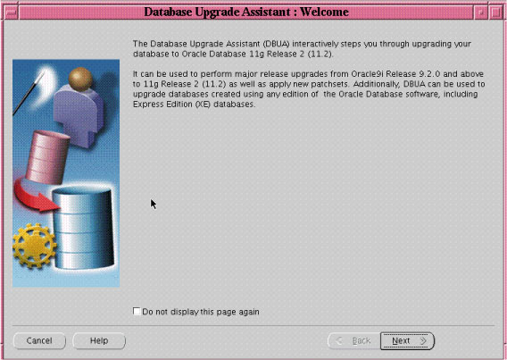
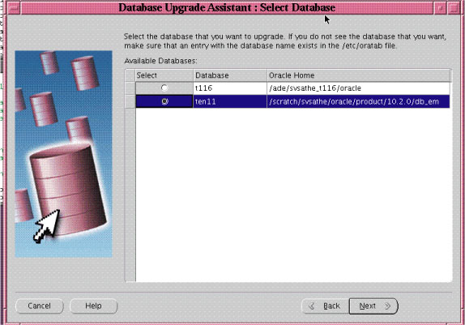
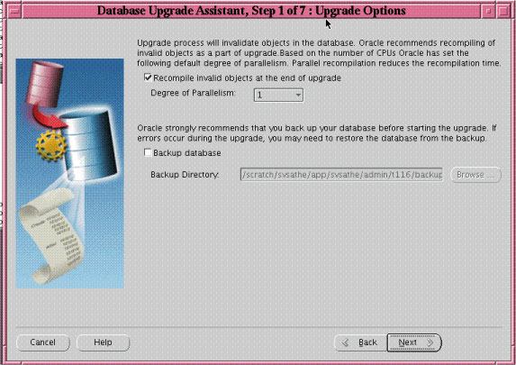
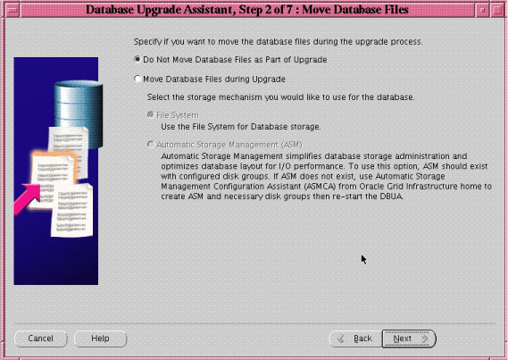
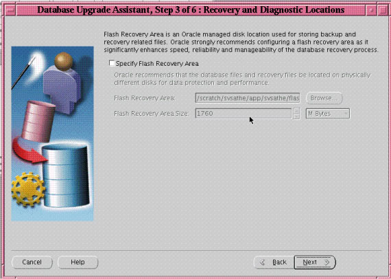
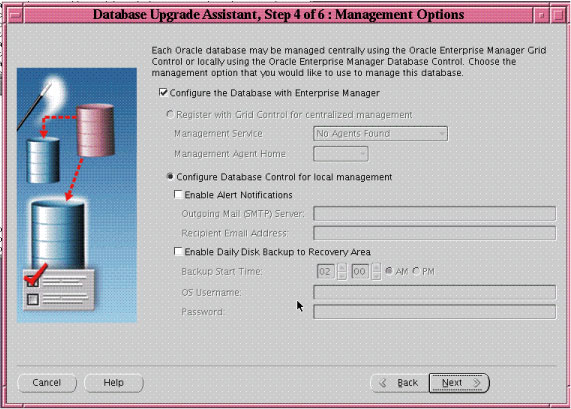
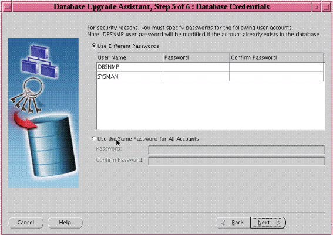
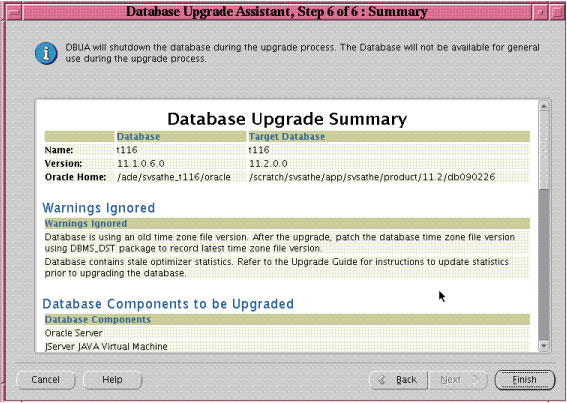

## 3 Upgrading to the New Release of Oracle Database

Upgrading to a new release of Oracle Database is a basic part of database maintenance and administration. Oracle provides the Database Upgrade Assistant and specialized scripts and tools to assist with the upgrade process and to automate many steps. This chapter discusses important information and requirements and guides you through the process of upgrading a database to Oracle Database 11g Release 2 (11.2).

This chapter contains the following topics:

Caution:

If you retain the old Oracle software, then never start the upgraded database with the old Oracle software. Only start the database with the executables in the new Oracle Database installation.

## System Considerations and Requirements for Upgrading Oracle Database

When you upgrade to a new release of Oracle Database, typically there are new or changed system requirements. The following topics describe the various checks and considerations to perform before starting an upgrade of Oracle Database:

- Relocating Existing Data Files to the New Oracle Database Environment
- About Upgrading PL/SQL Packages That Are Not Installed by Default
- About Upgrading Oracle ASM Installed with Oracle Grid Infrastructure
- Considerations for Upgrading Oracle Clusterware and Oracle ASM Instances
- About Upgrading with Read-Only and Offline Tablespaces
- About Upgrading Using Standby Databases
- About Upgrading Your Operating System
- Migrating Data to a Different Operating System
- About Upgrading Databases That Use Oracle Streams Downstream Capture
- About Upgrading Databases That Use Oracle Database Vault

Important:

To upgrade to this release, you must install the Oracle Grid Infrastructure and Oracle Database software into a new Oracle home instead of applying a patch set to the existing Oracle home. This is referred to as an out-of-place upgrade and is different from patch set releases for earlier releases of Oracle Database, where the patch set was always installed in place.

Note:

Oracle Grid Infrastructure does not support in-place upgrade. Only out-of-place upgrade into a new grid intrastructure home is supported.

See Also:

- [Oracle Database Net Services Administrator's Guide](https://docs.oracle.com/cd/E11882_01/network.112/e41945/toc.htm) for information about upgrade considerations for Oracle Net Services
- Your operating system-specific Oracle documentation for additional information about preparing to upgrade
- ["About Rolling Upgrades for Oracle Database"](intro.md) for information about rolling upgrades

### Relocating Existing Data Files to the New Oracle Database Environment

Before you remove the old Oracle environment, you must relocate any data files in that environment to the new Oracle Database environment.

To relocate data files to the new Oracle Database environment

- Use Database Upgrade Assistant (DBUA) and select the Move Database Files option during the upgrade.

See Also:

"Upgrading with Database Upgrade Assistant on Linux, UNIX, and Windows" for more information

[Oracle Database Administrator's Guide](https://docs.oracle.com/cd/E11882_01/server.112/e25494/create.htm#ADMIN11073), if you perform a manual upgrade, for information about relocating data files

### About Upgrading PL/SQL Packages That Are Not Installed by Default

Packages that were previously installed on the database for which you are preparing to upgrade to the current release may not be upgraded automatically. You may need to separately check if the package is available in the current release and reinstall that package to ensure you have the latest version.

See Also:

"Managing and Updating Access Control Lists and Network Utility Packages"

### About Upgrading Oracle ASM Installed with Oracle Grid Infrastructure

Oracle ASM is upgraded as part of the Oracle Grid Infrastructure upgrade. You cannot upgrade Oracle ASM before you upgrade Oracle Grid Infrastucture.

### Considerations for Upgrading Oracle Clusterware and Oracle ASM Instances

Starting with Oracle Database 11g Release 2 (11.2.0.1), Oracle Clusterware and Oracle Real Application Clusters (Oracle RAC) must be installed into a separate, new home from the existing installation. This reduces the downtime required to upgrade a node in the cluster and facilitates the provisioning of clusters within an enterprise. The reduction in planned outage time required for cluster upgrades helps in meeting availability service levels and also makes it easier to provide a standard installation across the enterprise.

The following considerations pertain to upgrading Oracle Clusterware and Oracle ASM instances:

- For releases earlier than Oracle Database 11g, either all Oracle software installations were owned by the Oracle user, typically `oracle`, or Oracle Database software was owned by the user `oracle`, and Oracle Clusterware software was owned by a separate user, typically `crsuser`.
- Starting with Oracle Database 11g, the user account that is designated as owner of the release 10g Cluster Ready Services (CRS) software must perform the Oracle Clusterware 11g upgrade. The user account that is performing this upgrade must also be the user that owns the ASM home of the earlier release (that is, previous to release 11.2). If the pre-11.2 ASM home has a different owner, then the owner account must be changed before performing the upgrade.
- As of Oracle Database 11g release 2 (11.2), the Oracle Clusterware software must be upgraded to a new home location in the Oracle Grid Infrastructure home. Additionally, Oracle ASM and Oracle Clusterware (and Oracle Restart for single-instance databases) must run in the same Oracle Grid Infrastructure home. When upgrading Oracle Clusterware to release 11.2, OUI automatically calls Oracle ASM Cluster Assistant (ASMCA) to perform the upgrade into the Oracle Grid Infrastructure home.
- To upgrade to Oracle Database release 11.2.0.3, you must install the Oracle Grid Infrastructure and Oracle Database software into a new Oracle home instead of into the existing Oracle home.
- For a single-instance configuration, Oracle ASM and Oracle Restart run from the Oracle Grid Infrastructure home, and the cluster synchronization services daemon (CSS) runs from this same home. Thus, Oracle ASM and CSS are upgraded to Oracle Database 11g Release 2 (11.2) at the same time.
- For Oracle Database release 11.1 and earlier releases, if your configuration does not include Oracle ASM, then you must shut down the CSS daemon and delete the CSS service from the system by running the `localconfig` command with the `delete` option. For example:
	```
	ORACLE_HOME/bin/localconfig delete
	```
- You must ensure that the database compatibility attribute for Oracle ASM disk groups matches the compatibility parameter that is set in `init.ora`.

#### Determining If Oracle ASM is Included in the Current Database Configuration

If you do not know whether or not your configuration includes Oracle ASM, then issue the following SQL statement on the database instance:

```
select count(*) from v$asm_client where status = 'CONNECTED';
```

If this statement returns one or more rows, then the database is actively using an Oracle ASM disk group.

#### About Upgrading an Oracle Real Application Clusters (Oracle RAC) Database

You can use Database Upgrade Assistant (DBUA) to upgrade an existing Oracle RAC database to the current release of Oracle Database. DBUA guides you through the upgrade process and configures your database for the new release. DBUA automates the upgrade process and makes appropriate recommendations for configuration options such as tablespaces and online redo log files.

If you are manually upgrading an Oracle RAC database, then most of the actions are to be performed on only one node of the system. Actions that must be performed on more than one node are indicated in the relevant steps.

#### About Requirements for Time Synchronization on Oracle RAC

Oracle Clusterware 11g release 2 (11.2) requires time synchronization across all nodes within a cluster when Oracle RAC is deployed.

You can use one of the following options for time synchronizaion:

- Your operating system-configured network time protocol (NTP)
- Oracle Cluster Time Synchronization Service

See Also:

[Oracle Grid Infrastructure Installation Guide](http://www.oracle.com/pls/topic/lookup?ctx=db112&id=CWGEN) for your operating system for information on configuring NTP and Oracle Cluster Time Synchronization Service

#### Considerations for Upgrading Oracle RAC and Databases That Use Oracle ASM

If you are upgrading Oracle RAC and your databases use Oracle ASM for data file storage, then you need to consider additional restrictions and requirements.

- A subset of nodes cannot be selected when upgrading from an earlier release to 11.2.0.3.
	Before the new database release 11.2.0.3 software can be installed on the system, the root script for upgrading Oracle Grid Infrastructure invokes ASMCA to upgrade Oracle ASM to release 11.2.0.3.
- Where Oracle Clusterware software has been upgraded to release 11.2.0.1, but where Oracle ASM is running an earlier release, then DBUA displays an error indicating that the Oracle ASM cluster has not been upgraded. In this case, the root script invokes Oracle ASM Cluster Assistant (ASMCA) to upgrade Oracle ASM to release 11.2.0.1 before installing any Oracle Database release 11.2.0.3 software on the system.
- When upgrading from release 11.2.0.1 to 11.2.0.3, DBUA needs the Oracle Clusterware stack to be up. If DBUA finds that the Oracle Clusterware stack is down on the local node, then it displays an error message indicating the commands that need to be run to start up the stack on the local node.
- DBUA does not permit a single-instance database (SIDB) release 11.2.0.3 to be installed on 11.2.0.1 clusters.
- If DBUA detects Oracle Restart, then it presents a page asking you whether to register the database with Oracle Restart. If you choose to register with Oracle Restart, then DBUA displays a message prompting you to first upgrade Oracle Grid infrastructure to release 11.2.0.3.

Note:

Oracle Restart was previously referred to as Oracle Single-Instance High Availability (SIHA).

#### About Upgrading System Authentication for Oracle ASM Instances

Starting with Oracle Database 11g Release 1 (11.1), you should use the `SYSASM` privilege to separate database management and storage management responsibilities. Also, you have the option to create separate operating system credentials for Oracle ASM and each database. This separation allows for an even greater division of database management and storage management responsibilities. For instance, if there are n databases using Oracle ASM on a given node, then you can configure n + 1 sets of operating system credentials groups whose members have `SYS` privileges: one `OSDBA` group for each database with `SYSDBA` privileges, and one `OSASM` group for the Oracle ASM instance with `SYSASM` privileges.

#### Considerations for Upgrading an Oracle ASM Instance

Before upgrading an Oracle ASM instance to the new Oracle Database 11g release, you must add a user and password combination to the password file that is local to a node's Oracle ASM instance using the SQL\*Plus `CREATE USER` statement:

```
CREATE USER user_name IDENTIFIED BY password;
```
- It is only necessary to add a user and password combination to the password file when upgrading the Oracle ASM instance. It is not necessary when upgrading a database to the new Oracle Database 11g release without upgrading Oracle ASM.
- If the default Oracle Database 11g security settings are in place, then passwords must be at least eight characters, and passwords such as `welcome` and `oracle` are not allowed.

See Also:

- [Oracle Database Storage Administrator's Guide](https://docs.oracle.com/cd/E11882_01/server.112/e18951/asminst.htm#OSTMG02600) for more information about authentication for accessing Oracle ASM instances
- [Oracle Database SQL Language Reference](https://docs.oracle.com/cd/E11882_01/server.112/e41084/toc.htm) for complete syntax about `CREATE USER`
- [Oracle Database Security Guide](https://docs.oracle.com/cd/E11882_01/network.112/e36292/app_devs.htm#DBSEG50053) for password management guidelines and other security recommendations

### About Upgrading with Read-Only and Offline Tablespaces

Oracle Database 11g Release 1 (11.1) and later releases can read file headers created in previous releases, so you are not required to do anything to them during the upgrade. The only exception to this is if you want to transport tablespaces created previously than Oracle Database 11g Release 1 (11.1) to another platform. In this case, the file headers must be made read/write at some point before the transport. However, there are no special actions required on them during the upgrade.

The file headers of offline data files are updated later when they are brought online, and the file headers of read-only tablespaces are updated if and when they are made read/write sometime after the upgrade. You are never required to make read-only tablespaces read/write in any other circumstance.

See Also:

[Oracle Database Administrator's Guide](https://docs.oracle.com/cd/E11882_01/server.112/e25494/toc.htm) for more information about read-only tablespaces and transporting tablespaces between databases

### About Upgrading Using Standby Databases

To upgrade the Oracle Database software when standby databases are present in an Oracle Data Guard configuration, see [Oracle Data Guard Concepts and Administration](https://docs.oracle.com/cd/E11882_01/server.112/e41134/upgrades.htm#SBYDB1200). To upgrade or downgrade Oracle Database and Oracle Enterprise Manager software in an Oracle Data Guard broker configuration, see [Oracle Data Guard Broker](https://docs.oracle.com/cd/E11882_01/server.112/e40771/upgrade_appx.htm#DGBKR1200).

During a rolling upgrade, you can run different releases of Oracle Database software on the primary and standby databases while you upgrade them, one at a time, incurring minimal downtime on the primary database by using either of the following methods:

- SQL Apply and logical standby databases
	Starting with Oracle Database 10g Release 1 (10.1.0.3), you can use Oracle Data Guard SQL Apply on a logical standby database to perform a rolling upgrade to the new Oracle Database 11g release. For example, you can upgrade the Oracle Database software from patch set release 10.1.0.n to the next database 10.1.0.(n+1) patch set release, or upgrade Oracle Database 10g Release 1 (10.1) to Oracle Database 11g Release 2 (11.2).
- Use of physical standby database for rolling upgrades
	A physical standby database can now take advantage of the rolling upgrade feature provided by a logical standby. Through the use of the new `KEEP IDENTITY` clause option to the SQL `ALTER DATABASE RECOVER TO LOGICAL STANDBY` statement, a physical standby database can be temporarily converted into a logical standby database for the rolling upgrade, and then reverted back to the original configuration of a primary database and a physical standby database when the upgrade is done.

See Also:

- [Oracle Database High Availability Best Practices](https://docs.oracle.com/cd/E11882_01/server.112/e10803/toc.htm)
- The following Oracle Maximum Availability Architecture (MAA) white papers at `http://www.oracle.com/technetwork/database/features/availability/maa-090890.html`:
	"Rolling Database Upgrades for Physical Standby Databases Using Transient Logical Standby 11g"
	"Rolling Database Upgrades using Data Guard SQL Apply"

### About Upgrading Your Operating System

When you upgrade to a new release of Oracle software, the operating system requirements may have changed. If required, upgrade the operating system before upgrading Oracle Database.

See Also:

- The [Oracle Database Installation Guide](http://www.oracle.com/pls/topic/lookup?ctx=db112&id=GINST) for your platform to obtain a list of supported operating systems
- Your operating system-specific documentation for information about how to perform an operating system upgrade

### Migrating Data to a Different Operating System

When using DBUA or when performing a manual upgrade, you cannot migrate data in a database on one operating system to a database on another operating system. For example, you cannot migrate data in an Oracle9i database on Solaris to an Oracle 11g database on Windows using DBUA.

To migrate Oracle Database software to a different operating system

1. Upgrade to the new Oracle Database 11g release on your current operating system platform following the instructions in this guide.
2. Test the upgraded database on your current operating system platform.
3. Use Oracle Data Guard and physical standby databases to migrate between operating systems.
	See Also:
	Note 413484.1 on My Oracle Support (formerly OracleMetaLink) at `https://support.oracle.com/` for more information on Oracle Data Guard support for heterogeneous primary and standby systems in the same Oracle Data Guard configuration
4. If cross-platform physical standby database is not available for the platform combination to be migrated, then you can use the Oracle Database 11g cross-platform transportable tablespace feature or the Oracle Data Pump Export and Import utilities to migrate the upgraded database to the different operating system.
	Note:
	Transportable tablespaces do not support migrating `SYSTEM` or `SYSAUX` tablespaces. All non-segment user data, such as roles, triggers, views, and procedures, must be moved to the new operating system with scripts or export/import.
5. If the two operating systems are in the same endianness group, then you can use the Oracle Database 11g cross-platform transportable database feature to migrate the entire database.
6. You can also use Oracle Streams to migrate data between operating systems. Oracle Streams has data type limitations and restrictions, such as for advanced queues and object types, and it requires additional administrative overhead.

See Also:

- [Oracle Database Backup and Recovery User's Guide](https://docs.oracle.com/cd/E11882_01/backup.112/e10642/toc.htm) for more information on transportable tablespaces
- [Oracle Database High Availability Overview](https://docs.oracle.com/cd/E11882_01/server.112/e17157/toc.htm) for more information on migrations using Data Guard or transportable databases
- [Oracle Streams Concepts and Administration](https://docs.oracle.com/cd/E11882_01/server.112/e17069/toc.htm) for more information on migrations using Oracle Streams
- [Chapter 7, "Moving Data Using Oracle Data Pump"](expimp.md)

### About Upgrading Databases That Use Oracle Streams Downstream Capture

In an Oracle Streams replication environment, downstream captures means that a capture process runs on a database other than the source database. When you upgrade the databases in such an environment, upgrade the database with the downstream capture process before you upgrade the source database. Upgrading the databases in this order ensures that the downstream capture database can continue to function after the source database is upgraded.

See Also:

[Oracle Streams Concepts and Administration](https://docs.oracle.com/cd/E11882_01/server.112/e17069/strms_capture.htm#STRMS129) for more information about downstream capture

### About Upgrading Databases That Use Oracle Database Vault

When upgrading from Oracle Database release 10.2 or 11.1, if you have enabled Oracle Database Vault in your current Oracle home, then you must disable Oracle Database Vault in the target Oracle home where the new release 11.2 software is installed. You must do this before upgrading the database. Enable Oracle Database Vault again once the upgrade is complete.

When running Database Upgrade Assistant (DBUA), if a warning appears like `Database Vault option is enabled in Oracle Home:` `C:\oracle\cdctest\product\11.2.0\dbhome_1. This option needs to be disabled prior to upgrade.`, then you must disable Oracle Database Vault in the target Oracle home where the new release 11.2 software is installed too.

See Also:

[Oracle Database Vault Administrator's Guide](https://docs.oracle.com/cd/E11882_01/server.112/e23090/dvdisabl.htm#DVADM012) for instructions about disabling Oracle Database Vault

## Installing the New Oracle Database Software for the Upgrade

You must install the software for the new Oracle Database release before you can perform the upgrade of Oracle Database. The installation procedure for the new Oracle Database 11g Release 2 (11.2) installs the Oracle software into a new Oracle home. This is referred to as an out-of-place upgrade and is different from patch set releases for earlier releases of Oracle Database, where the patch set was always installed in place. Oracle strongly recommends that you follow the steps in this procedure to ensure minimal downtime for the upgrade process and integrity of the new binaries and software libraries.

Important:

It is not possible to upgrade a database using DBUA when the source and target Oracle homes are owned by different users. Attempting to do so returns error PRKH-1014. Either ensure that the source and target databases have the same owner, or perform the manual steps described in "Upgrading Oracle Database Manually".

To install the new Oracle Database software for this release

1. If you are upgrading an Oracle RAC database, then you must perform the following steps in the order shown:
	1. Upgrade Oracle Clusterware first as described in "Considerations for Upgrading Oracle Clusterware and Oracle ASM Instances".
		Note:
		When upgrading a non-Oracle RAC database, you must run Oracle Net Configuration Assistant (NETCA) before running DBUA. See "Configuring the Listener When Upgrading from Oracle9i". When upgrading an Oracle RAC database, as part of the Oracle Clusterware upgrade, OUI automatically runs NETCA to upgrade the network listener. Therefore, you do not need to manually run NETCA.
		2. Mount the Oracle Grid Infrastructure installation media.
		3. Perform operating system prerequisite checks on each of the nodes that you intend to upgrade, to ensure that they meet the system prerequisites for Oracle Grid Infrastructure (Oracle Clusterware and Oracle ASM).
		4. If necessary, perform patch upgrades of the earlier release of Oracle Clusterware or Oracle Cluster Ready Services software to the most recent patch version.
		5. Ensure that you are logged in as the user that you want to own the Oracle Grid Infrastructure installation, and run the Oracle Grid Infrastructure installation. Provide information as prompted by the installer.
		6. When prompted, open a separate terminal session, log in as `root`, and run `root.sh`.
2. After upgrading Oracle Clusterware, follow the instructions in your Oracle operating system-specific documentation to prepare for installation of Oracle Database software and start the Oracle Universal Installer.
	- Oracle recommends that you run the Pre-Upgrade Information Tool before you upgrade using DBUA, so that you can preview the types of items DBUA checks. (See "Using the Pre-Upgrade Information Tool".) You can then run DBUA independently after the installation is complete.
		- If you use Oracle Label Security, Oracle Database Vault, or both, then select Enterprise Edition on the Select Database Edition page, click Select Options, and enable one or both components from the components list. See [Oracle Label Security Administrator's Guide](https://docs.oracle.com/cd/E11882_01/network.112/e10745/toc.htm) and [Oracle Database Vault Administrator's Guide](https://docs.oracle.com/cd/E11882_01/server.112/e23090/toc.htm) for more information.
	When installation of Oracle Database software has completed successfully, click Exit to close Oracle Universal Installer.
	See Also:
	- "Configuring the Listener When Upgrading from Oracle9i"
	- "Upgrading with Database Upgrade Assistant on Linux, UNIX, and Windows"
	- "Performing an In-Place Upgrade for Single-Instance Oracle Database"
	- "Performing an In-Place Upgrade for an Oracle RAC Database"

## About the Latest Patch Set Updates and Any Required Patches

The software for Oracle Database 11g Release 2 (11.2) contains a full release that includes all the latest patches and updates for Oracle Database. It is not necessary to check for patch set updates before proceeding with the upgrade process for this release. However, Oracle recommends that you periodically check for patches and patch set updates as a part of database administration.

See Also:

- [Oracle Universal Installer and OPatch User's Guide for Windows and UNIX](https://docs.oracle.com/cd/E11882_01/em.112/e12255/toc.htm)
- "Oracle Database Upgrade Path Reference List" (Note ID 730365.1) on My Oracle Support at `https://support.oracle.com`, which contains an upgrade reference list for most available Oracle Database releases, including download information, patch numbers, and links to other notes

## Using the Pre-Upgrade Information Tool

After you have installed the software for Oracle Database 11g Release 2 (11.2) and any required patches, Oracle recommends that you analyze your database before upgrading it to the new release. This is done by running the Pre-Upgrade Information Tool from the environment of the database you are to upgrade. The Pre-Upgrade Information Tool is a SQL script included with Oracle Database 11g Release 2 (11.2) software. This is a required step if you are upgrading manually; otherwise, the `catupgrd.sql` script terminates with errors. Running the Pre-Upgrade Information Tool is also recommended if you are upgrading with DBUA, so that you can preview the items that DBUA checks.

These topics contain additional information about the Pre-Upgrade Information Tool:

- About the Output of the Pre-Upgrade Information Tool
- Pre-Upgrade Information Tool Miscellaneous Warnings

See Also:

Note 884522.1 "How to Download and Run Oracle's Database Pre-Upgrade Utility" available from My Oracle Support at `https://support.oracle.com`, which contains the latest version of the Pre-Upgrade Information Tool. Oracle strongly recommends that you use the latest version of this script available in Note 884522.1.

To run the Pre-Upgrade Information Tool

1. Log in to the system as the owner of the environment of the database being upgraded.
	Important:
	The Pre-Upgrade Information Tool must be copied to and must be run from the environment of the database being upgraded.
2. Start SQL\*Plus.
3. Connect to the database instance as a user with `SYSDBA` privileges.
4. Set the system to spool results to a log file for later analysis:
	```
	SQL> SPOOL upgrade_info.log
	```
5. Run the Pre-Upgrade Information Tool:
	```
	SQL> @$11g_ORACLE_HOME/rdbms/admin/utlu112i.sql
	```
6. Turn off the spooling of script results to the log file:
	```
	SQL> SPOOL OFF
	```
	Check the output of the Pre-Upgrade Information Tool in `upgrade_info.log`.

Note:

Oracle interMedia became Oracle Multimedia in Oracle Database 11g Release 1 (11.1).

About the Output of the Pre-Upgrade Information Tool

The Pre-Upgrade Information Tool displays warnings about possible upgrade issues with the database. The output in Example 3-1 shows the report that is generated from running the Pre-Upgrade Information Tool after installing the software for Oracle Database 11g Release 2 (11.2). In addition to the warnings that the tool displays, you must address any errors described in the output of the Pre-Upgrade Information Tool before performing the upgrade.

For invalid objects or invalid components, Oracle recommends running the the `utlrp.sql` before starting the upgrade as a means to minimize the number of invalid objects and components marked with `WARNING`.

The following topics contain sample output of the Pre-Upgrade Information Tool and provide descriptions of each section of the output.

- Database Section Contents
- Tablespaces Section Contents
- Rollback Segments Section Contents
- Flashback Section Contents
- Update Parameters Section Contents
- Renamed Parameters Section Contents
- Obsolete/Deprecated Parameters Section Contents
- Components Section Contents
- Miscellaneous Warnings Section Contents
- Recommendations Section Contents

Important:

If you see a warning about the presence of the release 10g `DMSYS` schema in the database, then you must drop the `DMSYS` schema before proceeding with the upgrade. See [Oracle Data Mining Administrator's Guide](https://docs.oracle.com/cd/E11882_01/datamine.112/e16807/upgrade_odm.htm#DMADM232) for procedures.

Example 3-1 Pre-Upgrade Information Tool Sample Output

```
Oracle Database 11.2 Pre-Upgrade Information Tool 07-12-2011 12:51:34
Script Version: 11.2.0.3.0 Build: 001
.
**********************************************************************
Database:
**********************************************************************
--> name:          O112
--> version:       11.2.0.1.0
--> compatible:    11.2.0.0.0
--> blocksize:     8192
--> platform:      Linux x86 64-bit
--> timezone file: V11
.
**********************************************************************
Tablespaces: [make adjustments in the current environment]
**********************************************************************
--> SYSTEM tablespace is adequate for the upgrade.
.... minimum required size: 701 MB
--> SYSAUX tablespace is adequate for the upgrade.
.... minimum required size: 453 MB
--> UNDOTBS1 tablespace is adequate for the upgrade.
.... minimum required size: 400 MB
--> TEMP tablespace is adequate for the upgrade.
.... minimum required size: 60 MB
--> EXAMPLE tablespace is adequate for the upgrade.
.... minimum required size: 78 MB
.
**********************************************************************
Flashback: OFF
**********************************************************************
**********************************************************************
Update Parameters: [Update Oracle Database 11.2 init.ora or spfile]
Note: Pre-upgrade tool was run on a lower version 64-bit database.
**********************************************************************
--> If Target Oracle is 32-Bit, refer here for Update Parameters:
-- No update parameter changes are required.
.
 
--> If Target Oracle is 64-Bit, refer here for Update Parameters:
-- No update parameter changes are required.
.
**********************************************************************
Renamed Parameters: [Update Oracle Database 11.2 init.ora or spfile]
**********************************************************************
-- No renamed parameters found. No changes are required.
.
**********************************************************************
Obsolete/Deprecated Parameters: [Update Oracle Database 11.2 init.ora or spfile]
**********************************************************************
-- No obsolete parameters found. No changes are required
.
 
**********************************************************************
Components: [The following database components will be upgraded or installed]
**********************************************************************
--> Oracle Catalog Views         [upgrade]  VALID
--> Oracle Packages and Types    [upgrade]  VALID
--> JServer JAVA Virtual Machine [upgrade]  VALID
--> Oracle XDK for Java          [upgrade]  VALID
--> Oracle Workspace Manager     [upgrade]  VALID
--> OLAP Analytic Workspace      [upgrade]  VALID
--> OLAP Catalog                 [upgrade]  VALID
--> Oracle Label Security        [upgrade]  VALID
--> Oracle Database Vault        [upgrade]  VALID
... To successfully upgrade Oracle Database Vault, choose
... 'Select Options' in Oracle installer and then select
... Oracle Label Security.
--> EM Repository                [upgrade]  VALID
--> Oracle Text                  [upgrade]  VALID
--> Oracle XML Database          [upgrade]  VALID
--> Oracle Java Packages         [upgrade]  VALID
--> Oracle interMedia            [upgrade]  VALID
--> Spatial                      [upgrade]  VALID
--> Expression Filter            [upgrade]  VALID
--> Rule Manager                 [upgrade]  VALID
--> Oracle Application Express   [upgrade]  VALID
... APEX will only be upgraded if the version of APEX in
... the target Oracle home is higher than the current one.
--> Oracle OLAP API              [upgrade]  VALID
.
**********************************************************************
Miscellaneous Warnings
**********************************************************************
WARNING: --> Database is using a timezone file older than version 14.
.... After the release migration, it is recommended that DBMS_DST package
.... be used to upgrade the 11.2.0.1.0 database timezone version
.... to the latest version which comes with the new release.
WARNING: --> Database contains schemas with objects dependent on DBMS_LDAP package.
.... Refer to the 11g Upgrade Guide for instructions to configure Network ACLs.
.... USER APEX_030200 has dependent objects.
.
**********************************************************************
Recommendations
**********************************************************************
Oracle recommends gathering dictionary statistics prior to
upgrading the database.
To gather dictionary statistics execute the following command
while connected as SYSDBA:
 
    EXECUTE dbms_stats.gather_dictionary_stats;
 
**********************************************************************
Oracle recommends reviewing any defined events prior to upgrading.
 
To view existing non-default events execute the following commands
while connected AS SYSDBA:
  Events:
    SELECT (translate(value,chr(13)||chr(10),' ')) FROM sys.v$parameter2
      WHERE  UPPER(name) ='EVENT' AND  isdefault='FALSE'
 
  Trace Events:
    SELECT (translate(value,chr(13)||chr(10),' ')) from sys.v$parameter2
      WHERE UPPER(name) = '_TRACE_EVENTS' AND isdefault='FALSE'
 
Changes will need to be made in the init.ora or spfile.
 
**********************************************************************
```

Database Section Contents

The Database section displays global database information about the current database, such as the database name, release number (version), compatibility level, blocksize, OS platform, and time zone file. A warning is displayed if you must adjust the `COMPATIBLE` initialization parameter before the database is upgraded.

See Also:

["Setting the COMPATIBLE Initialization Parameter"](afterup.md) for information about setting the `COMPATIBLE` initialization parameter

Tablespaces Section Contents

The Tablespaces section displays a list of tablespaces in the current database. For each tablespace, the tablespace name and minimum required size is displayed. In addition, a message displays next to each tablespace confirming that the tablespace is adequate for the upgrade. If the minimum required size is not met, then you must make adjustments, which the tool recommends.

In a manual upgrade using SQL scripts and utilities, space must be added to tablespaces that do not have enough free space in the current database. These tablespace adjustments must be made before the database is upgraded. Some of these tasks are performed automatically by DBUA.

Rollback Segments Section Contents

The Rollback Segments section shows the status for rollback segments in the `SYSTEM` tablespace and displays a warning about any adjustments that need to be made before performing the upgrade. This section only appears if there are rollback segments.

Flashback Section Contents

The Flashback section shows whether flashback is ON or OFF, and displays warnings about pool size and cache size that must be increased. The status of `undo_management` is also displayed with any adjustment that must be made. You can execute an `ALTER` `SYSTEM` `SET` command to change the pool sizes and database cache size.

For example execute the following command to to set the `java_pool_size` to the recommended size as follows:

```
SQL> ALTER SYSTEM SET java_pool_size='nnnM' SCOPE=spfile;
```

The same can be done for changing the other settings.

Update Parameters Section Contents

The Update Parameters section displays a list of initialization parameters in the parameter file (`init.ora` or `spfile`) of the current database that must be adjusted before the database is upgraded. The adjustments must be made to the parameter file after it is copied to the new Oracle Database 11g release.

If you are using Oracle ASM disk groups, then you must ensure that the database compatibility attribute for the disk groups matches the compatibility parameter that is set in `init.ora`.

See Also:

[Appendix A, "Behavior Changes After Upgrading Oracle Database"](changes.md) for more information about changes to initialization parameters in this Oracle Database 11g release

Renamed Parameters Section Contents

The Renamed Parameters section displays a list of initialization parameters in the parameter file of the current database that are renamed in the new Oracle Database 11g release. New default values are also given.

See Also:

[Appendix A, "Behavior Changes After Upgrading Oracle Database"](changes.md) for initialization parameters that are renamed in the new Oracle Database 11g release

Obsolete/Deprecated Parameters Section Contents

The Obsolete/Deprecated Parameters section displays a list of initialization parameters in the parameter file of the current database that are obsolete or deprecated in the new Oracle Database 11g release. Obsolete initialization parameters must be removed from the parameter file before the database is upgraded.

See Also:

[Appendix A, "Behavior Changes After Upgrading Oracle Database"](changes.md) for a list of initialization parameters that are obsolete or deprecated in the new Oracle Database 11g release

Components Section Contents

The Components section displays a list of database components in the database to be upgraded or installed when the current database is upgraded to the new Oracle Database 11g release. Software components are pre-built code libraries that provide specific database funtionality like Oracle Text, Oracle Java packages, and Oracle RAC.

Miscellaneous Warnings Section Contents

The Miscellaneous Warnings section provides warnings about specific situations that require attention before or after the upgrade. For example, if the database is using a time zone file that is a version older than what is required for the upgrade, then a warning displays with the required action.

See Also:

"Pre-Upgrade Information Tool Miscellaneous Warnings"

Recommendations Section Contents

The Recommendations section provides Oracle recommendations, including the recommended SQL statements and commands, that should be performed before upgrading to the new Oracle Database 11g release.

### Pre-Upgrade Information Tool Miscellaneous Warnings

Before upgrading to the new Oracle Database 11g release, Oracle recommends analysis of the information and warnings displayed by the Pre-Upgrade Information Tool. The following topics describe warnings and the appropriate actions to take.

- Updating the CONNECT Role from Earlier Releases
- Managing and Updating Access Control Lists and Network Utility Packages
- About Downgrading and Database Links from Earlier Releases
- About Warnings for TIMESTAMP WITH TIME ZONE Data Type
- Decreasing Downtime for Gathering Optimizer Statistics (Optional)
- Identifying Invalid Objects
- Saving Database Control Files and Data with the emdwgrd Utility
- Verifying That Materialized View Refreshes Have Completed
- Ensuring That No Files Need Media Recovery
- Ensuring That No Files Are in Backup Mode
- Resolving Outstanding Distributed Transactions
- Synchronizing a Standby Database with the Primary Database
- Purging the Database Recycle Bin

#### Updating the CONNECT Role from Earlier Releases

After upgrading to the new Oracle Database 11g release from Oracle9i Release 2 (9.2) or Oracle Database 10g Release 1 (10.1), the `CONNECT` role has only the `CREATE SESSION` privilege. The other privileges granted to the `CONNECT` role in earlier releases are revoked during the upgrade.

To identify which users and roles in your database are granted the CONNECT role

1. Perform the following query:
	```
	SELECT grantee FROM dba_role_privs
	     WHERE granted_role = 'CONNECT' and
	                     grantee NOT IN (
	                                'SYS', 'OUTLN', 'SYSTEM', 'CTXSYS', 'DBSNMP', 
	                                'LOGSTDBY_ADMINISTRATOR', 'ORDSYS',
	                                'ORDPLUGINS',  'OEM_MONITOR', 'WKSYS', 'WKPROXY', 
	                                'WK_TEST', 'WKUSER', 'MDSYS', 'LBACSYS', 'DMSYS',
	                                'WMSYS', 'EXFSYS', 'SYSMAN', 'MDDATA',
	                                 'SI_INFORMTN_SCHEMA', 'XDB', 'ODM');
	```
2. If users or roles require privileges other than `CREATE` `SESSION`, then grant the specific required privileges before upgrading.
	The upgrade scripts provided by Oracle adjust the privileges for the Oracle-supplied users.

#### Managing and Updating Access Control Lists and Network Utility Packages

The new Oracle Database 11g release includes fine-grained access control to the `UTL_TCP`, `UTL_SMTP`, `UTL_MAIL`, `UTL_HTTP`, and `UTL_INADDR` packages using Oracle XML DB. If you have applications that use one of these packages, then you must install Oracle XML DB if it is not currently installed.

To update ACLs and Network Utility packages

1. Install Oracle XML DB if it is not currently installed.
	See Also:
	[Oracle XML DB Developer's Guide](https://docs.oracle.com/cd/E11882_01/appdev.112/e23094/toc.htm)
2. New behavior for the `DBMS_LDAP` PL/SQL package and the `HttpUriType` type requires the creation or update of access control lists (ACLs) after performing the upgrade to the new Oracle Database release 11.2.
	For example, if your application depends on the `DBMS_LDAP` package, then the error "ORA-24247: network access denied by access control list (ACL)" may occur. The logged-in user must have the `connect` privilege for the host and port specified by `DBMS_LDAP.init`.
3. If Oracle XML DB is installed on the database to be upgraded, and therefore one or all of the `UTL_TCP`, `UTL_SMTP`, `UTL_MAIL`, `UTL_HTTP`, and `UTL_INADDR` packages are installed, then you may need to re-install these packages after performing the upgrade to ensure that you have the latest version of these packages for the new release.

#### Assessing Dependencies and Adding ACLs for Network Utility Packages

After upgrading to the new Oracle Database 11g release, you may need to assess the dependencies of network utility packages and provide access by adding the appropriate access control lists (ACLs).

To check the status of access and add ACLs for network utility packages

1. Run the pre-upgrade information tool as described in "Using the Pre-Upgrade Information Tool".
2. Check the output from the pre-upgrade information tool (`upgrade_info``.log`) for messages such as the following:
	```
	WARNING: --> Database contains schemas with objects dependent on network packages.
	.... Refer to the 11g Upgrade Guide for instructions to configure Network ACLs.
	.... USER WKSYS has dependent objects.
	.... USER SYSMAN has dependent objects.
	.... USER FLOWS_010600 has dependent objects.
	.
	```
3. Query the `DBA_DEPENDENCIES` view to obtain more information about the dependencies. For example:
	```
	SELECT * FROM DBA_DEPENDENCIES
	WHERE referenced_name IN ('UTL_TCP','UTL_SMTP','UTL_MAIL','UTL_HTTP','UTL_INADDR','DBMS_LDAP')
	  AND owner NOT IN ('SYS','PUBLIC','ORDPLUGINS');
	```
4. Prepare post-upgrade scripts now to make the scripts available for use in the test environment. This ensures the new access controls are part of your upgrade testing.
	To configure network access control lists (ACLs) in the database so that these packages can work as they did in prior releases, see the example script provided in ["Configuring Fine-Grained Access to External Network Services After Upgrading Oracle Database"](afterup.md). This script shows how to use the `DBMS_NETWORK_ACL_ADMIN` package to create, assign, and add privileges to the access control list.
5. After the upgrade, you must grant the specific required privileges. Access is based on the usage in the original database.

#### About Downgrading and Database Links from Earlier Releases

This information is important only if you need to downgrade to your original database release after performing the upgrade. During the upgrade to the new Oracle Database 11g release from Oracle9i Release 2 (9.2) or Oracle Database 10g Release 1 (10.1), any passwords in database links are encrypted.

- To downgrade to the original release, all of the database links with encrypted passwords must be dropped before the downgrade. Consequently, the database links are nonexistent in the downgraded database.
- Use Oracle Data Pump full database export with `INCLUDE=DBLINK` to export all database links into a dump file suitable for import into the downgraded database. This dump file can then be used to replace the database links after the downgrade.
- Ensure that you know the password for any newly-created database links (that is, database links that you may have created while running the new release. Knowing the database link password is necessary because you will need to reset the database link password after downgrading to an earlier release.

#### About Warnings for TIMESTAMP WITH TIME ZONE Data Type

The time zone files that are supplied with Oracle Database 11g Release 2 (11.2) have been updated to reflect changes in transition rules for some time-zone regions. The changes might affect existing data of the `TIMESTAMP WITH TIME ZONE` data type.

The time zone behavior for Oracle Database 11g Release 2 (11.2) has changed significantly from earlier releases. You must make sure to obtain the latest time zone files before you upgrade the database. If the time zone file version of the database being upgraded is not the most recent version of the time zone file available for the new 11.2 release, then the Pre-Upgrade Information Tool displays a warning and describes how to proceed. Table 3-1 describes the warnings and summarizes how to resolve a mismatch in time zone file versions.

Caution:

The `TIMESTAMP WITH TIME ZONE` data stored in the database can become corrupted during the upgrade if there is a time zone file version mismatch.

Table 3-1 Choices for Fixing the Time Zone File Version

| IF the time zone version on the database being upgraded is... | THEN fix the time zone files... |
| --- | --- |
| Earlier than the most current version included in the new database release and the Pre-Upgrade Information Tool displays "Database is using a time zone file older than version n." | After completing the database upgrade.  Use the `DBMS_DST` PL/SQL package and follow the instructions in "Steps to Upgrade Time Zone File and Timestamp with Time Zone Data" in [Oracle Database Globalization Support Guide](https://docs.oracle.com/cd/E11882_01/server.112/e10729/ch4datetime.htm#NLSPG261). |
| Later than the version included in the new database release and the Pre-Upgrade Information Tool displays "Database is using a time zone file greater than version n." | Before beginning the database upgrade.  You must patch (`RDBMS DST` patch) the new Oracle home with the same version of the time zone file as the one currently used in the database being upgraded. Otherwise the upgrade will fail.  You must patch the Oracle home with the appropriate patch for the time zone file version in use. Apply the patch for each database to be upgraded. Otherwise, the upgrade script terminates without upgrading the database. |

See Also:

- The support note "Updated DST Transitions and New Time Zones in Oracle Time Zone File Patches" (ID 412160.1) from My Oracle Support at `https://support.oracle.com`
- [Oracle Database Globalization Support Guide](https://docs.oracle.com/cd/E11882_01/server.112/e10729/toc.htm) for detailed descriptions of time zone upgrade

#### Decreasing Downtime for Gathering Optimizer Statistics (Optional)

When upgrading to the new Oracle Database 11g release, optimizer statistics are collected for dictionary tables that lack statistics. This statistics collection process can be time consuming for databases with a large number of dictionary tables, but statistics gathering only occurs for those tables that lack statistics or are significantly changed during the upgrade.

To decrease the amount of downtime incurred when collecting statistics

- Collect statistics before performing the actual database upgrade. Oracle recommends that you use the `DBMS_STATS.GATHER_DICTIONARY_STATS` procedure to gather these statistics. For example, you can enter the following SQL statement:
	```
	EXEC DBMS_STATS.GATHER_DICTIONARY_STATS;
	```

Note:

If you are using Oracle9i Release 2 (9.2), then you should use the `DBMS_STATS.GATHER_SCHEMA_STATS` procedure to gather statistics. To do this, you can run the scripts provided in [Appendix B](statistics.md) in this guide.

System Components and Schemas Used for Optimizer Statistics

Table 3-2 lists the system components and schemas that are checked for statistics collection during the upgrade.

Table 3-2 Statistics Collection for System Components and Schemas

| Component Name | Schema |
| --- | --- |
| JServer JAVA Virtual Machine | `SYS` |
| OLAP Analytic Workspace | `SYS` |
| Oracle Database Catalog Views | `SYS` |
| Oracle Database JAVA Packages | `SYS` |
| Oracle Database Packages and Types | `SYS`, `DBSNMP`, `OUTLN`, `SYSTEM`, `DIP` |
| Oracle Database Vault | `DVSYS` |
| Oracle Enterprise Manager | `SYSMAN` |
| Oracle Expression Filter | `EXFSYS` |
| Oracle Multimedia | `ORDSYS, ORDPLUGINS, SI_INFORMTN_SCHEMA` |
| Oracle Label Security | `LBACSYS` |
| Oracle OLAP API | `SYS` |
| Oracle Spatial | `MDSYS, MDDATA` |
| Oracle Text | `CTXSYS` |
| Oracle Workspace Manager | `WMSYS` |
| Oracle XDK | `SYS` |
| Oracle XML Database | `XDB` |

#### Identifying Invalid Objects

Any invalid `SYS` / `SYSTEM` objects found before upgrading the database are stored in the table named `registry$sys_inv_objs`. Any invalid non- `SYS` / `SYSTEM` objects found before upgrading the database are stored in `registry$nonsys_inv_objs`.

To identify any new invalid objects due to the upgrade

- After the upgrade, run `ORACLE_HOME` `/rdbms/admin/utluiobj.sql`

#### Saving Database Control Files and Data with the emdwgrd Utility

If you plan to downgrade Oracle Enterprise Manager Database Control after upgrading to the new Oracle Database 11g release, then you must save your database control files and data before upgrading your database. Oracle provides the `emdwgrd` utility to use before upgrading your database to keep a copy of your database control files and data.

The `emdwgrd` utility resides in the `ORACLE_HOME/bin` directory in the new Oracle Database 11g release. The `emdwgrd` utility consists of `emdwgrd` and `emdwgrd.pl` for Linux and UNIX, and `emdwgrd.bat` and `emdwgrd.pl` for Windows. Before running the utility, you must install the software for the new Oracle Database 11g release, and then invoke the script from the new Oracle home. The `emdwgrd` utility, however, requires that you set `ORACLE_HOME` to the old Oracle home.

To save your database control files and data using emdwgrd

1. Install the software for the new Oracle Database 11g release. (This step is not required for an in-place patch set upgrade.)
	See Also:
	"Installing the New Oracle Database Software for the Upgrade"
2. Set `ORACLE_HOME` to your old Oracle home. (This step is not required for an in-place patch set upgrade.)
3. Set `ORACLE_SID` to the SID of the database being upgraded.
4. Set `PATH`, `LD_LIBRARY_PATH`, and `SHLIB_PATH` to point to the Oracle home from which the database is being upgraded.
5. Go to the Oracle home of the new Oracle Database 11g release.
6. Execute one of the following commands:
	- For a single-instance database, run the following command, where `old_SID` is the SID of the database being upgraded and `save_directory` is the path to the storage place you have chosen for your database control files and data:
		```
		emdwgrd -save -sid old_SID -path save_directory
		```
		Note:
		The script is in `emdwgrd.sh` on Linux and UNIX platforms. On Windows, the script is in `emdwgrd.bat`.
		- If the database is an Oracle RAC database, remote copy is required across the cluster nodes. Define an environment variable to indicate which remote copy is configured. For example:
		```
		setenv EM_REMCP /usr/bin/scp
		```
		Then, execute the following `save` command:
		```
		emdwgrd -save -cluster -sid old_SID -path save_directory
		```
		If the release 10g Oracle home is on a shared device, add `-shared` to the previous command line.
7. Enter the `SYS` password for the database to be upgraded.

Note:

The DBUA backup and restore process also allows you to revert to your previous Oracle Enterprise Manager Database Control environment after upgrading your database. However, all user data that is accumulated between the time of upgrade and restore operations is lost. Saving your database control files and data enables you to downgrade both your database and database control. All user data is retained even though all database control data that is accumulated between the time of upgrade and downgrade is lost.

#### Verifying That Materialized View Refreshes Have Completed

You must wait until all materialized views have completed refreshing before upgrading. You can query the system to determine if there are any materialized view refreshes still in progress.

To determine if there are any materialized view refreshes still in progress

- Run the following query
	```
	SQL> SELECT * FROM sys.obj$ o, sys.user$ u, sys.sum$ s
	WHERE o.type# = 42 AND bitand(s.mflags, 8) = 8;
	```

#### Ensuring That No Files Need Media Recovery

Before upgrading the database, you must ensure that there are no files requiring media recovery. You can query the system to get a list of files and then recover them as appropriate.

To get a list of files that require media recovery

- Issue the following statement:
	```
	SQL> SELECT * FROM v$recover_file;
	```

#### Ensuring That No Files Are in Backup Mode

Files must not be in backup mode when performing the upgrade; therefore, you must wait until backups are completed. You can query the system to see a list of any files in backup mode and then take appropriate action by either waiting for the backup to complete, or by aborting any backups that are not needed.

To get a list of files in backup mode

- Issue the following statement:
	```
	SQL> SELECT * FROM v$backup WHERE status != 'NOT ACTIVE';
	```

#### Resolving Outstanding Distributed Transactions

You must resolve outstanding distributed transactions before performing the upgrade. You can do this by first querying to see any pending transactions, and then committing the transactions. You must wait until all pending distributed transactions have been committed.

To resolve outstanding distributed transactions

1. Issue the following statement:
	```
	SQL> SELECT * FROM dba_2pc_pending;
	```
2. If the query in the previous step returns any rows, then issue the following statements:
	```
	SQL> SELECT local_tran_id FROM dba_2pc_pending;
	SQL> EXECUTE dbms_transaction.purge_lost_db_entry('');
	SQL> COMMIT;
	```

#### Synchronizing a Standby Database with the Primary Database

If a standby database exists, then you must synchronize it with the primary database.

To check if a standby database exists and to synchronize it

1. Issue the following query:
	```
	SQL> SELECT SUBSTR(value,INSTR(value,'=',INSTR(UPPER(value),'SERVICE'))+1)
	FROM v$parameter
	WHERE name LIKE 'log_archive_dest%' AND UPPER(value) LIKE 'SERVICE%';
	```
2. If the query in the previous step returns a row, then synchronize the standby database with the primary database.
	- Make sure all the logs are transported to the standby server after a final log switch in the primary.
		- Start the recovery of the standby database with the `NODELAY` option.

#### Purging the Database Recycle Bin

The database recycle bin must be empty before you begin the upgrade process. You use the `PURGE` statement to remove items and their associated objects from the recycle bin and release their storage space.

To empty the database recycle bin

- Issue the following command:
	```
	SQL> PURGE dba_recyclebin
	```

Caution:

The database recycle bin must be empty during the upgrade process to avoid possible `ORA-00600` errors and to minimize the upgrade time.

## Configuring the Listener When Upgrading from Oracle9i

If you are upgrading from Oracle9i and a listener was not configured in the Oracle9i repository, then you must run Oracle Net Configuration Assistant to configure the listening protocol address and service information for the new Oracle Database 11g database, including a `listener.ora` file, before running DBUA. A new version of the listener is required for an Oracle Database 11g database. Previous versions of the listener are not supported for use with an Oracle Database 11g database. However, it is possible to use the new version of the listener with previous versions of Oracle Database.

If you are upgrading an Oracle RAC database, then you have the following options:

- Upgrade the Oracle RAC database with DBUA, which automatically migrates the listener from your old Oracle home to the new Oracle Grid Infrastructure 11g Release 2 home.
	Note:
	Beginning with Oracle Database 11g Release 2, you must administer the listener by using the `lsnrctl` command in the Oracle Grid infrastructure home. Do not attempt to use the `lsnrctl` commands from Oracle home locations for previous releases.
- If you are upgrading from Oracle9i or upgrading manually without using DBUA, then run Oracle Net Configuration Assistant before upgrading the Oracle RAC database.
	This is a two-step option. You must first run Oracle Net Configuration Assistant from the old Oracle home to remove the old listener. Then you must run Oracle Net Configuration Assistant again from the Oracle home of the new Oracle Database 11g release to create a new listener.
	You must remove the old listener before creating a new one. If you attempt to create a new listener from the new Oracle home first, and use the same name and port as the old listener, then Oracle Net Configuration Assistant returns an error.
	See Also:
	[Oracle Database Net Services Administrator's Guide](https://docs.oracle.com/cd/E11882_01/network.112/e41945/admintools.htm#NETAG218) for complete information about using Oracle Net Configuration Assistant

## Upgrading with Database Upgrade Assistant on Linux, UNIX, and Windows

DBUA provides a graphical user interface (GUI) to guide you through the upgrade of a database, or you can invoke it in silent mode, which does not present a user interface. The following topics guide you through the process of upgrading a database using Database Upgrade Assistant (DBUA).

- Considerations for Using DBUA
- About the DBUA Graphical User Interface
- Using DBUA to Upgrade the Database on Linux, UNIX, and Windows Systems
- Using DBUA in Silent Mode to Upgrade Oracle Database

### Considerations for Using DBUA

- Important: If you terminate the upgrade, but do not restore the database, then you cannot restart DBUA. Instead, you must continue with a manual (command line) upgrade as described in "Manually Upgrading Oracle Database".
- DBUA can be used to upgrade from earlier Oracle Database 11g patch releases as well as from earlier major Oracle Database releases on both Oracle RAC databases and Oracle Database single-instance databases. The procedure to upgrade patch releases is no different from the normal upgrade procedure.
- You must run the Oracle Net Configuration Assistant before running DBUA. See "Configuring the Listener When Upgrading from Oracle9i".
	If you are upgrading an existing Oracle Enterprise Manager Database Control or if you are configuring a new Oracle Enterprise Manager Database Control for the new Oracle Database 11g release, then the listener must be running before upgrading Oracle Enterprise Manager. If DBUA detects that an Oracle Enterprise Manager upgrade or configuration is requested, and DBUA does not see a listener running, then it prompts you and starts the default listener in either of these cases.
- If you upgrade a cluster database using DBUA, then you must make sure the `CLUSTER_DATABASE` initialization parameter is set to `TRUE`.
- If the database instance is not running, then DBUA tries to start the instance with the default initialization parameter file. If that fails, then DBUA prompts you to provide the name of the correct initialization parameter file or to start the instance. If the instance is up and running, then DBUA connects to it.
- If you terminate the upgrade, but do not restore the database, then you cannot restart DBUA until you start up the existing database in `UPGRADE` mode using the new Oracle Database 11g server. You cannot go back to the original server unless you restore your database.
	For Oracle RAC, you cannot re-run DBUA once you terminate the upgrade. If you need to re-run the upgrade, then you must run DBUA from the restored backup of the database you are upgrading.
- If you restore your database manually (not using DBUA), then remove the `Welcome_` `SID``.txt` file, which is located in the ORACLE\_HOME/cfgtoollogs/dbua/logs/ directory, before starting DBUA. The presence of this file indicates to DBUA that this is a re-run operation.

### About the DBUA Graphical User Interface

If you installed Oracle Database 11g Release 2 (11.2) and specified that you are upgrading an existing database, then DBUA starts automatically. However, if you did not specify that you are upgrading an existing database, then you can start DBUA independently after installation is complete.

While the upgrade is in process, DBUA shows the upgrade progress for each component. DBUA writes detailed trace and log files and produces a complete HTML report for later reference. To enhance security, DBUA automatically locks new user accounts in the upgraded database. DBUA then proceeds to create new configuration files (parameter and listener files) in the new Oracle home.

DBUA does not begin the upgrade until all of the pre-upgrade steps are completed.

See Also:

"Using the Pre-Upgrade Information Tool"

These topics provide additional information about DBUA:

- Checks Performed by Oracle DBUA
- Upgrade Scripts Invoked by Oracle DBUA

#### Checks Performed by Oracle DBUA

DBUA performs the following checks before the upgrade:

- Invalid user accounts or roles
- Invalid data types or invalid objects
- Desupported character sets
- Adequate resources, including rollback segments, tablespaces, and free disk space
- Missing SQL scripts needed for the upgrade
- Listener running (if Oracle Enterprise Manager Database Control upgrade or configuration is requested)
- Oracle Database software linked with Database Vault option
	Note:
	If Database Vault is enabled, then DBUA returns an error asking you to disable Database Vault before upgrading. See "About Upgrading Databases That Use Oracle Database Vault".

#### Upgrade Scripts Invoked by Oracle DBUA

During the upgrade, DBUA automatically modifies or creates new required tablespaces and invokes the appropriate upgrade scripts, as follows:

- If the datafiles are auto extensible and have enough disk space to grow, then DBUA continues with the upgrade.
- If the datafiles are not autoextensible, then DBUA prompts you and makes the files auto extensible.
- If the tablespaces are auto extensible and the MAXSIZE initialization parameter needs adjustment, then DBUA prompts for the same and adjusts the MAXSIZE parameter.
- If there is not enough disk space to grow, then DBUA prompts you to create space (by adding more datafiles). DBUA does not add new datafiles because DBUA cannot determine where to create the files.

Optionally, DBUA backs up all necessary files.

### Using DBUA to Upgrade the Database on Linux, UNIX, and Windows Systems

Complete the following steps to upgrade a database using the DBUA graphical user interface. These steps are performed from within the new Oracle home where the latest database software has been installed as described in "Installing the New Oracle Database Software for the Upgrade".

Important:

If you terminate the upgrade, but do not restore the database, then you cannot restart DBUA. Instead, you must continue with a manual (command line) upgrade as described in "Manually Upgrading Oracle Database".

To upgrade a database using DBUA on Linux, UNIX, and Windows

1. Start DBUA from the Oracle home where the new database software has been installed:
	- On Linux or UNIX platforms, enter the following command at a system prompt in the new Oracle Database 11g Release 2 (11.2) home:
		```
		dbua
		```
		Note:
		The `dbua` executable is usually located in the ORACLE\_HOME/bin directory.
		- On Windows operating systems, select Start > Programs > Oracle - HOME\_NAME > Configuration and Migration Tools > Database Upgrade Assistant.
	The DBUA Welcome screen displays.
	

> This is a screen shot of the DBUA Welcome screen.
>
> At the top of the screen are the following two paragraphs:
>
> DBUA interactively steps you through upgrading your database to Oracle Database 11g Release 2 (11.2).
>
> It can be used to perform major release upgrades from previous versions (Oracle9i Release 2 (9.2), Oracle Database 10g Release 1 (10.1), Oracle Database 10g Release 2 (10.2)), and Oracle Database 11g Release 1 (11.1) as well as apply new patch sets. Additionally, DBUA can be used to upgrade databases created using any edition of the Oracle Database software, including Express Edition (XE) databases.
>
> Below the text is a Do not display this page again option.
>
> Below the option are Cancel, Help, Back, and Next buttons. The Back button is grayed out, because this is the first DBUA screen.

2. If you need help at any screen or want to consult more documentation about DBUA, then click Help to open the online help.
	Click Next.
	The Select Database page appears, listing the databases available for upgrade.
	

> This is a screen shot of the DBUA Select Databases screen.
>
> At the top of the screen is the following text:
>
> Select the database that you want to upgrade. If you do not see the database that you want, make sure that an entry with the database name exists in the /etc/oratab file.
>
> Below this text is an Available Databases table with columns labeled Select, Database, and Oracle\_Home.
>
> At the bottom of the screen are Cancel, Help, Back, and Next buttons.

3. Select the database you want to upgrade to Oracle Database 11g Release 2 (11.2).
	You can select only one database at a time. If you do not see the database that you want, then make sure an entry with the database name exists in the `oratab` file in the etc directory.
	If you are running DBUA from a user account that does not have `SYSDBA` privileges, then you must enter the user name and password credentials to enable `SYSDBA` privileges for the selected database.
	Click Next.
	DBUA analyzes the database, performing pre-upgrade checks and displaying warnings as necessary. Examples of DBUA database checks include:
	- Redo log files whose size is less than 4 MB. If such files are found, then DBUA gives the option to drop/create new redo log files.
		- Obsolete or deprecated initialization parameters.
	When DBUA finishes its checks, the Upgrade Options screen displays.
	

> This is a screen shot of the DBUA Upgrade Options screen.
>
> At the top of the screen is the following text:
>
> Upgrade process may invalidate objects in the database. Oracle recommends recompiling of invalid objects as a part of upgrade. Based on the number of CPUs Oracle has set the following default degree of parallelism. Parallel recompilation reduces the recompilation time.
>
> You can then select Recompile invalid objects at the end of upgrade, choose the Degree of Parallelism, and select the option to Backup database before you start the upgrade and specify the directory location for the backup files.
>
> This text and options are discussed in the following step.
>
> At the bottom of the screen are Cancel, Help, Back, and Next buttons.

4. The Upgrade Options screens enables you to set the following options:
	Recompile invalid objects at the end of upgrade
	Select Recompile invalid objects at the end of upgrade if you want DBUA to recompile all invalid PL/SQL modules after the upgrade is complete.
	When you upgrade a database to Oracle Database 11g Release 2 (11.2), many of the PL/SQL modules in your database become invalid. As a result, all existing PL/SQL modules in an `INVALID` state must be recompiled, such as packages, procedures, types, and so on.
	By default, Oracle Database recompiles invalid PL/SQL modules as they are used. The time it takes to recompile the module can result in poor performance when you begin to use your newly upgraded database.
	To eliminate these performance issues, select Recompile invalid objects at the end of upgrade. When you select this option, DBUA recompiles all the invalid PL/SQL modules immediately after the upgrade is performed. This ensures that you do not experience any performance issues later, as you begin using your newly upgraded database.
	Note:
	Selecting Recompile invalid objects at the end of upgrade is equivalent to running the `utlrp.sql` script, located in the `ORACLE_HOME` `/rdbms/admin` directory, which is used to recompile stored PL/SQL and Java code.
	The task of recompiling all the invalid PL/SQL modules in your database can take a significant amount of time and increase the time it takes to complete your database upgrade. If you have multiple CPUs, then you can reduce the time it takes to perform this task by taking advantage of parallel processing on your available CPUs. If you have multiple CPUs available, then DBUA automatically adds an additional section to the Recompile Invalid Objects screen and automatically determines the number of CPUs you have available.
	Degree of Parallelism
	DBUA also provides a recommended degree of parallelism, which determines how many parallel processes are used to recompile your invalid PL/SQL modules. Specifically, DBUA sets the degree of parallelism to one less than the number of CPUs you have available. For example, if you have three CPUs available for processing, then DBUA selects 2 from the Degree of Parallelism menu. You can adjust this default value by selecting a new value from the Degree of Parallelism menu.
	Backup Database
	Select Backup database if you want DBUA to back up your database for you.
	Important:
	Oracle strongly recommends that you back up your database before starting the upgrade. If errors occur during the upgrade, then you might be required to restore the database from the backup.
	If you use DBUA to back up your database, then it makes a copy of all your database files in the directory you specify in the Backup Directory field. DBUA performs this cold backup automatically after it shuts down the database and before it begins performing the upgrade procedure. The cold backup does not compress your database files, and the backup directory must be a valid file system path. You cannot specify a raw device for the cold backup files.
	In addition, DBUA creates a batch file in the specified directory. You can use this batch file to restore the database files:
	- On Windows operating systems, the file is called `db_name_restore.bat`.
		- On Linux or UNIX platforms, the file is called `db_name_restore.sh`.
	If you choose not to use DBUA for your backup, then Oracle assumes you have backed up your database using your own backup procedures.
	Note:
	DBUA does not back up Oracle ASM databases. You must manually back them up on your own.
	Click Next.
	If you are upgrading a single-instance database or Oracle Express Edition (XE), then the Move Database Files screen appears. If you are upgrading an Oracle Real Application Clusters database, then the Move Database Files screen does not display.
	

> This is a screen shot of the DBUA Move Database Files screen.
>
> At the top of the screen is the following text:
>
> "Specify if you want to move the database files during the upgrade process."
>
> Below this text are several options that are described in the following step.
>
> At the bottom of the screen are Cancel, Help, Back, and Next buttons.

5. Select one of the following options:
	- Do Not Move Database Files as Part of Upgrade
		- Move Database Files during Upgrade
	If you choose to move database files, then you must also make one of the following selections:
	- File System
		Your database files are moved to the host file system.
		- Oracle Automatic Storage Management (Oracle ASM)
		Your database files are moved to Oracle ASM storage, which must currently exist on your system. If you do not have an Oracle ASM instance, then you can create one using Automatic Storage Management Configuration Assistant (ASMCA) from the Oracle Grid Infrastructure home and then restart DBUA.
		See Also:
		- [Oracle Grid Infrastructure Installation Guide](http://www.oracle.com/pls/topic/lookup?ctx=db112&id=CWGEN) for information about installing and configuring Oracle ASM
		- "Managing Oracle ASM Instances With ASM Configuration Assistant" in [Oracle Database Storage Administrator's Guide](https://docs.oracle.com/cd/E11882_01/server.112/e18951/asmca.htm#OSTMG51000)
		Click Next.
		The Recovery and Diagnostic Locations screen displays, where you can designate a flash recovery area for your database.
		

> This is a screen shot of the DBUA Recovery and Diagnostic Locations screen.
>
> At the top of the screen is the following text:
>
> Flash recovery area is an Oracle managed disk location for storing backup and recovery related files. Oracle strongly recommends configuring a flash recovery area as it significantly enhances speed, reliability and manageability of the database recovery process.
>
> Below this text is a check box labeled Specify Flash Recovery Area followed by several options for specifying the flash recovery disk location and size. These options are described in the following step.
>
> At the bottom of the screen are Cancel, Help, Back, and Next buttons.

	Flash recovery area is an Oracle managed disk location used for storing backup and recovery related files. Oracle strongly recommends configuring a flash recovery area, because it significantly enhances speed, reliability, and manageability of the database recovery process. The location of the flash recovery area is also used by Enterprise Manager if you enable local management and daily backups on the Management Options screen.
	If you selected the Move Database Files during Upgrade option in step [^1], or if an Oracle Express Edition database is being upgraded to Oracle Enterprise Edition, then you must configure a flash recovery area. If a flash recovery area is currently configured, then the current settings are retained but the screen displays to allow you to override these values.
6. Do one of the following:
	- Accept the default flash recovery area location
		- Enter the full path to a different location in the Flash Recovery Area field
		- Click Browse and select a different flash recovery area location
	Do one of the following:
	- Accept the default size for the flash recovery area
		- Enter a different value in the Flash Recovery Area Size field
		- Click the up or down arrows to adjust the flash recovery area size
	See Also:
	[Oracle Database 2 Day DBA](https://docs.oracle.com/cd/E11882_01/server.112/e10897/toc.htm) for more information about configuring the flash recovery area
	Click Next.
	If no other database is currently being monitored with Enterprise Manager, then the Management Options screen displays.
	

> This is a screen shot of the DBUA Management Options screen.
>
> Its contents are described in the following step.
>
> At the bottom of the screen are Cancel, Help, Back, and Next buttons.
>
> Copyright © 2002, 2014, Oracle and/or its affiliates. All rights reserved.  
> [Legal Notices](https://docs.oracle.com/cd/E11882_01/dcommon/html/cpyr.htm)
  
	  
	At the Management Options screen, you have the option of setting up your database so it can be managed with Enterprise Manager. Enterprise Manager provides Web-based management tools for managing individual database instances, as well as central management tools for managing your entire Oracle environment, including multiple databases, hosts, application servers, and other components of your network.
	Before you can register the database with Oracle Enterprise Manager Grid Control, an Oracle Enterprise Manager Agent must be configured on the host computer.
7. To set up your database to be managed with Enterprise Manager, select Configure the Database with Enterprise Manager and then select one of the following options:
	- Register with Grid Control for centralized management
		If you select this option, then you must also select an Oracle Management Service from the Management Service drop-down list. When you run DBUA, it checks to see if the Oracle Management Agent has been installed on the host computer. If no Oracle Management Agent is found, then the Grid Control option is not available.
		When you finish installing the Oracle Database software, the database is automatically available as a managed target within Oracle Enterprise Manager Grid Control.
		- Configure Oracle Enterprise Manager Database Control for local management
		If you are not centrally managing your Oracle environment, then you can still use Enterprise Manager to manage your database. When you install Oracle Database, you automatically install Oracle Enterprise Manager Database Control, which provides Web-based features for monitoring and administering the single-instance or cluster database you are installing.
		Do the following steps if you want the `SYSMAN` user (the default Super Administrator and owner of the Management Repository schema) to receive E-mail notification when a metric for a specified condition reaches a critical or warning threshold:
		- Select Enable Alert Notifications
				- Enter the name of the e-mail server you want to use for notifications in the Outgoing Mail (SMTP) Server field
				- Enter the e-mail address of the `SYSMAN` user in the Recipient Email Address field
		For example, Enterprise Manager can send an e-mail when a target goes down or when there are database space usage problems. E-mail notifications are enabled immediately upon installation.
		Do the following steps to use the Oracle suggested backup strategy to back up your entire database with a minimum amount of configuration:
		- Select Enable Daily Disk Backup to Recovery Area
				- Enter a start time in the Backup Start Time field
				- Enter host credentials in the OS Username and Password fields
		If you select the Enable Daily Disk Backup to Recovery Area option, then Enterprise Manager is configured to back up your database immediately after you finish upgrading Oracle Database. Enterprise Manager backs up the database to the flash recovery area. Later, you can use Enterprise Manager to customize your backup strategy further.
		On Windows the user whose credentials you enter for the backup must be granted the `Logon` `as` `a` `batch` `job` privilege in the Local Security Policies of Windows. If the chosen user does not have this privilege, then the backup job fails.
	Click Next.
	The Database Credentials screen displays.
	

> This is a screen shot of the DBUA Database Credentials screen.
>
> The text at the top of the screen is "For security reasons, you must specify passwords for the following user accounts. Note: DBSNMP user password is modified if the account currently exists in the database."
>
> The contents of the screen after this text allow you to select either Use Different Password or Use the Same Password for All Accounts, and then specify and confirm the password for your chosen option. These options are described in the following step.
>
> At the bottom of the screen are Cancel, Help, Back, and Next buttons.

8. Select one of the following options:
	- Use Different Passwords
		If you choose to use different passwords, then you must enter a password in the Password and Confirm Password columns for each account in the table.
		- Use the Same Password for All Accounts
		If you choose to use the same password, then you must enter that password in the Password and Confirm Password fields.
		Note:
		If the default Oracle Database 11g Release 2 (11.2) security settings are in place, then new passwords must be at least eight characters, and passwords such as `welcome` and `oracle` are not allowed. See [Oracle Database Security Guide](https://docs.oracle.com/cd/E11882_01/network.112/e36292/guidelines.htm#DBSEG10005) for more information.
	Click Next.
	The Summary screen appears.
	

> This is a screen shot of the DBUA Summary screen.
>
> Its content is described in the following step.
>
> At the bottom of the screen are Cancel, Help, Back, Next, and Finish buttons. The Next button is currently grayed out.
>
> Copyright © 2002, 2014, Oracle and/or its affiliates. All rights reserved.  
> [Legal Notices](https://docs.oracle.com/cd/E11882_01/dcommon/html/cpyr.htm)

9. The Summary screen shows the following information about the upgrade before it starts:
	- Name, version, and Oracle home of the old and new databases
		- Database backup location, available space, and space required
		- Warnings ignored
		- Database components to be upgraded
		- Initialization parameters changes
		- Database files location
		- Listener registration
	See Also:
	["Setting the COMPATIBLE Initialization Parameter"](afterup.md) for information about setting the `COMPATIBLE` initialization parameter after the upgrade
	Check all of the specifications. Then do one of the following:
	- Click Back if anything is incorrect until you reach the screen where you can correct it.
		- Click Finish if everything is correct.
	The Progress screen displays and DBUA begins the upgrade.
10. After the upgrade has completed, the following message is displayed on the Progress screen:
	```
	Upgrade is complete. Click "OK" to see the results of the upgrade.
	```
11. The Upgrade Results screen displays a description of the original and upgraded databases and changes made to the initialization parameters. The screen also shows the directory where various log files are stored after the upgrade. You can examine these log files to obtain more details about the upgrade process.
	Note:
	An HTML version of the Upgrade Results is also saved in the log files directory.
	1. Click Configure Database Passwords to display the Password Management dialog box.
		The Password Management dialog box enables you to change the default password for a user after you upgrade the database. For security reasons, all users are locked except for the following users:
		- `SYS`
				- `SYSTEM`
		If you have enabled Local Management with Enterprise Manager, then the `SYSMAN` and `DBSNMP` accounts are also unlocked. These accounts provide Enterprise Manager with access to the database so it can gather monitoring data and so you can perform administration tasks with Enterprise Manager.
		If you have enabled Central Management with Enterprise Manager, then the `DBSNMP` account is unlocked, as well as the `SYS` and `SYSTEM` user accounts.
		Note:
		To prevent unauthorized use of the database, Oracle recommends that you change all user passwords immediately after you upgrade your database.
		If the default Oracle Database 11g Release 2 (11.2) security settings are in place, then passwords must be at least eight characters, and passwords such as `welcome` and `oracle` are not allowed. See [Oracle Database Security Guide](https://docs.oracle.com/cd/E11882_01/network.112/e36292/toc.htm) for more information.
		2. Click Restore Database if you are not satisfied with the upgrade results.
		Depending on the method you used to back up your database, the Restore operation performs one of two tasks:
		- If you used DBUA to back up your database, then clicking Restore restores the original database and the original database settings from the backup.
				- If you used your own backup procedure to back up the database, then clicking Restore restores only the original database settings. To restore the database itself, you must restore the backup you created with your own backup utilities.
	If you are satisfied with the upgrade results, then click Exit to quit DBUA and use your newly upgraded database.
	1. DBUA modifies the `SID_DESC` entry for the upgraded database in the Oracle Database `listener.ora` file in one of the following ways:
		A simple case: Suppose the old `listener.ora` has the following SID\_DESC entry:
		```
		...
		   (SID_DESC =
		      (SID_NAME = ORCL)
		   )
		...
		```
		If the database name is SAL, the domain name is COM, and the Oracle home is `/oracle/product/9.2`, then the assistant adds the following entry:
		```
		...
		   (SID_DESC =
		       (GLOBAL_DBNAME = sal.com)
		          (ORACLE_HOME = /oracle/product/9.2)
		          (SID_NAME = SAL)
		    )
		...
		```
		A more complicated case: Suppose the old `listener.ora` has the following SID\_DESC entry:
		```
		...
		   (SID_DESC =
		       (GLOBAL_DBNAME = an_entry)
		       (SID_NAME = ORCL)
		    )
		...
		```
		If an\_entry does not match the `GLOBAL_DBNAME` of the migrated database, and if the database name is SAL, the domain name is COM, and the Oracle home is `/oracle/product/9.2`, then the assistant adds the following entry:
		```
		...
		   (SID_DESC =
		       (GLOBAL_DBNAME = sal.com)
		          (ORACLE_HOME = /oracle/product/9.2)
		          (SID_NAME = SAL)
		    )
		...
		```
		This entry is the same as the entry in the simple case, but DBUA also adds the entry an\_entry to the `SERVICE_NAMES` parameter in the initialization parameter file. Therefore, DBUA changes the `SERVICE_NAMES` parameter to the following:
		```
		SERVICE_NAMES = sal.com, an_entry
		```
		2. DBUA removes the entry of the upgraded database from the old `listener.ora` file.
		3. DBUA reloads the `listener.ora` file in both the old and new Oracle Database environments.
12. \>>The following steps were deleted, either because the screens no longer appear or because they have been replaced with rewritten steps covering the same screens, as per IOUG presentation by Ravi Pattabhi 3/26/07. CBF 3/30/07
	Specify the attributes for the `SYSAUX` tablespace, which is added automatically to all new Oracle Database 11g Release 1 (11.1) databases you create.
	See Also:
	[Oracle Database Administrator's Guide](https://docs.oracle.com/cd/E11882_01/server.112/e25494/create.htm#ADMIN00203) for more information about the `SYSAUX` tablespace
	Many of the attributes of the `SYSAUX` tablespace are set automatically and cannot be modified. For example, the `SYSAUX` tablespace is set to use Automatic Segment-Space Management. However, you can specify the location of the data file, the default size of the `SYSAUX` tablespace, and its autoextend attributes.
	Note:
	If you specify an existing datafile for the `SYSAUX` tablespace, then you must select Reuse Existing File Name. Otherwise, DBUA alerts you to the fact that the file currently exists.
	Click Next.
	The Recompiling Invalid Objects screen appears.
13. Secure your database with passwords for the Enterprise Manager accounts. You can set a single password, which is applied to each of the listed Enterprise Manager user accounts, or enhance the security of the accounts by providing unique passwords for each user.
	Click Next.
	The Recovery Configuration screen appears.
14. Specify a flash recovery area and enable archiving. When you are managing your database, it is important to configure the database so you can recover your data in the event of a system failure.
	The Flash Recovery Area can be used to recover data that would otherwise be lost during a system failure. This location is also used by Enterprise Manager if you enabled local management and daily backups on the Management Options screen.
	Click Next.
	The Network Configuration screen appears.
15. At the Upgrade Operations page, do one of the following:
	- Select the option to upgrade only the Oracle ASM instance
		- Select the option to upgrade the database
		If you choose to upgrade the database, and the database is using Oracle ASM, then DBUA asks if you want to upgrade the Oracle ASM instance along with the database. Oracle recommends that you upgrade the database and Oracle ASM in separate DBUA sessions, in separate Oracle homes.
	Click Next.
	The Selecting a Database Instance screen appears.
16. At the Changes in Default Behavior screen, DBUA displays some changes in the behavior of Oracle Database 11g Release 1 (11.1) from that of previous releases. In some cases the default values of some initialization parameters have changed. In other cases some new behavior/requirement has been introduced that might affect current scripts or applications.
17. Complete the procedures described in [Chapter 4, "Post-Upgrade Tasks for Oracle Database"](afterup.md).

## Optionally Performing an In-Place Upgrade (Into the Same Oracle Home)

Oracle recommends when upgrading to Oracle Database 11g R2 (11.2) that you perform an out-of-place mode upgrade, which installs the new software into a new Oracle home. This means that you provide a different Oracle home location for the new upgrade. However, there may be cases where you need to perform an in-place upgrade, which maintains the same Oracle home. This section provides the information on how to keep the existing Oracle home.

The considerations and options for performing in-place upgrades are provided in these topics:

- Known Issue When Starting an In-Place Upgrade
- Performing an In-Place Upgrade for Single-Instance Oracle Database
- Performing an In-Place Upgrade for an Oracle RAC Database
- In-Place Upgrade on Windows

Known Issue When Starting an In-Place Upgrade

When performing an in-place upgrade, which uses the same Oracle home location, an error messages appears stating that the installer detects Oracle Database software in the location that you specified.

Message: The installer has detected that the software location you have specified contains Oracle Database software release 11.2.0.1. Oracle recommends that when upgrading, you perform an out-of-place installation of the software into a new Oracle home and then upgrade the database using the new software binaries.

Cause: The installer has detected that the software location you have specified contains Oracle Database software release 11.2.0.1.

Action: Either perform an in-place upgrade as described in this section, or perform an out-of-place upgrade, into a new Oracle home, as described in "Installing the New Oracle Database Software for the Upgrade".

Performing an In-Place Upgrade for Single-Instance Oracle Database

If you must perform an in-place upgrade, then the procedure is to back up the current installation, move it to a different location, and then install the new software in the old location, as described in the following procedure.

WARNING:

Oracle strongly recommends that you do not upgrade Oracle Database to release 11.2.0.2 or 11.2.0.3 using the existing Oracle home. This procedure is provided only if for some reason you have no alternative but to use the existing Oracle home.

To perform an in-place upgrade for a single-instance database

1. Obtain the Oracle Database release 11.2 software from My Oracle Support at `https://support.oracle.com/`.
2. Back up the configuration data by backing up the following directories:
	- `ORACLE_HOME/dbs`
		- `ORACLE_HOME/network/admin`
		- `ORACLE_HOME/owb/bin/admin`
		- `ORACLE_HOME/` `hostname_dbname`
		- `ORACLE_HOME/oc4j/j2ee/OC4J_DBConsole_` `hostname_dbname`
3. Depending on which release you are upgrading from, in the software location for the release 11.2.0.1 or 11.2.0.2 software, detach the `ORACLE_HOME` with the following command:
	```
	ORACLE_HOME/oui/bin/runInstaller -detachHome ORACLE_HOME=11.2.x.x.x software location
	```
4. Rename or move this `ORACLE_HOME` software directory to a temporary name:
	```
	mv ORACLE_HOME ORACLE_HOME.backup
	```
5. Start OUI and select release 11.2.0.3. Software Only.
6. For Location, select the same location as used for release 11.2.0.1 or 11.2.0.2 (depending on which release you are upgrading from).
7. After the installation completes, restore the configuration data for the old Oracle home. Restore the backed up configuration data files (from the backups you made of `/dbs` and `network/admin`), and also restore the following directories: `/` `hostname_dbname`, `/owb/bin/admin`, and `/oc4j/j2ee/OC4J_DBConsole_` `hostname_dbname`. Specify the actual name for `hostname_dbname` where hostname is the actual hostname and dbname is the actual database name.
8. Run DBUA from `ORACLE_HOME/bin directory` and select the 11.2.0.1.0 or 11.2.0.2.0 database instance to perform the upgrade to 11.2.0.3.0.

See Also:

- [Oracle Database Installation Guide](http://www.oracle.com/pls/topic/lookup?ctx=db112&id=GINST) for your operating system
- [Oracle Database Installation Guide for Linux](https://docs.oracle.com/cd/E11882_01/install.112/e47689/toc.htm)
- [Oracle Universal Installer and OPatch User's Guide for Windows and UNIX](https://docs.oracle.com/cd/E11882_01/em.112/e12255/toc.htm)

Performing an In-Place Upgrade for an Oracle RAC Database

Performing an in-place upgrade of an Oracle RAC database is similar to the procedure described in "Performing an In-Place Upgrade for Single-Instance Oracle Database". You must back up the current Oracle home and installation, move it to a different location, and then install the new software in the old location, as described in the following steps.

WARNING:

Oracle strongly recommends that you do not upgrade Oracle Database to release 11.2.0.2 or later using the existing Oracle home. This procedure is provided only if for some reason you have no alternative but to use the existing Oracle home.

To perform an in-place upgrade for Oracle RAC Database instances

1. Back up the configuration data by backing up the following directories on all cluster nodes:
	- `ORACLE_HOME/dbs`
		- `ORACLE_HOME/network/admin`
		- `ORACLE_HOME/owb/bin/admin`
		- `ORACLE_HOME/` `hostname_dbname`
		- `ORACLE_HOME/oc4j/j2ee/OC4J_DBConsole_` `hostname_dbname`
2. Run the following command on each of the nodes to detach the old Oracle RAC `ORACLE_HOME`. For example:
	```
	ORACLE_HOME/oui/bin/runInstaller -detachHome ORACLE_HOME=11.2 software location
	```
3. Rename this Oracle RAC `ORACLE_HOME` directory on all the nodes to a temporary name.
4. Install Oracle Database Software Only on all nodes.
5. On all nodes, restore into the 11.2.0.4 `ORACLE_HOME` software location the backed up configuration data files (from the backups you made of `/dbs` and `network/admin`), and also restore the following directories: `/` `hostname_dbname`, `/owb/bin/admin`, and `/oc4j/j2ee/OC4J_DBConsole_` `hostname_dbname`. Specify the actual name for `hostname_dbname`.
6. Run DBUA from the 11.2.0.4 `ORACLE_HOME/bin` directory on the local node and select the Oracle RAC database instance to upgrade it to release 11.2.0.4.0.

### In-Place Upgrade on Windows

Oracle recommends that you perform the out-of-place upgrade into a new Oracle home. This procedure is provided only if for some reason you must use the old Oracle home.

The following topics discuss how to perform an upgrade into an existing Oracle home on Windows platforms:

- Considerations for In-Place Upgrade of Oracle Database on Windows Platforms
- Performing an In-Place Upgrade of Oracle Database on Windows

Important:

- Oracle recommends that you perform the out-of-place upgrade into a new Oracle home, which is described in "Upgrading with Database Upgrade Assistant on Linux, UNIX, and Windows"
- The installer on Windows is `setup.exe` instead of `runInstaller`

#### Considerations for In-Place Upgrade of Oracle Database on Windows Platforms

On Windows, you must shut down all services that invoke or lock Oracle files. To do this, set the services to disable in Windows service manager. A reboot may be required after you disable some services in order to free their associated locked objects. On Windows platforms, `ORADIM` manages Windows Services (operating system processes). DBCA manages Oracle database instances and database services.

See Also:

[Oracle Database Platform Guide for Microsoft Windows](https://docs.oracle.com/cd/E11882_01/win.112/e10845/toc.htm)

#### Performing an In-Place Upgrade of Oracle Database on Windows

This procedure is provided only if you have no alternative but to use the old Oracle home when upgrading to the new Oracle Database 11g Release 2 (11.2) release. This is not the perferred method for upgrading Oracle Database to release 11.2. If you must perform an in-place upgrade, then you must perform the steps listed in this section. The procedure describes how to backup the current installation, move the current installation to a new location, and then install the new software into the old location.

WARNING:

Oracle strongly recommends that you do not upgrade Oracle Database to release 11.2.0.2 or later using the existing Oracle home. This procedure is provided only if for some reason you have no alternative but to use the existing Oracle home.

To perform an in-place upgrade on Windows

1. Back up the configuration data by backing up the following directories on the single node or all cluster nodes:
	- `ORACLE_HOME/dbs`
		- `ORACLE_HOME/database`
		- `ORACLE_HOME/network/admin`
		- `ORACLE_HOME/owb/bin/admin`
		- `ORACLE_HOME/` `hostname_dbname`
		- `ORACLE_HOME/oc4j/j2ee/OC4J_DBConsole_` `hostname_dbname`
2. Skip this step if you are upgrading a single instance database. If you are upgrading an Oracle RAC database, then installation of the software for Oracle Database 11g Release 2 (11.2) requires that you upgrade Oracle Clusterware first. See "Considerations for Upgrading Oracle Clusterware and Oracle ASM Instances"
3. Shut down the instances running on `ORACLE_HOME`:
	```
	SQL> SHUTDOWN IMMEDIATE
	```
	Note:
	On an Oracle RAC Database, you must shut down the database instances on all nodes, and stop all interfering services on all nodes in the cluster.
4. On all instances, use `NET STOP` to stop the Oracle services that may interfere with this Oracle home. For example:
	```
	C:\> NET STOP OracleService
	ORACLE_SID
	```
	where `OracleService` is the name of the service, and `ORACLE_SID` is the SID of the database instance.
	Oracle services that may need to be stopped include:
	- the TNSListener
		- HTTP server
		- Oracle Management Server
		- OLAP Agent
		- Intelligent Agent
	See Also:
	My Oracle Support at `https://support.oracle.com`:
	- Note ID 1291682.1, "In-Place Upgrade to 11.2.0.2 on Windows Platform" for information on 11.2.0.2 and 11.2.0.3
	- Note ID 294350.1, "Write Errors, or Files In Use, or NoServicesForProcessException During Patch Installation" for information on files that are locked by interfering processes
	- [Oracle Database Platform Guide for Microsoft Windows](https://docs.oracle.com/cd/E11882_01/win.112/e10845/create.htm#NTQRF05011) for information on using ORADIM to administer a database instance
	Note:
	The list of services to stop is not inclusive. There may be Windows-specific and vendor-specific services running that need to be stopped.
5. Run the following command on each of the nodes to detach this Oracle RAC `ORACLE_HOME`:
	```
	ORACLE_HOME/oui/bin/setup -detachHome ORACLE_HOME=this software location
	```
6. Rename this Oracle RAC `ORACLE_HOME` directory on all the nodes to a temporary name.
7. Install release 11.2.0.3 Software Only on all nodes.
8. If needed, use ORADIM to create a new instance:
	```
	C:\oracle\bin\oradim –NEW -SID ORACLE_SID
	```
	where `ORACLE_SID` is the SID of the database instance. This will enable the instance to be listed with DBUA for upgrading.
	See Also:
	[Oracle Database Platform Guide for Microsoft Windows](https://docs.oracle.com/cd/E11882_01/win.112/e10845/create.htm#NTQRF148) for information on creating an instance with ORADIM
9. On all nodes, restore into this `ORACLE_HOME` software location the backed up configuration data files (from the backups you made of `/dbs`, `/database`, and `network/admin`), and also restore the following directories: `/` `hostname_dbname`, `/owb/bin/admin`, and `/oc4j/j2ee/OC4J_DBConsole_` `hostname_dbname`. Specify the actual name for `hostname_dbname`.
10. Run DBUA from this `ORACLE_HOME/bin` directory on the local node. If you are upgrading an Oracle RAC database, then select the 11.2.0.1.0 or 11.2.0.2.0 Oracle RAC database instance to upgrade to release 11.2.0.3.0.

See Also:

[Oracle Database Platform Guide for Microsoft Windows](https://docs.oracle.com/cd/E11882_01/win.112/e10845/create.htm#NTQRF050) for information on postinstallation tasks for the database

### Using DBUA in Silent Mode to Upgrade Oracle Database

When invoked with the `-silent` command line option, DBUA operates in silent mode. In silent mode, DBUA does not present a user interface. It also writes any messages (including information, errors, and warnings) to a log file in ORACLE\_HOME `/cfgtoollogs/dbua/SID/upgrade` n, where n is the number of upgrades that DBUA has performed as of this upgrade.

To upgrade a database with DBUA in silent mode

- Issue the following command
	```
	dbua -silent -sid ORCL &
	```
	where the database is named `ORCL` in this example.

#### Oracle DBUA Command Line Options for Silent Mode

Database Upgrade Assistant (DBUA) supports command line options when run in silent mode. Table 3-3 describes the various options and the corresponding parameters that are supported by DBUA.

Note:

If the default Oracle Database 11g Release 2 (11.2) security settings are in place, then passwords must be at least eight characters, and passwords such as `welcome` and `oracle` are not allowed. See [Oracle Database Security Guide](https://docs.oracle.com/cd/E11882_01/network.112/e36292/guidelines.htm#DBSEG10005) for more information.

Table 3-3 DBUA Command Line Options

| Option | Description |
| --- | --- |
| `-silent` | Specifies that DBUA should operate in silent mode. |
| `-sid` `SID` | Specifies the system identifier (SID) of the database to upgrade |
| `-oracleHome` `home_name` | Specifies the Oracle Database home directory of the database to upgrade |
| `-oracleBase` `base_name` | Specifies the Oracle Database base directory of the database to upgrade |
| `-diagnosticDest` `diagnostic_destination` | Specifies the default location to store Oracle trace and diagnostic files. It replaces the initialization parameter settings for background dump destination and user dump destination from earlier releases. |
| `-sysDBAUserName` `SYSDBA_user` | Specifies a user with `SYSDBA` privileges. |
| `-sysDBAPassword` `SYSDBA_pwd` | Specifies the password for SYSDBA\_user. |
| `-autoextendFiles` | Autoextends database files during the upgrade. Data files revert to their original autoextend settings after the upgrade. |
| `-newGlobalDbName` `db_name` | Specifies a new global database name. This option applies only if you are moving data files or upgrading an Oracle XE database. |
| `-newSid` `new_SID` | Specifies a new system identifier (SID) of the database to upgrade. This option applies only if you are moving data files or upgrading an Oracle XE database. |
| `-upgradeTimezone` | Upgrades the timezone file version for the database. |
| `-generateMapFile` | Applies only if you are moving data files or upgrading an Oracle XE database. If you specify this option, then DBUA only generates a database map file in the log location and then exits. |
| `-useASM` | Applies only if you are moving data files or upgrading an Oracle XE database. If the database to upgrade has an Oracle ASM instance, then this option tells DBUA to use it for the upgrade. |
| `-commonFileLocation` `common_files` | Specifies a common location to store database files. This option applies only if you are moving data files or upgrading an Oracle XE database. |
| `-omfLocation` `omf_area` | Specifies a database area for Oracle Managed Files. This option applies only if you are moving data files or upgrading an Oracle XE database. |
| `-databaseMapFile` `map_file_name` | Specifies the full name of the map file to map database files. This option applies only if you are moving data files or upgrading an Oracle XE database. |
| `-newRecoveryArea` `recover_area` | Specifies the recovery area for a database that is moved during upgrade. This option applies only if you are moving data files or upgrading an Oracle XE database. |
| `-newRecoveryAreaSize` `recover_size` | Specifies the recovery area size (MB) for a database that is moved during upgrade. This option applies only if you are moving data files or upgrading an Oracle XE database. |
| `-apexAdminPassword` `apex_pwd` | Specifies the password for the Application Express Administrator. |
| `-disableUpgradeScriptLogging` | Disables the detailed log generation for running SQL scripts during the upgrade process. This is enabled by default. To enable log generation, do not specify this option. |
| `-backupLocation` `directory` | Specifies a directory to back up your database before the upgrade starts |
| `-sysauxTablespace` | Creates a new `SYSAUX` tablespace |
| `-datafileName` `name` | Specifies the complete path of the data file for creating the new `SYSAUX` tablespace |
| `-datafileSize` `size` | Specifies the size of the data file for creating the new `SYSAUX` tablespace {500M, 10G} |
| `-datafileSizeNext` `size` | Specifies the next extent for the data file |
| `-datafileSizeMax` `size` | Specifies the maximum size of the data file |
| `-postUpgradeScripts` `script` `[,` `script` `] ...` | Specifies a comma-delimited list of SQL scripts. Specify complete path names. The scripts are executed at the end of the upgrade. |
| `-initParam` `parameter` `=` `value` `[,` `parameter` `=` `value` `] ...` | Specifies a comma-delimited list of initialization parameter values of the form name=value |
| `-disableArchiveLogMode` | Turns off archiving and flashback logging for the duration of the upgrade. |
| `-recompile_invalid_objects true\|false` | When you specify `TRUE` for this option, DBUA recompiles all invalid PL/SQL modules immediately after the upgrade is performed. |
| `-degree_of_parallelism` `cpu_number` | Specifies the number of CPUs to be used for parallel recompilation. |
| `-emConfiguration`   `{CENTRAL\|LOCAL\|ALL\|NOBACKUP\|`   `NOEMAIL\|NONE}` | Specifies Oracle Enterprise Manager management options:  - `CENTRAL` - Database is centrally managed by Oracle Enterprise Manager. - `LOCAL` - Database is locally managed by Oracle Enterprise Manager. - `ALL` - This option configures Oracle Enterprise Manager Database Control, enables daily backups, and enables e-mail notifications - `NOBACKUP` - Automatic daily backups of the database are not enabled. - `NOEMAIL` - E-mail notifications are not enabled. - `NONE` - Database is not managed by Enterprise Manager. |
| `-dbsnmpPassword` `password` | Specifies the `DBSNMP` user password. This option applies only if you are configuring Oracle Enterprise Manager. |
| `-sysmanPassword` `password` | Specifies the `SYSMAN` user password. This option applies only if you are configuring Oracle Enterprise Manager. |
| `-asmPassword` `password` | Specifies the `SYS` password for the Oracle ASM instance. This option applies only if you are configuring Oracle Enterprise Manager. |
| `-hostUserName` `hostname` | Specifies the host user name for the Oracle Enterprise Manager backup job. This option applies only if you are configuring Oracle Enterprise Manager. |
| `-hostUserPassword` `password` | Specifies the host user password for the Oracle Enterprise Manager backup job. This option applies only if you are configuring Oracle Enterprise Manager. |
| `-backupSchedule` `hh``:``mm` | Specifies the daily backup schedule in the form hh:mm (hours and minutes). This option applies only if you are configuring Oracle Enterprise Manager. |
| `-smtpServer` `server_name` | Specifies the outgoing mail (SMTP) server for E-mail notifications. This option applies only if you are configuring Oracle Enterprise Manager. |
| `-emailAddress` `address` | Specifies the E-mail address for E-mail notifications. This option applies only if you are configuring Oracle Enterprise Manager. |
| `-centralAgent` `location` | Specifies the Oracle Enterprise Manager central agent location. This option applies only if you are configuring Oracle Enterprise Manager. |
| `-recoveryAreaDestination` `directory` | Specifies the destination directory for all recovery files. This option applies only if you are moving data files, upgrading an Oracle XE database, or configuring Oracle Enterprise Manager. |
| `[-localRacSid` `SID` | Specifies the local SID of the cluster database if the cluster database is not registered in the Oracle Cluster Registry |
| `-h \| -help` | Displays help for DBUA |

#### DBUA Command Line Syntax for Silent Mode

You can specify all valid options from the command line using the following syntax:

```
dbua [ -silent ] [ -sid SID ] [-oracleHome home_name] [-oracleBase base_name]
[-diagnosticDest diagnostic_destination]
[-sysDBAUserName SYSDBA_user] [-sysDBAPassword SYSDBA_pwd]
[-upgradeASM] [-autoextendFiles] [-newGlobalDbName db_name] [-newSid new_SID]
[-generateMapFile] [-useASM] [-commonFileLocation common_files]
[-omfLocation omf_area] [-databaseMapFile map_file_name]
[-newRecoveryArea recover_area] [-newRecoveryAreaSize recover_size]
[-apexAdminPassword apex_pwd] [-disableUpgradeScriptLogging ] 
[-backupLocation directory]
[-sysauxTablespace -datafileName name -datafileSize size 
  -datafileSizeNext size -datafileSizeMax size]
[-postUpgradeScripts script [, script ] ... ]
[-initParam parameter=value [, parameter=value ] ... ]
[-disableArchiveLogMode] [-recompile_invalid_objects true | false]
[-degree_of_parallelism cpu_number]
[-emConfiguration {CENTRAL|LOCAL|ALL|NOBACKUP|NOEMAIL|NONE}
  -dbsnmpPassword password -sysmanPassword password -asmPassword password 
  -hostUserName hostname -hostUserPassword password -backupSchedule hh:mm
  [-smtpServer server_name -emailAddress address]
  [-centralAgent location] [-localRacSid SID]]
[-recoveryAreaDestination directory] [-h|-help]
```

## Upgrading Oracle Database Manually

There may be cases where you need to upgrade Oracle Database manually instead of using DBUA. After installing the new Oracle Database software as described in "Installing the New Oracle Database Software for the Upgrade", backing up your database, and preparing the new Oracle home, you are ready to proceed with a manual upgrade. The procedure for manually upgrading your database assumes that you have previously run the Pre-Upgrade Information Tool as described in "Using the Pre-Upgrade Information Tool".

The following topics guide you through the process of performing a manual upgrade.

- Backing Up Oracle Database for a Manual Upgrade
- Preparing the New Oracle Home for a Manual Upgrade
- Manually Upgrading Oracle Database

### Backing Up Oracle Database for a Manual Upgrade

After running the Pre-Upgrade Information Tool and cleanly shutting down the instance, Oracle recommends that you back up the database as described in this section. If you encounter problems with the upgrade and wish to abandon the upgrade completely, then you must restore the database from this backup. Therefore, Oracle recommends that you back up your database now as a precaution.

To perform a full backup of the database to be upgraded

1. Sign on to RMAN:
	```
	rman "target / nocatalog"
	```
2. Issue the following RMAN commands:
	```
	RUN
	{
	    ALLOCATE CHANNEL chan_name TYPE DISK;
	    BACKUP DATABASE FORMAT 'some_backup_directory%U' TAG before_upgrade;
	    BACKUP CURRENT CONTROLFILE FORMAT 'controlfile location and name';
	}
	```

See Also:

[Oracle Database Backup and Recovery User's Guide](https://docs.oracle.com/cd/E11882_01/backup.112/e10642/toc.htm)

### Preparing the New Oracle Home for a Manual Upgrade

After backing up the database to be upgraded, prepare the new Oracle home in a new location. Do this for any release of Oracle Database for which you are upgrading, whether the database is release 11.2 or earlier. Starting with Oracle Database 11g Release 2 (11.2.0.3), you install the Oracle Grid Infrastructure and Oracle Database software into a new Oracle home instead of applying a patch set to the existing Oracle home.

See Also:

"Backing Up Oracle Database for a Manual Upgrade"

To prepare the new Oracle home

1. Copy configuration files from the Oracle home of the database being upgraded to the new Oracle Database 11g Release 2 (11.2) Oracle home:
	1. If your parameter file resides within the old environment's Oracle home, then copy it to the new Oracle home. By default, Oracle looks for the parameter file in the `ORACLE_HOME` `/dbs` directory on Linux or UNIX platforms and in the `ORACLE_HOME` `\database` directory on Windows operating systems. The parameter file can reside anywhere you wish, but it should not reside in the old environment's Oracle home after you upgrade to Oracle Database 11g Release 2 (11.2).
		Note:
		It might be necessary to create a text initialization parameter file (`PFILE`) from the server parameter file (`SPFILE`) so that you can edit the initialization parameters.
		2. If your parameter file resides within an Oracle ASM instance, then back up the parameter file using the following command:
		```
		CREATE pfile FROM spfile;
		```
		If you must downgrade the database and your `SPFILE` resided within Oracle ASM, then the parameter file must be restored before the downgrade.
		3. If your parameter file is a text-based initialization parameter file with either an `IFILE` (include file) or a `SPFILE` (server parameter file) entry, and the file specified in the `IFILE` or `SPFILE` entry resides within the old environment's Oracle home, then copy the file specified by the `IFILE` or `SPFILE` entry to the new Oracle home. The file specified in the `IFILE` or `SPFILE` entry contains additional initialization parameters.
		4. If you have a password file that resides within the old environment's Oracle home, then move or copy the password file to the Oracle Database 11g Release 2 (11.2) Oracle home.
		The name and location of the password file are operating system-specific. On Linux or UNIX platforms, the default password file is `orapw` `sid`, located in the `ORACLE_HOME/dbs` directory. On Windows operating systems, the default password file is `pwd` `sid``.ora`, located in the `ORACLE_HOME\database` directory. In both cases, `sid` is your Oracle instance ID.
		5. If you are upgrading a cluster database and your `init` `db_name``.ora` file resides within the old environment's Oracle home, then move or copy the `init` `db_name``.ora` file to the new Oracle home.
	Note:
	If you are upgrading a cluster database, then perform this step on all nodes in which this cluster database has instances configured.
2. If you are upgrading an Oracle Enterprise Edition database, you must copy the Enterprise Manager Database Console directory from the old Oracle Home into the new Oracle Home. Note that DBUA automatically copies and upgrades the Enterprise Manager Database Console directory.
3. Adjust your parameter file in Oracle Database 11g Release 2 (11.2) by completing the following steps:
	1. Remove obsolete initialization parameters and adjust deprecated initialization parameters. Certain parameters are obsolete in Oracle Database 11g Release 2 (11.2), while other parameters have become deprecated. Remove all obsolete parameters from any parameter file that starts an Oracle Database 11g Release 2 (11.2) instance. Obsolete parameters might cause errors in Oracle Database 11g Release 2 (11.2). Also, alter any parameter whose syntax has changed in the new release.
		The Pre-Upgrade Information Tool displays any deprecated parameters and obsolete parameters it finds in the Deprecated Parameters and Obsolete Parameters sections, respectively.
		See Also:
		[Appendix A, "Behavior Changes After Upgrading Oracle Database"](changes.md) for a list of initialization parameters that have been deprecated or have become obsolete, and for information on initialization parameters that have changed in ways that raise compatibility issues between different releases of Oracle Database software
		2. Make sure the `COMPATIBLE` initialization parameter is properly set for Oracle Database 11g Release 2 (11.2). The Pre-Upgrade Information Tool displays a warning in the Database section if `COMPATIBLE` is not properly set.
		3. Adjust the values of the initialization parameters to at least the minimum values indicated by the Pre-Upgrade Information Tool.
		4. Make sure all path names in the parameter file are fully specified. You should not have relative path names in the parameter file.
		5. If the parameter file contains an `IFILE` entry, then change the `IFILE` entry in the parameter file to point to the new location of the include file that you specified in Step [^2]. c. Then, edit the file specified in the `IFILE` entry in the same way that you edited the parameter file in Step a through Step d.
		6. If you are upgrading a cluster database, then modify the `init` `db_name``.ora` file in the same way that you modified the parameter file.
	Make sure you save all of the files you modified after making these adjustments.
	Note:
	If you are upgrading a cluster database, then perform this step on all nodes in which this cluster database has instances configured.
4. If you are upgrading a cluster database, then set the `CLUSTER_DATABASE` initialization parameter to `false`. After the upgrade, you must set this initialization parameter back to `TRUE`.

### Manually Upgrading Oracle Database

After installing the new Oracle Database software as described in "Installing the New Oracle Database Software for the Upgrade" and preparing the new Oracle home as described in "Preparing the New Oracle Home for a Manual Upgrade", you are ready to proceed with the manual upgrade.

To manually upgrade the database

1. Shut down the instance:
	```
	SQL> SHUTDOWN IMMEDIATE
	```
2. If your operating system is Windows, then complete the following steps:
	1. Stop the `OracleService` `SID` Oracle service of the database you are upgrading, where `SID` is the instance name. For example, if your `SID` is `ORCL`, then enter the following at a command prompt:
		```
		C:\> NET STOP OracleServiceORCL
		```
		2. Delete the Oracle service at a command prompt using `ORADIM`.
		If your `SID` is `ORCL`, then enter the following command:
		```
		C:\> ORADIM -DELETE -SID ORCL
		```
		3. Create the Oracle Database 11g Release 2 (11.2) service at a command prompt using the `ORADIM` command of the new Oracle Database release:
		```
		C:\> ORADIM -NEW -SID SID -SYSPWD PASSWORD -MAXUSERS USERS
		     -STARTMODE AUTO -PFILE ORACLE_HOME\DATABASE\INITSID.ORA
		```
		This syntax includes the following variables:
		| Variable | Description |
		| --- | --- |
		| `SID` | The same SID name as the SID of the database you are upgrading. |
		| `PASSWORD` | The password for the new Oracle Database 11g Release 2 (11.2) database instance. This is the password for the user connected with `SYSDBA` privileges. The `-SYSPWD` option is not required. If you do not specify it, then operating system authentication is used, and no password is required.  If the default Oracle Database 11g Release 2 (11.2) security settings are in place, then passwords must be at least eight characters, and passwords such as `welcome` and `oracle` are not allowed. See [Oracle Database Security Guide](https://docs.oracle.com/cd/E11882_01/network.112/e36292/guidelines.htm#DBSEG10005) for more information. |
		| `USERS` | The maximum number of users who can be granted `SYSDBA` and `SYSOPER` privileges. |
		| `ORACLE_HOME` | The Oracle Database 11g Release 2 (11.2) Oracle home directory. Ensure that you specify the full path name with the `-PFILE` option, including the drive letter of the Oracle home directory. |
		For example, if your `SID` is `ORCL`, your `password` (`SYSPWD`) is `TWxy5791`, the maximum number of users (`MAXUSERS`) is 10, and the `ORACLE_HOME` directory is `C:\ORACLE\PRODUCT\11.2.0\DB`, then enter the following command:
		```
		C:\> ORADIM -NEW -SID ORCL -SYSPWD TWxy5791 -MAXUSERS 10
		-STARTMODE AUTO -PFILE C:\ORACLE\PRODUCT\11.2.0\DB\DATABASE\INITORCL.ORA
		```
		`ORADIM` writes a log file to the `ORACLE_HOME\database` directory.
3. If your operating system is Linux or UNIX, then perform the following checks:
	1. Your `ORACLE_SID` is set correctly
		2. The `oratab` file points to your Oracle Database 11g Release 2 (11.2) Oracle home
		3. The following environment variables point to the Oracle Database 11g Release 2 (11.2) directories:
		- `ORACLE_HOME`
				- `PATH`
		4. Any scripts that clients use to set the `ORACLE_HOME` value must point to the new Oracle home.
	Note:
	If you are upgrading a cluster database, then perform these checks on all nodes on which this cluster database has instances configured.
	See Also:
	[Oracle Database Installation Guide](http://www.oracle.com/pls/topic/lookup?ctx=db112&id=GINST) for your operating system-specific Oracle Database procedures for information about setting other important environment variables on your operating system
4. If there is a different user and group for Grid Infrastructure and Oracle Database, then run the `setasmgidwrap` script, which is located in the `GRID_HOME/bin` directory, against the new `ORACLE_HOME/bin/oracle` directory with the `-o` option as shown in the following example:
	```
	$GRID_HOME/bin/setasmgidwrap o=ORACLE_HOME/bin/oracle
	```
5. Log in to the system as the owner of the Oracle Database 11g Release 2 (11.2) Oracle home directory.
6. At a system prompt, change to the `ORACLE_HOME/rdbms/admin` directory.
7. Start SQL\*Plus.
8. Connect to the database instance as a user with `SYSDBA` privileges.
9. Start the instance by issuing the following command:
	```
	SQL> STARTUP UPGRADE
	```
	Note:
	The `UPGRADE` keyword enables you to open a database based on an earlier Oracle Database release. It also restricts logons to `AS SYSDBA` sessions, disables system triggers, and performs additional operations that prepare the environment for the upgrade.
	You might be required to use the `PFILE` option to specify the location of your initialization parameter file.
	Once the database is started in upgrade mode, only queries on fixed views execute without errors until after the `catupgrd.sql` script is run. Before running `catupgrd.sql`, queries on any other view or the use of PL/SQL returns an error.
	The following are common errors that might occur when attempting to start the new Oracle Database 11g Release 2 (11.2) database. Some of these errors are written to the alert log and not to your session. If you receive any of these errors, then issue the `SHUTDOWN ABORT` command to shut down the database and correct the problem.
	- `ORA-00401: the value for parameter compatible is not supported by this release`
		The `COMPATIBLE` initialization parameter is set to a value less than `10.0.0`.
		- `ORA-39701: database must be mounted EXCLUSIVE for UPGRADE or DOWNGRADE`
		The `CLUSTER_DATABASE` initialization parameter is set to `TRUE` instead of `FALSE`.
		- `ORA-39700: database must be opened with UPGRADE option`
		The `STARTUP` command was issued without the `UPGRADE` keyword.
		- `ORA-00336: log file size xxxx blocks is less than minimum 8192 blocks`
		A redo log file size is less than 4 MB:
	If errors appear listing obsolete initialization parameters, then make a note of the obsolete initialization parameters and continue with the upgrade. Remove the obsolete initialization parameters the next time you shut down the database.
10. Perform this step only if you are upgrading from Oracle9i Release 2 (9.2). Otherwise, skip to the next step.
	Create a `SYSAUX` tablespace. In the new Oracle Database 11g release, the `SYSAUX` tablespace is used to consolidate data from a number of tablespaces that were separate in previous releases.
	The `SYSAUX` tablespace must be created with the following mandatory attributes:
	- `ONLINE`
		- `PERMANENT`
		- `READ WRITE`
		- `EXTENT MANAGEMENT LOCAL`
		- `SEGMENT SPACE MANAGEMENT AUTO`
	Table 3-4 can be used to determine an optimal size for the `SYSAUX` tablespace. Also, the Pre-Upgrade Information Tool provides an estimate of the minimum required size for the `SYSAUX` tablespace under the SYSAUX Tablespace section.
	Table 3-4 Guidelines for Sizing the SYSAUX Tablespace
	| Factor | Small | Medium | Large |
	| --- | --- | --- | --- |
	| Number of CPUs | 2 | 8 | 32 |
	| Number of concurrently active sessions | 5 | 20 | 100 |
	| Number of user objects (tables and indexes) | 500 | 5,000 | 50,000 |
	| Estimated SYSAUX size at steady state with default configuration | 500 MB | 2 GB | 5 GB |
	The following SQL statement would create a 500 MB `SYSAUX` tablespace for the database:
	```
	SQL> CREATE TABLESPACE sysaux DATAFILE 'sysaux01.dbf'
	         SIZE 500M REUSE
	         EXTENT MANAGEMENT LOCAL
	         SEGMENT SPACE MANAGEMENT AUTO
	         ONLINE;
	```
	See Also:
	[Oracle Database Administrator's Guide](https://docs.oracle.com/cd/E11882_01/server.112/e25494/create.htm#ADMIN00203) for more information about the `SYSAUX` tablespace
11. Set the system to spool results to a log file for later verification of success:
	```
	SQL> SPOOL upgrade.log
	```
12. Run the `catupgrd.sql` script:
	```
	SQL> @catupgrd.sql
	```
	The `catupgrd.sql` script determines which upgrade scripts must be run, runs them, and then shuts down the database. You must run the script in the Oracle Database 11g Release 2 (11.2) environment.
	The upgrade script creates and alters certain data dictionary tables. It also upgrades or installs the following database components in the new Oracle Database 11g Release 2 (11.2) database:
	- Oracle Database Catalog Views
		- Oracle Database Packages and Types
		- JServer JAVA Virtual Machine
		- Oracle Database Java Packages
		- Oracle XDK
		- Oracle Real Application Clusters
		- Oracle Workspace Manager
		- Oracle Multimedia
		- Oracle XML Database
		- OLAP Analytic Workspace
		- Oracle OLAP API
		- OLAP Catalog
		- Oracle Text
		- Spatial
		- Oracle Data Mining
		- Oracle Label Security
		- Messaging Gateway
		- Oracle Expression Filter
		- Oracle Rules Manager
		- Oracle Enterprise Manager Repository
		- Oracle Database Vault
		- Oracle Application Express
	Note:
	If you did not run the Pre-Upgrade Information Tool, the `catupgrd.sql` script terminates with one of the following errors:
	```
	ORA-00942: table or view does not exist
	ORA-00904: "TZ_VERSION": invalid identifier
	ORA-01722: invalid number
	```
	If you receive any of these errors, issue the `SHUTDOWN ABORT` statement, revert to the original Oracle home directory, and run the Pre-Upgrade Information Tool (`utlu112i.sql`) as described in "Using the Pre-Upgrade Information Tool".
13. Restart the instance to reinitialize the system parameters for normal operation.
	```
	SQL> STARTUP
	```
	This restart, following the database shutdown performed as part of the `catupgrd.sql` script, flushes all caches, clears buffers, and performs other housekeeping activities. These measures are an important final step to ensure the integrity and consistency of the newly upgraded Oracle Database software.
14. If you encountered a message listing obsolete initialization parameters when you started the database in Step [^3], then remove the obsolete initialization parameters from the parameter file before restarting. If necessary, convert the `SPFILE` to a `PFILE` so you can edit the file to delete parameters. See the chapter about managing initialization parameters using a server parameter file in [Oracle Database Administrator's Guide](https://docs.oracle.com/cd/E11882_01/server.112/e25494/create.htm#ADMIN00202).
15. Run `utlu112s.sql`, the Post-Upgrade Status Tool, which provides a summary of the upgrade at the end of the spool log. You can run `utlu112s.sql` any time after completing the upgrade. See "About the Post-Upgrade Status Tool" for more information.
	Run `utlu112s.sql` to display the results of the upgrade as follows:
	```
	SQL> @utlu112s.sql
	```
	If the Post-Upgrade Status Tool returns errors or shows components that are not `VALID` or not the most recent release, then see "Troubleshooting the Upgrade of Oracle Database" for more information.
16. Run `catuppst.sql` to perform upgrade actions that do not require the database to be in `UPGRADE` mode:
	```
	SQL> @catuppst.sql
	```
	This may generate the following informational messages:
	```
	Generating apply and rollback scripts...
	Check the following file for errors:
	Apply script: .*
	Rollback script: .*
	Executing script file...
	Updating registry...
	Check the following log file for errors: 
	Generating apply and rollback scripts...
	Check the following file for errors:
	.../cfgtoollogs/catbundle/catbundle_PSU_*.log
	Apply script:
	.../rdbms/admin/catbundle_PSU_*_APPLY.sql
	Rollback script:
	.../rdbms/admin/catbundle_PSU_*_ROLLBACK.sql
	Executing script file... 
	Updating registry...
	Check the following log file for errors:
	.../cfgtoollogs/catbundle/catbundle_PSU_*.log
	```
17. Run `utlrp.sql` to recompile any remaining stored PL/SQL and Java code.
	```
	SQL> @utlrp.sql
	```
	Verify that all expected packages and classes are valid:
	```
	SQL> SELECT count(*) FROM dba_invalid_objects;
	SQL> SELECT distinct object_name FROM dba_invalid_objects;
	```
	Note:
	If the pre-upgrade information tool detected `INVALID` objects and populated the `registry$sys_inv_objs` and `registry$nonsys_inv_objs` tables, then execute `ORACLE_HOME` `/rdbms/admin/utluiobj.sql` to display only those objects which are newly invalid because of the upgrade process. The `utluiobj.sql` script only displays objects that are now `INVALID` but which were `VALID` before the upgrade.
18. Exit SQL\*Plus.
19. If you are upgrading a cluster database from releases 10.2, 11.1, or 11.2, then upgrade the database configuration in Oracle Clusterware using the following command:
	```
	$ srvctl upgrade database -d db-unique-name -o oraclehome
	```
	where `db-unique-name` is the database name assigned to it (not the instance name), and `oraclehome` is the Oracle home location in which the database is being upgraded.

Your database is now upgraded to the new Oracle Database 11g release. You are ready to complete the procedures described in [Chapter 4, "Post-Upgrade Tasks for Oracle Database"](afterup.md).

Note:

Oracle Warehouse Builder components are not upgraded as part of the `catupgrd.sql` script and, therefore, its version will not be updated during the upgrade process.

Caution:

If you retain the old Oracle software, then never start the upgraded database with the old software. Only start the database with the executables in the new Oracle Database installation. Also, before you remove the old Oracle environment, make sure you relocate any data files in that environment to the new Oracle Database environment. See the [Oracle Database Administrator's Guide](https://docs.oracle.com/cd/E11882_01/server.112/e25494/dfiles.htm#ADMIN012) for information about relocating data files.

#### About the Post-Upgrade Status Tool

The Post-Upgrade Status Tool, which is the `utlu112s.sql` script, displays the status of the database components in the upgraded database and the time required to complete each component upgrade. Any errors that occur during the upgrade are listed with each component and must be addressed. The `utlu112s.sql` script can be run any time after you run `catupgrd.sql`, but not after running `utlrp.sql`.

The Post-Upgrade Status Tool displays a report similar to the following output:

```
Oracle Database 11.2 Post-Upgrade Status Tool           07-12-2011 12:36:25     
.                                                                               
Component                               Current      Version     Elapsed Time   
Name                                    Status       Number      HH:MM:SS       
.                                                                               
Oracle Server                                                                   
.                                         VALID      11.2.0.3.0  00:04:47       
JServer JAVA Virtual Machine                                                    
.                                         VALID      11.2.0.3.0  00:01:05       
Oracle Workspace Manager                                                        
.                                         VALID      11.2.0.3.0  00:00:18       
OLAP Analytic Workspace                                                         
.                                         VALID      11.2.0.3.0  00:00:07       
OLAP Catalog                                                                    
.                                         VALID      11.2.0.3.0  00:00:21       
Oracle OLAP API                                                                 
.                                         VALID      11.2.0.3.0  00:00:12       
Oracle Label Security                                                           
.                                         VALID      11.2.0.3.0  00:00:02       
Oracle Enterprise Manager                                                       
.                                         VALID      11.2.0.3.0  00:00:50       
Oracle XDK                                                                      
.                                         VALID      11.2.0.3.0  00:00:19       
Oracle Text                                                                     
.                                         VALID      11.2.0.3.0  00:00:11       
Oracle XML Database                                                             
.                                         VALID      11.2.0.3.0  00:01:04       
Oracle Database Java Packages                                                   
.                                         VALID      11.2.0.3.0  00:00:07       
Oracle Multimedia                                                               
.                                         VALID      11.2.0.3.0  00:01:25       
Spatial                                                                         
.                                         VALID      11.2.0.3.0  00:00:50       
Oracle Expression Filter                                                        
.                                         VALID      11.2.0.3.0  00:00:04       
Oracle Rules Manager                                                            
.                                         VALID      11.2.0.3.0  00:00:02       
Oracle Application Express                                                      
.                                         VALID     3.2.1.00.10                 
Oracle Database Vault                                                           
.                                         VALID      11.2.0.3.0  00:00:02       
Gathering Statistics                                                            
.                                                                00:00:36       
Total Upgrade Time: 00:12:30
```

## Troubleshooting the Upgrade of Oracle Database

Oracle provides troubleshooting tips and workarounds for problems and errors that may occur during the upgrade process for Oracle Database. Also, be sure to check [Oracle Database Readme](https://docs.oracle.com/cd/E11882_01/readmes.112/e41331/toc.htm).

This section contains the following topics:

- Pre-Upgrade Oracle Home Removal on Oracle RAC
- Resource Limits and Oracle Database Upgrade
- COMPATIBLE Parameter Not Set
- Edition Session Startup Error
- Manual Workaround for ORA-01408
- Running the DBMS\_DST Package After Upgrade Can Result in ORA-01822
- DBUA May Mark Invalid Components with an X Before Entire Upgrade is Done
- Understanding Component Status
- Rerunning the Upgrade for Oracle Database
- Cancelling the Upgrade for Oracle Database

### Pre-Upgrade Oracle Home Removal on Oracle RAC

You may need to keep the old Oracle Home for a while after a successful upgrade. However, after you have tested the newly upgraded Oracle database, you will need to remove the old Oracle Home.

As the clusterware user on all nodes, enter the following SQL\*Plus commands.

- Detach OLD\_HOME (where OLD\_HOME is your pre-upgrade Oracle Home:
	```
	$OLD_HOME/oui/bin/runInstaller -detachHome -silent -local
	```
- Confirm OLD\_HOME is removed from central inventory:
	```
	$OLD_HOME/OPatch/opatch lsinventory -all
	```
- Remove files in OLD\_HOME manually:
	```
	/bin/rm -rf $OLD_HOME
	```

### Resource Limits and Oracle Database Upgrade

If you run out of resources, such as disk space or memory, during the upgrade of Oracle Database, then increase the resource allocation. After increasing the resource allocation, you should perform a `SHUTDOWN ABORT` and restart the instance (in `UPGRADE` mode) before rerunning the `catupgrd.sql` script or restarting DBUA.

The resources that generally require increases for a new Oracle Database release are as follows:

- `SYSTEM` and `SYSAUX` tablespaces
	Typically you receive one of the following messages during the upgrade if your `SYSTEM` tablespace size is insufficient:
	```
	ORA-01650: unable to extend rollback segment string by string in tablespace string
	ORA-01651: unable to extend save undo segment by string for tablespace string
	ORA-01652: unable to extend temp segment by string in tablespace string
	ORA-01653: unable to extend table string.string by string in tablespace string
	ORA-01654: unable to extend index string.string by string in tablespace string
	ORA-01655: unable to extend cluster string.string by string in tablespace string
	```
	To avoid these errors, set `AUTOEXTEND ON MAXSIZE UNLIMITED` for the `SYSTEM` and `SYSAUX` tablespaces.
- Shared memory
	You might require larger shared memory pool sizes in some cases. The error message indicates which shared memory initialization parameter must be increased.
	```
	ORA-04031: unable to allocate string bytes of shared memory ("string","string","string","string")
	```
	See Also:
	[Oracle Database Reference](https://docs.oracle.com/cd/E11882_01/server.112/e40402/toc.htm) for information about shared memory initialization parameters.
- Rollback segments/undo tablespace
	If you are using rollback segments, then you must have a single large (100 MB) `PUBLIC` rollback segment online while the upgrade scripts are being run. Smaller public rollback segments should be taken offline during the upgrade. Typically you get the following error if your rollback segment size is insufficient:
	```
	ORA-01562: failed to extend rollback segment number string
	```
	If you are using an undo tablespace, then be sure it is at least 400 MB.
- Flash Recovery Area
	If you are using a Flash Recovery Area and it fills up during the upgrade, then the following error appears in the alert log, followed by suggestions for recovering from the problem:
	```
	ORA-19815: WARNING: db_recovery_file_dest_size of string bytes is 98.99%
	used, and has string remaining bytes available.
	```
	Identify the root cause of the problem and take appropriate actions to proceed with the upgrade. To avoid issues during the upgrade, increase the amount of space available in your Flash Recovery Area before starting the upgrade.

### COMPATIBLE Parameter Not Set

If you see error ORA-00723, "Initialization parameter `COMPATIBLE` must be explicitly set," when attempting to open a database in the new Oracle home in upgrade mode, then check that `COMPATIBLE` is set in the pfile or spfile.

See Also:

["Setting the COMPATIBLE Initialization Parameter"](afterup.md) for information about setting the `COMPATIBLE` initialization parameter

### Edition Session Startup Error

If an upgrade script or command running in SQL\*Plus set the `EDITION` parameter, then Oracle Database cannot start properly afterwards and error `SP2-1540`: "Oracle Database cannot startup in an Edition session" is thrown. To avoid this problem, after running `catugrd.sql` or any SQL\*Plus session where this parameter is changed, exit the SQL\*Plus session and restart the instance in a different session.

### Manual Workaround for ORA-01408

The ORA-01408 error is a known problem with Oracle Application databases. The workaround addresses the following scenario:

```
SQL> Create Index system.repcat$_audit_column_f2_idx ON
2  system.repcat$_audit_column(base_sname,base_oname,base_conflict_type_id,
3  base_reference_name)
4  /
system.repcat$_audit_column(base_sname,base_oname,base_conflict_type_id,
                          *ERROR at line 2:
ORA-01408: such column list already indexed
```

The workaround is to drop the `REPCAT$_AUDIT_COLUMN_IDX1` index and rerun the upgrade as described in "Rerunning the Upgrade for Oracle Database".

### Running the DBMS\_DST Package After Upgrade Can Result in ORA-01822

Running the `DBMS_DST` package after upgrading to Oracle Database 11g Release 2 (11.2) can result in the `ORA-01882: time zone region not found` error.

This error is returned if the user sets the time zone file version incorrectly, which results in the region IDs of several time zone regions being stored incorrectly in the database. For example:

```
ERROR at line 1:
@  ORA-01882: time zone region not found
@  ORA-06512: at "SYS.DBMS_DST", line 113
@  ORA-06512: at "SYS.DBMS_DST", line 1101
@  ORA-06512: at line 1
```

To fix this problem, update the time zone version as described in "About Warnings for TIMESTAMP WITH TIME ZONE Data Type" and rerun the upgrade as described in "Rerunning the Upgrade for Oracle Database".

### Understanding Component Status

The Post-Upgrade Status Tool should report `VALID` status for all components at the end of the upgrade. The following list shows and briefly describes other status values that you might see:

- `NO SCRIPT`
	The component upgrade script was not found in ORACLE\_HOME. Check the install logs, install the component software, and then rerun `catupgrd.sql`.
- `OPTION OFF`
	The server option required for the component was not installed or was not linked with the server. Check the `V$OPTION` view as well as the install logs. Install the component or relink the server with the required option, and then rerun `catupgrd.sql`.
- `REMOVED`
	The component was not upgraded because it was removed from the database.
- `INVALID`
	Some objects for the component were invalid at the completion of the upgrade. If there were no errors during the component upgrade, then running `utlrp.sql` might change the status to `VALID` without rerunning the entire upgrade. Check the `DBA_REGISTRY` view after running `utlrp.sql`.
- `UPGRADING`
	The component upgrade did not complete. Resolve the problem and rerun `catupgrd.sql`.

See Also:

"About the Post-Upgrade Status Tool"

### DBUA May Mark Invalid Components with an X Before Entire Upgrade is Done

DBUA may mark invalid components with an `X` on the Upgrade Progress window as the upgrade is progressing. An invalid component could be re-validated after a recompile is performed. Please check the final component status on the Upgrade Result page in DBUA after `utlrp.sql` recompiles have been run.

See Also:

"Understanding Component Status"

## Rerunning the Upgrade for Oracle Database

You can rerun the upgrade with the `catupgrd.sql` script as described in the following steps.

To rerun the upgrade

1. Shut down the database as follows:
	```
	SQL> SHUTDOWN IMMEDIATE
	```
2. Restart the database in `UPGRADE` mode:
	```
	SQL> STARTUP UPGRADE
	```
3. Set the system to spool results to a log file for later verification of success:
	```
	SQL> SPOOL upgrade.log
	```
4. Rerun `catupgrd.sql`:
	```
	SQL> @catupgrd.sql
	```
	Note:
	You can rerun the `catupgrd.sql` script as many times as necessary. The first time you run the script, there should be no error messages returned. If you rerun the script, then the `ORA-00001` message is displayed. You can safely ignore this message.
5. Rerun `utlu112s.sql`:
	```
	SQL> @utlu112s.sql
	```

## Cancelling the Upgrade for Oracle Database

If you completed the steps in "Backing Up Oracle Database for a Manual Upgrade" to back up your database, then the easiest way to cancel the upgrade is to restore that backup as described in the following procedure.

To cancel the upgrade by restoring the previous backup

1. Log in to the system as the owner of the Oracle home directory of the previous release.
2. Sign on to RMAN:
	```
	rman "target / nocatalog"
	```
3. Issue the following RMAN commands:
	```
	STARTUP NOMOUNT
	RUN
	{
	    RESTORE CONTROLFILE FROM 'save_controlfile_location';
	    ALTER DATABASE MOUNT;
	    RESTORE DATABASE FROM TAG before_upgrade
	    ALTER DATABASE OPEN RESETLOGS;
	}
	```

## About Upgrading an Oracle ASM Instance

The recommended practice for upgrading Oracle ASM is to upgrade an Oracle ASM instance with the Oracle Universal Installer (OUI) executable file that is located in the Oracle Grid Infrastructure home directory. OUI automatically defaults to upgrade mode when it detects an Oracle ASM instance at an earlier release level.

Oracle ASM Configuration Assistant enables you to upgrade an existing Oracle ASM instance to the current software level and upgrade an older Oracle ASM instance to the latest Oracle Grid Infrastructure home.

You can upgrade an Oracle ASM instance to an Oracle Restart 11g release 2 (11.2) configuration. The recommended practice is to upgrade an Oracle ASM instance with Oracle Universal Installer (OUI).

You can also perform a rolling upgrade to clustered Oracle ASM instances in environments running Oracle Database 11g or later.

See Also:

- [Oracle Database Storage Administrator's Guide](https://docs.oracle.com/cd/E11882_01/server.112/e18951/asmca.htm#OSTMG50000) for more information about upgrading and Oracle ASM instance with OUI
- [Oracle Database Storage Administrator's Guide](https://docs.oracle.com/cd/E11882_01/server.112/e18951/asmca.htm#OSTMG50000) for more information about upgrading an Oracle ASM instance with Oracle ASM Configuration Assistant
- [Oracle Database Storage Administrator's Guide](https://docs.oracle.com/cd/E11882_01/server.112/e18951/asminst.htm#OSTMG13650) for more information about upgrading an Oracle ASM instance in an Oracle Restart configuration with OUI
- [Oracle Grid Infrastructure Installation Guide](http://www.oracle.com/pls/topic/lookup?ctx=db112&id=CWGEN) for step-by-step instructions about performing a rolling upgrade of Oracle ASM

[^1]: Select one of the following options:

- Do Not Move Database Files as Part of Upgrade
- Move Database Files during Upgrade

If you choose to move database files, then you must also make one of the following selections:

- File System
	Your database files are moved to the host file system.
- Oracle Automatic Storage Management (Oracle ASM)
	Your database files are moved to Oracle ASM storage, which must currently exist on your system. If you do not have an Oracle ASM instance, then you can create one using Automatic Storage Management Configuration Assistant (ASMCA) from the Oracle Grid Infrastructure home and then restart DBUA.
	See Also:
	- [Oracle Grid Infrastructure Installation Guide](http://www.oracle.com/pls/topic/lookup?ctx=db112&id=CWGEN) for information about installing and configuring Oracle ASM
	- "Managing Oracle ASM Instances With ASM Configuration Assistant" in [Oracle Database Storage Administrator's Guide](https://docs.oracle.com/cd/E11882_01/server.112/e18951/asmca.htm#OSTMG51000)
	Click Next.
	The Recovery and Diagnostic Locations screen displays, where you can designate a flash recovery area for your database.
	

> This is a screen shot of the DBUA Recovery and Diagnostic Locations screen.
>
> At the top of the screen is the following text:
>
> Flash recovery area is an Oracle managed disk location for storing backup and recovery related files. Oracle strongly recommends configuring a flash recovery area as it significantly enhances speed, reliability and manageability of the database recovery process.
>
> Below this text is a check box labeled Specify Flash Recovery Area followed by several options for specifying the flash recovery disk location and size. These options are described in the following step.
>
> At the bottom of the screen are Cancel, Help, Back, and Next buttons.


Flash recovery area is an Oracle managed disk location used for storing backup and recovery related files. Oracle strongly recommends configuring a flash recovery area, because it significantly enhances speed, reliability, and manageability of the database recovery process. The location of the flash recovery area is also used by Enterprise Manager if you enable local management and daily backups on the Management Options screen.

If you selected the Move Database Files during Upgrade option in step 5, or if an Oracle Express Edition database is being upgraded to Oracle Enterprise Edition, then you must configure a flash recovery area. If a flash recovery area is currently configured, then the current settings are retained but the screen displays to allow you to override these values.

[^undefined]: Do one of the following:

- Accept the default flash recovery area location
- Enter the full path to a different location in the Flash Recovery Area field
- Click Browse and select a different flash recovery area location

Do one of the following:

- Accept the default size for the flash recovery area
- Enter a different value in the Flash Recovery Area Size field
- Click the up or down arrows to adjust the flash recovery area size

See Also:

[Oracle Database 2 Day DBA](https://docs.oracle.com/cd/E11882_01/server.112/e10897/toc.htm) for more information about configuring the flash recovery area

Click Next.

If no other database is currently being monitored with Enterprise Manager, then the Management Options screen displays.


> This is a screen shot of the DBUA Management Options screen.
>
> Its contents are described in the following step.
>
> At the bottom of the screen are Cancel, Help, Back, and Next buttons.
>
> Copyright © 2002, 2014, Oracle and/or its affiliates. All rights reserved.  
> [Legal Notices](https://docs.oracle.com/cd/E11882_01/dcommon/html/cpyr.htm)
  
  

At the Management Options screen, you have the option of setting up your database so it can be managed with Enterprise Manager. Enterprise Manager provides Web-based management tools for managing individual database instances, as well as central management tools for managing your entire Oracle environment, including multiple databases, hosts, application servers, and other components of your network.

Before you can register the database with Oracle Enterprise Manager Grid Control, an Oracle Enterprise Manager Agent must be configured on the host computer.

[^undefined]: To set up your database to be managed with Enterprise Manager, select Configure the Database with Enterprise Manager and then select one of the following options:

- Register with Grid Control for centralized management
	If you select this option, then you must also select an Oracle Management Service from the Management Service drop-down list. When you run DBUA, it checks to see if the Oracle Management Agent has been installed on the host computer. If no Oracle Management Agent is found, then the Grid Control option is not available.
	When you finish installing the Oracle Database software, the database is automatically available as a managed target within Oracle Enterprise Manager Grid Control.
- Configure Oracle Enterprise Manager Database Control for local management
	If you are not centrally managing your Oracle environment, then you can still use Enterprise Manager to manage your database. When you install Oracle Database, you automatically install Oracle Enterprise Manager Database Control, which provides Web-based features for monitoring and administering the single-instance or cluster database you are installing.
	Do the following steps if you want the `SYSMAN` user (the default Super Administrator and owner of the Management Repository schema) to receive E-mail notification when a metric for a specified condition reaches a critical or warning threshold:
	- Select Enable Alert Notifications
		- Enter the name of the e-mail server you want to use for notifications in the Outgoing Mail (SMTP) Server field
		- Enter the e-mail address of the `SYSMAN` user in the Recipient Email Address field
	For example, Enterprise Manager can send an e-mail when a target goes down or when there are database space usage problems. E-mail notifications are enabled immediately upon installation.
	Do the following steps to use the Oracle suggested backup strategy to back up your entire database with a minimum amount of configuration:
	- Select Enable Daily Disk Backup to Recovery Area
		- Enter a start time in the Backup Start Time field
		- Enter host credentials in the OS Username and Password fields
	If you select the Enable Daily Disk Backup to Recovery Area option, then Enterprise Manager is configured to back up your database immediately after you finish upgrading Oracle Database. Enterprise Manager backs up the database to the flash recovery area. Later, you can use Enterprise Manager to customize your backup strategy further.
	On Windows the user whose credentials you enter for the backup must be granted the `Logon` `as` `a` `batch` `job` privilege in the Local Security Policies of Windows. If the chosen user does not have this privilege, then the backup job fails.

Click Next.

The Database Credentials screen displays.


> This is a screen shot of the DBUA Database Credentials screen.
>
> The text at the top of the screen is "For security reasons, you must specify passwords for the following user accounts. Note: DBSNMP user password is modified if the account currently exists in the database."
>
> The contents of the screen after this text allow you to select either Use Different Password or Use the Same Password for All Accounts, and then specify and confirm the password for your chosen option. These options are described in the following step.
>
> At the bottom of the screen are Cancel, Help, Back, and Next buttons.


[^undefined]: Select one of the following options:

- Use Different Passwords
	If you choose to use different passwords, then you must enter a password in the Password and Confirm Password columns for each account in the table.
- Use the Same Password for All Accounts
	If you choose to use the same password, then you must enter that password in the Password and Confirm Password fields.
	Note:
	If the default Oracle Database 11g Release 2 (11.2) security settings are in place, then new passwords must be at least eight characters, and passwords such as `welcome` and `oracle` are not allowed. See [Oracle Database Security Guide](https://docs.oracle.com/cd/E11882_01/network.112/e36292/guidelines.htm#DBSEG10005) for more information.

Click Next.

The Summary screen appears.


> This is a screen shot of the DBUA Summary screen.
>
> Its content is described in the following step.
>
> At the bottom of the screen are Cancel, Help, Back, Next, and Finish buttons. The Next button is currently grayed out.
>
> Copyright © 2002, 2014, Oracle and/or its affiliates. All rights reserved.  
> [Legal Notices](https://docs.oracle.com/cd/E11882_01/dcommon/html/cpyr.htm)


[^undefined]: The Summary screen shows the following information about the upgrade before it starts:

- Name, version, and Oracle home of the old and new databases
- Database backup location, available space, and space required
- Warnings ignored
- Database components to be upgraded
- Initialization parameters changes
- Database files location
- Listener registration

See Also:

["Setting the COMPATIBLE Initialization Parameter"](afterup.md) for information about setting the `COMPATIBLE` initialization parameter after the upgrade

Check all of the specifications. Then do one of the following:

- Click Back if anything is incorrect until you reach the screen where you can correct it.
- Click Finish if everything is correct.

The Progress screen displays and DBUA begins the upgrade.

[^undefined]: After the upgrade has completed, the following message is displayed on the Progress screen:

```
Upgrade is complete. Click "OK" to see the results of the upgrade.
```

[^undefined]: The Upgrade Results screen displays a description of the original and upgraded databases and changes made to the initialization parameters. The screen also shows the directory where various log files are stored after the upgrade. You can examine these log files to obtain more details about the upgrade process.

Note:

An HTML version of the Upgrade Results is also saved in the log files directory.
1. Click Configure Database Passwords to display the Password Management dialog box.
	The Password Management dialog box enables you to change the default password for a user after you upgrade the database. For security reasons, all users are locked except for the following users:
	- `SYS`
		- `SYSTEM`
	If you have enabled Local Management with Enterprise Manager, then the `SYSMAN` and `DBSNMP` accounts are also unlocked. These accounts provide Enterprise Manager with access to the database so it can gather monitoring data and so you can perform administration tasks with Enterprise Manager.
	If you have enabled Central Management with Enterprise Manager, then the `DBSNMP` account is unlocked, as well as the `SYS` and `SYSTEM` user accounts.
	Note:
	To prevent unauthorized use of the database, Oracle recommends that you change all user passwords immediately after you upgrade your database.
	If the default Oracle Database 11g Release 2 (11.2) security settings are in place, then passwords must be at least eight characters, and passwords such as `welcome` and `oracle` are not allowed. See [Oracle Database Security Guide](https://docs.oracle.com/cd/E11882_01/network.112/e36292/toc.htm) for more information.
2. Click Restore Database if you are not satisfied with the upgrade results.
	Depending on the method you used to back up your database, the Restore operation performs one of two tasks:
	- If you used DBUA to back up your database, then clicking Restore restores the original database and the original database settings from the backup.
		- If you used your own backup procedure to back up the database, then clicking Restore restores only the original database settings. To restore the database itself, you must restore the backup you created with your own backup utilities.

If you are satisfied with the upgrade results, then click Exit to quit DBUA and use your newly upgraded database.

1. DBUA modifies the `SID_DESC` entry for the upgraded database in the Oracle Database `listener.ora` file in one of the following ways:
	A simple case: Suppose the old `listener.ora` has the following SID\_DESC entry:
	```
	...
	   (SID_DESC =
	      (SID_NAME = ORCL)
	   )
	...
	```
	If the database name is SAL, the domain name is COM, and the Oracle home is `/oracle/product/9.2`, then the assistant adds the following entry:
	```
	...
	   (SID_DESC =
	       (GLOBAL_DBNAME = sal.com)
	          (ORACLE_HOME = /oracle/product/9.2)
	          (SID_NAME = SAL)
	    )
	...
	```
	A more complicated case: Suppose the old `listener.ora` has the following SID\_DESC entry:
	```
	...
	   (SID_DESC =
	       (GLOBAL_DBNAME = an_entry)
	       (SID_NAME = ORCL)
	    )
	...
	```
	If an\_entry does not match the `GLOBAL_DBNAME` of the migrated database, and if the database name is SAL, the domain name is COM, and the Oracle home is `/oracle/product/9.2`, then the assistant adds the following entry:
	```
	...
	   (SID_DESC =
	       (GLOBAL_DBNAME = sal.com)
	          (ORACLE_HOME = /oracle/product/9.2)
	          (SID_NAME = SAL)
	    )
	...
	```
	This entry is the same as the entry in the simple case, but DBUA also adds the entry an\_entry to the `SERVICE_NAMES` parameter in the initialization parameter file. Therefore, DBUA changes the `SERVICE_NAMES` parameter to the following:
	```
	SERVICE_NAMES = sal.com, an_entry
	```
2. DBUA removes the entry of the upgraded database from the old `listener.ora` file.
3. DBUA reloads the `listener.ora` file in both the old and new Oracle Database environments.

[^undefined]: \>>The following steps were deleted, either because the screens no longer appear or because they have been replaced with rewritten steps covering the same screens, as per IOUG presentation by Ravi Pattabhi 3/26/07. CBF 3/30/07

Specify the attributes for the `SYSAUX` tablespace, which is added automatically to all new Oracle Database 11g Release 1 (11.1) databases you create.

See Also:

[Oracle Database Administrator's Guide](https://docs.oracle.com/cd/E11882_01/server.112/e25494/create.htm#ADMIN00203) for more information about the `SYSAUX` tablespace

Many of the attributes of the `SYSAUX` tablespace are set automatically and cannot be modified. For example, the `SYSAUX` tablespace is set to use Automatic Segment-Space Management. However, you can specify the location of the data file, the default size of the `SYSAUX` tablespace, and its autoextend attributes.

Note:

If you specify an existing datafile for the `SYSAUX` tablespace, then you must select Reuse Existing File Name. Otherwise, DBUA alerts you to the fact that the file currently exists.

Click Next.

The Recompiling Invalid Objects screen appears.

[^undefined]: Secure your database with passwords for the Enterprise Manager accounts. You can set a single password, which is applied to each of the listed Enterprise Manager user accounts, or enhance the security of the accounts by providing unique passwords for each user.

Click Next.

The Recovery Configuration screen appears.

[^undefined]: Specify a flash recovery area and enable archiving. When you are managing your database, it is important to configure the database so you can recover your data in the event of a system failure.

The Flash Recovery Area can be used to recover data that would otherwise be lost during a system failure. This location is also used by Enterprise Manager if you enabled local management and daily backups on the Management Options screen.

Click Next.

The Network Configuration screen appears.

[^undefined]: At the Upgrade Operations page, do one of the following:

- Select the option to upgrade only the Oracle ASM instance
- Select the option to upgrade the database
	If you choose to upgrade the database, and the database is using Oracle ASM, then DBUA asks if you want to upgrade the Oracle ASM instance along with the database. Oracle recommends that you upgrade the database and Oracle ASM in separate DBUA sessions, in separate Oracle homes.

Click Next.

The Selecting a Database Instance screen appears.

[^undefined]: At the Changes in Default Behavior screen, DBUA displays some changes in the behavior of Oracle Database 11g Release 1 (11.1) from that of previous releases. In some cases the default values of some initialization parameters have changed. In other cases some new behavior/requirement has been introduced that might affect current scripts or applications.

[^undefined]: Complete the procedures described in [Chapter 4, "Post-Upgrade Tasks for Oracle Database"](afterup.md).

[^2]: Copy configuration files from the Oracle home of the database being upgraded to the new Oracle Database 11g Release 2 (11.2) Oracle home:

1. If your parameter file resides within the old environment's Oracle home, then copy it to the new Oracle home. By default, Oracle looks for the parameter file in the `ORACLE_HOME` `/dbs` directory on Linux or UNIX platforms and in the `ORACLE_HOME` `\database` directory on Windows operating systems. The parameter file can reside anywhere you wish, but it should not reside in the old environment's Oracle home after you upgrade to Oracle Database 11g Release 2 (11.2).
	Note:
	It might be necessary to create a text initialization parameter file (`PFILE`) from the server parameter file (`SPFILE`) so that you can edit the initialization parameters.
2. If your parameter file resides within an Oracle ASM instance, then back up the parameter file using the following command:
	```
	CREATE pfile FROM spfile;
	```
	If you must downgrade the database and your `SPFILE` resided within Oracle ASM, then the parameter file must be restored before the downgrade.
3. If your parameter file is a text-based initialization parameter file with either an `IFILE` (include file) or a `SPFILE` (server parameter file) entry, and the file specified in the `IFILE` or `SPFILE` entry resides within the old environment's Oracle home, then copy the file specified by the `IFILE` or `SPFILE` entry to the new Oracle home. The file specified in the `IFILE` or `SPFILE` entry contains additional initialization parameters.
4. If you have a password file that resides within the old environment's Oracle home, then move or copy the password file to the Oracle Database 11g Release 2 (11.2) Oracle home.
	The name and location of the password file are operating system-specific. On Linux or UNIX platforms, the default password file is `orapw` `sid`, located in the `ORACLE_HOME/dbs` directory. On Windows operating systems, the default password file is `pwd` `sid``.ora`, located in the `ORACLE_HOME\database` directory. In both cases, `sid` is your Oracle instance ID.
5. If you are upgrading a cluster database and your `init` `db_name``.ora` file resides within the old environment's Oracle home, then move or copy the `init` `db_name``.ora` file to the new Oracle home.

Note:

If you are upgrading a cluster database, then perform this step on all nodes in which this cluster database has instances configured.

[^undefined]: If you are upgrading an Oracle Enterprise Edition database, you must copy the Enterprise Manager Database Console directory from the old Oracle Home into the new Oracle Home. Note that DBUA automatically copies and upgrades the Enterprise Manager Database Console directory.

[^undefined]: Adjust your parameter file in Oracle Database 11g Release 2 (11.2) by completing the following steps:

1. Remove obsolete initialization parameters and adjust deprecated initialization parameters. Certain parameters are obsolete in Oracle Database 11g Release 2 (11.2), while other parameters have become deprecated. Remove all obsolete parameters from any parameter file that starts an Oracle Database 11g Release 2 (11.2) instance. Obsolete parameters might cause errors in Oracle Database 11g Release 2 (11.2). Also, alter any parameter whose syntax has changed in the new release.
	The Pre-Upgrade Information Tool displays any deprecated parameters and obsolete parameters it finds in the Deprecated Parameters and Obsolete Parameters sections, respectively.
	See Also:
	[Appendix A, "Behavior Changes After Upgrading Oracle Database"](changes.md) for a list of initialization parameters that have been deprecated or have become obsolete, and for information on initialization parameters that have changed in ways that raise compatibility issues between different releases of Oracle Database software
2. Make sure the `COMPATIBLE` initialization parameter is properly set for Oracle Database 11g Release 2 (11.2). The Pre-Upgrade Information Tool displays a warning in the Database section if `COMPATIBLE` is not properly set.
3. Adjust the values of the initialization parameters to at least the minimum values indicated by the Pre-Upgrade Information Tool.
4. Make sure all path names in the parameter file are fully specified. You should not have relative path names in the parameter file.
5. If the parameter file contains an `IFILE` entry, then change the `IFILE` entry in the parameter file to point to the new location of the include file that you specified in Step 1. c. Then, edit the file specified in the `IFILE` entry in the same way that you edited the parameter file in Step a through Step d.
6. If you are upgrading a cluster database, then modify the `init` `db_name``.ora` file in the same way that you modified the parameter file.

Make sure you save all of the files you modified after making these adjustments.

Note:

If you are upgrading a cluster database, then perform this step on all nodes in which this cluster database has instances configured.

[^3]: Start the instance by issuing the following command:

```
SQL> STARTUP UPGRADE
```

Note:

The `UPGRADE` keyword enables you to open a database based on an earlier Oracle Database release. It also restricts logons to `AS SYSDBA` sessions, disables system triggers, and performs additional operations that prepare the environment for the upgrade.

You might be required to use the `PFILE` option to specify the location of your initialization parameter file.

Once the database is started in upgrade mode, only queries on fixed views execute without errors until after the `catupgrd.sql` script is run. Before running `catupgrd.sql`, queries on any other view or the use of PL/SQL returns an error.

The following are common errors that might occur when attempting to start the new Oracle Database 11g Release 2 (11.2) database. Some of these errors are written to the alert log and not to your session. If you receive any of these errors, then issue the `SHUTDOWN ABORT` command to shut down the database and correct the problem.

- `ORA-00401: the value for parameter compatible is not supported by this release`
	The `COMPATIBLE` initialization parameter is set to a value less than `10.0.0`.
- `ORA-39701: database must be mounted EXCLUSIVE for UPGRADE or DOWNGRADE`
	The `CLUSTER_DATABASE` initialization parameter is set to `TRUE` instead of `FALSE`.
- `ORA-39700: database must be opened with UPGRADE option`
	The `STARTUP` command was issued without the `UPGRADE` keyword.
- `ORA-00336: log file size xxxx blocks is less than minimum 8192 blocks`
	A redo log file size is less than 4 MB:

If errors appear listing obsolete initialization parameters, then make a note of the obsolete initialization parameters and continue with the upgrade. Remove the obsolete initialization parameters the next time you shut down the database.

[^undefined]: Perform this step only if you are upgrading from Oracle9i Release 2 (9.2). Otherwise, skip to the next step.

Create a `SYSAUX` tablespace. In the new Oracle Database 11g release, the `SYSAUX` tablespace is used to consolidate data from a number of tablespaces that were separate in previous releases.

The `SYSAUX` tablespace must be created with the following mandatory attributes:

- `ONLINE`
- `PERMANENT`
- `READ WRITE`
- `EXTENT MANAGEMENT LOCAL`
- `SEGMENT SPACE MANAGEMENT AUTO`

Table 3-4 can be used to determine an optimal size for the `SYSAUX` tablespace. Also, the Pre-Upgrade Information Tool provides an estimate of the minimum required size for the `SYSAUX` tablespace under the SYSAUX Tablespace section.

Table 3-4 Guidelines for Sizing the SYSAUX Tablespace

| Factor | Small | Medium | Large |
| --- | --- | --- | --- |
| Number of CPUs | 2 | 8 | 32 |
| Number of concurrently active sessions | 5 | 20 | 100 |
| Number of user objects (tables and indexes) | 500 | 5,000 | 50,000 |
| Estimated SYSAUX size at steady state with default configuration | 500 MB | 2 GB | 5 GB |

The following SQL statement would create a 500 MB `SYSAUX` tablespace for the database:

```
SQL> CREATE TABLESPACE sysaux DATAFILE 'sysaux01.dbf'
         SIZE 500M REUSE
         EXTENT MANAGEMENT LOCAL
         SEGMENT SPACE MANAGEMENT AUTO
         ONLINE;
```

See Also:

[Oracle Database Administrator's Guide](https://docs.oracle.com/cd/E11882_01/server.112/e25494/create.htm#ADMIN00203) for more information about the `SYSAUX` tablespace