## A SQL\*Loader Syntax Diagrams

This appendix describes SQL\*Loader syntax in graphic form (sometimes called railroad diagrams or DDL diagrams). For information about the syntax notation used, see the [Oracle Database SQL Language Reference.](https://docs.oracle.com/cd/E11882_01/server.112/e41084/ap_syntx.htm#SQLRF018)

The following diagrams are shown with certain clauses collapsed (such as `pos_spec`). These diagrams are expanded and explained further along in the appendix.

Options Clause

  
[Description of the illustration ''options.gif''](https://docs.oracle.com/cd/E11882_01/server.112/e22490/img_text/options.htm)  
  

Load Statement

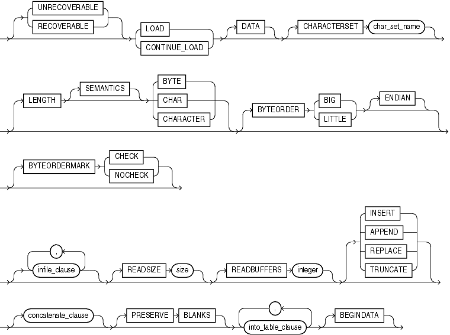

> ```
> load_statement ::=
>  
>   [{ UNRECOVERABLE | RECOVERABLE }] { LOAD | CONTINUE_LOAD } [DATA] [CHARACTERSET char_set_name]
> [LENGTH [SEMANTICS] { BYTE | CHAR | CHARACTER }] [BYTEORDER { BIG | LITTLE } [ENDIAN]]
> [BYTEORDERMARK { CHECK | NOCHECK }]
> [infile_clause] [, infile_clause]... [READSIZE size] [READBUFFERS integer] 
> [{ INSERT | APPEND | REPLACE | TRUNCATE }] 
> [concatenate_clause][PRESERVE BLANKS] into_table_clause [, into_table_clause]... [BEGINDATA]
> ```
  
  

infile\_clause

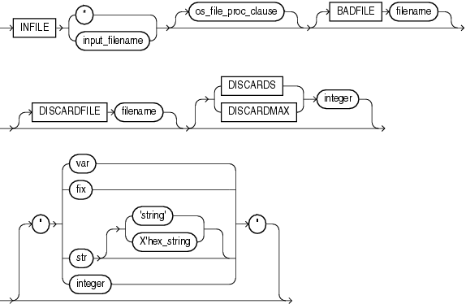

> ```
> infile_clause ::= 
>  
>   INFILE { * | input_filename } [os_file_proc_clause] [ BADFILE filename ] 
>  [DISCARDFILE filename] [{ DISCARDS | DISCARDMAX } integer]
>  [" { var | fix | [str [ 'string' | X'hex_string ] ] | integer } "]
> ```
>
> [Copyright © 1996, 2018, Oracle and/or its affiliates. All rights reserved.](https://docs.oracle.com/cd/E11882_01/dcommon/html/cpyr.htm)
  
  

concatenate\_clause

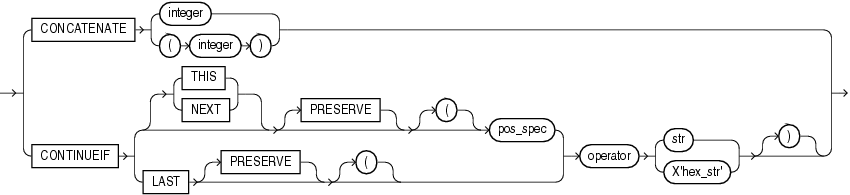

> ```
> concatenate ::= 
>  
>   CONCATENATE { integer | (integer) }
>   |CONTINUEIF 
>   { { THIS | NEXT } [PRESERVE] [(] (pos_spec)
>   |[LAST [PRESERVE] [(] } operator { str | X'hex_str' } [)]
> ```
>
> [Copyright © 1996, 2018, Oracle and/or its affiliates. All rights reserved.](https://docs.oracle.com/cd/E11882_01/dcommon/html/cpyr.htm)
  
  

into\_table\_clause

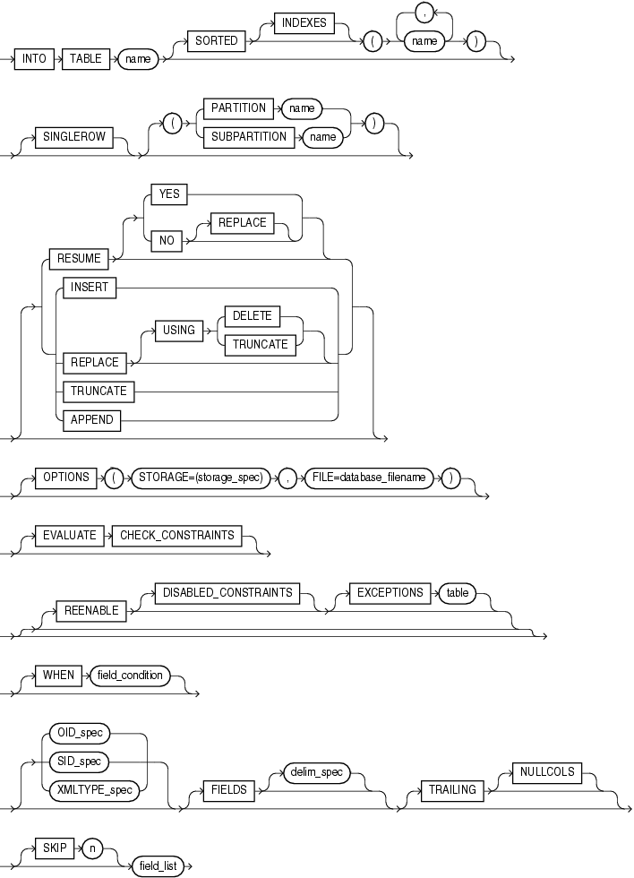

> ```
> intotab_clause ::= 
>  
>  INTO TABLE name [SORTED [INDEXES] (name)]
>  [SINGLEROW] [ ( { PARTITION name | SUBPARTITION name } ) ]  
>  [ {RESUME [ { YES | NO [REPLACE] } ] | INSERT | REPLACE [ USING  {DELETE | TRUNCATE} ]
>  | TRUNCATE | APPEND} ]
> [OPTIONS (STORAGE=storage_spec, FILE=database_filename)]
> [ [EVALUATE CHECK_CONSTRAINTS] 
> [REENABLE] [DISABLED_CONSTRAINTS] ]
> [EXCEPTIONS table]
>  [WHEN field_condition]
> [ OID_spec| SID_spec  | XMLTYPE_spec] [FIELDS [delim_spec]] [TRAILING [NULCOLS]] 
> [TREAT AS typename]
> [SKIP n] field_list
> ```
  
  

field\_condition


> ```
> fld_cond  ::= 
>  
>   [(] 
>   {full_fieldname | pos_spec } operator { 'char_string' | X'hex_string' | BLANKS} 
>   [)] AND
>   [(]
>   {full_fieldname | pos_spec } operator { 'char_string' | X'hex_string' | BLANKS}
>   [)]...
> ```
>
> [Copyright © 1996, 2018, Oracle and/or its affiliates. All rights reserved.](https://docs.oracle.com/cd/E11882_01/dcommon/html/cpyr.htm)
  
  

delim\_spec

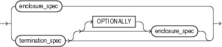

> ```
> delim_spec ::= 
>  
>    { termination_spec [[OPTIONALLY] enclosure_spec] | enclosure_spec }
> ```
>
> [Copyright © 1996, 2018, Oracle and/or its affiliates. All rights reserved.](https://docs.oracle.com/cd/E11882_01/dcommon/html/cpyr.htm)
  
  

full\_fieldname

  
[Description of the illustration ''fieldname.gif''](https://docs.oracle.com/cd/E11882_01/server.112/e22490/img_text/fieldname.htm)  
  

termination\_spec

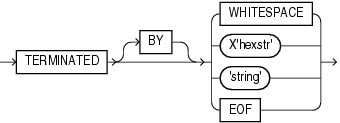

> ```
> terminat ::= 
>  
>   TERMINATED [BY] { WHITESPACE | X'hexstr' | 'string' | EOF }
> ```
>
> [Copyright © 1996, 2018, Oracle and/or its affiliates. All rights reserved.](https://docs.oracle.com/cd/E11882_01/dcommon/html/cpyr.htm)
  
  

enclosure\_spec


> ```
> enclose ::= 
>  
>   ENCLOSED [BY] [ 'string' | X'hexstr' ] [AND] [ 'string' | X'hexstr' ]
> ```
>
> [Copyright © 1996, 2018, Oracle and/or its affiliates. All rights reserved.](https://docs.oracle.com/cd/E11882_01/dcommon/html/cpyr.htm)
  
  

oid\_spec

  
[Description of the illustration ''oid\_spec.gif''](https://docs.oracle.com/cd/E11882_01/server.112/e22490/img_text/oid_spec.htm)  
  

sid\_spec

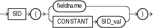

> ```
> sid_spec ::= 
>  
>   SID ( { fieldname | CONSTANT SID_val } )
> ```
>
> [Copyright © 1996, 2018, Oracle and/or its affiliates. All rights reserved.](https://docs.oracle.com/cd/E11882_01/dcommon/html/cpyr.htm)
  
  

xmltype\_spec

  
[Description of the illustration ''xmltype\_spec.gif''](https://docs.oracle.com/cd/E11882_01/server.112/e22490/img_text/xmltype_spec.htm)  
  

field\_list


> ```
> field_list :==
>  
> (column_name { dgen_fld_spec 
> | scalar_fld_spec 
> | col_obj_fld_spec 
> | collection_fld_spec
> | filler_fld_spec }
> )
> [(, column_name { d_gen_fld_spec 
> | scalar_fld_spec 
> | col_obj_fld_spec 
> | collection_fld_spec
> | filler_fld_spec }
> )]...
> ```
>
> [Copyright © 1996, 2018, Oracle and/or its affiliates. All rights reserved.](https://docs.oracle.com/cd/E11882_01/dcommon/html/cpyr.htm)
  
  

dgen\_fld\_spec


> ```
> dgen_fld ::= 
>   
>   { RECNUM 
>   | SYSDATE 
>   | CONSTANT val 
>   | SEQUENCE [( { COUNT | MAX | integer } [, incr] )] 
>   | { REF_spec init_spec | SID_spec init_spec | BFILE_spec init_spec }
>   | EXPRESSION "sql_string" }
> ```
>
> [Copyright © 1996, 2018, Oracle and/or its affiliates. All rights reserved.](https://docs.oracle.com/cd/E11882_01/dcommon/html/cpyr.htm)
  
  

ref\_spec

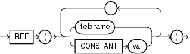

> ```
> ref ::= 
>  
>   REF ( { fieldname | CONSTANT val } [, { fieldname | CONSTANT val }]... )
> ```
>
> [Copyright © 1996, 2018, Oracle and/or its affiliates. All rights reserved.](https://docs.oracle.com/cd/E11882_01/dcommon/html/cpyr.htm)
  
  

init\_spec

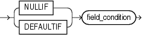

> ```
> init ::= 
>  
>   { NULLIF | DEFAULTIF } field_condition
> ```
>
> [Copyright © 1996, 2018, Oracle and/or its affiliates. All rights reserved.](https://docs.oracle.com/cd/E11882_01/dcommon/html/cpyr.htm)
  
  

bfile\_spec


> ```
> bfile ::= 
>  
>   BFILE ( { fieldname | CONSTANT val } , { fieldname | CONSTANT val } )
> ```
>
> [Copyright © 1996, 2018, Oracle and/or its affiliates. All rights reserved.](https://docs.oracle.com/cd/E11882_01/dcommon/html/cpyr.htm)
  
  

filler\_fld\_spec

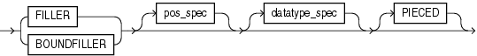

> ```
> filler_fld ::= 
>  
>  { FILLER | BOUNDFILLER } [pos_spec] [datatype_spec] [PIECED]
> ```
>
> [Copyright © 1996, 2018, Oracle and/or its affiliates. All rights reserved.](https://docs.oracle.com/cd/E11882_01/dcommon/html/cpyr.htm)
  
  

scalar\_fld\_spec


> ```
> scalar ::=
>  
>  { [LOBFILE_spec] | [POSITION pos_spec] } [datatype_spec] [PIECED]
>  [init_spec] ["sql_string"]
> ```
>
> [Copyright © 1996, 2018, Oracle and/or its affiliates. All rights reserved.](https://docs.oracle.com/cd/E11882_01/dcommon/html/cpyr.htm)
  
  

lobfile\_spec

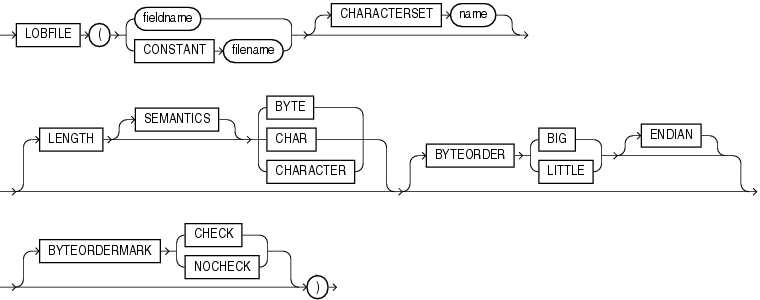

> ```
> lobfile_spec ::= 
>  
>   LOBFILE ({ fieldname | CONSTANT filename } [CHARACTERSET name]
>  [LENGTH [SEMANTICS] { BYTE | CHAR | CHARACTER }] [BYTEORDER { BIG | LITTLE } [ENDIAN]]
> [BYTEORDERMARK { CHECK | NOCHECK }] )
> ```
>
> [Copyright © 1996, 2018, Oracle and/or its affiliates. All rights reserved.](https://docs.oracle.com/cd/E11882_01/dcommon/html/cpyr.htm)
  
  

pos\_spec

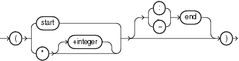

> ```
> pos_spec ::= 
>  
>   ( { start | * [+integer] } [{ : | - } end] )
> ```
>
> [Copyright © 1996, 2018, Oracle and/or its affiliates. All rights reserved.](https://docs.oracle.com/cd/E11882_01/dcommon/html/cpyr.htm)
  
  

datatype\_spec

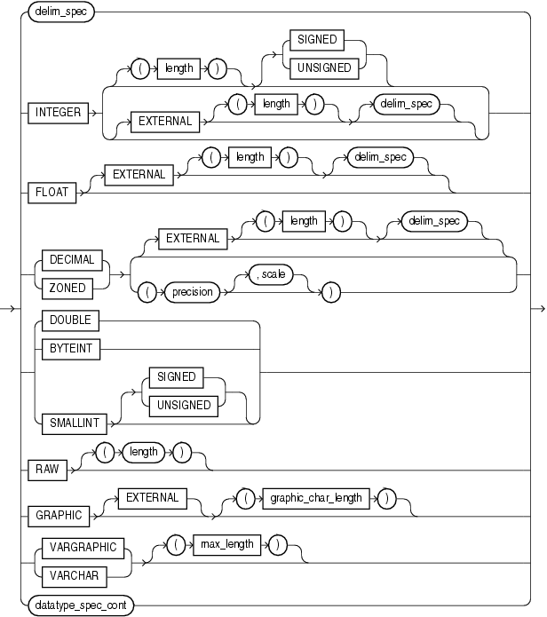

> ```
> datatype_spec ::= 
>  
>   delim_spec                                                      
>  |INTEGER { [(length)] [{ SIGNED | UNSIGNED }] |               
>  [EXTERNAL [(length)] [delim_spec]] }        
>  |FLOAT [EXTERNAL [(length)] [delim_spec] ]                
>  |{ DECIMAL | ZONED } { [EXTERNAL [(length)] [delim_spec]] | 
>  (precision [, scale]) }            
>  |{ DOUBLE | BYTEINT | SMALLINT { SIGNED | UNSIGNED } }                
>  |RAW [(length)]                                         
>  |GRAPHIC [EXTERNAL] [(graphic_char_length)]                
>  |{ VARGRAPHIC | VARCHAR } [(max_length)]                      
>  datatype_spec_cont
> ```
  
  

datatype\_spec\_cont

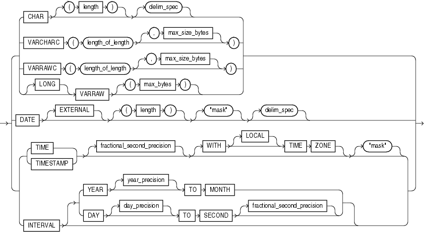

> ```
> datatype_spec_cont ::= 
>            
>  CHAR [(length)] [delim_spec]                             
>  |VARCHARC (length_of_length [, max_size_bytes])       
>  |VARRAWC  (length_of_length [, max_size_bytes])        
>  |[LONG] VARRAW [(max_bytes)]                            
>  |DATE [EXTERNAL] [(length)] [\"mask\"] [delim_spec] 
>  |{ TIME|TIMESTAMP } [(fractional_second_precision)] [WITH [LOCAL] TIME ZONE] [\"mask\"]        
>  |INTERVAL [ { YEAR [(year_precision)] TO MONTH | DAY [(day_precision)] TO SECOND [(fractional_second_precision)]} ]
> ```
>
> [Copyright © 1996, 2018, Oracle and/or its affiliates. All rights reserved.](https://docs.oracle.com/cd/E11882_01/dcommon/html/cpyr.htm)
  
  

col\_obj\_fld\_spec


> ```
> col_obj_fld_spec ::= 
>  
>   COLUMN OBJECT [TREAT AS typename] [init_spec] field_list [sql_string_spec]
> ```
>
> [Copyright © 1996, 2018, Oracle and/or its affiliates. All rights reserved.](https://docs.oracle.com/cd/E11882_01/dcommon/html/cpyr.htm)
  
  

collection\_fld\_spec

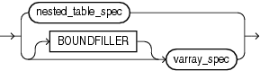

> ```
> coll_fld ::= 
>  
>   { nested_table_spec | [BOUNDFILLER] varray_spec }
> ```
>
> [Copyright © 1996, 2018, Oracle and/or its affiliates. All rights reserved.](https://docs.oracle.com/cd/E11882_01/dcommon/html/cpyr.htm)
  
  

nested\_table\_spec


> ```
> nested_table ::= 
>  
>   NESTED TABLE (SDF_spec count_spec init_spec  | count_spec field_list |delim_spec)
> ```
>
> [Copyright © 1996, 2018, Oracle and/or its affiliates. All rights reserved.](https://docs.oracle.com/cd/E11882_01/dcommon/html/cpyr.htm)
  
  

varray\_spec


> ```
> varray ::= 
>  
>   VARRAY (SDF_spec count_spec init_spec |count_spec field_list | delim_spec)
> ```
>
> [Copyright © 1996, 2018, Oracle and/or its affiliates. All rights reserved.](https://docs.oracle.com/cd/E11882_01/dcommon/html/cpyr.htm)
  
  

sdf\_spec

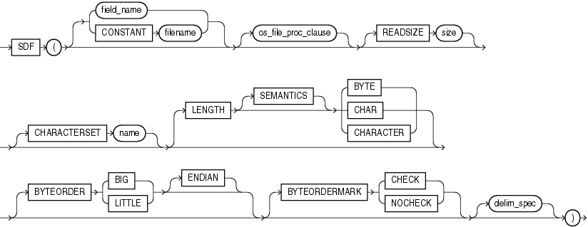

> ```
> sdf ::=
>  
>   SDF ( [ field_name | CONSTANT filename ] [os_file_proc_clause] [READSIZE size] 
>  
>  [CHARACTERSET name] [LENGTH [SEMANTICS] {BYTE | CHAR | CHARACTER}] 
>  
>  [BYTEORDER { BIG | LITTLE } [ENDIAN]] [BYTEORDERMARK { CHECK | NOCHECK }] [delim_spec] )
> ```
>
> [Copyright © 1996, 2018, Oracle and/or its affiliates. All rights reserved.](https://docs.oracle.com/cd/E11882_01/dcommon/html/cpyr.htm)
  
  

count\_spec


> ```
> count ::= 
>  
>   COUNT ({ fieldname | CONSTANT positive_integer })
> ```
>
> [Copyright © 1996, 2018, Oracle and/or its affiliates. All rights reserved.](https://docs.oracle.com/cd/E11882_01/dcommon/html/cpyr.htm)
