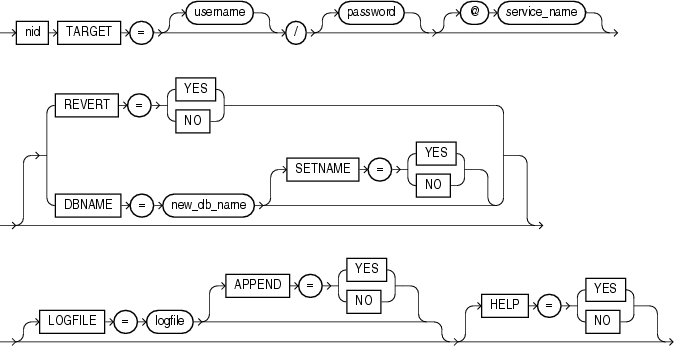

## 18 DBNEWID Utility

DBNEWID is a database utility that can change the internal database identifier (DBID) and the database name (DBNAME) for an operational database.

This chapter contains the following sections:

## What Is the DBNEWID Utility?

Before the introduction of the DBNEWID utility, you could manually create a copy of a database and give it a new database name (DBNAME) by re-creating the control file. However, you could not give the database a new identifier (DBID). The DBID is an internal, unique identifier for a database. Because Recovery Manager (RMAN) distinguishes databases by DBID, you could not register a seed database and a manually copied database together in the same RMAN repository. The DBNEWID utility solves this problem by allowing you to change any of the following:

- Only the DBID of a database
- Only the DBNAME of a database
- Both the DBNAME and DBID of a database

## Ramifications of Changing the DBID and DBNAME

Changing the DBID of a database is a serious procedure. When the DBID of a database is changed, all previous backups and archived logs of the database become unusable. This is similar to creating a database except that the data is already in the data files. After you change the DBID, backups and archive logs that were created before the change can no longer be used because they still have the original DBID, which does not match the current DBID. You must open the database with the `RESETLOGS` option, which re-creates the online redo logs and resets their sequence to 1 (see [Oracle Database Administrator's Guide)](https://docs.oracle.com/cd/E11882_01/server.112/e25494/toc.htm). Consequently, you should make a backup of the whole database immediately after changing the DBID.

Changing the DBNAME without changing the DBID does not require you to open with the `RESETLOGS` option, so database backups and archived logs are not invalidated. However, changing the DBNAME does have consequences. You must change the `DB_NAME` initialization parameter after a database name change to reflect the new name. Also, you may have to re-create the Oracle password file. If you restore an old backup of the control file (before the name change), then you should use the initialization parameter file and password file from before the database name change.

Note:

Do not change the DBID or DBNAME of a database if you are using a capture process to capture changes to the database. See [Oracle Streams Concepts and Administration](https://docs.oracle.com/cd/E11882_01/server.112/e17069/strms_capture.htm#STRMS002) for more information about capture processes.

### Considerations for Global Database Names

If you are dealing with a database in a distributed database system, then each database should have a unique global database name. The DBNEWID utility does not change global database names. This can only be done with the SQL `ALTER` `DATABASE` statement, for which the syntax is as follows:

```
ALTER DATABASE RENAME GLOBAL_NAME TO newname.domain;
```

The global database name is made up of a database name and a domain, which are determined by the `DB_NAME` and `DB_DOMAIN` initialization parameters when the database is first created.

The following example changes the database name to `sales` in the domain `us`.`example`.`com`:

```
ALTER DATABASE RENAME GLOBAL_NAME TO sales.us.example.com
```

You would do this after you finished using DBNEWID to change the database name.

See Also:

[Oracle Database Administrator's Guide](https://docs.oracle.com/cd/E11882_01/server.112/e25494/toc.htm) for more information about global database names

## Changing the DBID and DBNAME of a Database

This section contains these topics:

- Changing the DBID and Database Name
- Changing Only the Database ID
- Changing Only the Database Name
- Troubleshooting DBNEWID

### Changing the DBID and Database Name

The following steps describe how to change the DBID of a database. Optionally, you can change the database name as well.

1. Ensure that you have a recoverable whole database backup.
2. Ensure that the target database is mounted but not open, and that it was shut down consistently before mounting. For example:
	```
	SHUTDOWN IMMEDIATE
	STARTUP MOUNT
	```
3. Invoke the DBNEWID utility on the command line, specifying a valid user (`TARGET`) that has the `SYSDBA` privilege (you will be prompted for a password):
	```
	% nid TARGET=SYS
	```
	To change the database name in addition to the DBID, also specify the `DBNAME` parameter on the command line (you will be prompted for a password). The following example changes the database name to `test_db`:
	```
	% nid TARGET=SYS DBNAME=test_db
	```
	The DBNEWID utility performs validations in the headers of the data files and control files before attempting I/O to the files. If validation is successful, then DBNEWID prompts you to confirm the operation (unless you specify a log file, in which case it does not prompt), changes the DBID (and the DBNAME, if specified, as in this example) for each data file, including offline normal and read-only data files, shuts down the database, and then exits. The following is an example of what the output for this would look like:
	```
	.
	.
	.
	Connected to database PROD (DBID=86997811)
	.
	.
	.
	Control Files in database:
	    /oracle/TEST_DB/data/cf1.dbf
	    /oracle/TEST_DB/data/cf2.dbf
	The following datafiles are offline clean:
	    /oracle/TEST_DB/data/tbs_61.dbf (23)
	    /oracle/TEST_DB/data/tbs_62.dbf (24)
	    /oracle/TEST_DB/data/temp3.dbf (3)
	These files must be writable by this utility.
	The following datafiles are read-only:
	    /oracle/TEST_DB/data/tbs_51.dbf (15)
	    /oracle/TEST_DB/data/tbs_52.dbf (16)
	    /oracle/TEST_DB/data/tbs_53.dbf (22)
	These files must be writable by this utility.
	Changing database ID from 86997811 to 1250654267
	Changing database name from PROD to TEST_DB
	    Control File /oracle/TEST_DB/data/cf1.dbf - modified
	    Control File /oracle/TEST_DB/data/cf2.dbf - modified
	    Datafile /oracle/TEST_DB/data/tbs_01.dbf - dbid changed, wrote new name
	    Datafile /oracle/TEST_DB/data/tbs_ax1.dbf - dbid changed, wrote new name
	    Datafile /oracle/TEST_DB/data/tbs_02.dbf - dbid changed, wrote new name
	    Datafile /oracle/TEST_DB/data/tbs_11.dbf - dbid changed, wrote new name
	    Datafile /oracle/TEST_DB/data/tbs_12.dbf - dbid changed, wrote new name
	    Datafile /oracle/TEST_DB/data/temp1.dbf - dbid changed, wrote new name
	    Control File /oracle/TEST_DB/data/cf1.dbf - dbid changed, wrote new name
	    Control File /oracle/TEST_DB/data/cf2.dbf - dbid changed, wrote new name
	    Instance shut down
	Database name changed to TEST_DB.
	Modify parameter file and generate a new password file before restarting.
	Database ID for database TEST_DB changed to 1250654267.
	All previous backups and archived redo logs for this database are unusable.
	Database has been shutdown, open database with RESETLOGS option.
	Successfully changed database name and ID.
	DBNEWID - Completed successfully.
	```
	If validation is not successful, then DBNEWID terminates and leaves the target database intact, as shown in the following sample output. You can open the database, fix the error, and then either resume the DBNEWID operation or continue using the database without changing its DBID.
	```
	.
	.
	.
	Connected to database PROD (DBID=86997811)
	.
	.
	.  
	Control Files in database:
	    /oracle/TEST_DB/data/cf1.dbf
	    /oracle/TEST_DB/data/cf2.dbf
	 
	The following datafiles are offline clean:
	    /oracle/TEST_DB/data/tbs_61.dbf (23)
	    /oracle/TEST_DB/data/tbs_62.dbf (24)
	    /oracle/TEST_DB/data/temp3.dbf (3)
	These files must be writable by this utility.
	 
	The following datafiles are read-only:
	    /oracle/TEST_DB/data/tbs_51.dbf (15)
	    /oracle/TEST_DB/data/tbs_52.dbf (16)
	    /oracle/TEST_DB/data/tbs_53.dbf (22)
	These files must be writable by this utility.
	 
	The following datafiles are offline immediate:
	    /oracle/TEST_DB/data/tbs_71.dbf (25)
	    /oracle/TEST_DB/data/tbs_72.dbf (26)
	 
	NID-00122: Database should have no offline immediate datafiles
	  
	Change of database name failed during validation - database is intact.
	DBNEWID - Completed with validation errors.
	```
4. Mount the database. For example:
	```
	STARTUP MOUNT
	```
5. Open the database in `RESETLOGS` mode and resume normal use. For example:
	```
	ALTER DATABASE OPEN RESETLOGS;
	```
	Make a new database backup. Because you reset the online redo logs, the old backups and archived logs are no longer usable in the current incarnation of the database.

### Changing Only the Database ID

To change the database ID without changing the database name, follow the steps in "Changing the DBID and Database Name", but in Step 3 do not specify the optional database name (DBNAME). The following is an example of the type of output that is generated when only the database ID is changed.

```
.
.
.
Connected to database PROD (DBID=86997811)
.
.
.  
Control Files in database:
    /oracle/TEST_DB/data/cf1.dbf
    /oracle/TEST_DB/data/cf2.dbf
 
The following datafiles are offline clean:
    /oracle/TEST_DB/data/tbs_61.dbf (23)
    /oracle/TEST_DB/data/tbs_62.dbf (24)
    /oracle/TEST_DB/data/temp3.dbf (3)
These files must be writable by this utility.
 
The following datafiles are read-only:
    /oracle/TEST_DB/data/tbs_51.dbf (15)
    /oracle/TEST_DB/data/tbs_52.dbf (16)
    /oracle/TEST_DB/data/tbs_53.dbf (22)
These files must be writable by this utility.
 
Changing database ID from 86997811 to 4004383693
    Control File /oracle/TEST_DB/data/cf1.dbf - modified
    Control File /oracle/TEST_DB/data/cf2.dbf - modified
    Datafile /oracle/TEST_DB/data/tbs_01.dbf - dbid changed
    Datafile /oracle/TEST_DB/data/tbs_ax1.dbf - dbid changed
    Datafile /oracle/TEST_DB/data/tbs_02.dbf - dbid changed
    Datafile /oracle/TEST_DB/data/tbs_11.dbf - dbid changed
    Datafile /oracle/TEST_DB/data/tbs_12.dbf - dbid changed
    Datafile /oracle/TEST_DB/data/temp1.dbf - dbid changed
    Control File /oracle/TEST_DB/data/cf1.dbf - dbid changed
    Control File /oracle/TEST_DB/data/cf2.dbf - dbid changed
    Instance shut down
 
Database ID for database TEST_DB changed to 4004383693.
All previous backups and archived redo logs for this database are unusable.
Database has been shutdown, open database with RESETLOGS option.
Succesfully changed database ID.
DBNEWID - Completed succesfully.
```

### Changing Only the Database Name

The following steps describe how to change the database name without changing the DBID.

1. Ensure that you have a recoverable whole database backup.
2. Ensure that the target database is mounted but not open, and that it was shut down consistently before mounting. For example:
	```
	SHUTDOWN IMMEDIATE
	STARTUP MOUNT
	```
3. Invoke the utility on the command line, specifying a valid user with the `SYSDBA` privilege (you will be prompted for a password). You must specify both the `DBNAME` and `SETNAME` parameters. This example changes the name to `test_db`:
	```
	% nid TARGET=SYS DBNAME=test_db SETNAME=YES
	```
	DBNEWID performs validations in the headers of the control files (not the data files) before attempting I/O to the files. If validation is successful, then DBNEWID prompts for confirmation, changes the database name in the control files, shuts down the database and exits. The following is an example of what the output for this would look like:
	```
	.
	.
	.
	Control Files in database:
	    /oracle/TEST_DB/data/cf1.dbf
	    /oracle/TEST_DB/data/cf2.dbf
	The following datafiles are offline clean:
	    /oracle/TEST_DB/data/tbs_61.dbf (23)
	    /oracle/TEST_DB/data/tbs_62.dbf (24)
	    /oracle/TEST_DB/data/temp3.dbf (3)
	These files must be writable by this utility.
	The following datafiles are read-only:
	    /oracle/TEST_DB/data/tbs_51.dbf (15)
	    /oracle/TEST_DB/data/tbs_52.dbf (16)
	    /oracle/TEST_DB/data/tbs_53.dbf (22)
	These files must be writable by this utility.
	Changing database name from PROD to TEST_DB
	    Control File /oracle/TEST_DB/data/cf1.dbf - modified
	    Control File /oracle/TEST_DB/data/cf2.dbf - modified
	    Datafile /oracle/TEST_DB/data/tbs_01.dbf - wrote new name
	    Datafile /oracle/TEST_DB/data/tbs_ax1.dbf - wrote new name
	    Datafile /oracle/TEST_DB/data/tbs_02.dbf - wrote new name
	    Datafile /oracle/TEST_DB/data/tbs_11.dbf - wrote new name
	    Datafile /oracle/TEST_DB/data/tbs_12.dbf - wrote new name
	    Datafile /oracle/TEST_DB/data/temp1.dbf - wrote new name
	    Control File /oracle/TEST_DB/data/cf1.dbf - wrote new name
	    Control File /oracle/TEST_DB/data/cf2.dbf - wrote new name
	    Instance shut down
	Database name changed to TEST_DB.
	Modify parameter file and generate a new password file before restarting.
	Successfully changed database name.
	DBNEWID - Completed successfully.
	```
	If validation is not successful, then DBNEWID terminates and leaves the target database intact. You can open the database, fix the error, and then either resume the DBNEWID operation or continue using the database without changing the database name. (For an example of what the output looks like for an unsuccessful validation, see Step 3 in "Changing the DBID and Database Name".)
4. Set the `DB_NAME` initialization parameter in the initialization parameter file (PFILE) to the new database name.
	Note:
	The DBNEWID utility does not change the server parameter file (`SPFILE`). Therefore, if you use `SPFILE` to start your Oracle database, then you must re-create the initialization parameter file from the server parameter file, remove the server parameter file, change the `DB_NAME` in the initialization parameter file, and then re-create the server parameter file.
5. Create a new password file.
6. Start up the database and resume normal use. For example:
	```
	STARTUP
	```
	Because you have changed only the database name, and not the database ID, it is not necessary to use the `RESETLOGS` option when you open the database. This means that all previous backups are still usable.

### Troubleshooting DBNEWID

If the DBNEWID utility succeeds in its validation stage but detects an error while performing the requested change, then the utility stops and leaves the database in the middle of the change. In this case, you cannot open the database until the DBNEWID operation is either completed or reverted. DBNEWID displays messages indicating the status of the operation.

Before continuing or reverting, fix the underlying cause of the error. Sometimes the only solution is to restore the whole database from a recent backup and perform recovery to the point in time before DBNEWID was started. This underscores the importance of having a recent backup available before running DBNEWID.

If you choose to continue with the change, then re-execute your original command. The DBNEWID utility resumes and attempts to continue the change until all data files and control files have the new value or values. At this point, the database is shut down. You should mount it before opening it with the `RESETLOGS` option.

If you choose to revert a DBNEWID operation, and if the reversion succeeds, then DBNEWID reverts all performed changes and leaves the database in a mounted state.

If DBNEWID is run against a release 10.1 or later Oracle database, then a summary of the operation is written to the alert file. For example, for a change of database name and database ID, you might see something similar to the following:

```
*** DBNEWID utility started ***
DBID will be changed from 86997811 to new DBID of 1250452230 for
database PROD
DBNAME will be changed from PROD to new DBNAME of TEST_DB
Starting datafile conversion
Setting recovery target incarnation to 1
Datafile conversion complete
Database name changed to TEST_DB.
Modify parameter file and generate a new password file before restarting.
Database ID for database TEST_DB changed to 1250452230.
All previous backups and archived redo logs for this database are unusable.
Database has been shutdown, open with RESETLOGS option.
Successfully changed database name and ID.
*** DBNEWID utility finished successfully ***
```

For a change of just the database name, the alert file might show something similar to the following:

```
*** DBNEWID utility started ***
DBNAME will be changed from PROD to new DBNAME of TEST_DB
Starting datafile conversion
Datafile conversion complete
Database name changed to TEST_DB.
Modify parameter file and generate a new password file before restarting.
Successfully changed database name.
*** DBNEWID utility finished successfully ***
 
In case of failure during DBNEWID the alert will also log the failure:
*** DBNEWID utility started ***
DBID will be changed from 86997811 to new DBID of 86966847 for database
AV3
Change of database ID failed.
Must finish change or REVERT changes before attempting any database
operation.
*** DBNEWID utility finished with errors ***
```

## DBNEWID Syntax

The following diagrams show the syntax for the DBNEWID utility.



> ```
> nid ::=
>  
> nid TARGET = [username] / [password] [@service_name]
>  
> [REVERT = { YES | NO }
> |DBNAME = new_db_name [SETNAME = { YES | NO }]]
>  
> [LOGFILE = logfile [APPEND = { YES | NO }] [HELP = { YES | NO }]]
>  
> End of description.
> ```
>
> [Copyright © 1996, 2018, Oracle and/or its affiliates. All rights reserved.](https://docs.oracle.com/cd/E11882_01/dcommon/html/cpyr.htm)
  
  

### Parameters

Table 18-1 describes the parameters in the DBNEWID syntax.

Table 18-1 Parameters for the DBNEWID Utility

| Parameter | Description |
| --- | --- |
| `TARGET` | Specifies the username and password used to connect to the database. The user must have the `SYSDBA` privilege. If you are using operating system authentication, then you can connect with the slash (`/`). If the `$ORACLE_HOME` and `$ORACLE_SID` variables are not set correctly in the environment, then you can specify a secure (IPC or BEQ) service to connect to the target database. A target database must be specified in all invocations of the DBNEWID utility. |
| `REVERT` | Specify `YES` to indicate that a failed change of DBID should be reverted (default is `NO`). The utility signals an error if no change DBID operation is in progress on the target database. A successfully completed change of DBID cannot be reverted. `REVERT=YES` is valid only when a DBID change failed. |
| `DBNAME=` `new_db_name` | Changes the database name of the database. You can change the DBID and the DBNAME of a database at the same time. To change only the DBNAME, also specify the `SETNAME` parameter. |
| `SETNAME` | Specify `YES` to indicate that DBNEWID should change the database name of the database but should not change the DBID (default is `NO`). When you specify `SETNAME=YES`, the utility writes only to the target database control files. |
| `LOGFILE=` `logfile` | Specifies that DBNEWID should write its messages to the specified file. By default the utility overwrites the previous log. If you specify a log file, then DBNEWID does not prompt for confirmation. |
| `APPEND` | Specify `YES` to append log output to the existing log file (default is `NO`). |
| `HELP` | Specify `YES` to print a list of the DBNEWID syntax options (default is `NO`). |

### Restrictions and Usage Notes

The DBNEWID utility has the following restrictions:

- To change the DBID of a database, the database must be mounted and must have been shut down consistently before mounting. In the case of an Oracle Real Application Clusters database, the database must be mounted in `NOPARALLEL` mode.
- You must open the database with the `RESETLOGS` option after changing the DBID. However, you do not have to open with the `RESETLOGS` option after changing only the database name.
- No other process should be running against the database when DBNEWID is executing. If another session shuts down and starts the database, then DBNEWID terminates unsuccessfully.
- All online data files should be consistent without needing recovery.
- Normal offline data files should be accessible and writable. If this is not the case, then you must drop these files before invoking the DBNEWID utility.
- All read-only tablespaces must be accessible and made writable at the operating system level before invoking DBNEWID. If these tablespaces cannot be made writable (for example, they are on a CD-ROM), then you must unplug the tablespaces using the transportable tablespace feature and then plug them back in the database before invoking the DBNEWID utility (see the [Oracle Database Administrator's Guide](https://docs.oracle.com/cd/E11882_01/server.112/e25494/toc.htm)).
- The DBNEWID utility does not change global database names. See "Considerations for Global Database Names".

### Additional Restrictions for Releases Earlier Than Oracle Database 10g

The following additional restrictions apply if the DBNEWID utility is run against an Oracle Database release earlier than 10.1:

- The `nid` executable file should be owned and run by the Oracle owner because it needs direct access to the data files and control files. If another user runs the utility, then set the user ID to the owner of the data files and control files.
- The DBNEWID utility must access the data files of the database directly through a local connection. Although DBNEWID can accept a net service name, it cannot change the DBID of a nonlocal database.