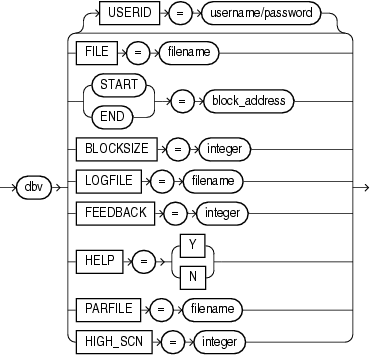

## 17 DBVERIFY: Offline Database Verification Utility

DBVERIFY is an external command-line utility that performs a physical data structure integrity check.

DBVERIFY can be used on offline or online databases, as well on backup files. You use DBVERIFY primarily when you need to ensure that a backup database (or data file) is valid before it is restored, or as a diagnostic aid when you have encountered data corruption problems. Because DBVERIFY can be run against an offline database, integrity checks are significantly faster.

DBVERIFY checks are limited to cache-managed blocks (that is, data blocks). Because DBVERIFY is only for use with data files, it does not work against control files or redo logs.

There are two command-line interfaces to DBVERIFY. With the first interface, you specify disk blocks of a single data file for checking. With the second interface, you specify a segment for checking. Both interfaces are started with the `dbv` command. The following sections provide descriptions of these interfaces:

- Using DBVERIFY to Validate Disk Blocks of a Single Data File
- Using DBVERIFY to Validate a Segment

## Using DBVERIFY to Validate Disk Blocks of a Single Data File

In this mode, DBVERIFY scans one or more disk blocks of a single data file and performs page checks.

Note:

If the file you are verifying is an Oracle Automatic Storage Management (Oracle ASM) file, then you must supply a `USERID`. This is because DBVERIFY needs to connect to an Oracle instance to access Oracle ASM files.

### Syntax

The syntax for `DBVERIFY` when you want to validate disk blocks of a single data file is as follows:



> ```
> dbverify ::= 
>  
>   dbv [ USERID=username/password ]
>     FILE = filename
>   | { START = block_address | END = block_address }
>   | BLOCKSIZE = integer
>   | HIGH_SCN = integer
>   | LOGFILE = filename
>   | FEEDBACK = integer
>   | HELP  = { Y | N } 
>   | PARFILE = filename
>   
> End of description.
> ```
  

### Parameters

Descriptions of the parameters are as follows:

| Parameter | Description |
| --- | --- |
| `USERID` | Specifies your username and password. This parameter is only necessary when the files being verified are Oracle ASM files. |
| `FILE` | The name of the database file to verify. |
| `START` | The starting block address to verify. Specify block addresses in Oracle blocks (as opposed to operating system blocks). If you do not specify `START`, then DBVERIFY defaults to the first block in the file. |
| `END` | The ending block address to verify. If you do not specify `END`, then DBVERIFY defaults to the last block in the file. |
| `BLOCKSIZE` | `BLOCKSIZE` is required only if the file to be verified does not have a block size of 2 KB. If the file does not have block size of 2 KB and you do not specify `BLOCKSIZE`, then you will receive the error DBV-00103. |
| `HIGH_SCN` | When a value is specified for `HIGH_SCN`, DBVERIFY writes diagnostic messages for each block whose block-level SCN exceeds the value specified.  This parameter is optional. There is no default. |
| `LOGFILE` | Specifies the file to which logging information should be written. The default sends output to the terminal display. |
| `FEEDBACK` | Causes DBVERIFY to send a progress display to the terminal in the form of a single period (.) for `n` number of pages verified during the DBVERIFY run. If `n` = 0, then there is no progress display. |
| `HELP` | Provides online help. |
| `PARFILE` | Specifies the name of the parameter file to use. You can store various values for DBVERIFY parameters in flat files. This enables you to customize parameter files to handle different types of data files and to perform specific types of integrity checks on data files. |

### Sample DBVERIFY Output For a Single Data File

The following is a sample verification of the file `t_db1.dbf.`The feedback parameter has been given the value 100 to display one period (.) for every 100 pages processed. A portion of the resulting output is also shown.

```
% dbv FILE=t_db1.dbf FEEDBACK=100
.
.
.
DBVERIFY - Verification starting : FILE = t_db1.dbf 

................................................................................
 

DBVERIFY - Verification complete 
 
Total Pages Examined         : 9216 
Total Pages Processed (Data) : 2044 
Total Pages Failing   (Data) : 0 
Total Pages Processed (Index): 733 
Total Pages Failing   (Index): 0 
Total Pages Empty            : 5686 
Total Pages Marked Corrupt   : 0 

Total Pages Influx           : 0
```

Notes:

- Pages = Blocks
- Total Pages Examined = number of blocks in the file
- Total Pages Processed = number of blocks that were verified (formatted blocks)
- Total Pages Failing (Data) = number of blocks that failed the data block checking routine
- Total Pages Failing (Index) = number of blocks that failed the index block checking routine
- Total Pages Marked Corrupt = number of blocks for which the cache header is invalid, thereby making it impossible for DBVERIFY to identify the block type
- Total Pages Influx = number of blocks that are being read and written to at the same time. If the database is open when DBVERIFY is run, then DBVERIFY reads blocks multiple times to get a consistent image. But because the database is open, there may be blocks that are being read and written to at the same time (INFLUX). DBVERIFY cannot get a consistent image of pages that are in flux.

## Using DBVERIFY to Validate a Segment

In this mode, DBVERIFY enables you to specify a table segment or index segment for verification. It checks to ensure that a row chain pointer is within the segment being verified.

This mode requires that you specify a segment (data or index) to be validated. It also requires that you log on to the database with `SYSDBA` privileges, because information about the segment must be retrieved from the database.

During this mode, the segment is locked. If the specified segment is an index, then the parent table is locked. Note that some indexes, such as IOTs, do not have parent tables.

### Syntax

The syntax for `DBVERIFY` when you want to validate a segment is as follows:


> ```
> dbverify_seg ::= 
>  
>   dbv USERID = username/password 
>   | SEGMENT_ID = tsn.segfile.segblock
>   | LOGFILE = filename
>   | FEEDBACK = integer
>   | HELP  = { Y | N }
>   | PARFILE = filename 
>   | HIGH_SCN = integer 
>  
> End of description.
> ```
>
> [Copyright © 1996, 2018, Oracle and/or its affiliates. All rights reserved.](https://docs.oracle.com/cd/E11882_01/dcommon/html/cpyr.htm)
  

### Parameters

Descriptions of the parameters are as follows:

| Parameter | Description |
| --- | --- |
| `USERID` | Specifies your username and password. |
| `SEGMENT_ID` | Specifies the segment to verify. It is composed of the tablespace ID number (`tsn`), segment header file number (`segfile`), and segment header block number (`segblock`). You can get this information from `SYS_USER_SEGS. T` he relevant columns are `TABLESPACE_ID`, `HEADER_FILE`, and `HEADER_BLOCK`. You must have `SYSDBA` privileges to query `SYS_USER_SEGS`. |
| `HIGH_SCN` | When a value is specified for `HIGH_SCN`, DBVERIFY writes diagnostic messages for each block whose block-level SCN exceeds the value specified.  This parameter is optional. There is no default. |
| `LOGFILE` | Specifies the file to which logging information should be written. The default sends output to the terminal display. |
| `FEEDBACK` | Causes DBVERIFY to send a progress display to the terminal in the form of a single period (.) for `n` number of pages verified during the DBVERIFY run. If `n` = 0, then there is no progress display. |
| `HELP` | Provides online help. |
| `PARFILE` | Specifies the name of the parameter file to use. You can store various values for DBVERIFY parameters in flat files. This enables you to customize parameter files to handle different types of data files and to perform specific types of integrity checks on data files. |

### Sample DBVERIFY Output For a Validated Segment

The following is a sample of the output that would be shown for a DBVERIFY operation to validate `SEGMENT_ID` 1.2.67.

```
DBVERIFY - Verification starting : SEGMENT_ID = 1.2.67
 
DBVERIFY - Verification complete
 
Total Pages Examined         : 8
Total Pages Processed (Data) : 0
Total Pages Failing   (Data) : 0
Total Pages Processed (Index): 1
Total Pages Failing   (Index): 0
Total Pages Processed (Other): 2
Total Pages Processed (Seg)  : 1
Total Pages Failing   (Seg)  : 0
Total Pages Empty            : 4
Total Pages Marked Corrupt   : 0
Total Pages Influx           : 0
Highest block SCN            : 7358 (0.7358)
```