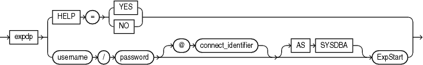
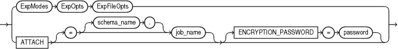
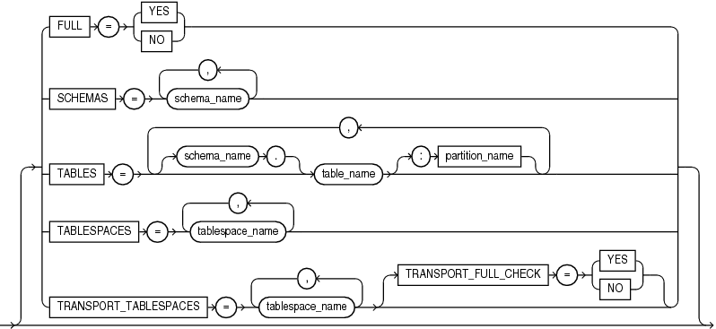
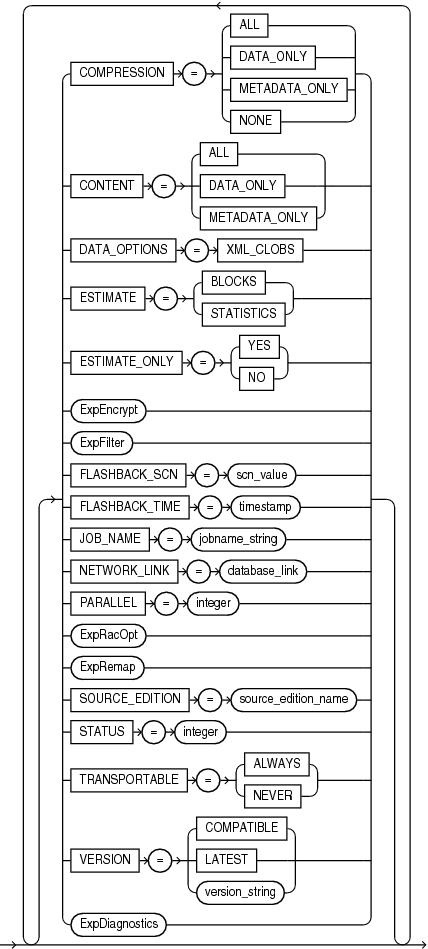
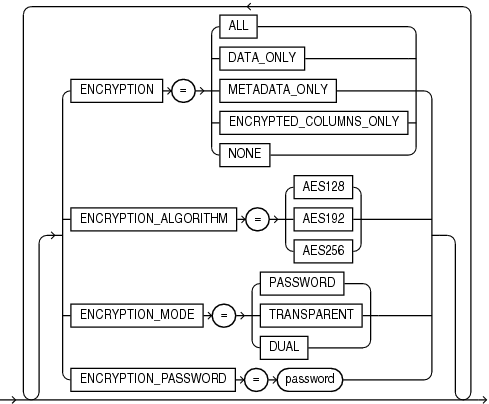
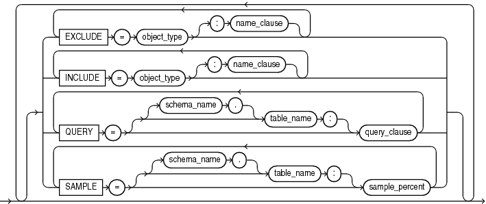
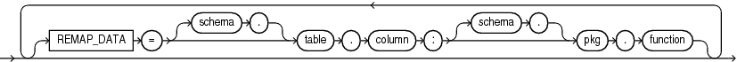
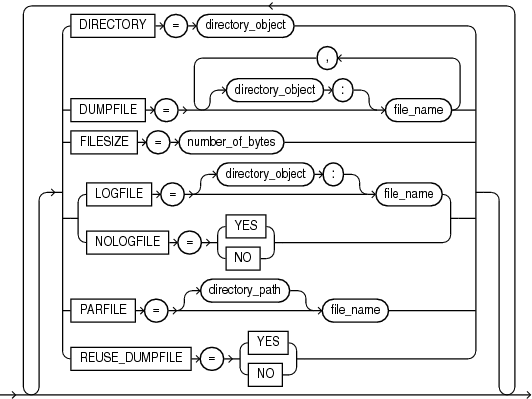
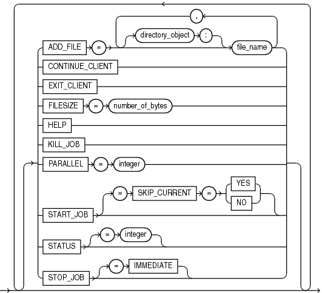
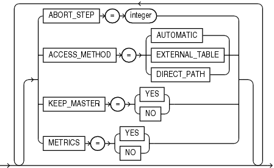

## 2 Data Pump Export

This chapter describes the Oracle Data Pump Export utility (expdp). The following topics are discussed:

## What Is Data Pump Export?

Data Pump Export (hereinafter referred to as Export for ease of reading) is a utility for unloading data and metadata into a set of operating system files called a dump file set. The dump file set can be imported only by the Data Pump Import utility. The dump file set can be imported on the same system or it can be moved to another system and loaded there.

The dump file set is made up of one or more disk files that contain table data, database object metadata, and control information. The files are written in a proprietary, binary format. During an import operation, the Data Pump Import utility uses these files to locate each database object in the dump file set.

Because the dump files are written by the server, rather than by the client, the database administrator (DBA) must create directory objects that define the server locations to which files are written. See ["Default Locations for Dump, Log, and SQL Files"](dp_overview.md) for more information about directory objects.

Data Pump Export enables you to specify that a job should move a subset of the data and metadata, as determined by the export mode. This is done using data filters and metadata filters, which are specified through Export parameters. See "Filtering During Export Operations".

To see some examples of the various ways in which you can use Data Pump Export, refer to "Examples of Using Data Pump Export".

## Invoking Data Pump Export

The Data Pump Export utility is invoked using the `expdp` command. The characteristics of the export operation are determined by the Export parameters you specify. These parameters can be specified either on the command line or in a parameter file.

Note:

Do not invoke Export as `SYSDBA,` except at the request of Oracle technical support. `SYSDBA` is used internally and has specialized functions; its behavior is not the same as for general users.

The following sections contain more information about invoking Export:

- "Data Pump Export Interfaces"
- "Data Pump Export Modes"
- "Network Considerations"

### Data Pump Export Interfaces

You can interact with Data Pump Export by using a command line, a parameter file, or an interactive-command mode.

- Command-Line Interface: Enables you to specify most of the Export parameters directly on the command line. For a complete description of the parameters available in the command-line interface, see "Parameters Available in Export's Command-Line Mode".
- Parameter File Interface: Enables you to specify command-line parameters in a parameter file. The only exception is the `PARFILE` parameter, because parameter files cannot be nested. The use of parameter files is recommended if you are using parameters whose values require quotation marks. See "Use of Quotation Marks On the Data Pump Command Line".
- Interactive-Command Interface: Stops logging to the terminal and displays the Export prompt, from which you can enter various commands, some of which are specific to interactive-command mode. This mode is enabled by pressing Ctrl+C during an export operation started with the command-line interface or the parameter file interface. Interactive-command mode is also enabled when you attach to an executing or stopped job.
	For a complete description of the commands available in interactive-command mode, see "Commands Available in Export's Interactive-Command Mode".

### Data Pump Export Modes

Export provides different modes for unloading different portions of the database. The mode is specified on the command line, using the appropriate parameter. The available modes are described in the following sections:

- "Full Export Mode"
- "Schema Mode"
- "Table Mode"
- "Tablespace Mode"
- "Transportable Tablespace Mode"

Note:

Several system schemas cannot be exported because they are not user schemas; they contain Oracle-managed data and metadata. Examples of system schemas that are not exported include `SYS`, `ORDSYS`, and `MDSYS`.

See Also:

"Examples of Using Data Pump Export"

#### Full Export Mode

A full export is specified using the `FULL` parameter. In a full database export, the entire database is unloaded. This mode requires that you have the `DATAPUMP_EXP_FULL_DATABASE` role.

See Also:

"FULL" for a description of the Export `FULL` parameter

#### Schema Mode

A schema export is specified using the `SCHEMAS` parameter. This is the default export mode. If you have the `DATAPUMP_EXP_FULL_DATABASE` role, then you can specify a list of schemas, optionally including the schema definitions themselves and also system privilege grants to those schemas. If you do not have the `DATAPUMP_EXP_FULL_DATABASE` role, then you can export only your own schema.

The `SYS` schema cannot be used as a source schema for export jobs.

Cross-schema references are not exported unless the referenced schema is also specified in the list of schemas to be exported. For example, a trigger defined on a table within one of the specified schemas, but that resides in a schema not explicitly specified, is not exported. This is also true for external type definitions upon which tables in the specified schemas depend. In such a case, it is expected that the type definitions already exist in the target instance at import time.

See Also:

"SCHEMAS" for a description of the Export `SCHEMAS` parameter

#### Table Mode

A table mode export is specified using the `TABLES` parameter. In table mode, only a specified set of tables, partitions, and their dependent objects are unloaded.

If you specify the `TRANSPORTABLE=ALWAYS` parameter with the `TABLES` parameter, then only object metadata is unloaded. To move the actual data, you copy the data files to the target database. This results in quicker export times. If you are moving data files between releases or platforms, then the data files may need to be processed by Oracle Recovery Manager (RMAN).

See Also:

[Oracle Database Backup and Recovery User's Guide](https://docs.oracle.com/cd/E11882_01/backup.112/e10642/rcmxplat.htm#BRADV05432) for more information on transporting data across platforms

You must have the `DATAPUMP_EXP_FULL_DATABASE` role to specify tables that are not in your own schema. Note that type definitions for columns are not exported in table mode. It is expected that the type definitions already exist in the target instance at import time. Also, as in schema exports, cross-schema references are not exported.

See Also:

- "TABLES" for a description of the Export `TABLES` parameter
- "TRANSPORTABLE" for a description of the Export `TRANSPORTABLE` parameter

#### Tablespace Mode

A tablespace export is specified using the `TABLESPACES` parameter. In tablespace mode, only the tables contained in a specified set of tablespaces are unloaded. If a table is unloaded, then its dependent objects are also unloaded. Both object metadata and data are unloaded. In tablespace mode, if any part of a table resides in the specified set, then that table and all of its dependent objects are exported. Privileged users get all tables. Unprivileged users get only the tables in their own schemas.

See Also:

- "TABLESPACES" for a description of the Export `TABLESPACES` parameter

#### Transportable Tablespace Mode

A transportable tablespace export is specified using the `TRANSPORT_TABLESPACES` parameter. In transportable tablespace mode, only the metadata for the tables (and their dependent objects) within a specified set of tablespaces is exported. The tablespace data files are copied in a separate operation. Then, a transportable tablespace import is performed to import the dump file containing the metadata and to specify the data files to use.

Transportable tablespace mode requires that the specified tables be completely self-contained. That is, all storage segments of all tables (and their indexes) defined within the tablespace set must also be contained within the set. If there are self-containment violations, then Export identifies all of the problems without actually performing the export.

Transportable tablespace exports cannot be restarted once stopped. Also, they cannot have a degree of parallelism greater than 1.

Encrypted columns are not supported in transportable tablespace mode.

Note:

You cannot export transportable tablespaces and then import them into a database at a lower release level. The target database must be at the same or higher release level as the source database.

Considerations for Time Zone File Versions in Transportable Tablespace Mode

Jobs performed in transportable tablespace mode have the following requirements concerning time zone file versions:

- If the source is Oracle Database 11g release 2 (11.2.0.2) or later and there are tables in the transportable set that use TIMESTAMP WITH TIMEZONE (TSTZ) columns, then the time zone file version on the target database must exactly match the time zone file version on the source database.
- If the source is earlier than Oracle Database 11g release 2 (11.2.0.2), then the time zone file version must be the same on the source and target database for all transportable jobs regardless of whether the transportable set uses TSTZ columns.

If these requirements are not met, then the import job aborts before anything is imported. This is because if the import job were allowed to import the objects, there might be inconsistent results when tables with TSTZ columns were read.

To identify the time zone file version of a database, you can execute the following SQL statement:

```
SQL> SELECT VERSION FROM V$TIMEZONE_FILE;
```

### Network Considerations

You can specify a connect identifier in the connect string when you invoke the Data Pump Export utility. This identifier can specify a database instance that is different from the current instance identified by the current Oracle System ID (SID). The connect identifier can be an Oracle\*Net connect descriptor or a net service name (usually defined in the `tnsnames.ora` file) that maps to a connect descriptor. Use of a connect identifier requires that you have Oracle Net Listener running (to start the default listener, enter `lsnrctl` `start`). The following is an example of this type of connection, in which `inst1` is the connect identifier:

```
expdp hr@inst1 DIRECTORY=dpump_dir1 DUMPFILE=hr.dmp TABLES=employees
```

Export then prompts you for a password:

```
Password: password
```

The local Export client connects to the database instance defined by the connect identifier `inst1` (a net service name), retrieves data from `inst1`, and writes it to the dump file `hr.dmp` on `inst1`.

Specifying a connect identifier when you invoke the Export utility is different from performing an export operation using the `NETWORK_LINK` parameter. When you start an export operation and specify a connect identifier, the local Export client connects to the database instance identified by the connect identifier, retrieves data from that database instance, and writes it to a dump file set on that database instance. Whereas, when you perform an export using the `NETWORK_LINK` parameter, the export is performed using a database link. (A database link is a connection between two physical database servers that allows a client to access them as one logical database.)

See Also:

- "NETWORK\_LINK"
- [Oracle Database Administrator's Guide](https://docs.oracle.com/cd/E11882_01/server.112/e25494/ds_concepts.htm#ADMIN12083) for more information about database links
- [Oracle Database Net Services Administrator's Guide](https://docs.oracle.com/cd/E11882_01/network.112/e41945/toc.htm) for more information about connect identifiers and Oracle Net Listener
- [Oracle Database Heterogeneous Connectivity User's Guide](https://docs.oracle.com/cd/E11882_01/server.112/e11050/toc.htm)

## Filtering During Export Operations

Data Pump Export provides data and metadata filtering capability to help you limit the type of information that is exported.

### Data Filters

Data specific filtering is implemented through the `QUERY` and `SAMPLE` parameters, which specify restrictions on the table rows that are to be exported.

Data filtering can also occur indirectly because of metadata filtering, which can include or exclude table objects along with any associated row data.

Each data filter can be specified once per table within a job. If different filters using the same name are applied to both a particular table and to the whole job, then the filter parameter supplied for the specific table takes precedence.

### Metadata Filters

Metadata filtering is implemented through the `EXCLUDE` and `INCLUDE` parameters. The `EXCLUDE` and `INCLUDE` parameters are mutually exclusive.

Metadata filters identify a set of objects to be included or excluded from an Export or Import operation. For example, you could request a full export, but without Package Specifications or Package Bodies.

To use filters correctly and to get the results you expect, remember that dependent objects of an identified object are processed along with the identified object. For example, if a filter specifies that an index is to be included in an operation, then statistics from that index will also be included. Likewise, if a table is excluded by a filter, then indexes, constraints, grants, and triggers upon the table will also be excluded by the filter.

If multiple filters are specified for an object type, then an implicit `AND` operation is applied to them. That is, objects pertaining to the job must pass all of the filters applied to their object types.

The same metadata filter name can be specified multiple times within a job.

To see a list of valid object types, query the following views: `DATABASE_EXPORT_OBJECTS` for full mode, `SCHEMA_EXPORT_OBJECTS` for schema mode, and `TABLE_EXPORT_OBJECTS` for table and tablespace mode. The values listed in the `OBJECT_PATH` column are the valid object types. For example, you could perform the following query:

```
SQL> SELECT OBJECT_PATH, COMMENTS FROM SCHEMA_EXPORT_OBJECTS
  2  WHERE OBJECT_PATH LIKE '%GRANT' AND OBJECT_PATH NOT LIKE '%/%';
```

The output of this query looks similar to the following:

```
OBJECT_PATH
--------------------------------------------------------------------------------
COMMENTS
--------------------------------------------------------------------------------
GRANT
Object grants on the selected tables
 
OBJECT_GRANT
Object grants on the selected tables
 
PROCDEPOBJ_GRANT
Grants on instance procedural objects
 
PROCOBJ_GRANT
Schema procedural object grants in the selected schemas
 
ROLE_GRANT
Role grants to users associated with the selected schemas
 
SYSTEM_GRANT
System privileges granted to users associated with the selected schemas
```

See Also:

"EXCLUDE" and "INCLUDE"

## Parameters Available in Export's Command-Line Mode

This section describes the parameters available in the command-line mode of Data Pump Export. Be sure to read the following sections before using the Export parameters:

- "Specifying Export Parameters"
- "Use of Quotation Marks On the Data Pump Command Line"

Many of the parameter descriptions include an example of how to use the parameter. For background information on setting up the necessary environment to run the examples, see:

- "Using the Export Parameter Examples"

Specifying Export Parameters

For parameters that can have multiple values specified, the values can be separated by commas or by spaces. For example, you could specify `TABLES=employees,jobs` or `TABLES=employees jobs`.

For every parameter you enter, you must enter an equal sign (=) and a value. Data Pump has no other way of knowing that the previous parameter specification is complete and a new parameter specification is beginning. For example, in the following command line, even though `NOLOGFILE` is a valid parameter, it would be interpreted as another dumpfile name for the `DUMPFILE` parameter:

```
expdp DIRECTORY=dpumpdir DUMPFILE=test.dmp NOLOGFILE TABLES=employees
```

This would result in two dump files being created, `test.dmp` and `nologfile.dmp`.

To avoid this, specify either `NOLOGFILE=YES` or `NOLOGFILE=NO`.

Use of Quotation Marks On the Data Pump Command Line

Some operating systems treat quotation marks as special characters and will therefore not pass them to an application unless they are preceded by an escape character, such as the backslash (\\). This is true both on the command line and within parameter files. Some operating systems may require an additional set of single or double quotation marks on the command line around the entire parameter value containing the special characters.

The following examples are provided to illustrate these concepts. Be aware that they may not apply to your particular operating system and that this documentation cannot anticipate the operating environments unique to each user.

Suppose you specify the `TABLES` parameter in a parameter file, as follows:

```
TABLES = \"MixedCaseTableName\"
```

If you were to specify that on the command line, some operating systems would require that it be surrounded by single quotation marks, as follows:

```
TABLES = '\"MixedCaseTableName\"'
```

To avoid having to supply additional quotation marks on the command line, Oracle recommends the use of parameter files. Also, note that if you use a parameter file and the parameter value being specified does not have quotation marks as the first character in the string (for example, `TABLES=scott."EmP"`), then the use of escape characters may not be necessary on some systems.

See Also:

- The Export "PARFILE" parameter
- ["Default Locations for Dump, Log, and SQL Files"](dp_overview.md) for information about creating default directory objects
- "Examples of Using Data Pump Export"
- Your Oracle operating system-specific documentation for information about how special and reserved characters are handled on your system

Using the Export Parameter Examples

If you try running the examples that are provided for each parameter, be aware of the following:

- After you enter the username and parameters as shown in the example, Export is started and you are prompted for a password. You must enter the password before a database connection is made.
- Most of the examples use the sample schemas of the seed database, which is installed by default when you install Oracle Database. In particular, the human resources (`hr`) schema is often used.
- The examples assume that the directory objects, `dpump_dir1` and `dpump_dir2`, already exist and that `READ` and `WRITE` privileges have been granted to the `hr` user for these directory objects. See ["Default Locations for Dump, Log, and SQL Files"](dp_overview.md) for information about creating directory objects and assigning privileges to them.
- Some of the examples require the `DATAPUMP_EXP_FULL_DATABASE` and `DATAPUMP_IMP_FULL_DATABASE` roles. The examples assume that the `hr` user has been granted these roles.

If necessary, ask your DBA for help in creating these directory objects and assigning the necessary privileges and roles.

Syntax diagrams of these parameters are provided in "Syntax Diagrams for Data Pump Export".

Unless specifically noted, these parameters can also be specified in a parameter file.

### ABORT\_STEP

Default: Null

Purpose

Used to stop the job after it is initialized. This allows the master table to be queried before any data is exported.

Syntax and Description

```
ABORT_STEP=[n | -1]
```

The possible values correspond to a process order number in the master table. The result of using each number is as follows:

- n -- If the value is zero or greater, then the export operation is started and the job is aborted at the object that is stored in the master table with the corresponding process order number.
- \-1 -- If the value is negative one (-1) then abort the job after setting it up, but before exporting any objects or data.

Restrictions

- None

Example

```
> expdp hr DIRECTORY=dpump_dir1 DUMPFILE=expdat.dmp SCHEMAS=hr ABORT_STEP=-1
```

### ACCESS\_METHOD

Default: `AUTOMATIC`

Purpose

Instructs Export to use a particular method to unload data.

Syntax and Description

```
ACCESS_METHOD=[AUTOMATIC | DIRECT_PATH | EXTERNAL_TABLE]
```

The `ACCESS_METHOD` parameter is provided so that you can try an alternative method if the default method does not work for some reason. Oracle recommends that you use the default option (`AUTOMATIC`) whenever possible because it allows Data Pump to automatically select the most efficient method.

Restrictions

- If the `NETWORK_LINK` parameter is also specified, then direct path mode is not supported.
- The `ACCESS_METHOD` parameter for Data Pump Export is not valid for transportable tablespace jobs.

Example

```
> expdp hr DIRECTORY=dpump_dir1 DUMPFILE=expdat.dmp SCHEMAS=hr 
ACCESS_METHOD=EXTERNAL_TABLE
```

### ATTACH

Default: job currently in the user's schema, if there is only one

Purpose

Attaches the client session to an existing export job and automatically places you in the interactive-command interface. Export displays a description of the job to which you are attached and also displays the Export prompt.

Syntax and Description

```
ATTACH [=[schema_name.]job_name]
```

The `schema_name` is optional. To specify a schema other than your own, you must have the `DATAPUMP_EXP_FULL_DATABASE` role.

The `job_name` is optional if only one export job is associated with your schema and the job is active. To attach to a stopped job, you must supply the job name. To see a list of Data Pump job names, you can query the `DBA_DATAPUMP_JOBS` view or the `USER_DATAPUMP_JOBS` view.

When you are attached to the job, Export displays a description of the job and then displays the Export prompt.

Restrictions

- When you specify the `ATTACH` parameter, the only other Data Pump parameter you can specify on the command line is `ENCRYPTION_PASSWORD`.
- If the job you are attaching to was initially started using an encryption password, then when you attach to the job you must again enter the `ENCRYPTION_PASSWORD` parameter on the command line to re-specify that password. The only exception to this is if the job was initially started with the `ENCRYPTION=ENCRYPTED_COLUMNS_ONLY` parameter. In that case, the encryption password is not needed when attaching to the job.
- You cannot attach to a job in another schema unless it is already running.
- If the dump file set or master table for the job have been deleted, then the attach operation will fail.
- Altering the master table in any way will lead to unpredictable results.

Example

The following is an example of using the `ATTACH` parameter. It assumes that the job, `hr.export_job`, already exists.

```
> expdp hr ATTACH=hr.export_job
```

See Also:

"Commands Available in Export's Interactive-Command Mode"

### CLUSTER

Default: YES

Purpose

Determines whether Data Pump can use Oracle Real Application Clusters (Oracle RAC) resources and start workers on other Oracle RAC instances.

Syntax and Description

```
CLUSTER=[YES | NO]
```

To force Data Pump Export to use only the instance where the job is started and to replicate pre-Oracle Database 11g release 2 (11.2) behavior, specify `CLUSTER=NO`.

To specify a specific, existing service and constrain worker processes to run only on instances defined for that service, use the `SERVICE_NAME` parameter with the `CLUSTER=Y` ES parameter.

Use of the `CLUSTER` parameter may affect performance because there is some additional overhead in distributing the export job across Oracle RAC instances. For small jobs, it may be better to specify `CLUSTER=NO` to constrain the job to run on the instance where it is started. Jobs whose performance benefits the most from using the `CLUSTER` parameter are those involving large amounts of data.

See Also:

- "SERVICE\_NAME"
- ["Oracle RAC Considerations"](dp_overview.md)

Example

The following is an example of using the `CLUSTER` parameter:

```
> expdp hr DIRECTORY=dpump_dir1 DUMPFILE=hr_clus%U.dmp CLUSTER=NO PARALLEL=3
```

This example starts a schema-mode export (the default) of the `hr` schema. Because `CLUSTER=NO` is specified, the job uses only the instance on which it started. (If the `CLUSTER` parameter had not been specified at all, then the default value of `Y` would have been used and workers would have been started on other instances in the Oracle RAC, if necessary.) The dump files will be written to the location specified for the `dpump_dir1` directory object. The job can have up to 3 parallel processes.

### COMPRESSION

Default: `METADATA_ONLY`

Purpose

Specifies which data to compress before writing to the dump file set.

Syntax and Description

```
COMPRESSION=[ALL | DATA_ONLY | METADATA_ONLY | NONE]
```
- `ALL` enables compression for the entire export operation. The `ALL` option requires that the Oracle Advanced Compression option be enabled.
- `DATA_ONLY` results in all data being written to the dump file in compressed format. The `DATA_ONLY` option requires that the Oracle Advanced Compression option be enabled.
- `METADATA_ONLY` results in all metadata being written to the dump file in compressed format. This is the default.
- `NONE` disables compression for the entire export operation.

See Also:

[Oracle Database Licensing Information](https://docs.oracle.com/cd/E11882_01/license.112/e47877/options.htm#DBLIC141) for information about licensing requirements for the Oracle Advanced Compression option

Restrictions

- To make full use of all these compression options, the `COMPATIBLE` initialization parameter must be set to at least 11.0.0.
- The `METADATA_ONLY` option can be used even if the `COMPATIBLE` initialization parameter is set to 10.2.
- Compression of data using `ALL` or `DATA_ONLY` is valid only in the Enterprise Edition of Oracle Database 11g and also requires that the Oracle Advanced Compression option be enabled.

Example

The following is an example of using the `COMPRESSION` parameter:

```
> expdp hr DIRECTORY=dpump_dir1 DUMPFILE=hr_comp.dmp COMPRESSION=METADATA_ONLY
```

This command will execute a schema-mode export that will compress all metadata before writing it out to the dump file, `hr_comp.dmp`. It defaults to a schema-mode export because no export mode is specified.

### CONTENT

Default: `ALL`

Purpose

Enables you to filter what Export unloads: data only, metadata only, or both.

Syntax and Description

```
CONTENT=[ALL | DATA_ONLY | METADATA_ONLY]
```
- `ALL` unloads both data and metadata. This is the default.
- `DATA_ONLY` unloads only table row data; no database object definitions are unloaded.
- `METADATA_ONLY` unloads only database object definitions; no table row data is unloaded. Be aware that if you specify `CONTENT=METADATA_ONLY`, then when the dump file is subsequently imported, any index or table statistics imported from the dump file will be locked after the import.

Restrictions

- The `CONTENT=METADATA_ONLY` parameter cannot be used with the `TRANSPORT_TABLESPACES` (transportable-tablespace mode) parameter or with the `QUERY` parameter.

Example

The following is an example of using the `CONTENT` parameter:

```
> expdp hr DIRECTORY=dpump_dir1 DUMPFILE=hr.dmp CONTENT=METADATA_ONLY
```

This command will execute a schema-mode export that will unload only the metadata associated with the `hr` schema. It defaults to a schema-mode export of the `hr` schema because no export mode is specified.

### DATA\_OPTIONS

Default: There is no default. If this parameter is not used, then the special data handling options it provides simply do not take effect.

Purpose

The `DATA_OPTIONS` parameter designates how certain types of data should be handled during export operations.

Syntax and Description

```
DATA_OPTIONS=XML_CLOBS
```

The `XML_CLOBS` option specifies that XMLType columns are to be exported in uncompressed CLOB format regardless of the XMLType storage format that was defined for them.

If a table has XMLType columns stored only as CLOBs, then it is not necessary to specify the `XML_CLOBS` option because Data Pump automatically exports them in CLOB format.If a table has XMLType columns stored as any combination of object-relational (schema-based), binary, or CLOB formats, then Data Pump exports them in compressed format, by default. This is the preferred method. However, if you need to export the data in uncompressed CLOB format, you can use the `XML_CLOBS` option to override the default.

See Also:

[Oracle XML DB Developer's Guide](https://docs.oracle.com/cd/E11882_01/appdev.112/e23094/xdb26imp.htm#ADXDB3000) for information specific to exporting and importing XMLType tables

Restrictions

- Using the `XML_CLOBS` option requires that the same XML schema be used at both export and import time.
- The Export `DATA_OPTIONS` parameter requires the job version to be set at `11.0.0` or higher. See "VERSION".

Example

This example shows an export operation in which any XMLType columns in the `hr.xdb_tab1` table are exported in uncompressed CLOB format regardless of the XMLType storage format that was defined for them.

```
> expdp hr TABLES=hr.xdb_tab1 DIRECTORY=dpump_dir1 DUMPFILE=hr_xml.dmp
VERSION=11.2 DATA_OPTIONS=XML_CLOBS
```

### DIRECTORY

Default: `DATA_PUMP_DIR`

Purpose

Specifies the default location to which Export can write the dump file set and the log file.

Syntax and Description

```
DIRECTORY=directory_object
```

The `directory_object` is the name of a database directory object (not the file path of an actual directory). Upon installation, privileged users have access to a default directory object named `DATA_PUMP_DIR`. Users with access to the default `DATA_PUMP_DIR` directory object do not need to use the `DIRECTORY` parameter at all.

A directory object specified on the `DUMPFILE` or `LOGFILE` parameter overrides any directory object that you specify for the `DIRECTORY` parameter.

Example

The following is an example of using the `DIRECTORY` parameter:

```
> expdp hr DIRECTORY=dpump_dir1 DUMPFILE=employees.dmp CONTENT=METADATA_ONLY
```

The dump file, `employees`.`dmp`, will be written to the path that is associated with the directory object `dpump_dir1`.

See Also:

- ["Default Locations for Dump, Log, and SQL Files"](dp_overview.md) for more information about default directory objects and the order of precedence Data Pump uses to determine a file's location
- ["Oracle RAC Considerations"](dp_overview.md)
- [Oracle Database SQL Language Reference](https://docs.oracle.com/cd/E11882_01/server.112/e41084/toc.htm) for information about the `CREATE` `DIRECTORY` command

### DUMPFILE

Default: `expdat`.`dmp`

Purpose

Specifies the names, and optionally, the directory objects of dump files for an export job.

Syntax and Description

```
DUMPFILE=[directory_object:]file_name [, ...]
```

The `directory_object` is optional if one has already been established by the `DIRECTORY` parameter. If you supply a value here, then it must be a directory object that already exists and that you have access to. A database directory object that is specified as part of the `DUMPFILE` parameter overrides a value specified by the `DIRECTORY` parameter or by the default directory object.

You can supply multiple `file_name` specifications as a comma-delimited list or in separate `DUMPFILE` parameter specifications. If no extension is given for the file name, then Export uses the default file extension of.`dmp`. The file names can contain a substitution variable (`%U`), which implies that multiple files may be generated. The substitution variable is expanded in the resulting file names into a 2-digit, fixed-width, incrementing integer starting at 01 and ending at 99. If a file specification contains two substitution variables, both are incremented at the same time. For example, `exp%Uaa%U.dmp` would resolve to `exp01aa01.dmp`, `exp02aa02.dmp`, and so forth.

If the `FILESIZE` parameter is specified, then each dump file will have a maximum of that size and be nonextensible. If more space is required for the dump file set and a template with a substitution variable (`%U`) was supplied, then a new dump file is automatically created of the size specified by the `FILESIZE` parameter, if there is room on the device.

As each file specification or file template containing a substitution variable is defined, it is instantiated into one fully qualified file name and Export attempts to create it. The file specifications are processed in the order in which they are specified. If the job needs extra files because the maximum file size is reached, or to keep parallel workers active, then additional files are created if file templates with substitution variables were specified.

Although it is possible to specify multiple files using the `DUMPFILE` parameter, the export job may only require a subset of those files to hold the exported data. The dump file set displayed at the end of the export job shows exactly which files were used. It is this list of files that is required to perform an import operation using this dump file set. Any files that were not used can be discarded.

Restrictions

- Any resulting dump file names that match preexisting dump file names will generate an error and the preexisting dump files will not be overwritten. You can override this behavior by specifying the Export parameter `REUSE_DUMPFILES=YES`.

Example

The following is an example of using the `DUMPFILE` parameter:

```
> expdp hr SCHEMAS=hr DIRECTORY=dpump_dir1 DUMPFILE=dpump_dir2:exp1.dmp,
 exp2%U.dmp PARALLEL=3
```

The dump file, `exp1`.`dmp,` will be written to the path associated with the directory object `dpump_dir2` because `dpump_dir2` was specified as part of the dump file name, and therefore overrides the directory object specified with the `DIRECTORY` parameter. Because all three parallel processes will be given work to perform during this job, dump files named `exp201.dmp` and `exp202.dmp` will be created based on the specified substitution variable `exp2%U.dmp`. Because no directory is specified for them, they will be written to the path associated with the directory object, `dpump_dir1`, that was specified with the `DIRECTORY` parameter.

See Also:

- ["Using Substitution Variables"](dp_overview.md) for more information on how substitution variables are handled when you specify them in dump file names

### ENCRYPTION

Default: The default value depends upon the combination of encryption-related parameters that are used. To enable encryption, either the `ENCRYPTION` or `ENCRYPTION_PASSWORD` parameter, or both, must be specified.

If only the `ENCRYPTION_PASSWORD` parameter is specified, then the `ENCRYPTION` parameter defaults to `ALL`.

If only the `ENCRYPTION` parameter is specified and the Oracle encryption wallet is open, then the default mode is `TRANSPARENT`. If only the `ENCRYPTION` parameter is specified and the wallet is closed, then an error is returned.

If neither `ENCRYPTION` nor `ENCRYPTION_PASSWORD` is specified, then `ENCRYPTION` defaults to `NONE`.

Purpose

Specifies whether to encrypt data before writing it to the dump file set.

Syntax and Description

```
ENCRYPTION = [ALL | DATA_ONLY | ENCRYPTED_COLUMNS_ONLY | METADATA_ONLY | NONE]
```

`ALL` enables encryption for all data and metadata in the export operation.

`DATA_ONLY` specifies that only data is written to the dump file set in encrypted format.

`ENCRYPTED_COLUMNS_ONLY` specifies that only encrypted columns are written to the dump file set in encrypted format. To use this option, you must have Oracle Advanced Security transparent data encryption enabled. See [Oracle Database Advanced Security Administrator's Guide](https://docs.oracle.com/cd/E11882_01/network.112/e40393/asotrans.htm#ASOAG600) for more information about transparent data encryption.

`METADATA_ONLY` specifies that only metadata is written to the dump file set in encrypted format.

`NONE` specifies that no data is written to the dump file set in encrypted format.

Note:

If the data being exported includes SecureFiles that you want to be encrypted, then you must specify `ENCRYPTION=ALL` to encrypt the entire dump file set. Encryption of the entire dump file set is the only way to achieve encryption security for SecureFiles during a Data Pump export operation. For more information about SecureFiles, see [Oracle Database SecureFiles and Large Objects Developer's Guide](https://docs.oracle.com/cd/E11882_01/appdev.112/e18294/toc.htm).

Restrictions

- To specify the `ALL`, `DATA_ONLY`, or `METADATA_ONLY` options, the `COMPATIBLE` initialization parameter must be set to at least 11.0.0.
- This parameter is valid only in the Enterprise Edition of Oracle Database 11g.
- Data Pump encryption features require that the Oracle Advanced Security option be enabled. See [Oracle Database Advanced Security Administrator's Guide](https://docs.oracle.com/cd/E11882_01/network.112/e40393/toc.htm) for information about licensing requirements for the Oracle Advanced Security option.

Example

The following example performs an export operation in which only data is encrypted in the dump file:

```
> expdp hr DIRECTORY=dpump_dir1 DUMPFILE=hr_enc.dmp JOB_NAME=enc1
ENCRYPTION=data_only ENCRYPTION_PASSWORD=foobar
```

### ENCRYPTION\_ALGORITHM

Default: `AES128`

Purpose

Specifies which cryptographic algorithm should be used to perform the encryption.

Syntax and Description

```
ENCRYPTION_ALGORITHM = [AES128 | AES192 | AES256]
```

See [Oracle Database Advanced Security Administrator's Guide](https://docs.oracle.com/cd/E11882_01/network.112/e40393/toc.htm) for information about encryption algorithms.

Restrictions

- To use this encryption feature, the `COMPATIBLE` initialization parameter must be set to at least 11.0.0.
- The `ENCRYPTION_ALGORITHM` parameter requires that you also specify either the `ENCRYPTION` or `ENCRYPTION_PASSWORD` parameter; otherwise an error is returned.
- This parameter is valid only in the Enterprise Edition of Oracle Database 11g.
- Data Pump encryption features require that the Oracle Advanced Security option be enabled. See [Oracle Database Advanced Security Administrator's Guide](https://docs.oracle.com/cd/E11882_01/network.112/e40393/toc.htm) for information about licensing requirements for the Oracle Advanced Security option.

Example

```
> expdp hr DIRECTORY=dpump_dir1 DUMPFILE=hr_enc3.dmp
ENCRYPTION_PASSWORD=foobar ENCRYPTION_ALGORITHM=AES128
```

### ENCRYPTION\_MODE

Default: The default mode depends on which other encryption-related parameters are used. If only the `ENCRYPTION` parameter is specified and the Oracle encryption wallet is open, then the default mode is `TRANSPARENT`. If only the `ENCRYPTION` parameter is specified and the wallet is closed, then an error is returned.

If the `ENCRYPTION_PASSWORD` parameter is specified and the wallet is open, then the default is `DUAL`. If the `ENCRYPTION_PASSWORD` parameter is specified and the wallet is closed, then the default is `PASSWORD`.

Purpose

Specifies the type of security to use when encryption and decryption are performed.

Syntax and Description

```
ENCRYPTION_MODE = [DUAL | PASSWORD | TRANSPARENT]
```

`DUAL` mode creates a dump file set that can later be imported either transparently or by specifying a password that was used when the dual-mode encrypted dump file set was created. When you later import the dump file set created in `DUAL` mode, you can use either the wallet or the password that was specified with the `ENCRYPTION_PASSWORD` parameter. `DUAL` mode is best suited for cases in which the dump file set will be imported on-site using the wallet, but which may also need to be imported offsite where the wallet is not available.

`PASSWORD` mode requires that you provide a password when creating encrypted dump file sets. You will need to provide the same password when you import the dump file set. `PASSWORD` mode requires that you also specify the `ENCRYPTION_PASSWORD` parameter. The `PASSWORD` mode is best suited for cases in which the dump file set will be imported into a different or remote database, but which must remain secure in transit.

`TRANSPARENT` mode allows an encrypted dump file set to be created without any intervention from a database administrator (DBA), provided the required wallet is available. Therefore, the `ENCRYPTION_PASSWORD` parameter is not required, and will in fact, cause an error if it is used in `TRANSPARENT` mode. This encryption mode is best suited for cases in which the dump file set will be imported into the same database from which it was exported.

Restrictions

- To use `DUAL` or `TRANSPARENT` mode, the `COMPATIBLE` initialization parameter must be set to at least 11.0.0.
- When you use the `ENCRYPTION_MODE` parameter, you must also use either the `ENCRYPTION` or `ENCRYPTION_PASSWORD` parameter. Otherwise, an error is returned.
- When you use the `ENCRYPTION=` `ENCRYPTED_COLUMNS_ONLY`, you cannot use the `ENCRYPTION_MODE` parameter. Otherwise, an error is returned.
- This parameter is valid only in the Enterprise Edition of Oracle Database 11g.
- Data Pump encryption features require that the Oracle Advanced Security option be enabled. See [Oracle Database Advanced Security Administrator's Guide](https://docs.oracle.com/cd/E11882_01/network.112/e40393/toc.htm) for information about licensing requirements for the Oracle Advanced Security option.

Example

```
> expdp hr DIRECTORY=dpump_dir1 DUMPFILE=hr_enc4.dmp
ENCRYPTION=all ENCRYPTION_PASSWORD=secretwords
ENCRYPTION_ALGORITHM=AES256 ENCRYPTION_MODE=DUAL
```

### ENCRYPTION\_PASSWORD

Default: There is no default; the value is user-provided.

Purpose

Specifies a password for encrypting encrypted column data, metadata, or table data in the export dumpfile. This prevents unauthorized access to an encrypted dump file set.

Note:

Data Pump encryption functionality changed as of Oracle Database 11g release 1 (11.1). Before release 11.1, the `ENCRYPTION_PASSWORD` parameter applied only to encrypted columns. However, as of release 11.1, the new `ENCRYPTION` parameter provides options for encrypting other types of data. This means that if you now specify `ENCRYPTION_PASSWORD` without also specifying `ENCRYPTION` and a specific option, then all data written to the dump file will be encrypted (equivalent to specifying `ENCRYPTION=ALL`). If you want to re-encrypt only encrypted columns, then you must now specify `ENCRYPTION=ENCRYPTED_COLUMNS_ONLY` in addition to `ENCRYPTION_PASSWORD`.

Syntax and Description

```
ENCRYPTION_PASSWORD = password
```

Thee `password` value that is supplied specifies a key for re-encrypting encrypted table columns, metadata, or table data so that they are not written as clear text in the dump file set. If the export operation involves encrypted table columns, but an encryption password is not supplied, then the encrypted columns will be written to the dump file set as clear text and a warning will be issued.

For export operations, this parameter is required if the `ENCRYPTION_MODE` parameter is set to either `PASSWORD` or `DUAL`.

Note:

There is no connection or dependency between the key specified with the Data Pump `ENCRYPTION_PASSWORD` parameter and the key specified with the `ENCRYPT` keyword when the table with encrypted columns was initially created. For example, suppose a table is created as follows, with an encrypted column whose key is `xyz`:
```
CREATE TABLE emp (col1 VARCHAR2(256) ENCRYPT IDENTIFIED BY "xyz");
```

When you export the `emp` table, you can supply any arbitrary value for `ENCRYPTION_PASSWORD`. It does not have to be `xyz`.

Restrictions

- This parameter is valid only in the Enterprise Edition of Oracle Database 11g.
- Data Pump encryption features require that the Oracle Advanced Security option be enabled. See [Oracle Database Advanced Security Administrator's Guide](https://docs.oracle.com/cd/E11882_01/network.112/e40393/toc.htm) for information about licensing requirements for the Oracle Advanced Security option.
- If `ENCRYPTION_PASSWORD` is specified but `ENCRYPTION_MODE` is not specified, then it is not necessary to have Oracle Advanced Security transparent data encryption enabled since `ENCRYPTION_MODE` will default to `PASSWORD`.
- The `ENCRYPTION_PASSWORD` parameter is not valid if the requested encryption mode is `TRANSPARENT`.
- To use the `ENCRYPTION_PASSWORD` parameter if `ENCRYPTION_MODE` is set to `DUAL`, you must have Oracle Advanced Security transparent data encryption enabled. See [Oracle Database Advanced Security Administrator's Guide](https://docs.oracle.com/cd/E11882_01/network.112/e40393/toc.htm) for more information about transparent data encryption.
- For network exports, the `ENCRYPTION_PASSWORD` parameter in conjunction with `ENCRYPTION=ENCRYPTED_COLUMNS_ONLY` is not supported with user-defined external tables that have encrypted columns. The table will be skipped and an error message will be displayed, but the job will continue.
- Encryption attributes for all columns must match between the exported table definition and the target table. For example, suppose you have a table, `EMP`, and one of its columns is named `EMPNO`. Both of the following situations would result in an error because the encryption attribute for the `EMP` column in the source table would not match the encryption attribute for the `EMP` column in the target table:
	- The `EMP` table is exported with the `EMPNO` column being encrypted, but before importing the table you remove the encryption attribute from the `EMPNO` column.
		- The `EMP` table is exported without the `EMPNO` column being encrypted, but before importing the table you enable encryption on the `EMPNO` column.

Example

In the following example, an encryption password, `123456`, is assigned to the dump file, `dpcd2be1.dmp`.

```
expdp hr TABLES=employee_s_encrypt DIRECTORY=dpump_dir1
DUMPFILE=dpcd2be1.dmp ENCRYPTION=ENCRYPTED_COLUMNS_ONLY 
ENCRYPTION_PASSWORD=123456
```

Encrypted columns in the `employee_s_encrypt` table, will not be written as clear text in the `dpcd2be1.dmp` dump file. Note that to subsequently import the `dpcd2be1.dmp` file created by this example, you will need to supply the same encryption password. (See ["ENCRYPTION\_PASSWORD"](dp_import.md) for an example of an import operation using the `ENCRYPTION_PASSWORD` parameter.)

### ESTIMATE

Default: `BLOCKS`

Purpose

Specifies the method that Export will use to estimate how much disk space each table in the export job will consume (in bytes). The estimate is printed in the log file and displayed on the client's standard output device. The estimate is for table row data only; it does not include metadata.

Syntax and Description

```
ESTIMATE=[BLOCKS | STATISTICS]
```
- `BLOCKS` - The estimate is calculated by multiplying the number of database blocks used by the source objects, times the appropriate block sizes.
- `STATISTICS` - The estimate is calculated using statistics for each table. For this method to be as accurate as possible, all tables should have been analyzed recently. (Table analysis can be done with either the SQL `ANALYZE` statement or the `DBMS_STATS` PL/SQL package.)

Restrictions

- If the Data Pump export job involves compressed tables, then the default size estimation given for the compressed table is inaccurate when `ESTIMATE=BLOCKS` is used. This is because the size estimate does not reflect that the data was stored in a compressed form. To get a more accurate size estimate for compressed tables, use `ESTIMATE=STATISTICS`.
- The estimate may also be inaccurate if either the `QUERY` or `REMAP_DATA` parameter is used.

Example

The following example shows a use of the `ESTIMATE` parameter in which the estimate is calculated using statistics for the `employees` table:

```
> expdp hr TABLES=employees ESTIMATE=STATISTICS DIRECTORY=dpump_dir1
 DUMPFILE=estimate_stat.dmp
```

### ESTIMATE\_ONLY

Default: `NO`

Purpose

Instructs Export to estimate the space that a job would consume, without actually performing the export operation.

Syntax and Description

```
ESTIMATE_ONLY=[YES | NO]
```

If `ESTIMATE_ONLY` = `YES`, then Export estimates the space that would be consumed, but quits without actually performing the export operation.

Restrictions

- The `ESTIMATE_ONLY` parameter cannot be used in conjunction with the `QUERY` parameter.

Example

The following shows an example of using the `ESTIMATE_ONLY` parameter to determine how much space an export of the `HR` schema will take.

```
> expdp hr ESTIMATE_ONLY=YES NOLOGFILE=YES SCHEMAS=HR
```

### EXCLUDE

Default: There is no default

Purpose

Enables you to filter the metadata that is exported by specifying objects and object types to be excluded from the export operation.

Syntax and Description

```
EXCLUDE=object_type[:name_clause] [, ...]
```

The `object_type` specifies the type of object to be excluded. To see a list of valid values for `object_type`, query the following views: `DATABASE_EXPORT_OBJECTS` for full mode, `SCHEMA_EXPORT_OBJECTS` for schema mode, and `TABLE_EXPORT_OBJECTS` for table and tablespace mode. The values listed in the `OBJECT_PATH` column are the valid object types.

All object types for the given mode of export will be included in the export except those specified in an `EXCLUDE` statement. If an object is excluded, then all of its dependent objects are also excluded. For example, excluding a table will also exclude all indexes and triggers on the table.

The `name_clause` is optional. It allows selection of specific objects within an object type. It is a SQL expression used as a filter on the type's object names. It consists of a SQL operator and the values against which the object names of the specified type are to be compared. The `name_clause` applies only to object types whose instances have names (for example, it is applicable to `TABLE`, but not to `GRANT`). It must be separated from the object type with a colon and enclosed in double quotation marks, because single quotation marks are required to delimit the name strings. For example, you could set `EXCLUDE=INDEX:"LIKE 'EMP%'"` to exclude all indexes whose names start with `EMP`.

The name that you supply for the `name_clause` must exactly match, including upper and lower casing, an existing object in the database. For example, if the `name_clause` you supply is for a table named `EMPLOYEES`, then there must be an existing table named `EMPLOYEES` using all upper case. If the `name_clause` were supplied as `Employees` or `employees` or any other variation, then the table would not be found.

If no `name_clause` is provided, then all objects of the specified type are excluded.

More than one `EXCLUDE` statement can be specified.

Depending on your operating system, the use of quotation marks when you specify a value for this parameter may also require that you use escape characters. Oracle recommends that you place this parameter in a parameter file, which can reduce the number of escape characters that might otherwise be needed on the command line.

See Also:

- "INCLUDE" for an example of using a parameter file
- "Use of Quotation Marks On the Data Pump Command Line"

If the `object_type` you specify is `CONSTRAINT`, `GRANT`, or `USER`, then you should be aware of the effects this will have, as described in the following paragraphs.

Excluding Constraints

The following constraints cannot be explicitly excluded:

- `NOT` `NULL` constraints
- Constraints needed for the table to be created and loaded successfully; for example, primary key constraints for index-organized tables, or `REF` `SCOPE` and `WITH` `ROWID` constraints for tables with `REF` columns

This means that the following `EXCLUDE` statements will be interpreted as follows:

- `EXCLUDE=` `CONSTRAINT` will exclude all (nonreferential) constraints, except for `NOT` `NULL` constraints and any constraints needed for successful table creation and loading.
- `EXCLUDE=` `REF_CONSTRAINT` will exclude referential integrity (foreign key) constraints.

Excluding Grants and Users

Specifying `EXCLUDE` = `GRANT` excludes object grants on all object types and system privilege grants.

Specifying `EXCLUDE` = `USER` excludes only the definitions of users, not the objects contained within users' schemas.

To exclude a specific user and all objects of that user, specify a command such as the following, where `hr` is the schema name of the user you want to exclude.

`expdp FULL=YES DUMPFILE=expfull.dmp EXCLUDE=SCHEMA:"='HR'"`

Note that in this situation, an export mode of `FULL` is specified. If no mode were specified, then the default mode, `SCHEMAS`, would be used. This would cause an error because the command would indicate that the schema should be both exported and excluded at the same time.

If you try to exclude a user by using a statement such as `EXCLUDE=USER:"='HR'"`, then only the information used in `CREATE USER hr` DDL statements will be excluded, and you may not get the results you expect.

Restrictions

- The `EXCLUDE` and `INCLUDE` parameters are mutually exclusive.

Example

The following is an example of using the `EXCLUDE` statement.

```
> expdp hr DIRECTORY=dpump_dir1 DUMPFILE=hr_exclude.dmp EXCLUDE=VIEW,
PACKAGE, FUNCTION
```

This will result in a schema-mode export (the default export mode) in which all of the `hr` schema will be exported except its views, packages, and functions.

See Also:

- "Filtering During Export Operations" for more information about the effects of using the `EXCLUDE` parameter

### FILESIZE

Default: `0` (equivalent to the maximum size of 16 terabytes)

Purpose

Specifies the maximum size of each dump file. If the size is reached for any member of the dump file set, then that file is closed and an attempt is made to create a new file, if the file specification contains a substitution variable or if additional dump files have been added to the job.

Syntax and Description

```
FILESIZE=integer[B | KB | MB | GB | TB]
```

The `integer` can be immediately followed (do not insert a space) by `B`, `KB`, `MB`, `GB`, or `TB` (indicating bytes, kilobytes, megabytes, gigabytes, and terabytes respectively). Bytes is the default. The actual size of the resulting file may be rounded down slightly to match the size of the internal blocks used in dump files.

Restrictions

- The minimum size for a file is ten times the default Data Pump block size, which is 4 kilobytes.
- The maximum size for a file is 16 terabytes.

Example

The following shows an example in which the size of the dump file is set to 3 megabytes:

```
> expdp hr DIRECTORY=dpump_dir1 DUMPFILE=hr_3m.dmp FILESIZE=3MB
```

If 3 megabytes had not been sufficient to hold all the exported data, then the following error would have been displayed and the job would have stopped:

```
ORA-39095: Dump file space has been exhausted: Unable to allocate 217088 bytes
```

The actual number of bytes that could not be allocated may vary. Also, this number does not represent the amount of space needed to complete the entire export operation. It indicates only the size of the current object that was being exported when the job ran out of dump file space.This situation can be corrected by first attaching to the stopped job, adding one or more files using the `ADD_FILE` command, and then restarting the operation.

### FLASHBACK\_SCN

Default: There is no default

Purpose

Specifies the system change number (SCN) that Export will use to enable the Flashback Query utility.

Syntax and Description

```
FLASHBACK_SCN=scn_value
```

The export operation is performed with data that is consistent up to the specified SCN. If the `NETWORK_LINK` parameter is specified, then the SCN refers to the SCN of the source database.

Restrictions

- `FLASHBACK_SCN` and `FLASHBACK_TIME` are mutually exclusive.
- The `FLASHBACK_SCN` parameter pertains only to the Flashback Query capability of Oracle Database. It is not applicable to Flashback Database, Flashback Drop, or Flashback Data Archive.

Example

The following example assumes that an existing SCN value of `384632` exists. It exports the `hr` schema up to SCN 384632.

```
> expdp hr DIRECTORY=dpump_dir1 DUMPFILE=hr_scn.dmp FLASHBACK_SCN=384632
```

Note:

If you are on a logical standby system and using a network link to access the logical standby primary, then the `FLASHBACK_SCN` parameter is ignored because SCNs are selected by logical standby. See [Oracle Data Guard Concepts and Administration](https://docs.oracle.com/cd/E11882_01/server.112/e41134/toc.htm) for information about logical standby databases.

### FLASHBACK\_TIME

Default: There is no default

Purpose

The SCN that most closely matches the specified time is found, and this SCN is used to enable the Flashback utility. The export operation is performed with data that is consistent up to this SCN.

Syntax and Description

```
FLASHBACK_TIME="TO_TIMESTAMP(time-value)"
```

Because the `TO_TIMESTAMP` value is enclosed in quotation marks, it would be best to put this parameter in a parameter file. See "Use of Quotation Marks On the Data Pump Command Line".

Restrictions

- `FLASHBACK_TIME` and `FLASHBACK_SCN` are mutually exclusive.
- The `FLASHBACK_TIME` parameter pertains only to the flashback query capability of Oracle Database. It is not applicable to Flashback Database, Flashback Drop, or Flashback Data Archive.

Example

You can specify the time in any format that the `DBMS_FLASHBACK.ENABLE_AT_TIME` procedure accepts. For example, suppose you have a parameter file, `flashback.par`, with the following contents:

```
DIRECTORY=dpump_dir1
DUMPFILE=hr_time.dmp
FLASHBACK_TIME="TO_TIMESTAMP('25-08-2008 14:35:00', 'DD-MM-YYYY HH24:MI:SS')"
```

You could then issue the following command:

```
> expdp hr PARFILE=flashback.par
```

The export operation will be performed with data that is consistent with the SCN that most closely matches the specified time.

Note:

If you are on a logical standby system and using a network link to access the logical standby primary, then the `FLASHBACK_SCN` parameter is ignored because SCNs are selected by logical standby. See [Oracle Data Guard Concepts and Administration](https://docs.oracle.com/cd/E11882_01/server.112/e41134/toc.htm) for information about logical standby databases.

See Also:

[Oracle Database Advanced Application Developer's Guide](https://docs.oracle.com/cd/E11882_01/appdev.112/e41502/toc.htm) for information about using Flashback Query

### FULL

Default: `NO`

Purpose

Specifies that you want to perform a full database mode export.

Syntax and Description

```
FULL=[YES | NO]
```

`FULL=YES` indicates that all data and metadata are to be exported. Filtering can restrict what is exported using this export mode. See "Filtering During Export Operations".

To perform a full export, you must have the `DATAPUMP_EXP_FULL_DATABASE` role.

Note:

Be aware that when you later import a dump file that was created by a full-mode export, the import operation attempts to copy the password for the `SYS` account from the source database. This sometimes fails (for example, if the password is in a shared password file). If it does fail, then after the import completes, you must set the password for the `SYS` account at the target database to a password of your choice.

Restrictions

- A full export does not export system schemas that contain Oracle-managed data and metadata. Examples of system schemas that are not exported include `SYS`, `ORDSYS`, and `MDSYS`.
- Grants on objects owned by the `SYS` schema are never exported.
- If you are exporting data that is protected by a realm, then you must have authorization for that realm.
	See Also:
	[Oracle Database Vault Administrator's Guide](https://docs.oracle.com/cd/E11882_01/server.112/e23090/cfrealms.htm#DVADM003) for information about configuring realms

Example

The following is an example of using the `FULL` parameter. The dump file, `expfull.dmp` is written to the `dpump_dir2` directory.

```
> expdp hr DIRECTORY=dpump_dir2 DUMPFILE=expfull.dmp FULL=YES NOLOGFILE=YES
```

### HELP

Default: `NO`

Purpose

Displays online help for the Export utility.

Syntax and Description

```
HELP = [YES | NO]
```

If `HELP` = `YES` is specified, then Export displays a summary of all Export command-line parameters and interactive commands.

Example

```
> expdp HELP = YES
```

This example will display a brief description of all Export parameters and commands.

### INCLUDE

Default: There is no default

Purpose

Enables you to filter the metadata that is exported by specifying objects and object types for the current export mode. The specified objects and all their dependent objects are exported. Grants on these objects are also exported.

Syntax and Description

```
INCLUDE = object_type[:name_clause] [, ...]
```

The `object_type` specifies the type of object to be included. To see a list of valid values for `object_type`, query the following views: `DATABASE_EXPORT_OBJECTS` for full mode, `SCHEMA_EXPORT_OBJECTS` for schema mode, and `TABLE_EXPORT_OBJECTS` for table and tablespace mode. The values listed in the `OBJECT_PATH` column are the valid object types.

Only object types explicitly specified in `INCLUDE` statements, and their dependent objects, are exported. No other object types, including the schema definition information that is normally part of a schema-mode export when you have the `DATAPUMP_EXP_FULL_DATABASE` role, are exported.

The `name_clause` is optional. It allows fine-grained selection of specific objects within an object type. It is a SQL expression used as a filter on the object names of the type. It consists of a SQL operator and the values against which the object names of the specified type are to be compared. The `name_clause` applies only to object types whose instances have names (for example, it is applicable to `TABLE`, but not to `GRANT`). It must be separated from the object type with a colon and enclosed in double quotation marks, because single quotation marks are required to delimit the name strings.

The name that you supply for the `name_clause` must exactly match, including upper and lower casing, an existing object in the database. For example, if the `name_clause` you supply is for a table named `EMPLOYEES`, then there must be an existing table named `EMPLOYEES` using all upper case. If the `name_clause` were supplied as `Employees` or `employees` or any other variation, then the table would not be found.

Depending on your operating system, the use of quotation marks when you specify a value for this parameter may also require that you use escape characters. Oracle recommends that you place this parameter in a parameter file, which can reduce the number of escape characters that might otherwise be needed on the command line. See "Use of Quotation Marks On the Data Pump Command Line".

For example, suppose you have a parameter file named `hr.par` with the following content:

```
SCHEMAS=HR
DUMPFILE=expinclude.dmp
DIRECTORY=dpump_dir1
LOGFILE=expinclude.log
INCLUDE=TABLE:"IN ('EMPLOYEES', 'DEPARTMENTS')"
INCLUDE=PROCEDURE
INCLUDE=INDEX:"LIKE 'EMP%'"
```

You could then use the `hr.par` file to start an export operation, without having to enter any other parameters on the command line. The `EMPLOYEES` and `DEPARTMENTS` tables, all procedures, and all index names with an EMP prefix will be included in the export.

```
> expdp hr PARFILE=hr.par
```

Including Constraints

If the `object_type` you specify is a `CONSTRAINT`, then you should be aware of the effects this will have.

The following constraints cannot be explicitly included:

- `NOT` `NULL` constraints
- Constraints needed for the table to be created and loaded successfully; for example, primary key constraints for index-organized tables, or `REF` `SCOPE` and `WITH` `ROWID` constraints for tables with `REF` columns

This means that the following `INCLUDE` statements will be interpreted as follows:

- `INCLUDE=` `CONSTRAINT` will include all (nonreferential) constraints, except for `NOT` `NULL` constraints and any constraints needed for successful table creation and loading
- `INCLUDE=` `REF_CONSTRAINT` will include referential integrity (foreign key) constraints

Restrictions

- The `INCLUDE` and `EXCLUDE` parameters are mutually exclusive.
- Grants on objects owned by the `SYS` schema are never exported.

Example

The following example performs an export of all tables (and their dependent objects) in the `hr` schema:

```
> expdp hr INCLUDE=TABLE DUMPFILE=dpump_dir1:exp_inc.dmp NOLOGFILE=YES
```

### JOB\_NAME

Default: system-generated name of the form `SYS_EXPORT_<mode>_NN`

Purpose

Used to identify the export job in subsequent actions, such as when the `ATTACH` parameter is used to attach to a job, or to identify the job using the `DBA_DATAPUMP_JOBS` or `USER_DATAPUMP_JOBS` views.

Syntax and Description

```
JOB_NAME=jobname_string
```

The `jobname_string` specifies a name of up to 30 bytes for this export job. The bytes must represent printable characters and spaces. If spaces are included, then the name must be enclosed in single quotation marks (for example, 'Thursday Export'). The job name is implicitly qualified by the schema of the user performing the export operation. The job name is used as the name of the master table, which controls the export job.

The default job name is system-generated in the form `SYS_EXPORT_<mode>_NN`, where `NN` expands to a 2-digit incrementing integer starting at 01. An example of a default name is `'SYS_EXPORT_TABLESPACE_02'`.

Example

The following example shows an export operation that is assigned a job name of `exp_job`:

```
> expdp hr DIRECTORY=dpump_dir1 DUMPFILE=exp_job.dmp JOB_NAME=exp_job
NOLOGFILE=YES
```

### KEEP\_MASTER

Default: `NO`

Purpose

Indicates whether the master table should be deleted or retained at the end of a Data Pump job that completes successfully. The master table is automatically retained for jobs that do not complete successfully.

Syntax and Description

```
KEEP_MASTER=[YES | NO]
```

Restrictions

- None

Example

```
> expdp hr DIRECTORY=dpump_dir1 DUMPFILE=expdat.dmp SCHEMAS=hr KEEP_MASTER=YES
```

### LOGFILE

Default: `export`.`log`

Purpose

Specifies the name, and optionally, a directory, for the log file of the export job.

Syntax and Description

```
LOGFILE=[directory_object:]file_name
```

You can specify a database `directory_object` previously established by the DBA, assuming that you have access to it. This overrides the directory object specified with the `DIRECTORY` parameter.

The `file_name` specifies a name for the log file. The default behavior is to create a file named `export`.`log` in the directory referenced by the directory object specified in the `DIRECTORY` parameter.

All messages regarding work in progress, work completed, and errors encountered are written to the log file. (For a real-time status of the job, use the `STATUS` command in interactive mode.)

A log file is always created for an export job unless the `NOLOGFILE` parameter is specified. As with the dump file set, the log file is relative to the server and not the client.

An existing file matching the file name will be overwritten.

Restrictions

- To perform a Data Pump Export using Oracle Automatic Storage Management (Oracle ASM), you must specify a `LOGFILE` parameter that includes a directory object that does not include the Oracle ASM + notation. That is, the log file must be written to a disk file, and not written into the Oracle ASM storage. Alternatively, you can specify `NOLOGFILE=YES`. However, this prevents the writing of the log file.

Example

The following example shows how to specify a log file name if you do not want to use the default:

```
> expdp hr DIRECTORY=dpump_dir1 DUMPFILE=hr.dmp LOGFILE=hr_export.log
```

Note:

Data Pump Export writes the log file using the database character set. If your client `NLS_LANG` environment setting sets up a different client character set from the database character set, then it is possible that table names may be different in the log file than they are when displayed on the client output screen.

See Also:

- "STATUS"
- ["Using Directory Objects When Oracle Automatic Storage Management Is Enabled"](dp_overview.md) for information about Oracle Automatic Storage Management and directory objects

### METRICS

Default: `NO`

Purpose

Indicates whether additional information about the job should be reported to the Data Pump log file.

Syntax and Description

```
METRICS=[YES | NO]
```

When `METRICS=YES` is used, the number of objects and the elapsed time are recorded in the Data Pump log file.

Restrictions

- None

Example

```
> expdp hr DIRECTORY=dpump_dir1 DUMPFILE=expdat.dmp SCHEMAS=hr METRICS=YES
```

### NETWORK\_LINK

Default: There is no default

Purpose

Enables an export from a (source) database identified by a valid database link. The data from the source database instance is written to a dump file set on the connected database instance.

Syntax and Description

```
NETWORK_LINK=source_database_link
```

The `NETWORK_LINK` parameter initiates an export using a database link. This means that the system to which the `expdp` client is connected contacts the source database referenced by the `source_database_link`, retrieves data from it, and writes the data to a dump file set back on the connected system.

The `source_database_link` provided must be the name of a database link to an available database. If the database on that instance does not already have a database link, then you or your DBA must create one using the SQL `CREATE DATABASE LINK` statement.

If the source database is read-only, then the user on the source database must have a locally managed temporary tablespace assigned as the default temporary tablespace. Otherwise, the job will fail.

Caution:

If an export operation is performed over an unencrypted network link, then all data is exported as clear text even if it is encrypted in the database. See [Oracle Database Advanced Security Administrator's Guide](https://docs.oracle.com/cd/E11882_01/network.112/e40393/toc.htm) for information about network security.

See Also:

- [Oracle Database Administrator's Guide](https://docs.oracle.com/cd/E11882_01/server.112/e25494/ds_concepts.htm#ADMIN12083) for more information about database links
- [Oracle Database SQL Language Reference](https://docs.oracle.com/cd/E11882_01/server.112/e41084/statements_5005.htm#SQLRF01205) for more information about the `CREATE DATABASE LINK` statement
- [Oracle Database Administrator's Guide](https://docs.oracle.com/cd/E11882_01/server.112/e25494/tspaces.htm#ADMIN11367) for more information about locally managed tablespaces

Restrictions

- The only types of database links supported by Data Pump Export are: public, fixed user, and connected user. Current-user database links are not supported.
- Network exports do not support `LONG` columns.
- When operating across a network link, Data Pump requires that the source and target databases differ by no more than one version. For example, if one database is Oracle Database 11g, then the other database must be either 11g or 10g. Note that Data Pump checks only the major version number (for example, 10g and 11g), not specific release numbers (for example, 10.1, 10.2, 11.1, or 11.2).

Example

The following is an example of using the `NETWORK_LINK` parameter. The `source_database_link` would be replaced with the name of a valid database link that must already exist.

```
> expdp hr DIRECTORY=dpump_dir1 NETWORK_LINK=source_database_link
  DUMPFILE=network_export.dmp LOGFILE=network_export.log
```

### NOLOGFILE

Default: `NO`

Purpose

Specifies whether to suppress creation of a log file.

Syntax and Description

```
NOLOGFILE=[YES | NO]
```

Specify `NOLOGFILE` = `YES` to suppress the default behavior of creating a log file. Progress and error information is still written to the standard output device of any attached clients, including the client that started the original export operation. If there are no clients attached to a running job and you specify `NOLOGFILE=YES`, then you run the risk of losing important progress and error information.

Example

The following is an example of using the `NOLOGFILE` parameter:

```
> expdp hr DIRECTORY=dpump_dir1 DUMPFILE=hr.dmp NOLOGFILE=YES
```

This command results in a schema-mode export (the default) in which no log file is written.

### PARALLEL

Default: `1`

Purpose

Specifies the maximum number of processes of active execution operating on behalf of the export job. This execution set consists of a combination of worker processes and parallel I/O server processes. The master control process and worker processes acting as query coordinators in parallel query operations do not count toward this total.

This parameter enables you to make trade-offs between resource consumption and elapsed time.

Syntax and Description

```
PARALLEL=integer
```

The value you specify for `integer` should be less than, or equal to, the number of files in the dump file set (or you should specify substitution variables in the dump file specifications). Because each active worker process or I/O server process writes exclusively to one file at a time, an insufficient number of files can have adverse effects. Some of the worker processes will be idle while waiting for files, thereby degrading the overall performance of the job. More importantly, if any member of a cooperating group of parallel I/O server processes cannot obtain a file for output, then the export operation will be stopped with an `ORA-39095` error. Both situations can be corrected by attaching to the job using the Data Pump Export utility, adding more files using the `ADD_FILE` command while in interactive mode, and in the case of a stopped job, restarting the job.

To increase or decrease the value of `PARALLEL` during job execution, use interactive-command mode. Decreasing parallelism does not result in fewer worker processes associated with the job; it decreases the number of worker processes that will be executing at any given time. Also, any ongoing work must reach an orderly completion point before the decrease takes effect. Therefore, it may take a while to see any effect from decreasing the value. Idle workers are not deleted until the job exits.

Increasing the parallelism takes effect immediately if there is work that can be performed in parallel.

See Also:

["Controlling Resource Consumption"](dp_perf.md)

Using PARALLEL During An Export In An Oracle RAC Environment

In an Oracle Real Application Clusters (Oracle RAC) environment, if an export operation has `PARALLEL=1`, then all Data Pump processes reside on the instance where the job is started. Therefore, the directory object can point to local storage for that instance.

If the export operation has `PARALLEL` set to a value greater than 1, then Data Pump processes can reside on instances other than the one where the job was started. Therefore, the directory object must point to shared storage that is accessible by all instances of the Oracle RAC.

Restrictions

- This parameter is valid only in the Enterprise Edition of Oracle Database 11g.
- To export a table or table partition in parallel (using PQ slaves), you must have the `DATAPUMP_EXP_FULL_DATABASE` role.

Example

The following is an example of using the `PARALLEL` parameter:

```
> expdp hr DIRECTORY=dpump_dir1 LOGFILE=parallel_export.log 
JOB_NAME=par4_job DUMPFILE=par_exp%u.dmp PARALLEL=4
```

This results in a schema-mode export (the default) of the `hr` schema in which up to four files could be created in the path pointed to by the directory object, `dpump_dir1`.

### PARFILE

Default: There is no default

Purpose

Specifies the name of an export parameter file.

Syntax and Description

```
PARFILE=[directory_path]file_name
```

Unlike dump files, log files, and SQL files which are created and written by the server, the parameter file is opened and read by the `expdp` client. Therefore, a directory object name is neither required nor appropriate. The default is the user's current directory. The use of parameter files is highly recommended if you are using parameters whose values require the use of quotation marks.

See Also:

"Use of Quotation Marks On the Data Pump Command Line"

Restrictions

- The `PARFILE` parameter cannot be specified within a parameter file.

Example

The content of an example parameter file, `hr.par`, might be as follows:

```
SCHEMAS=HR
DUMPFILE=exp.dmp
DIRECTORY=dpump_dir1
LOGFILE=exp.log
```

You could then issue the following Export command to specify the parameter file:

```
> expdp hr PARFILE=hr.par
```

### QUERY

Default: There is no default

Purpose

Allows you to specify a query clause that is used to filter the data that gets exported.

Syntax and Description

```
QUERY = [schema.][table_name:] query_clause
```

The `query_clause` is typically a SQL `WHERE` clause for fine-grained row selection, but could be any SQL clause. For example, an `ORDER` `BY` clause could be used to speed up a migration from a heap-organized table to an index-organized table. If a schema and table name are not supplied, then the query is applied to (and must be valid for) all tables in the export job. A table-specific query overrides a query applied to all tables.

When the query is to be applied to a specific table, a colon must separate the table name from the query clause. More than one table-specific query can be specified, but only one query can be specified per table.

If the `NETWORK_LINK` parameter is specified along with the `QUERY` parameter, then any objects specified in the `query_clause` that are on the remote (source) node must be explicitly qualified with the `NETWORK_LINK` value. Otherwise, Data Pump assumes that the object is on the local (target) node; if it is not, then an error is returned and the import of the table from the remote (source) system fails.

For example, if you specify `NETWORK_LINK=dblink1`, then the `query_clause` of the `QUERY` parameter must specify that link, as shown in the following example:

```
QUERY=(hr.employees:"WHERE last_name IN(SELECT last_name 
FROM hr.employees@dblink1)")
```

Depending on your operating system, the use of quotation marks when you specify a value for this parameter may also require that you use escape characters. Oracle recommends that you place this parameter in a parameter file, which can reduce the number of escape characters that might otherwise be needed on the command line. See "Use of Quotation Marks On the Data Pump Command Line".

To specify a schema other than your own in a table-specific query, you must be granted access to that specific table.

Restrictions

- The `QUERY` parameter cannot be used with the following parameters:
	- `CONTENT=METADATA_ONLY`
		- `ESTIMATE_ONLY`
		- `TRANSPORT_TABLESPACES`
- When the `QUERY` parameter is specified for a table, Data Pump uses external tables to unload the target table. External tables uses a SQL `CREATE TABLE AS SELECT` statement. The value of the `QUERY` parameter is the `WHERE` clause in the `SELECT` portion of the `CREATE TABLE` statement. If the `QUERY` parameter includes references to another table with columns whose names match the table being unloaded, and if those columns are used in the query, then you will need to use a table alias to distinguish between columns in the table being unloaded and columns in the `SELECT` statement with the same name. The table alias used by Data Pump for the table being unloaded is `KU$`.
	For example, suppose you want to export a subset of the `sh.sales` table based on the credit limit for a customer in the `sh.customers` table. In the following example, `KU$` is used to qualify the `cust_id` field in the `QUERY` parameter for unloading `sh.sales`. As a result, Data Pump exports only rows for customers whose credit limit is greater than $10,000.
	```
	QUERY='sales:"WHERE EXISTS (SELECT cust_id FROM customers c 
	   WHERE cust_credit_limit > 10000 AND ku$.cust_id = c.cust_id)"'
	```
	If, as in the following query, `KU$` is not used for a table alias, then the result will be that all rows are unloaded:
	```
	QUERY='sales:"WHERE EXISTS (SELECT cust_id FROM customers c 
	   WHERE cust_credit_limit > 10000 AND cust_id = c.cust_id)"'
	```
- The maximum length allowed for a `QUERY` string is 4000 bytes including quotation marks, which means that the actual maximum length allowed is 3998 bytes.

Example

The following is an example of using the `QUERY` parameter:

```
> expdp hr PARFILE=emp_query.par
```

The contents of the emp\_query.par file are as follows:

```
QUERY=employees:"WHERE department_id > 10 AND salary > 10000"
NOLOGFILE=YES 
DIRECTORY=dpump_dir1 
DUMPFILE=exp1.dmp
```

This example unloads all tables in the `hr` schema, but only the rows that fit the query expression. In this case, all rows in all tables (except `employees`) in the `hr` schema will be unloaded. For the `employees` table, only rows that meet the query criteria are unloaded.

### REMAP\_DATA

Default: There is no default

Purpose

The `REMAP_DATA` parameter allows you to specify a remap function that takes as a source the original value of the designated column and returns a remapped value that will replace the original value in the dump file. A common use for this option is to mask data when moving from a production system to a test system. For example, a column of sensitive customer data such as credit card numbers could be replaced with numbers generated by a `REMAP_DATA` function. This would allow the data to retain its essential formatting and processing characteristics without exposing private data to unauthorized personnel.

The same function can be applied to multiple columns being dumped. This is useful when you want to guarantee consistency in remapping both the child and parent column in a referential constraint.

Syntax and Description

```
REMAP_DATA=[schema.]tablename.column_name:[schema.]pkg.function
```

The description of each syntax element, in the order in which they appear in the syntax, is as follows:

schema -- the schema containing the table to be remapped. By default, this is the schema of the user doing the export.

tablename -- the table whose column will be remapped.

column\_name -- the column whose data is to be remapped. The maximum number of columns that can be remapped for a single table is 10.

schema -- the schema containing the PL/SQL package you have created that contains the remapping function. As a default, this is the schema of the user doing the export.

pkg -- the name of the PL/SQL package you have created that contains the remapping function.

function -- the name of the function within the PL/SQL that will be called to remap the column table in each row of the specified table.

Restrictions

- The datatypes of the source argument and the returned value should both match the data type of the designated column in the table.
- Remapping functions should not perform commits or rollbacks except in autonomous transactions.
- The maximum number of columns you can remap on a single table is 10. You can remap 9 columns on table `a` and 8 columns on table `b`, and so on, but the maximum for each table is 10.
- The use of synonyms as values for the `REMAP_DATA` parameter is not supported. For example, if the `regions` table in the `hr` schema had a synonym of `regn`, an error would be returned if you specified `regn` as part of the `REMPA_DATA` specification.
- Remapping LOB column data of a remote table is not supported.

Example

The following example assumes a package named `remap` has been created that contains functions named `minus10` and `plusx` which change the values for `employee_id` and `first_name` in the `employees` table.

```
> expdp hr DIRECTORY=dpump_dir1 DUMPFILE=remap1.dmp TABLES=employees
REMAP_DATA=hr.employees.employee_id:hr.remap.minus10 
REMAP_DATA=hr.employees.first_name:hr.remap.plusx
```

### REUSE\_DUMPFILES

Default: `NO`

Purpose

Specifies whether to overwrite a preexisting dump file.

Syntax and Description

```
REUSE_DUMPFILES=[YES | NO]
```

Normally, Data Pump Export will return an error if you specify a dump file name that already exists. The `REUSE_DUMPFILES` parameter allows you to override that behavior and reuse a dump file name. For example, if you performed an export and specified `DUMPFILE=hr.dmp` and `REUSE_DUMPFILES=YES`, then `hr.dmp` would be overwritten if it already existed. Its previous contents would be lost and it would contain data for the current export instead.

Example

The following export operation creates a dump file named `enc1.dmp`, even if a dump file with that name already exists.

```
> expdp hr DIRECTORY=dpump_dir1 DUMPFILE=enc1.dmp
TABLES=employees REUSE_DUMPFILES=YES
```

### SAMPLE

Default: There is no default

Purpose

Allows you to specify a percentage of the data rows to be sampled and unloaded from the source database.

Syntax and Description

```
SAMPLE=[[schema_name.]table_name:]sample_percent
```

This parameter allows you to export subsets of data by specifying the percentage of data to be sampled and exported. The `sample_percent` indicates the probability that a row will be selected as part of the sample. It does not mean that the database will retrieve exactly that amount of rows from the table. The value you supply for `sample_percent` can be anywhere from.000001 up to, but not including, 100.

The `sample_percent` can be applied to specific tables. In the following example, 50% of the `HR.EMPLOYEES` table will be exported:

```
SAMPLE="HR"."EMPLOYEES":50
```

If you specify a schema, then you must also specify a table. However, you can specify a table without specifying a schema; the current user will be assumed. If no table is specified, then the `sample_percent` value applies to the entire export job.

Note that you can use this parameter with the Data Pump Import `PCTSPACE` transform, so that the size of storage allocations matches the sampled data subset. (See ["TRANSFORM"](dp_import.md).)

Restrictions

- The `SAMPLE` parameter is not valid for network exports.

Example

In the following example, the value `70` for `SAMPLE` is applied to the entire export job because no table name is specified.

```
> expdp hr DIRECTORY=dpump_dir1 DUMPFILE=sample.dmp SAMPLE=70
```

### SCHEMAS

Default: current user's schema

Purpose

Specifies that you want to perform a schema-mode export. This is the default mode for Export.

Syntax and Description

```
SCHEMAS=schema_name [, ...]
```

If you have the `DATAPUMP_EXP_FULL_DATABASE` role, then you can specify a single schema other than your own or a list of schema names. The `DATAPUMP_EXP_FULL_DATABASE` role also allows you to export additional nonschema object information for each specified schema so that the schemas can be re-created at import time. This additional information includes the user definitions themselves and all associated system and role grants, user password history, and so on. Filtering can further restrict what is exported using schema mode (see "Filtering During Export Operations").

Restrictions

- If you do not have the `DATAPUMP_EXP_FULL_DATABASE` role, then you can specify only your own schema.
- The `SYS` schema cannot be used as a source schema for export jobs.

Example

The following is an example of using the `SCHEMAS` parameter. Note that user `hr` is allowed to specify more than one schema because the `DATAPUMP_EXP_FULL_DATABASE` role was previously assigned to it for the purpose of these examples.

```
> expdp hr DIRECTORY=dpump_dir1 DUMPFILE=expdat.dmp SCHEMAS=hr,sh,oe
```

This results in a schema-mode export in which the schemas, `hr`, `sh,` and `oe` will be written to the `expdat.dmp` dump file located in the `dpump_dir1` directory.

### SERVICE\_NAME

Default: There is no default

Purpose

Used to specify a service name to be used in conjunction with the `CLUSTER` parameter.

Syntax and Description

```
SERVICE_NAME=name
```

The `SERVICE_NAME` parameter can be used with the `CLUSTER=YES` parameter to specify an existing service associated with a resource group that defines a set of Oracle Real Application Clusters (Oracle RAC) instances belonging to that resource group, typically a subset of all the Oracle RAC instances.

The service name is only used to determine the resource group and instances defined for that resource group. The instance where the job is started is always used, regardless of whether it is part of the resource group.

The `SERVICE_NAME` parameter is ignored if `CLUSTER=NO` is also specified.

Suppose you have an Oracle RAC configuration containing instances A, B, C, and D. Also suppose that a service named `my_service` exists with a resource group consisting of instances A, B, and C only. In such a scenario, the following would be true:

- If you start a Data Pump job on instance A and specify `CLUSTER=YES` (or accept the default, which is `Y`) and you do not specify the `SERVICE_NAME` parameter, then Data Pump creates workers on all instances: A, B, C, and D, depending on the degree of parallelism specified.
- If you start a Data Pump job on instance A and specify `CLUSTER=YES` and `SERVICE_NAME=my_service`, then workers can be started on instances A, B, and C only.
- If you start a Data Pump job on instance D and specify `CLUSTER=YES` and `SERVICE_NAME=my_service`, then workers can be started on instances A, B, C, and D. Even though instance D is not in `my_service` it is included because it is the instance on which the job was started.
- If you start a Data Pump job on instance A and specify `CLUSTER=NO`, then any `SERVICE_NAME` parameter you specify is ignored and all processes will start on instance A.

See Also:

"CLUSTER"

Example

The following is an example of using the `SERVICE_NAME` parameter:

```
expdp hr DIRECTORY=dpump_dir1 DUMPFILE=hr_svname2.dmp SERVICE_NAME=sales
```

This example starts a schema-mode export (the default mode) of the `hr` schema. Even though `CLUSTER=YES` is not specified on the command line, it is the default behavior, so the job will use all instances in the resource group associated with the service name `sales`. A dump file named `hr_svname2.dmp` will be written to the location specified by the `dpump_dir1` directory object.

### SOURCE\_EDITION

Default: the default database edition on the system

Purpose

Specifies the database edition from which objects will be exported.

Syntax and Description

```
SOURCE_EDITION=edition_name
```

If `SOURCE_EDITION=` `edition_name` is specified, then the objects from that edition are exported. Data Pump selects all inherited objects that have not changed and all actual objects that have changed.

If this parameter is not specified, then the default edition is used. If the specified edition does not exist or is not usable, then an error message is returned.

See Also:

- [Oracle Database SQL Language Reference](https://docs.oracle.com/cd/E11882_01/server.112/e41084/toc.htm) for information about how editions are created
- [Oracle Database Advanced Application Developer's Guide](https://docs.oracle.com/cd/E11882_01/appdev.112/e41502/toc.htm) for more information about the editions feature, including inherited and actual objects

Restrictions

- This parameter is only useful if there are two or more versions of the same versionable objects in the database.
- The job version must be `11.2` or higher. See "VERSION".

Example

The following is an example of using the `SOURCE_EDITION` parameter:

```
> expdp hr DIRECTORY=dpump_dir1 DUMPFILE=exp_dat.dmp SOURCE_EDITION=exp_edition EXCLUDE=USER
```

This example assumes the existence of an edition named `exp_edition` on the system from which objects are being exported. Because no export mode is specified, the default of schema mode will be used. The `EXCLUDE=user` parameter excludes only the definitions of users, not the objects contained within users' schemas.

### STATUS

Default: `0`

Purpose

Specifies the frequency at which the job status display is updated.

Syntax and Description

```
STATUS=[integer]
```

If you supply a value for `integer`, it specifies how frequently, in seconds, job status should be displayed in logging mode. If no value is entered or if the default value of 0 is used, then no additional information is displayed beyond information about the completion of each object type, table, or partition.

This status information is written only to your standard output device, not to the log file (if one is in effect).

Example

The following is an example of using the `STATUS` parameter.

```
> expdp hr DIRECTORY=dpump_dir1 SCHEMAS=hr,sh STATUS=300
```

This example will export the `hr` and `sh` schemas and display the status of the export every 5 minutes (60 seconds x 5 = 300 seconds).

### TABLES

Default: There is no default

Purpose

Specifies that you want to perform a table-mode export.

Syntax and Description

```
TABLES=[schema_name.]table_name[:partition_name] [, ...]
```

Filtering can restrict what is exported using this mode (see "Filtering During Export Operations"). You can filter the data and metadata that is exported, by specifying a comma-delimited list of tables and partitions or subpartitions. If a partition name is specified, then it must be the name of a partition or subpartition in the associated table. Only the specified set of tables, partitions, and their dependent objects are unloaded.

If an entire partitioned table is exported, then it will be imported in its entirety, as a partitioned table. The only case in which this is not true is if `PARTITION_OPTIONS=DEPARTITION` is specified during import.

The table name that you specify can be preceded by a qualifying schema name. The schema defaults to that of the current user. To specify a schema other than your own, you must have the `DATAPUMP_EXP_FULL_DATABASE` role.

Use of the wildcard character, %, to specify table names and partition names is supported.

The following restrictions apply to table names:

- By default, table names in a database are stored as uppercase. If you have a table name in mixed-case or lowercase, and you want to preserve case-sensitivity for the table name, then you must enclose the name in quotation marks. The name must exactly match the table name stored in the database.
	Some operating systems require that quotation marks on the command line be preceded by an escape character. The following are examples of how case-sensitivity can be preserved in the different Export modes.
	- In command-line mode:
		```
		TABLES='\"Emp\"'
		```
		- In parameter file mode:
		```
		TABLES='"Emp"'
		```
- Table names specified on the command line cannot include a pound sign (#), unless the table name is enclosed in quotation marks. Similarly, in the parameter file, if a table name includes a pound sign (#), then the Export utility interprets the rest of the line as a comment, unless the table name is enclosed in quotation marks.
	For example, if the parameter file contains the following line, then Export interprets everything on the line after `emp#` as a comment and does not export the tables `dept` and `mydata:`
	```
	TABLES=(emp#, dept, mydata)
	```
	However, if the parameter file contains the following line, then the Export utility exports all three tables because `emp#` is enclosed in quotation marks:
	```
	TABLES=('"emp#"', dept, mydata)
	```
	Note:
	Some operating systems require single quotation marks rather than double quotation marks, or the reverse. See your Oracle operating system-specific documentation. Different operating systems also have other restrictions on table naming.
	For example, the UNIX C shell attaches a special meaning to a dollar sign ($) or pound sign (#) (or certain other special characters). You must use escape characters to get such characters in the name past the shell and into Export.

Using the Transportable Option During Table-Mode Export

To use the transportable option during a table-mode export, specify the `TRANSPORTABLE=ALWAYS` parameter with the `TABLES` parameter. Metadata for the specified tables, partitions, or subpartitions is exported to the dump file. To move the actual data, you copy the data files to the target database.

If only a subset of a table's partitions are exported and the `TRANSPORTABLE=ALWAYS` parameter is used, then on import each partition becomes a non-partitioned table.

See Also:

- "TRANSPORTABLE"
- The Import ["REMAP\_TABLE"](dp_import.md) command
- ["Using Data File Copying to Move Data"](dp_overview.md)

Restrictions

- Cross-schema references are not exported. For example, a trigger defined on a table within one of the specified schemas, but that resides in a schema not explicitly specified, is not exported.
- Types used by the table are not exported in table mode. This means that if you subsequently import the dump file and the type does not already exist in the destination database, then the table creation will fail.
- The use of synonyms as values for the `TABLES` parameter is not supported. For example, if the `regions` table in the `hr` schema had a synonym of `regn`, then it would not be valid to use `TABLES=regn`. An error would be returned.
- The export of tables that include a wildcard character, %, in the table name is not supported if the table has partitions.
- The length of the table name list specified for the `TABLES` parameter is limited to a maximum of 4 MB, unless you are using the `NETWORK_LINK` parameter to an Oracle Database release 10.2.0.3 or earlier or to a read-only database. In such cases, the limit is 4 KB.
- You can only specify partitions from one table if `TRANSPORTABLE=ALWAYS` is also set on the export.

Examples

The following example shows a simple use of the `TABLES` parameter to export three tables found in the `hr` schema: `employees`, `jobs`, and `departments`. Because user `hr` is exporting tables found in the `hr` schema, the schema name is not needed before the table names.

```
> expdp hr DIRECTORY=dpump_dir1 DUMPFILE=tables.dmp
TABLES=employees,jobs,departments
```

The following example assumes that user `hr` has the `DATAPUMP_EXP_FULL_DATABASE` role. It shows the use of the `TABLES` parameter to export partitions.

```
> expdp hr DIRECTORY=dpump_dir1 DUMPFILE=tables_part.dmp
TABLES=sh.sales:sales_Q1_2008,sh.sales:sales_Q2_2008
```

This example exports the partitions, `sales_Q1_2008` and `sales_Q2_2008`, from the table `sales` in the schema `sh`.

### TABLESPACES

Default: There is no default

Purpose

Specifies a list of tablespace names to be exported in tablespace mode.

Syntax and Description

```
TABLESPACES=tablespace_name [, ...]
```

In tablespace mode, only the tables contained in a specified set of tablespaces are unloaded. If a table is unloaded, then its dependent objects are also unloaded. Both object metadata and data are unloaded. If any part of a table resides in the specified set, then that table and all of its dependent objects are exported. Privileged users get all tables. Unprivileged users get only the tables in their own schemas

Filtering can restrict what is exported using this mode (see "Filtering During Export Operations").

Restrictions

- The length of the tablespace name list specified for the `TABLESPACES` parameter is limited to a maximum of 4 MB, unless you are using the `NETWORK_LINK` to an Oracle Database release 10.2.0.3 or earlier or to a read-only database. In such cases, the limit is 4 KB.

Example

The following is an example of using the `TABLESPACES` parameter. The example assumes that tablespaces `tbs_4`, `tbs_5`, and `tbs_6` already exist.

```
> expdp hr DIRECTORY=dpump_dir1 DUMPFILE=tbs.dmp 
TABLESPACES=tbs_4, tbs_5, tbs_6
```

This results in a tablespace export in which tables (and their dependent objects) from the specified tablespaces (`tbs_4`, `tbs_5`, and `tbs_6`) will be unloaded.

### TRANSPORT\_FULL\_CHECK

Default: `NO`

Purpose

Specifies whether to check for dependencies between those objects inside the transportable set and those outside the transportable set. This parameter is applicable only to a transportable-tablespace mode export.

Syntax and Description

```
TRANSPORT_FULL_CHECK=[YES | NO]
```

If `TRANSPORT_FULL_CHECK` = `YES`, then Export verifies that there are no dependencies between those objects inside the transportable set and those outside the transportable set. The check addresses two-way dependencies. For example, if a table is inside the transportable set but its index is not, then a failure is returned and the export operation is terminated. Similarly, a failure is also returned if an index is in the transportable set but the table is not.

If `TRANSPORT_FULL_CHECK` = `NO,` then Export verifies only that there are no objects within the transportable set that are dependent on objects outside the transportable set. This check addresses a one-way dependency. For example, a table is not dependent on an index, but an index is dependent on a table, because an index without a table has no meaning. Therefore, if the transportable set contains a table, but not its index, then this check succeeds. However, if the transportable set contains an index, but not the table, then the export operation is terminated.

There are other checks performed as well. For instance, export always verifies that all storage segments of all tables (and their indexes) defined within the tablespace set specified by `TRANSPORT_TABLESPACES` are actually contained within the tablespace set.

Example

The following is an example of using the `TRANSPORT_FULL_CHECK` parameter. It assumes that tablespace `tbs_1` exists.

```
> expdp hr DIRECTORY=dpump_dir1 DUMPFILE=tts.dmp 
TRANSPORT_TABLESPACES=tbs_1 TRANSPORT_FULL_CHECK=YES LOGFILE=tts.log
```

### TRANSPORT\_TABLESPACES

Default: There is no default

Purpose

Specifies that you want to perform an export in transportable-tablespace mode.

Syntax and Description

```
TRANSPORT_TABLESPACES=tablespace_name [, ...]
```

Use the `TRANSPORT_TABLESPACES` parameter to specify a list of tablespace names for which object metadata will be exported from the source database into the target database.

The log file for the export lists the data files that are used in the transportable set, the dump files, and any containment violations.

The `TRANSPORT_TABLESPACES` parameter exports metadata for all objects within the specified tablespaces. If you want to perform a transportable export of only certain tables, partitions, or subpartitions, then you must use the `TABLES` parameter with the `TRANSPORTABLE=ALWAYS` parameter.

Note:

You cannot export transportable tablespaces and then import them into a database at a lower release level. The target database must be at the same or higher release level as the source database.

Restrictions

- Transportable jobs are not restartable.
- Transportable jobs are restricted to a degree of parallelism of 1.
- Transportable tablespace mode requires that you have the `DATAPUMP_EXP_FULL_DATABASE` role.
- Transportable mode does not support encrypted columns.
- The default tablespace of the user performing the export must not be set to one of the tablespaces being transported.
- The `SYS` and `SYSAUX` tablespaces are not transportable.
- All tablespaces in the transportable set must be set to read-only.
- If the Data Pump Export `VERSION` parameter is specified along with the `TRANSPORT_TABLESPACES` parameter, then the version must be equal to or greater than the Oracle Database `COMPATIBLE` initialization parameter.
- The `TRANSPORT_TABLESPACES` parameter cannot be used in conjunction with the `QUERY` parameter.
- Transportable tablespace jobs do not support the `ACCESS_METHOD` parameter for Data Pump Export.

Example 1

The following is an example of using the `TRANSPORT_TABLESPACES` parameter in a file-based job (rather than network-based). The tablespace `tbs_1` is the tablespace being moved. This example assumes that tablespace `tbs_1` exists and that it has been set to read-only. This example also assumes that the default tablespace was changed before this export command was issued.

```
> expdp hr DIRECTORY=dpump_dir1 DUMPFILE=tts.dmp
TRANSPORT_TABLESPACES=tbs_1 TRANSPORT_FULL_CHECK=YES LOGFILE=tts.log
```

See Also:

- "Transportable Tablespace Mode"
- ["Using Data File Copying to Move Data"](dp_overview.md)
- "Considerations for Time Zone File Versions in Transportable Tablespace Mode"
- [Oracle Database Administrator's Guide](https://docs.oracle.com/cd/E11882_01/server.112/e25494/toc.htm) for detailed information about transporting tablespaces between databases

### TRANSPORTABLE

Default: `NEVER`

Purpose

Specifies whether the transportable option should be used during a table mode export (specified with the `TABLES` parameter) to export metadata for specific tables, partitions, and subpartitions.

Syntax and Description

```
TRANSPORTABLE = [ALWAYS | NEVER]
```

The definitions of the allowed values are as follows:

`ALWAYS` - Instructs the export job to use the transportable option. If transportable is not possible, then the job will fail. The transportable option exports only metadata for the specified tables, partitions, or subpartitions specified by the `TABLES` parameter. You must copy the actual data files to the target database. See ["Using Data File Copying to Move Data"](dp_overview.md).

`NEVER` - Instructs the export job to use either the direct path or external table method to unload data rather than the transportable option. This is the default.

Note:

If you want to export an entire tablespace in transportable mode, then use the `TRANSPORT_TABLESPACES` parameter.

- If only a subset of a table's partitions are exported and the `TRANSPORTABLE=ALWAYS` parameter is used, then on import each partition becomes a non-partitioned table.
- If only a subset of a table's partitions are exported and the `TRANSPORTABLE` parameter is not used at all or is set to `NEVER` (the default), then on import:
	- If `PARTITION_OPTIONS=DEPARTITION` is used, then each partition included in the dump file set is created as a non-partitioned table.
		- If `PARTITION_OPTIONS` is not used, then the complete table is created. That is, all the metadata for the complete table is present so that the table definition looks the same on the target system as it did on the source. But only the data that was exported for the specified partitions is inserted into the table.

Restrictions

- The `TRANSPORTABLE` parameter is only valid in table mode exports.
- The user performing a transportable export requires the `DATAPUMP_EXP_FULL_DATABASE` privilege.
- Tablespaces associated with tables, partitions, and subpartitions must be read-only.
- Transportable mode does not export any data. Data is copied when the tablespace data files are copied from the source system to the target system. The tablespaces that must be copied are listed at the end of the log file for the export operation.
- To make use of the `TRANSPORTABLE` parameter, the `COMPATIBLE` initialization parameter must be set to at least 11.0.0.
- The default tablespace of the user performing the export must not be set to one of the tablespaces being transported.

Example

The following example assumes that the `sh` user has the `DATAPUMP_EXP_FULL_DATABASE` role and that table `sales2` is partitioned and contained within tablespace `tbs2`. (The `tbs2` tablespace must be set to read-only in the source database.)

```
> expdp sh DIRECTORY=dpump_dir1 DUMPFILE=tto1.dmp
TABLES=sh.sales2 TRANSPORTABLE=ALWAYS
```

After the export completes successfully, you must copy the data files to the target database area. You could then perform an import operation using the `PARTITION_OPTIONS` and `REMAP_SCHEMA` parameters to make each of the partitions in `sales2` its own table.

```
> impdp system PARTITION_OPTIONS=DEPARTITION 
TRANSPORT_DATAFILES=oracle/dbs/tbs2 DIRECTORY=dpump_dir1 
DUMPFILE=tto1.dmp REMAP_SCHEMA=sh:dp
```

### VERSION

Default: `COMPATIBLE`

Purpose

Specifies the version of database objects to be exported (that is, only database objects and attributes that are compatible with the specified release will be exported). This can be used to create a dump file set that is compatible with a previous release of Oracle Database. Note that this does not mean that Data Pump Export can be used with releases of Oracle Database prior to Oracle Database 10g release 1 (10.1). Data Pump Export only works with Oracle Database 10g release 1 (10.1) or later. The `VERSION` parameter simply allows you to identify the version of the objects being exported.

Syntax and Description

```
VERSION=[COMPATIBLE | LATEST | version_string]
```

The legal values for the `VERSION` parameter are as follows:

- `COMPATIBLE` - This is the default value. The version of the metadata corresponds to the database compatibility level. Database compatibility must be set to 9.2 or higher.
- `LATEST` - The version of the metadata corresponds to the database release.
- `version_string` - A specific database release (for example, 11.2.0). In Oracle Database 11g, this value cannot be lower than 9.2.

Database objects or attributes that are incompatible with the specified release will not be exported. For example, tables containing new datatypes that are not supported in the specified release will not be exported.

See Also:

["Moving Data Between Different Database Releases"](dp_overview.md)

Restrictions

- Exporting a table with archived LOBs to a database release earlier than 11.2 is not allowed.
- If the Data Pump Export `VERSION` parameter is specified along with the `TRANSPORT_TABLESPACES` parameter, then the value must be equal to or greater than the Oracle Database `COMPATIBLE` initialization parameter.

Example

The following example shows an export for which the version of the metadata will correspond to the database release:

```
> expdp hr TABLES=hr.employees VERSION=LATEST DIRECTORY=dpump_dir1
DUMPFILE=emp.dmp NOLOGFILE=YES
```

## Commands Available in Export's Interactive-Command Mode

In interactive-command mode, the current job continues running, but logging to the terminal is suspended and the Export prompt (`Export>`) is displayed.

To start interactive-command mode, do one of the following:

- From an attached client, press Ctrl+C.
- From a terminal other than the one on which the job is running, specify the `ATTACH` parameter in an `expdp` command to attach to the job. This is a useful feature in situations in which you start a job at one location and need to check on it at a later time from a different location.

Table 2-1 lists the activities you can perform for the current job from the Data Pump Export prompt in interactive-command mode.

Table 2-1 Supported Activities in Data Pump Export's Interactive-Command Mode

| Activity | Command Used |
| --- | --- |
| Add additional dump files. | ADD\_FILE |
| Exit interactive mode and enter logging mode. | CONTINUE\_CLIENT |
| Stop the export client session, but leave the job running. | EXIT\_CLIENT |
| Redefine the default size to be used for any subsequent dump files. | FILESIZE |
| Display a summary of available commands. | HELP |
| Detach all currently attached client sessions and terminate the current job. | KILL\_JOB |
| Increase or decrease the number of active worker processes for the current job. This command is valid only in the Enterprise Edition of Oracle Database 11g. | PARALLEL |
| Restart a stopped job to which you are attached. | START\_JOB |
| Display detailed status for the current job and/or set status interval. | STATUS |
| Stop the current job for later restart. | STOP\_JOB |

The following are descriptions of the commands available in the interactive-command mode of Data Pump Export.

### ADD\_FILE

Purpose

Adds additional files or substitution variables to the export dump file set.

Syntax and Description

```
ADD_FILE=[directory_object:]file_name [,...]
```

Each file name can have a different directory object. If no directory object is specified, then the default is assumed.

The `file_name` must not contain any directory path information. However, it can include a substitution variable, `%U`, which indicates that multiple files may be generated using the specified file name as a template.

The size of the file being added is determined by the setting of the `FILESIZE` parameter.

See Also:

["File Allocation"](dp_overview.md) for information about the effects of using substitution variables

Example

The following example adds two dump files to the dump file set. A directory object is not specified for the dump file named `hr2.dmp`, so the default directory object for the job is assumed. A different directory object, `dpump_dir2`, is specified for the dump file named `hr3.dmp`.

```
Export> ADD_FILE=hr2.dmp, dpump_dir2:hr3.dmp
```

### CONTINUE\_CLIENT

Purpose

Changes the Export mode from interactive-command mode to logging mode.

Syntax and Description

```
CONTINUE_CLIENT
```

In logging mode, status is continually output to the terminal. If the job is currently stopped, then `CONTINUE_CLIENT` will also cause the client to attempt to start the job.

Example

```
Export> CONTINUE_CLIENT
```

### EXIT\_CLIENT

Purpose

Stops the export client session, exits Export, and discontinues logging to the terminal, but leaves the current job running.

Syntax and Description

```
EXIT_CLIENT
```

Because `EXIT_CLIENT` leaves the job running, you can attach to the job at a later time. To see the status of the job, you can monitor the log file for the job or you can query the `USER_DATAPUMP_JOBS` view or the `V$SESSION_LONGOPS` view.

Example

```
Export> EXIT_CLIENT
```

### FILESIZE

Purpose

Redefines the maximum size of subsequent dump files. If the size is reached for any member of the dump file set, then that file is closed and an attempt is made to create a new file, if the file specification contains a substitution variable or if additional dump files have been added to the job.

Syntax and Description

```
FILESIZE=integer[B | KB | MB | GB | TB]
```

The `integer` can be immediately followed (do not insert a space) by `B`, `KB`, `MB`, `GB`, or `TB` (indicating bytes, kilobytes, megabytes, gigabytes, and terabytes respectively). Bytes is the default. The actual size of the resulting file may be rounded down slightly to match the size of the internal blocks used in dump files.

A file size of 0 is equivalent to the maximum file size of 16 TB.

Restrictions

- The minimum size for a file is ten times the default Data Pump block size, which is 4 kilobytes.
- The maximum size for a file is 16 terabytes.

Example

```
Export> FILESIZE=100MB
```

### HELP

Purpose

Provides information about Data Pump Export commands available in interactive-command mode.

Syntax and Description

```
HELP
```

Displays information about the commands available in interactive-command mode.

Example

```
Export> HELP
```

### KILL\_JOB

Purpose

Detaches all currently attached client sessions and then terminates the current job. It exits Export and returns to the terminal prompt.

Syntax and Description

```
KILL_JOB
```

A job that is terminated using `KILL_JOB` cannot be restarted. All attached clients, including the one issuing the `KILL_JOB` command, receive a warning that the job is being terminated by the current user and are then detached. After all clients are detached, the job's process structure is immediately run down and the master table and dump files are deleted. Log files are not deleted.

Example

```
Export> KILL_JOB
```

### PARALLEL

Purpose

Enables you to increase or decrease the number of active processes (worker and parallel slaves) for the current job.

Syntax and Description

```
PARALLEL=integer
```

`PARALLEL` is available as both a command-line parameter and as an interactive-command mode parameter. You set it to the desired number of parallel processes (worker and parallel slaves). An increase takes effect immediately if there are sufficient files and resources. A decrease does not take effect until an existing process finishes its current task. If the value is decreased, then workers are idled but not deleted until the job exits.

See Also:

"PARALLEL" for more information about parallelism

Restrictions

- This parameter is valid only in the Enterprise Edition of Oracle Database 11g.

Example

```
Export> PARALLEL=10
```

### START\_JOB

Purpose

Starts the current job to which you are attached.

Syntax and Description

```
START_JOB
```

The `START_JOB` command restarts the current job to which you are attached (the job cannot be currently executing). The job is restarted with no data loss or corruption after an unexpected failure or after you issued a `STOP_JOB` command, provided the dump file set and master table have not been altered in any way.

Exports done in transportable-tablespace mode are not restartable.

Example

```
Export> START_JOB
```

### STATUS

Purpose

Displays cumulative status of the job, a description of the current operation, and an estimated completion percentage. It also allows you to reset the display interval for logging mode status.

Syntax and Description

```
STATUS[=integer]
```

You have the option of specifying how frequently, in seconds, this status should be displayed in logging mode. If no value is entered or if the default value of 0 is used, then the periodic status display is turned off and status is displayed only once.

This status information is written only to your standard output device, not to the log file (even if one is in effect).

Example

The following example will display the current job status and change the logging mode display interval to five minutes (300 seconds):

```
Export> STATUS=300
```

### STOP\_JOB

Purpose

Stops the current job either immediately or after an orderly shutdown, and exits Export.

Syntax and Description

```
STOP_JOB[=IMMEDIATE]
```

If the master table and dump file set are not disturbed when or after the `STOP_JOB` command is issued, then the job can be attached to and restarted at a later time with the `START_JOB` command.

To perform an orderly shutdown, use `STOP_JOB` (without any associated value). A warning requiring confirmation will be issued. An orderly shutdown stops the job after worker processes have finished their current tasks.

To perform an immediate shutdown, specify `STOP_JOB` = `IMMEDIATE`. A warning requiring confirmation will be issued. All attached clients, including the one issuing the `STOP_JOB` command, receive a warning that the job is being stopped by the current user and they will be detached. After all clients are detached, the process structure of the job is immediately run down. That is, the master process will not wait for the worker processes to finish their current tasks. There is no risk of corruption or data loss when you specify `STOP_JOB=IMMEDIATE`. However, some tasks that were incomplete at the time of shutdown may have to be redone at restart time.

Example

```
Export> STOP_JOB=IMMEDIATE
```

## Examples of Using Data Pump Export

This section provides the following examples of using Data Pump Export:

- Performing a Table-Mode Export
- Data-Only Unload of Selected Tables and Rows
- Estimating Disk Space Needed in a Table-Mode Export
- Performing a Schema-Mode Export
- Performing a Parallel Full Database Export
- Using Interactive Mode to Stop and Reattach to a Job

For information that will help you to successfully use these examples, see "Using the Export Parameter Examples".

### Performing a Table-Mode Export

Example 2-1 shows a table-mode export, specified using the `TABLES` parameter. Issue the following Data Pump export command to perform a table export of the tables `employees` and `jobs` from the human resources (`hr`) schema:

Example 2-1 Performing a Table-Mode Export

```
expdp hr TABLES=employees,jobs DUMPFILE=dpump_dir1:table.dmp NOLOGFILE=YES
```

Because user `hr` is exporting tables in his own schema, it is not necessary to specify the schema name for the tables. The `NOLOGFILE=YES` parameter indicates that an Export log file of the operation will not be generated.

### Data-Only Unload of Selected Tables and Rows

Example 2-2 shows the contents of a parameter file (`exp.par`) that you could use to perform a data-only unload of all tables in the human resources (`hr`) schema except for the tables `countries` and `regions`. Rows in the `employees` table are unloaded that have a `department_id` other than 50. The rows are ordered by `employee_id`.

Example 2-2 Data-Only Unload of Selected Tables and Rows

```
DIRECTORY=dpump_dir1
DUMPFILE=dataonly.dmp
CONTENT=DATA_ONLY
EXCLUDE=TABLE:"IN ('COUNTRIES', 'REGIONS')"
QUERY=employees:"WHERE department_id !=50 ORDER BY employee_id"
```

You can issue the following command to execute the `exp.par` parameter file:

```
> expdp hr PARFILE=exp.par
```

A schema-mode export (the default mode) is performed, but the `CONTENT` parameter effectively limits the export to an unload of just the table's data. The DBA previously created the directory object `dpump_dir1` which points to the directory on the server where user `hr` is authorized to read and write export dump files. The dump file `dataonly.dmp` is created in `dpump_dir1`.

### Estimating Disk Space Needed in a Table-Mode Export

Example 2-3 shows the use of the `ESTIMATE_ONLY` parameter to estimate the space that would be consumed in a table-mode export, without actually performing the export operation. Issue the following command to use the `BLOCKS` method to estimate the number of bytes required to export the data in the following three tables located in the human resource (`hr`) schema: `employees`, `departments`, and `locations`.

Example 2-3 Estimating Disk Space Needed in a Table-Mode Export

```
> expdp hr DIRECTORY=dpump_dir1 ESTIMATE_ONLY=YES TABLES=employees, 
departments, locations LOGFILE=estimate.log
```

The estimate is printed in the log file and displayed on the client's standard output device. The estimate is for table row data only; it does not include metadata.

### Performing a Schema-Mode Export

Example 2-4 shows a schema-mode export of the `hr` schema. In a schema-mode export, only objects belonging to the corresponding schemas are unloaded. Because schema mode is the default mode, it is not necessary to specify the `SCHEMAS` parameter on the command line, unless you are specifying more than one schema or a schema other than your own.

Example 2-4 Performing a Schema Mode Export

```
> expdp hr DUMPFILE=dpump_dir1:expschema.dmp LOGFILE=dpump_dir1:expschema.log
```

### Performing a Parallel Full Database Export

Example 2-5 shows a full database Export that will have up to 3 parallel processes (worker or PQ slaves).

Example 2-5 Parallel Full Export

```
> expdp hr FULL=YES DUMPFILE=dpump_dir1:full1%U.dmp, dpump_dir2:full2%U.dmp
FILESIZE=2G PARALLEL=3 LOGFILE=dpump_dir1:expfull.log JOB_NAME=expfull
```

Because this is a full database export, all data and metadata in the database will be exported. Dump files `full101`.`dmp`, `full201`.`dmp`, `full102`.`dmp`, and so on will be created in a round-robin fashion in the directories pointed to by the `dpump_dir1` and `dpump_dir2` directory objects. For best performance, these should be on separate I/O channels. Each file will be up to 2 gigabytes in size, as necessary. Initially, up to three files will be created. More files will be created, if needed. The job and master table will have a name of `expfull`. The log file will be written to `expfull.log` in the `dpump_dir1` directory.

### Using Interactive Mode to Stop and Reattach to a Job

To start this example, reexecute the parallel full export in Example 2-5. While the export is running, press Ctrl+C. This will start the interactive-command interface of Data Pump Export. In the interactive interface, logging to the terminal stops and the Export prompt is displayed.

Example 2-6 Stopping and Reattaching to a Job

At the Export prompt, issue the following command to stop the job:

```
Export> STOP_JOB=IMMEDIATE
Are you sure you wish to stop this job ([y]/n): y
```

The job is placed in a stopped state and exits the client.

Enter the following command to reattach to the job you just stopped:

```
> expdp hr ATTACH=EXPFULL
```

After the job status is displayed, you can issue the `CONTINUE_CLIENT` command to resume logging mode and restart the `expfull` job.

```
Export> CONTINUE_CLIENT
```

A message is displayed that the job has been reopened, and processing status is output to the client.

## Syntax Diagrams for Data Pump Export

This section provides syntax diagrams for Data Pump Export. These diagrams use standard SQL syntax notation. For more information about SQL syntax notation, see [Oracle Database SQL Language Reference](https://docs.oracle.com/cd/E11882_01/server.112/e41084/ap_syntx.htm#SQLRF018).

ExpInit



> ```
> expinit ::= 
>  
>  expdp   [HELP = {YES | NO}] | username/password [@connect_identifier] [AS SYSDBA] [ExpStart]
> ```
>
> [Copyright © 1996, 2018, Oracle and/or its affiliates. All rights reserved.](https://docs.oracle.com/cd/E11882_01/dcommon/html/cpyr.htm)
  
  

ExpStart



> ```
> expstart ::= 
>
>  ExpModes ExpOpts ExpFileOpts
> | ATTACH [= [schema_name.]job_name] [ENCRYPTION_PASSWORD=password]
> ```
>
> [Copyright © 1996, 2018, Oracle and/or its affiliates. All rights reserved.](https://docs.oracle.com/cd/E11882_01/dcommon/html/cpyr.htm)
  
  

ExpModes



> ```
> expmodes ::= 
>  
> [ FULL = {YES | NO}
> | SCHEMAS = schema_name [, schema_name] ...
> | TABLES = [schema_name.] table_name [:partition_name] [, ...]
> | TABLESPACES = tablespace_name [, tablespace_name] ...
> | TRANSPORT_TABLESPACES = tablespace_name [, tablespace_name] ... 
>   [TRANSPORT_FULL_CHECK = {YES | NO}]
> ]
> ```
>
> [Copyright © 1996, 2018, Oracle and/or its affiliates. All rights reserved.](https://docs.oracle.com/cd/E11882_01/dcommon/html/cpyr.htm)
  
  

ExpOpts



> ```
> expopts ::= 
>  
> [ 
> | COMPRESSION = {ALL | DATA_ONLY | METADATA_ONLY | NONE}
> | CONTENT = {ALL | DATA_ONLY | METADATA_ONLY}
> | DATA_OPTIONS = XML_CLOBS
> | ESTIMATE = {BLOCKS | STATISTICS}  
> | ESTIMATE_ONLY = {YES | NO}
> | ExpEncrypt
> | ExpFilter
> | FLASHBACK_SCN = scn_value
> | FLASHBACK_TIME = timestamp
> | JOB_NAME = jobname_string
> | NETWORK_LINK = database_link
> | PARALLEL = integer
> | ExpRacOpt
> | ExpRemap
> | SOURCE_EDITION = source_edition_name
> | STATUS = integer
> | TRANSPORTABLE = {ALWAYS | NEVER}
> | VERSION = {COMPATIBLE | LATEST | version_string}
> | ExpDiagnostics
> ```
  
  

ExpEncrypt



> ```
> expencrypt ::=  
> [ 
> | ENCRYPTION = {ALL | DATA_ONLY | METADATA_ONLY | ENCRYPTED_COLUMNS_ONLY | NONE}
> | ENCRYPTION_ALGORITHM = {AES128 | AES192 | AES256}
> | ENCRYPTION_MODE = {PASSWORD | TRANSPARENT | DUAL}
> | ENCRYPTION_PASSWORD = password
> ]
> ```
>
> [Copyright © 1996, 2018, Oracle and/or its affiliates. All rights reserved.](https://docs.oracle.com/cd/E11882_01/dcommon/html/cpyr.htm)
  
  

ExpFilter



> ```
> expfilter ::= 
>  
> [ 
> | EXCLUDE = object_type[:name_clause] [,...]
> | INCLUDE = object_type[:name_clause] [,...]
> | QUERY = [[schema_name.]table_name:] query_clause [,...]
> | SAMPLE = [[schema_name.]table_name:] sample_percent [,...]
> ]
> ```
>
> [Copyright © 1996, 2018, Oracle and/or its affiliates. All rights reserved.](https://docs.oracle.com/cd/E11882_01/dcommon/html/cpyr.htm)
  
  

ExpRacOpt


> ```
> expracopt ::=
>
> [
> |CLUSTER = {YES | NO}
> |SERVICE_NAME = service_name
> ]
> ```
>
> [Copyright © 1996, 2018, Oracle and/or its affiliates. All rights reserved.](https://docs.oracle.com/cd/E11882_01/dcommon/html/cpyr.htm)
  
  

ExpRemap



> ```
> expremap ::= 
>  
> [ 
> REMAP_DATA = [[schema.]table.column : [schema.]pkg.function] [,...]
> ]
> ```
>
> [Copyright © 1996, 2018, Oracle and/or its affiliates. All rights reserved.](https://docs.oracle.com/cd/E11882_01/dcommon/html/cpyr.htm)
  
  

ExpFileOpts



> ```
> expfileopts ::= 
>  
> [
> DIRECTORY = directory_object 
> |DUMPFILE = [directory_object:]file_name 
>  [, [directory_object:]file_name] ...
> |FILESIZE = number_of_bytes 
> | { LOGFILE = [directory_object:]file_name | NOLOGFILE = {YES | NO} }
> |PARFILE =  [directory_path] file_name]
> |REUSE_DUMPFILE = {YES | NO}
> ]
> ```
>
> [Copyright © 1996, 2018, Oracle and/or its affiliates. All rights reserved.](https://docs.oracle.com/cd/E11882_01/dcommon/html/cpyr.htm)
  
  

ExpDynOpts



> ```
> expdynopts ::= 
>  
>  ADD_FILE = [directory_object:] file_name 
>   [, [directory_object:] file_name] ...
> [ CONTINUE_CLIENT 
> | EXIT_CLIENT
> | FILESIZE = integer 
> | HELP 
> | KILL_JOB 
> | PARALLEL = integer
> | START_JOB  [= SKIP_CURRENT = {YES | NO} ]
> | STATUS [= integer] 
> | STOP_JOB [= IMMEDIATE] ]
> ```
>
> [Copyright © 1996, 2018, Oracle and/or its affiliates. All rights reserved.](https://docs.oracle.com/cd/E11882_01/dcommon/html/cpyr.htm)
  
  

ExpDiagnostics



> ```
> expdiagnostics ::= 
>  
> [ 
>  DATA_ACCESS_METHOD = {EXT_TAB | DIRECT_PATH}
> | KEEP_MASTER = {YES | NO}
> | METRICS = {YES | NO}
> ]
> ```
>
> [Copyright © 1996, 2018, Oracle and/or its affiliates. All rights reserved.](https://docs.oracle.com/cd/E11882_01/dcommon/html/cpyr.htm)
