## 3 Data Pump Import

This chapter describes the Oracle Data Pump Import utility (impdp). The following topics are discussed:

## What Is Data Pump Import?

Data Pump Import (hereinafter referred to as Import for ease of reading) is a utility for loading an export dump file set into a target system. The dump file set is made up of one or more disk files that contain table data, database object metadata, and control information. The files are written in a proprietary, binary format. During an import operation, the Data Pump Import utility uses these files to locate each database object in the dump file set.

Import can also be used to load a target database directly from a source database with no intervening dump files. This is known as a network import.

Data Pump Import enables you to specify whether a job should move a subset of the data and metadata from the dump file set or the source database (in the case of a network import), as determined by the import mode. This is done using data filters and metadata filters, which are implemented through Import commands. See "Filtering During Import Operations".

To see some examples of the various ways in which you can use Import, refer to "Examples of Using Data Pump Import".

## Invoking Data Pump Import

The Data Pump Import utility is invoked using the `impdp` command. The characteristics of the import operation are determined by the import parameters you specify. These parameters can be specified either on the command line or in a parameter file.

Note:

Do not invoke Import as `SYSDBA,` except at the request of Oracle technical support. `SYSDBA` is used internally and has specialized functions; its behavior is not the same as for general users.

Note:

Be aware that if you are performing a Data Pump Import into a table or tablespace created with the `NOLOGGING` clause enabled, then a redo log file may still be generated. The redo that is generated in such a case is generally for maintenance of the master table or related to underlying recursive space transactions, data dictionary changes, and index maintenance for indices on the table that require logging.

The following sections contain more information about invoking Import:

- "Data Pump Import Interfaces"
- "Data Pump Import Modes"
- "Network Considerations"

### Data Pump Import Interfaces

You can interact with Data Pump Import by using a command line, a parameter file, or an interactive-command mode.

- Command-Line Interface: Enables you to specify the Import parameters directly on the command line. For a complete description of the parameters available in the command-line interface, see "Parameters Available in Import's Command-Line Mode".
- Parameter File Interface: Enables you to specify command-line parameters in a parameter file. The only exception is the `PARFILE` parameter because parameter files cannot be nested. The use of parameter files is recommended if you are using parameters whose values require quotation marks. See "Use of Quotation Marks On the Data Pump Command Line".
- Interactive-Command Interface: Stops logging to the terminal and displays the Import prompt, from which you can enter various commands, some of which are specific to interactive-command mode. This mode is enabled by pressing Ctrl+C during an import operation started with the command-line interface or the parameter file interface. Interactive-command mode is also enabled when you attach to an executing or stopped job.
	For a complete description of the commands available in interactive-command mode, see "Commands Available in Import's Interactive-Command Mode".

### Data Pump Import Modes

The import mode determines what is imported. The specified mode applies to the source of the operation, either a dump file set or another database if the `NETWORK_LINK` parameter is specified.

When the source of the import operation is a dump file set, specifying a mode is optional. If no mode is specified, then Import attempts to load the entire dump file set in the mode in which the export operation was run.

The mode is specified on the command line, using the appropriate parameter. The available modes are described in the following sections:

- "Full Import Mode"
- "Schema Mode"
- "Table Mode"
- "Tablespace Mode"
- "Transportable Tablespace Mode"

Note:

When you import a dump file that was created by a full-mode export, the import operation attempts to copy the password for the `SYS` account from the source database. This sometimes fails (for example, if the password is in a shared password file). If it does fail, then after the import completes, you must set the password for the `SYS` account at the target database to a password of your choice.

#### Full Import Mode

A full import is specified using the `FULL` parameter. In full import mode, the entire content of the source (dump file set or another database) is loaded into the target database. This is the default for file-based imports. You must have the `DATAPUMP_IMP_FULL_DATABASE` role if the source is another database.

Cross-schema references are not imported for non-privileged users. For example, a trigger defined on a table within the importing user's schema, but residing in another user's schema, is not imported.

The `DATAPUMP_IMP_FULL_DATABASE` role is required on the target database and the `DATAPUMP_EXP_FULL_DATABASE` role is required on the source database if the `NETWORK_LINK` parameter is used for a full import.

See Also:

"FULL"

#### Schema Mode

A schema import is specified using the `SCHEMAS` parameter. In a schema import, only objects owned by the specified schemas are loaded. The source can be a full, table, tablespace, or schema-mode export dump file set or another database. If you have the `DATAPUMP_IMP_FULL_DATABASE` role, then a list of schemas can be specified and the schemas themselves (including system privilege grants) are created in the database in addition to the objects contained within those schemas.

Cross-schema references are not imported for non-privileged users unless the other schema is remapped to the current schema. For example, a trigger defined on a table within the importing user's schema, but residing in another user's schema, is not imported.

See Also:

"SCHEMAS"

#### Table Mode

A table-mode import is specified using the `TABLES` parameter. In table mode, only the specified set of tables, partitions, and their dependent objects are loaded. The source can be a full, schema, tablespace, or table-mode export dump file set or another database. You must have the `DATAPUMP_IMP_FULL_DATABASE` role to specify tables that are not in your own schema.

You can use the transportable option during a table-mode import by specifying the `TRANPORTABLE=ALWAYS` parameter with the `TABLES` parameter. Note that this requires use of the `NETWORK_LINK` parameter, as well.

See Also:

- "TABLES"
- "TRANSPORTABLE"
- ["Using Data File Copying to Move Data"](dp_overview.md)

#### Tablespace Mode

A tablespace-mode import is specified using the `TABLESPACES` parameter. In tablespace mode, all objects contained within the specified set of tablespaces are loaded, along with the dependent objects. The source can be a full, schema, tablespace, or table-mode export dump file set or another database. For unprivileged users, objects not remapped to the current schema will not be processed.

See Also:

"TABLESPACES"

#### Transportable Tablespace Mode

A transportable tablespace import is specified using the `TRANSPORT_TABLESPACES` parameter. In transportable tablespace mode, the metadata from another database is loaded using a database link (specified with the `NETWORK_LINK` parameter). There are no dump files involved. The actual data files, specified by the `TRANSPORT_DATAFILES` parameter, must be made available from the source system for use in the target database, typically by copying them over to the target system.

Encrypted columns are not supported in transportable tablespace mode.

This mode requires the `DATAPUMP_IMP_FULL_DATABASE` role.

Note:

You cannot export transportable tablespaces and then import them into a database at a lower release level. The target database must be at the same or higher release level as the source database.

Considerations for Time Zone File Versions in Transportable Tablespace Mode

Jobs performed in transportable tablespace mode have the following requirements concerning time zone file versions:

- If the source is Oracle Database 11g release 2 (11.2.0.2) or later and there are tables in the transportable set that use TIMESTAMP WITH TIMEZONE (TSTZ) columns, then the time zone file version on the target database must exactly match the time zone file version on the source database.
- If the source is earlier than Oracle Database 11g release 2 (11.2.0.2), then the time zone file version must be the same on the source and target database for all transportable jobs regardless of whether the transportable set uses TSTZ columns.

If these requirements are not met, then the import job aborts before anything is imported. This is because if the import job were allowed to import the objects, there might be inconsistent results when tables with TSTZ columns were read.

To identify the time zone file version of a database, you can execute the following SQL statement:

```
SQL> SELECT VERSION FROM V$TIMEZONE_FILE;
```

### Network Considerations

You can specify a connect identifier in the connect string when you invoke the Data Pump Import utility. The connect identifier can specify a database instance that is different from the current instance identified by the current Oracle System ID (SID). The connect identifier can be an Oracle\*Net connect descriptor or a net service name (usually defined in the `tnsnames.ora` file) that maps to a connect descriptor. Use of a connect identifier requires that you have Oracle Net Listener running (to start the default listener, enter `lsnrctl` `start`). The following is an example of this type of connection, in which `inst1` is the connect identifier:

```
impdp hr@inst1 DIRECTORY=dpump_dir1 DUMPFILE=hr.dmp TABLES=employees
```

Import then prompts you for a password:

```
Password: password
```

The local Import client connects to the database instance identified by the connect identifier `inst1` (a net service name), and imports the data from the dump file `hr.dmp` to `inst1`.

Specifying a connect identifier when you invoke the Import utility is different from performing an import operation using the `NETWORK_LINK` parameter. When you start an import operation and specify a connect identifier, the local Import client connects to the database instance identified by the connect identifier and imports the data from the dump file named on the command line to that database instance.

Whereas, when you perform an import using the `NETWORK_LINK` parameter, the import is performed using a database link, and there is no dump file involved. (A database link is a connection between two physical database servers that allows a client to access them as one logical database.)

See Also:

- "NETWORK\_LINK"
- [Oracle Database Administrator's Guide](https://docs.oracle.com/cd/E11882_01/server.112/e25494/ds_concepts.htm#ADMIN12083) for more information about database links
- [Oracle Database Net Services Administrator's Guide](https://docs.oracle.com/cd/E11882_01/network.112/e41945/toc.htm) for more information about connect identifiers and Oracle Net Listener
- [Oracle Database Heterogeneous Connectivity User's Guide](https://docs.oracle.com/cd/E11882_01/server.112/e11050/toc.htm)

## Filtering During Import Operations

Data Pump Import provides data and metadata filtering capability to help you limit the type of information that is imported.

### Data Filters

Data specific filtering is implemented through the `QUERY` and `SAMPLE` parameters, which specify restrictions on the table rows that are to be imported. Data filtering can also occur indirectly because of metadata filtering, which can include or exclude table objects along with any associated row data.

Each data filter can only be specified once per table and once per job. If different filters using the same name are applied to both a particular table and to the whole job, then the filter parameter supplied for the specific table takes precedence.

### Metadata Filters

Data Pump Import provides much greater metadata filtering capability than was provided by the original Import utility. Metadata filtering is implemented through the `EXCLUDE` and `INCLUDE` parameters. The `EXCLUDE` and `INCLUDE` parameters are mutually exclusive.

Metadata filters identify a set of objects to be included or excluded from a Data Pump operation. For example, you could request a full import, but without Package Specifications or Package Bodies.

To use filters correctly and to get the results you expect, remember that dependent objects of an identified object are processed along with the identified object. For example, if a filter specifies that a package is to be included in an operation, then grants upon that package will also be included. Likewise, if a table is excluded by a filter, then indexes, constraints, grants, and triggers upon the table will also be excluded by the filter.

If multiple filters are specified for an object type, then an implicit `AND` operation is applied to them. That is, objects participating in the job must pass all of the filters applied to their object types.

The same filter name can be specified multiple times within a job.

To see a list of valid object types, query the following views: `DATABASE_EXPORT_OBJECTS` for full mode, `SCHEMA_EXPORT_OBJECTS` for schema mode, and `TABLE_EXPORT_OBJECTS` for table and tablespace mode. The values listed in the `OBJECT_PATH` column are the valid object types. Note that full object path names are determined by the export mode, not by the import mode.

See Also:

- ["Metadata Filters"](dp_export.md) for an example of using filtering
- The Import "EXCLUDE" parameter
- The Import "INCLUDE" parameter

## Parameters Available in Import's Command-Line Mode

This section describes the parameters available in the command-line mode of Data Pump Import. Be sure to read the following sections before using the Import parameters:

- Specifying Import Parameters
- Use of Quotation Marks On the Data Pump Command Line

Many of the descriptions include an example of how to use the parameter. For background information on setting up the necessary environment to run the examples, see:

- Using the Import Parameter Examples

Specifying Import Parameters

For parameters that can have multiple values specified, the values can be separated by commas or by spaces. For example, you could specify `TABLES=employees,jobs` or `TABLES=employees jobs`.

For every parameter you enter, you must enter an equal sign (=) and a value. Data Pump has no other way of knowing that the previous parameter specification is complete and a new parameter specification is beginning. For example, in the following command line, even though `NOLOGFILE` is a valid parameter, it would be interpreted as another dump file name for the `DUMPFILE` parameter:

```
impdp DIRECTORY=dpumpdir DUMPFILE=test.dmp NOLOGFILE TABLES=employees
```

This would result in two dump files being created, `test.dmp` and `nologfile.dmp`.

To avoid this, specify either `NOLOGFILE=YES` or `NOLOGFILE=NO`.

Use of Quotation Marks On the Data Pump Command Line

Some operating systems treat quotation marks as special characters and will therefore not pass them to an application unless they are preceded by an escape character, such as the backslash (\\). This is true both on the command line and within parameter files. Some operating systems may require an additional set of single or double quotation marks on the command line around the entire parameter value containing the special characters.

The following examples are provided to illustrate these concepts. Be aware that they may not apply to your particular operating system and that this documentation cannot anticipate the operating environments unique to each user.

Suppose you specify the `TABLES` parameter in a parameter file, as follows:

```
TABLES = \"MixedCaseTableName\"
```

If you were to specify that on the command line, then some operating systems would require that it be surrounded by single quotation marks, as follows:

```
TABLES = '\"MixedCaseTableName\"'
```

To avoid having to supply additional quotation marks on the command line, Oracle recommends the use of parameter files. Also, note that if you use a parameter file and the parameter value being specified does not have quotation marks as the first character in the string (for example, `TABLES=scott."EmP"`), then the use of escape characters may not be necessary on some systems.

See Also:

- The Import "PARFILE" parameter
- ["Default Locations for Dump, Log, and SQL Files"](dp_overview.md) for information about creating default directory objects
- ["Examples of Using Data Pump Export"](dp_export.md)
- Your Oracle operating system-specific documentation for information about how special and reserved characters are handled on your system

Using the Import Parameter Examples

If you try running the examples that are provided for each parameter, then be aware of the following:

- After you enter the username and parameters as shown in the example, Import is started and you are prompted for a password. You must supply a password before a database connection is made.
- Most of the examples use the sample schemas of the seed database, which is installed by default when you install Oracle Database. In particular, the human resources (`hr`) schema is often used.
- Examples that specify a dump file to import assume that the dump file exists. Wherever possible, the examples use dump files that are generated when you run the Export examples in [Chapter 2](dp_export.md).
- The examples assume that the directory objects, `dpump_dir1` and `dpump_dir2`, already exist and that `READ` and `WRITE` privileges have been granted to the `hr` user for these directory objects. See ["Default Locations for Dump, Log, and SQL Files"](dp_overview.md) for information about creating directory objects and assigning privileges to them.
- Some of the examples require the `DATAPUMP_EXP_FULL_DATABASE` and `DATAPUMP_IMP_FULL_DATABASE` roles. The examples assume that the `hr` user has been granted these roles.

If necessary, ask your DBA for help in creating these directory objects and assigning the necessary privileges and roles.

Syntax diagrams of these parameters are provided in "Syntax Diagrams for Data Pump Import".

Unless specifically noted, these parameters can also be specified in a parameter file.

### ABORT\_STEP

Default: Null

Purpose

Used to stop the job after it is initialized. This allows the master table to be queried before any data is imported.

Syntax and Description

```
ABORT_STEP=[n | -1]
```

The possible values correspond to a process order number in the master table. The result of using each number is as follows:

- n -- If the value is zero or greater, then the import operation is started and the job is aborted at the object that is stored in the master table with the corresponding process order number.
- \-1 and the job is an import using a `NETWORK_LINK` -- Abort the job after setting it up but before importing any objects.
- \-1 and the job is an import that does not use `NETWORK_LINK` -- Abort the job after loading the master table and applying filters.

Restrictions

- None

Example

```
> impdp hr SCHEMAS=hr DIRECTORY=dpump_dir1 LOGFILE=schemas.log
DUMPFILE=expdat.dmp ABORT_STEP=-1
```

### ACCESS\_METHOD

Default: `AUTOMATIC`

Purpose

Instructs Import to use a particular method to load data.

Syntax and Description

```
ACCESS_METHOD=[AUTOMATIC | DIRECT_PATH | EXTERNAL_TABLE | CONVENTIONAL]
```

The `ACCESS_METHOD` parameter is provided so that you can try an alternative method if the default method does not work for some reason. Oracle recommends that you use the default option (`AUTOMATIC`) whenever possible because it allows Data Pump to automatically select the most efficient method.

Restrictions

- If the `NETWORK_LINK` parameter is also specified, then the `ACCESS_METHOD` parameter is ignored.
- The `ACCESS_METHOD` parameter for Data Pump Import is not valid for transportable tablespace jobs.

Example

```
> impdp hr SCHEMAS=hr DIRECTORY=dpump_dir1 LOGFILE=schemas.log
DUMPFILE=expdat.dmp ACCESS_METHOD=CONVENTIONAL
```

### ATTACH

Default: current job in user's schema, if there is only one running job.

Purpose

Attaches the client session to an existing import job and automatically places you in interactive-command mode.

Syntax and Description

```
ATTACH [=[schema_name.]job_name]
```

Specify a `schema_name` if the schema to which you are attaching is not your own. You must have the `DATAPUMP_IMP_FULL_DATABASE` role to do this.

A `job_name` does not have to be specified if only one running job is associated with your schema and the job is active. If the job you are attaching to is stopped, then you must supply the job name. To see a list of Data Pump job names, you can query the `DBA_DATAPUMP_JOBS` view or the `USER_DATAPUMP_JOBS` view.

When you are attached to the job, Import displays a description of the job and then displays the Import prompt.

Restrictions

- When you specify the `ATTACH` parameter, the only other Data Pump parameter you can specify on the command line is `ENCRYPTION_PASSWORD`.
- If the job you are attaching to was initially started using an encryption password, then when you attach to the job you must again enter the `ENCRYPTION_PASSWORD` parameter on the command line to re-specify that password. The only exception to this is if the job was initially started with the `ENCRYPTION=ENCRYPTED_COLUMNS_ONLY` parameter. In that case, the encryption password is not needed when attaching to the job.
- You cannot attach to a job in another schema unless it is already running.
- If the dump file set or master table for the job have been deleted, then the attach operation fails.
- Altering the master table in any way can lead to unpredictable results.

Example

The following is an example of using the `ATTACH` parameter.

```
> impdp hr ATTACH=import_job
```

This example assumes that a job named `import_job` exists in the `hr` schema.

See Also:

"Commands Available in Import's Interactive-Command Mode"

### CLUSTER

Default: `Y` ES

Purpose

Determines whether Data Pump can use Oracle Real Application Clusters (Oracle RAC) resources and start workers on other Oracle RAC instances.

Syntax and Description

```
CLUSTER=[YES | NO]
```

To force Data Pump Import to use only the instance where the job is started and to replicate pre-Oracle Database 11g release 2 (11.2) behavior, specify `CLUSTER=NO`.

To specify a specific, existing service and constrain worker processes to run only on instances defined for that service, use the `SERVICE_NAME` parameter with the `CLUSTER=YES` parameter.

Use of the `CLUSTER` parameter may affect performance because there is some additional overhead in distributing the import job across Oracle RAC instances. For small jobs, it may be better to specify `CLUSTER=NO` to constrain the job to run on the instance where it is started. Jobs whose performance benefits the most from using the `CLUSTER` parameter are those involving large amounts of data.

See Also:

- "SERVICE\_NAME"
- ["Oracle RAC Considerations"](dp_overview.md)

Example

```
> impdp hr DIRECTORY=dpump_dir1 SCHEMAS=hr CLUSTER=NO PARALLEL=3 NETWORK_LINK=dbs1
```

This example performs a schema-mode import of the `hr` schema. Because `CLUSTER=NO` is used, the job uses only the instance where it is started. Up to 3 parallel processes can be used. The `NETWORK_LINK` value of `dbs1` would be replaced with the name of the source database from which you were importing data. (Note that there is no dump file generated because this is a network import.)

The `NETWORK_LINK` parameter is simply being used as part of the example. It is not required when using the `CLUSTER` parameter.

### CONTENT

Default: `ALL`

Purpose

Enables you to filter what is loaded during the import operation.

Syntax and Description

```
CONTENT=[ALL | DATA_ONLY | METADATA_ONLY]
```
- `ALL` loads any data and metadata contained in the source. This is the default.
- `DATA_ONLY l` oads only table row data into existing tables; no database objects are created.
- `METADATA_ONLY` loads only database object definitions; no table row data is loaded. Be aware that if you specify `CONTENT=METADATA_ONLY`, then any index or table statistics imported from the dump file are locked after the import operation is complete.

Restrictions

- The `CONTENT=METADATA_ONLY` parameter and value cannot be used in conjunction with the `TRANSPORT_TABLESPACES` (transportable-tablespace mode) parameter or the `QUERY` parameter.
- The `CONTENT=ALL` and `CONTENT=DATA_ONLY` parameter and values cannot be used in conjunction with the `SQLFILE` parameter.

Example

The following is an example of using the `CONTENT` parameter. You can create the `expfull.dmp` dump file used in this example by running the example provided for the Export `FULL` parameter. See ["FULL"](dp_export.md).

```
> impdp hr DIRECTORY=dpump_dir1 DUMPFILE=expfull.dmp CONTENT=METADATA_ONLY
```

This command will execute a full import that will load only the metadata in the `expfull.dmp` dump file. It executes a full import because that is the default for file-based imports in which no import mode is specified.

### DATA\_OPTIONS

Default: There is no default. If this parameter is not used, then the special data handling options it provides simply do not take effect.

Purpose

The `DATA_OPTIONS` parameter designates how certain types of data should be handled during import operations.

Syntax and Description

```
DATA_OPTIONS = [DISABLE_APPEND_HINT | SKIP_CONSTRAINT_ERRORS]
```
- `DISABLE_APPEND_HINT` - Specifies that you do not want the import operation to use the `APPEND` hint while loading the data object. Disabling the `APPEND` hint can be useful if there is a small set of data objects to load that already exist in the database and some other application may be concurrently accessing one or more of the data objects.
	If `DISABLE_APPEND_HINT` is not set, then the default behavior is to use the `APPEND` hint for loading data objects.
- `SKIP_CONSTRAINT_ERRORS` - affects how non-deferred constraint violations are handled while a data object (table, partition, or subpartition) is being loaded. It has no effect on the load if deferred constraint violations are encountered. Deferred constraint violations always cause the entire load to be rolled back.
	The `SKIP_CONSTRAINT_ERRORS` option specifies that you want the import operation to proceed even if non-deferred constraint violations are encountered. It logs any rows that cause non-deferred constraint violations, but does not stop the load for the data object experiencing the violation.
	If `SKIP_CONSTRAINT_ERRORS` is not set, then the default behavior is to roll back the entire load of the data object on which non-deferred constraint violations are encountered.

Restrictions

- If `DISABLE_APPEND_HINT` is used, then it can take longer for data objects to load.
- If `SKIP_CONSTRAINT_ERRORS` is used and if a data object has unique indexes or constraints defined on it at the time of the load, then the `APPEND` hint will not be used for loading that data object. Therefore, loading such data objects will take longer when the `SKIP_CONSTRAINT_ERRORS` option is used.
- Even if `SKIP_CONSTRAINT_ERRORS` is specified, then it is not used unless a data object is being loaded using the external table access method.

Example

This example shows a data-only table mode import with `SKIP_CONSTRAINT_ERRORS` enabled:

```
> impdp hr TABLES=employees CONTENT=DATA_ONLY 
DUMPFILE=dpump_dir1:table.dmp DATA_OPTIONS=skip_constraint_errors
```

If any non-deferred constraint violations are encountered during this import operation, then they will be logged and the import will continue on to completion.

### DIRECTORY

Default: `DATA_PUMP_DIR`

Purpose

Specifies the default location in which the import job can find the dump file set and where it should create log and SQL files.

Syntax and Description

```
DIRECTORY=directory_object
```

The `directory_object` is the name of a database directory object (not the file path of an actual directory). Upon installation, privileged users have access to a default directory object named `DATA_PUMP_DIR`. Users with access to the default `DATA_PUMP_DIR` directory object do not need to use the `DIRECTORY` parameter at all.

A directory object specified on the `DUMPFILE`, `LOGFILE`, or `SQLFILE` parameter overrides any directory object that you specify for the `DIRECTORY` parameter. You must have Read access to the directory used for the dump file set and Write access to the directory used to create the log and SQL files.

Example

The following is an example of using the `DIRECTORY` parameter. You can create the `expfull.dmp` dump file used in this example by running the example provided for the Export `FULL` parameter. See ["FULL"](dp_export.md).

```
> impdp hr DIRECTORY=dpump_dir1 DUMPFILE=expfull.dmp 
LOGFILE=dpump_dir2:expfull.log
```

This command results in the import job looking for the `expfull.dmp` dump file in the directory pointed to by the `dpump_dir1` directory object. The `dpump_dir2` directory object specified on the `LOGFILE` parameter overrides the `DIRECTORY` parameter so that the log file is written to `dpump_dir2`.

See Also:

- ["Default Locations for Dump, Log, and SQL Files"](dp_overview.md) for more information about default directory objects and the order of precedence Data Pump uses to determine a file's location
- ["Oracle RAC Considerations"](dp_overview.md)
- [Oracle Database SQL Language Reference](https://docs.oracle.com/cd/E11882_01/server.112/e41084/toc.htm) for more information about the `CREATE` `DIRECTORY` command

### DUMPFILE

Default: `expdat`.`dmp`

Purpose

Specifies the names and optionally, the directory objects of the dump file set that was created by Export.

Syntax and Description

```
DUMPFILE=[directory_object:]file_name [, ...]
```

The `directory_object` is optional if one has already been established by the `DIRECTORY` parameter. If you do supply a value here, then it must be a directory object that already exists and that you have access to. A database directory object that is specified as part of the `DUMPFILE` parameter overrides a value specified by the `DIRECTORY` parameter.

The `file_name` is the name of a file in the dump file set. The file names can also be templates that contain the substitution variable, `%U`. If `%U` is used, then Import examines each file that matches the template (until no match is found) to locate all files that are part of the dump file set. The `%U` expands to a 2-digit incrementing integer starting with 01.

Sufficient information is contained within the files for Import to locate the entire set, provided the file specifications in the `DUMPFILE` parameter encompass the entire set. The files are not required to have the same names, locations, or order that they had at export time.

Example

The following is an example of using the Import `DUMPFILE` parameter. You can create the dump files used in this example by running the example provided for the Export `DUMPFILE` parameter. See ["DUMPFILE"](dp_export.md).

```
> impdp hr DIRECTORY=dpump_dir1 DUMPFILE=dpump_dir2:exp1.dmp, exp2%U.dmp
```

Because a directory object (`dpump_dir2`) is specified for the `exp1.dmp` dump file, the import job will look there for the file. It will also look in `dpump_dir1` for dump files of the form `exp2` `nn``.dmp`. The log file will be written to `dpump_dir1`.

See Also:

- ["File Allocation"](dp_overview.md)
- "Performing a Data-Only Table-Mode Import"

### ENCRYPTION\_PASSWORD

Default: There is no default; the value is user-supplied.

Purpose

Specifies a password for accessing encrypted column data in the dump file set. This prevents unauthorized access to an encrypted dump file set.

Syntax and Description

```
ENCRYPTION_PASSWORD = password
```

This parameter is required on an import operation if an encryption password was specified on the export operation. The password that is specified must be the same one that was specified on the export operation.

Restrictions

- This parameter is valid only in the Enterprise Edition of Oracle Database 11g.
- Data Pump encryption features require that the Oracle Advanced Security option be enabled. See [Oracle Database Advanced Security Administrator's Guide](https://docs.oracle.com/cd/E11882_01/network.112/e40393/toc.htm) for information about licensing requirements for the Oracle Advanced Security option.
- The `ENCRYPTION_PASSWORD` parameter is not valid if the dump file set was created using the transparent mode of encryption.
- The `ENCRYPTION_PASSWORD` parameter is not valid for network import jobs.
- Encryption attributes for all columns must match between the exported table definition and the target table. For example, suppose you have a table, `EMP`, and one of its columns is named `EMPNO`. Both of the following situations would result in an error because the encryption attribute for the `EMP` column in the source table would not match the encryption attribute for the `EMP` column in the target table:
	- The `EMP` table is exported with the `EMPNO` column being encrypted, but before importing the table you remove the encryption attribute from the `EMPNO` column.
		- The `EMP` table is exported without the `EMPNO` column being encrypted, but before importing the table you enable encryption on the `EMPNO` column.

Example

In the following example, the encryption password, `123456`, must be specified because it was specified when the `dpcd2be1.dmp` dump file was created (see ["ENCRYPTION\_PASSWORD"](dp_export.md)).

```
> impdp hr TABLES=employee_s_encrypt DIRECTORY=dpump_dir
  DUMPFILE=dpcd2be1.dmp ENCRYPTION_PASSWORD=123456
```

During the import operation, any columns in the `employee_s_encrypt` table that were encrypted during the export operation are decrypted before being imported.

### ESTIMATE

Default: `BLOCKS`

Purpose

Instructs the source system in a network import operation to estimate how much data will be generated.

Syntax and Description

```
ESTIMATE=[BLOCKS | STATISTICS]
```

The valid choices for the `ESTIMATE` parameter are as follows:

- `BLOCKS` - The estimate is calculated by multiplying the number of database blocks used by the source objects times the appropriate block sizes.
- `STATISTICS` - The estimate is calculated using statistics for each table. For this method to be as accurate as possible, all tables should have been analyzed recently. (Table analysis can be done with either the SQL `ANALYZE` statement or the `DBMS_STATS` PL/SQL package.)

The estimate that is generated can be used to determine a percentage complete throughout the execution of the import job.

Restrictions

- The Import `ESTIMATE` parameter is valid only if the `NETWORK_LINK` parameter is also specified.
- When the import source is a dump file set, the amount of data to be loaded is already known, so the percentage complete is automatically calculated.
- The estimate may be inaccurate if either the `QUERY` or `REMAP_DATA` parameter is used.

Example

In the following example, `source_database_link` would be replaced with the name of a valid link to the source database.

```
> impdp hr TABLES=job_history NETWORK_LINK=source_database_link
  DIRECTORY=dpump_dir1 ESTIMATE=STATISTICS
```

The `job_history` table in the `hr` schema is imported from the source database. A log file is created by default and written to the directory pointed to by the `dpump_dir1` directory object. When the job begins, an estimate for the job is calculated based on table statistics.

### EXCLUDE

Default: There is no default

Purpose

Enables you to filter the metadata that is imported by specifying objects and object types to exclude from the import job.

Syntax and Description

```
EXCLUDE=object_type[:name_clause] [, ...]
```

The `object_type` specifies the type of object to be excluded. To see a list of valid values for `object_type`, query the following views: `DATABASE_EXPORT_OBJECTS` for full mode, `SCHEMA_EXPORT_OBJECTS` for schema mode, and `TABLE_EXPORT_OBJECTS` for table and tablespace mode. The values listed in the `OBJECT_PATH` column are the valid object types.

For the given mode of import, all object types contained within the source (and their dependents) are included, except those specified in an `EXCLUDE` statement. If an object is excluded, then all of its dependent objects are also excluded. For example, excluding a table will also exclude all indexes and triggers on the table.

The `name_clause` is optional. It allows fine-grained selection of specific objects within an object type. It is a SQL expression used as a filter on the object names of the type. It consists of a SQL operator and the values against which the object names of the specified type are to be compared. The `name_clause` applies only to object types whose instances have names (for example, it is applicable to `TABLE` and `VIEW`, but not to `GRANT`). It must be separated from the object type with a colon and enclosed in double quotation marks, because single quotation marks are required to delimit the name strings. For example, you could set `EXCLUDE=INDEX:"LIKE` `'DEPT%'"` to exclude all indexes whose names start with `dept`.

The name that you supply for the `name_clause` must exactly match, including upper and lower casing, an existing object in the database. For example, if the `name_clause` you supply is for a table named `EMPLOYEES`, then there must be an existing table named `EMPLOYEES` using all upper case. If the `name_clause` were supplied as `Employees` or `employees` or any other variation, then the table would not be found.

More than one `EXCLUDE` statement can be specified.

Depending on your operating system, the use of quotation marks when you specify a value for this parameter may also require that you use escape characters. Oracle recommends that you place this parameter in a parameter file, which can reduce the number of escape characters that might otherwise be needed on the command line.

See Also:

"Use of Quotation Marks On the Data Pump Command Line"

As explained in the following sections, you should be aware of the effects of specifying certain objects for exclusion, in particular, `CONSTRAINT`, `GRANT`, and `USER`.

Excluding Constraints

The following constraints cannot be excluded:

- `NOT` `NULL` constraints.
- Constraints needed for the table to be created and loaded successfully (for example, primary key constraints for index-organized tables or `REF` `SCOPE` and `WITH` `ROWID` constraints for tables with `REF` columns).

This means that the following `EXCLUDE` statements will be interpreted as follows:

- `EXCLUDE=` `CONSTRAINT` will exclude all nonreferential constraints, except for `NOT` `NULL` constraints and any constraints needed for successful table creation and loading.
- `EXCLUDE=` `REF_CONSTRAINT` will exclude referential integrity (foreign key) constraints.

Excluding Grants and Users

Specifying `EXCLUDE=` `GRANT` excludes object grants on all object types and system privilege grants.

Specifying `EXCLUDE=` `USER` excludes only the definitions of users, not the objects contained within users' schemas.

To exclude a specific user and all objects of that user, specify a command such as the following, where `hr` is the schema name of the user you want to exclude.

`impdp FULL=YES DUMPFILE=expfull.dmp EXCLUDE=SCHEMA:"='HR'"`

Note that in this situation, an import mode of `FULL` is specified. If no mode were specified, then the default mode, `SCHEMAS`, would be used. This would cause an error because the command would indicate that the schema should be both imported and excluded at the same time.

If you try to exclude a user by using a statement such as `EXCLUDE` = `USER`:"= ' `HR` '", then only `CREATE USER hr` DDL statements will be excluded, and you may not get the results you expect.

Restrictions

- The `EXCLUDE` and `INCLUDE` parameters are mutually exclusive.

Example

Assume the following is in a parameter file, `exclude.par`, being used by a DBA or some other user with the `DATAPUMP_IMP_FULL_DATABASE` role. (If you want to try the example, then you must create this file.)

```
EXCLUDE=FUNCTION
EXCLUDE=PROCEDURE
EXCLUDE=PACKAGE
EXCLUDE=INDEX:"LIKE 'EMP%' "
```

You could then issue the following command. You can create the `expfull.dmp` dump file used in this command by running the example provided for the Export `FULL` parameter. See ["FULL"](dp_export.md).

```
> impdp system DIRECTORY=dpump_dir1 DUMPFILE=expfull.dmp PARFILE=exclude.par
```

All data from the `expfull.dmp` dump file will be loaded except for functions, procedures, packages, and indexes whose names start with `emp`.

See Also:

"Filtering During Import Operations" for more information about the effects of using the `EXCLUDE` parameter

### FLASHBACK\_SCN

Default: There is no default

Purpose

Specifies the system change number (SCN) that Import will use to enable the Flashback utility.

Syntax and Description

```
FLASHBACK_SCN=scn_number
```

The import operation is performed with data that is consistent up to the specified `scn_number`.

Note:

If you are on a logical standby system, then the `FLASHBACK_SCN` parameter is ignored because SCNs are selected by logical standby. See [Oracle Data Guard Concepts and Administration](https://docs.oracle.com/cd/E11882_01/server.112/e41134/toc.htm) for information about logical standby databases.

Restrictions

- The `FLASHBACK_SCN` parameter is valid only when the `NETWORK_LINK` parameter is also specified.
- The `FLASHBACK_SCN` parameter pertains only to the Flashback Query capability of Oracle Database. It is not applicable to Flashback Database, Flashback Drop, or Flashback Data Archive.
- `FLASHBACK_SCN` and `FLASHBACK_TIME` are mutually exclusive.

Example

The following is an example of using the `FLASHBACK_SCN` parameter.

```
> impdp hr DIRECTORY=dpump_dir1 FLASHBACK_SCN=123456 
NETWORK_LINK=source_database_link
```

The `source_database_link` in this example would be replaced with the name of a source database from which you were importing data.

### FLASHBACK\_TIME

Default: There is no default

Purpose

Specifies the system change number (SCN) that Import will use to enable the Flashback utility.

Syntax and Description

```
FLASHBACK_TIME="TO_TIMESTAMP()"
```

The SCN that most closely matches the specified time is found, and this SCN is used to enable the Flashback utility. The import operation is performed with data that is consistent up to this SCN. Because the `TO_TIMESTAMP` value is enclosed in quotation marks, it would be best to put this parameter in a parameter file. See "Use of Quotation Marks On the Data Pump Command Line".

Note:

If you are on a logical standby system, then the `FLASHBACK_TIME` parameter is ignored because SCNs are selected by logical standby. See [Oracle Data Guard Concepts and Administration](https://docs.oracle.com/cd/E11882_01/server.112/e41134/toc.htm) for information about logical standby databases.

Restrictions

- This parameter is valid only when the `NETWORK_LINK` parameter is also specified.
- The `FLASHBACK_TIME` parameter pertains only to the flashback query capability of Oracle Database. It is not applicable to Flashback Database, Flashback Drop, or Flashback Data Archive.
- `FLASHBACK_TIME` and `FLASHBACK_SCN` are mutually exclusive.

Example

You can specify the time in any format that the `DBMS_FLASHBACK.ENABLE_AT_TIME` procedure accepts,. For example, suppose you have a parameter file, flashback\_imp.par, that contains the following:

```
FLASHBACK_TIME="TO_TIMESTAMP('25-08-2008 14:35:00', 'DD-MM-YYYY HH24:MI:SS')"
```

You could then issue the following command:

```
> impdp hr DIRECTORY=dpump_dir1 PARFILE=flashback_imp.par NETWORK_LINK=source_database_link
```

The import operation will be performed with data that is consistent with the SCN that most closely matches the specified time.

See Also:

[Oracle Database Advanced Application Developer's Guide](https://docs.oracle.com/cd/E11882_01/appdev.112/e41502/toc.htm) for information about using flashback

### FULL

Default: `Y` ES

Purpose

Specifies that you want to perform a full database import.

Syntax and Description

```
FULL=YES
```

A value of `FULL=YES` indicates that all data and metadata from the source (either a dump file set or another database) is imported.

Filtering can restrict what is imported using this import mode (see "Filtering During Import Operations").

If the `NETWORK_LINK` parameter is used and the `USERID` that is executing the import job has the `DATAPUMP_IMP_FULL_DATABASE` role on the target database, then that user must also have the `DATAPUMP_EXP_FULL_DATABASE` role on the source database.

If you are an unprivileged user importing from a file, then only schemas that map to your own schema are imported.

`FULL` is the default mode when you are performing a file-based import.

Example

The following is an example of using the `FULL` parameter. You can create the `expfull.dmp` dump file used in this example by running the example provided for the Export `FULL` parameter. See ["FULL"](dp_export.md).

```
> impdp hr DUMPFILE=dpump_dir1:expfull.dmp FULL=YES 
LOGFILE=dpump_dir2:full_imp.log
```

This example imports everything from the `expfull.dmp` dump file. In this example, a `DIRECTORY` parameter is not provided. Therefore, a directory object must be provided on both the `DUMPFILE` parameter and the `LOGFILE` parameter. The directory objects can be different, as shown in this example.

### HELP

Default: `NO`

Purpose

Displays online help for the Import utility.

Syntax and Description

```
HELP=YES
```

If `HELP` = `YES` is specified, then Import displays a summary of all Import command-line parameters and interactive commands.

Example

```
> impdp HELP = YES
```

This example will display a brief description of all Import parameters and commands.

### INCLUDE

Default: There is no default

Purpose

Enables you to filter the metadata that is imported by specifying objects and object types for the current import mode.

Syntax and Description

```
INCLUDE = object_type[:name_clause] [, ...]
```

The `object_type` specifies the type of object to be included. To see a list of valid values for `object_type`, query the following views: `DATABASE_EXPORT_OBJECTS` for full mode, `SCHEMA_EXPORT_OBJECTS` for schema mode, and `TABLE_EXPORT_OBJECTS` for table and tablespace mode. The values listed in the `OBJECT_PATH` column are the valid object types.

Only object types in the source (and their dependents) that are explicitly specified in the `INCLUDE` statement are imported.

The `name_clause` is optional. It allows fine-grained selection of specific objects within an object type. It is a SQL expression used as a filter on the object names of the type. It consists of a SQL operator and the values against which the object names of the specified type are to be compared. The `name_clause` applies only to object types whose instances have names (for example, it is applicable to `TABLE`, but not to `GRANT`). It must be separated from the object type with a colon and enclosed in double quotation marks, because single quotation marks are required to delimit the name strings.

The name that you supply for the `name_clause` must exactly match, including upper and lower casing, an existing object in the database. For example, if the `name_clause` you supply is for a table named `EMPLOYEES`, then there must be an existing table named `EMPLOYEES` using all upper case. If the `name_clause` were supplied as `Employees` or `employees` or any other variation, then the table would not be found.

More than one `INCLUDE` statement can be specified.

Depending on your operating system, the use of quotation marks when you specify a value for this parameter may also require that you use escape characters. Oracle recommends that you place this parameter in a parameter file, which can reduce the number of escape characters that might otherwise be needed on the command line. See "Use of Quotation Marks On the Data Pump Command Line".

To see a list of valid paths for use with the `INCLUDE` parameter, you can query the following views: `DATABASE_EXPORT_OBJECTS` for Full mode, `SCHEMA_EXPORT_OBJECTS` for schema mode, and `TABLE_EXPORT_OBJECTS` for table and tablespace mode.

Restrictions

- The `INCLUDE` and `EXCLUDE` parameters are mutually exclusive.

Example

Assume the following is in a parameter file, `imp_include.par`, being used by a DBA or some other user with the `DATAPUMP_IMP_FULL_DATABASE` role:

```
INCLUDE=FUNCTION
INCLUDE=PROCEDURE
INCLUDE=PACKAGE
INCLUDE=INDEX:"LIKE 'EMP%' "
```

You can then issue the following command:

```
> impdp system SCHEMAS=hr DIRECTORY=dpump_dir1 DUMPFILE=expfull.dmp 
PARFILE=imp_include.par
```

You can create the `expfull.dmp` dump file used in this example by running the example provided for the Export `FULL` parameter. See ["FULL"](dp_export.md).

The Import operation will load only functions, procedures, and packages from the `hr` schema and indexes whose names start with `EMP`. Although this is a privileged-mode import (the user must have the `DATAPUMP_IMP_FULL_DATABASE` role), the schema definition is not imported, because the `USER` object type was not specified in an `INCLUDE` statement.

### JOB\_NAME

Default: system-generated name of the form `SYS_<IMPORT or SQLFILE>_<mode>_NN`

Purpose

The job name is used to identify the import job in subsequent actions, such as when the `ATTACH` parameter is used to attach to a job, or to identify the job via the `DBA_DATAPUMP_JOBS` or `USER_DATAPUMP_JOBS` views.

Syntax and Description

```
JOB_NAME=jobname_string
```

The `jobname_string` specifies a name of up to 30 bytes for this import job. The bytes must represent printable characters and spaces. If spaces are included, then the name must be enclosed in single quotation marks (for example, 'Thursday Import'). The job name is implicitly qualified by the schema of the user performing the import operation. The job name is used as the name of the master table, which controls the export job.

The default job name is system-generated in the form `SYS_IMPORT_mode_NN` or `SYS_SQLFILE_mode_NN`, where `NN` expands to a 2-digit incrementing integer starting at 01. An example of a default name is `'SYS_IMPORT_TABLESPACE_02` '.

Example

The following is an example of using the `JOB_NAME` parameter. You can create the `expfull.dmp` dump file used in this example by running the example provided for the Export `FULL` parameter. See ["FULL"](dp_export.md).

```
> impdp hr DIRECTORY=dpump_dir1 DUMPFILE=expfull.dmp JOB_NAME=impjob01
```

### KEEP\_MASTER

Default: `NO`

Purpose

Indicates whether the master table should be deleted or retained at the end of a Data Pump job that completes successfully. The master table is automatically retained for jobs that do not complete successfully.

Syntax and Description

```
KEEP_MASTER=[YES | NO]
```

Restrictions

- None

Example

```
> impdp hr SCHEMAS=hr DIRECTORY=dpump_dir1 LOGFILE=schemas.log
DUMPFILE=expdat.dmp KEEP_MASTER=YES
```

### LOGFILE

Default: `import`.`log`

Purpose

Specifies the name, and optionally, a directory object, for the log file of the import job.

Syntax and Description

```
LOGFILE=[directory_object:]file_name
```

If you specify a `directory_object`, then it must be one that was previously established by the DBA and that you have access to. This overrides the directory object specified with the `DIRECTORY` parameter. The default behavior is to create `import`.`log` in the directory referenced by the directory object specified in the `DIRECTORY` parameter.

If the `file_name` you specify already exists, then it will be overwritten.

All messages regarding work in progress, work completed, and errors encountered are written to the log file. (For a real-time status of the job, use the `STATUS` command in interactive mode.)

A log file is always created unless the `NOLOGFILE` parameter is specified. As with the dump file set, the log file is relative to the server and not the client.

Note:

Data Pump Import writes the log file using the database character set. If your client `NLS_LANG` environment sets up a different client character set from the database character set, then it is possible that table names may be different in the log file than they are when displayed on the client output screen.

Restrictions

- To perform a Data Pump Import using Oracle Automatic Storage Management (Oracle ASM), you must specify a `LOGFILE` parameter that includes a directory object that does not include the Oracle ASM + notation. That is, the log file must be written to a disk file, and not written into the Oracle ASM storage. Alternatively, you can specify `NOLOGFILE=YES`. However, this prevents the writing of the log file.

Example

The following is an example of using the `LOGFILE` parameter. You can create the `expfull.dmp` dump file used in this example by running the example provided for the Export `FULL` parameter. See ["FULL"](dp_export.md).

```
> impdp hr SCHEMAS=HR DIRECTORY=dpump_dir2 LOGFILE=imp.log
 DUMPFILE=dpump_dir1:expfull.dmp
```

Because no directory object is specified on the `LOGFILE` parameter, the log file is written to the directory object specified on the `DIRECTORY` parameter.

See Also:

- "STATUS"
- ["Using Directory Objects When Oracle Automatic Storage Management Is Enabled"](dp_overview.md) for information about Oracle Automatic Storage Management and directory objects

### MASTER\_ONLY

Default: `NO`

Purpose

Indicates whether to import just the master table and then stop the job so that the contents of the master table can be examined.

Syntax and Description

```
MASTER_ONLY=[YES | NO]
```

Restrictions

- If the `NETWORK_LINK` parameter is also specified, then `MASTER_ONLY=YES` is not supported.

Example

```
> impdp hr SCHEMAS=hr DIRECTORY=dpump_dir1 LOGFILE=schemas.log
DUMPFILE=expdat.dmp MASTER_ONLY=YES
```

### METRICS

Default: `NO`

Purpose

Indicates whether additional information about the job should be reported to the Data Pump log file.

Syntax and Description

```
METRICS=[YES | NO]
```

When `METRICS=YES` is used, the number of objects and the elapsed time are recorded in the Data Pump log file.

Restrictions

- None

Example

```
> impdp hr SCHEMAS=hr DIRECTORY=dpump_dir1 LOGFILE=schemas.log
DUMPFILE=expdat.dmp METRICS=YES
```

### NETWORK\_LINK

Default: There is no default

Purpose

Enables an import from a (source) database identified by a valid database link. The data from the source database instance is written directly back to the connected database instance.

Syntax and Description

```
NETWORK_LINK=source_database_link
```

The `NETWORK_LINK` parameter initiates an import via a database link. This means that the system to which the `impdp` client is connected contacts the source database referenced by the `source_database_link`, retrieves data from it, and writes the data directly to the database on the connected instance. There are no dump files involved.

The `source_database_link` provided must be the name of a database link to an available database. If the database on that instance does not already have a database link, then you or your DBA must create one using the SQL `CREATE DATABASE LINK` statement.

When you perform a network import using the transportable method, you must copy the source data files to the target database before you start the import.

If the source database is read-only, then the connected user must have a locally managed tablespace assigned as the default temporary tablespace on the source database. Otherwise, the job will fail.

This parameter is required when any of the following parameters are specified: `FLASHBACK_SCN`, `FLASHBACK_TIME`, `ESTIMATE`, `TRANSPORT_TABLESPACES`, or `TRANSPORTABLE`.

Caution:

If an import operation is performed over an unencrypted network link, then all data is imported as clear text even if it is encrypted in the database. See [Oracle Database Advanced Security Administrator's Guide](https://docs.oracle.com/cd/E11882_01/network.112/e40393/toc.htm) for more information about network security.

See Also:

- [Oracle Database Administrator's Guide](https://docs.oracle.com/cd/E11882_01/server.112/e25494/ds_concepts.htm#ADMIN12083) for more information about database links
- [Oracle Database SQL Language Reference](https://docs.oracle.com/cd/E11882_01/server.112/e41084/statements_5005.htm#SQLRF01205) for more information about the `CREATE DATABASE LINK` statement
- [Oracle Database Administrator's Guide](https://docs.oracle.com/cd/E11882_01/server.112/e25494/tspaces.htm#ADMIN11367) for more information about locally managed tablespaces

Restrictions

- The Import `NETWORK_LINK` parameter is not supported for tables containing SecureFiles that have ContentType set or that are currently stored outside of the SecureFiles segment through Oracle Database File System Links.
- Network imports do not support the use of evolved types.
- Network imports do not support `LONG` columns.
- When operating across a network link, Data Pump requires that the source and target databases differ by no more than one version. For example, if one database is Oracle Database 11g, then the other database must be either 11g or 10g. Note that Data Pump checks only the major version number (for example, 10g and 11g), not specific release numbers (for example, 10.1, 10.2, 11.1, or 11.2).
- If the `USERID` that is executing the import job has the `DATAPUMP_IMP_FULL_DATABASE` role on the target database, then that user must also have the `DATAPUMP_EXP_FULL_DATABASE` role on the source database.
- The only types of database links supported by Data Pump Import are: public, fixed user, and connected user. Current-user database links are not supported.
- Network mode import does not use parallel query (PQ) slaves. See "Using PARALLEL During a Network Mode Import".

Example

In the following example, the `source_database_link` would be replaced with the name of a valid database link.

```
> impdp hr TABLES=employees DIRECTORY=dpump_dir1
NETWORK_LINK=source_database_link EXCLUDE=CONSTRAINT
```

This example results in an import of the `employees` table (excluding constraints) from the source database. The log file is written to `dpump_dir1`, specified on the `DIRECTORY` parameter.

### NOLOGFILE

Default: `NO`

Purpose

Specifies whether to suppress the default behavior of creating a log file.

Syntax and Description

```
NOLOGFILE=[YES | NO]
```

If you specify `NOLOGFILE=YES` to suppress creation of a log file, then progress and error information is still written to the standard output device of any attached clients, including the client that started the original export operation. If there are no clients attached to a running job and you specify `NOLOGFILE=YES`, then you run the risk of losing important progress and error information.

Example

The following is an example of using the `NOLOGFILE` parameter.

```
> impdp hr DIRECTORY=dpump_dir1 DUMPFILE=expfull.dmp NOLOGFILE=YES
```

This command results in a full mode import (the default for file-based imports) of the `expfull.dmp` dump file. No log file is written because `NOLOGFILE` is set to `YES`.

### PARALLEL

Default: `1`

Purpose

Specifies the maximum number of processes of active execution operating on behalf of the import job.

Syntax and Description

```
PARALLEL=integer
```

The value you specify for `integer` specifies the maximum number of processes of active execution operating on behalf of the import job. This execution set consists of a combination of worker processes and parallel I/O server processes. The master control process, idle workers, and worker processes acting as parallel execution coordinators in parallel I/O operations do not count toward this total. This parameter enables you to make trade-offs between resource consumption and elapsed time.

If the source of the import is a dump file set consisting of files, then multiple processes can read from the same file, but performance may be limited by I/O contention.

To increase or decrease the value of `PARALLEL` during job execution, use interactive-command mode.

Parallelism is used for loading user data and package bodies, and for building indexes.

See Also:

["Controlling Resource Consumption"](dp_perf.md)

Using PARALLEL During a Network Mode Import

During a network mode import, the `PARALLEL` parameter defines the maximum number of worker processes that can be assigned to the job. To understand the effect of the `PARALLEL` parameter during a network import mode, it is important to understand the concept of "table\_data objects" as defined by Data Pump. When Data Pump moves data, it considers the following items to be individual "table\_data objects":

- a complete table (one that is not partitioned or subpartitioned)
- partitions, if the table is partitioned but not subpartitioned
- subpartitions, if the table is subpartitioned

For example:

- A nonpartitioned table, `scott.non_part_table`, has 1 table\_data object:
	`scott.non_part_table`
- A partitioned table, `scott.part_table` (having partition `p1` and partition `p2`), has 2 table\_data objects:
	`scott.part_table:p1`
	`scott.part_table:p` 2
- A subpartitioned table, `scott.sub_part_table` (having partition `p1` and `p2`, and subpartitions `p1s1`, `p1s2`, `p2s1`, and `p2s2`) has 4 table\_data objects:
	`scott.sub_part_table:p1s1`
	`scott.sub_part_table:p1s2`
	`scott.sub_part_table:p2s1`
	`scott.sub_part_table:p2s2`

During a network mode import, each table\_data object is assigned its own worker process, up to the value specified for the `PARALLEL` parameter. No parallel query (PQ) slaves are assigned because network mode import does not use parallel query (PQ) slaves. Multiple table\_data objects can be unloaded at the same time, but each table\_data object is unloaded using a single process.

Using PARALLEL During An Import In An Oracle RAC Environment

In an Oracle Real Application Clusters (Oracle RAC) environment, if an import operation has `PARALLEL=1`, then all Data Pump processes reside on the instance where the job is started. Therefore, the directory object can point to local storage for that instance.

If the import operation has `PARALLEL` set to a value greater than 1, then Data Pump processes can reside on instances other than the one where the job was started. Therefore, the directory object must point to shared storage that is accessible by all instances of the Oracle RAC.

Restrictions

- This parameter is valid only in the Enterprise Edition of Oracle Database 11g.
- To import a table or table partition in parallel (using PQ slaves), you must have the `DATAPUMP_IMP_FULL_DATABASE` role.

Example

The following is an example of using the `PARALLEL` parameter.

```
> impdp hr DIRECTORY=dpump_dir1 LOGFILE=parallel_import.log 
JOB_NAME=imp_par3 DUMPFILE=par_exp%U.dmp PARALLEL=3
```

This command imports the dump file set that is created when you run the example for the Export `PARALLEL` parameter. (See ["PARALLEL"](dp_export.md).) The names of the dump files are `par_exp01.dmp`, `par_exp02.dmp`, and `par_exp03.dmp`.

### PARFILE

Default: There is no default

Purpose

Specifies the name of an import parameter file.

Syntax and Description

```
PARFILE=[directory_path]file_name
```

Unlike dump files, log files, and SQL files which are created and written by the server, the parameter file is opened and read by the `impdp` client. Therefore, a directory object name is neither required nor appropriate. The default is the user's current directory. The use of parameter files is highly recommended if you are using parameters whose values require the use of quotation marks.

See Also:

"Use of Quotation Marks On the Data Pump Command Line"

Restrictions

- The `PARFILE` parameter cannot be specified within a parameter file.

Example

The content of an example parameter file, `hr_imp.par`, might be as follows:

```
TABLES= countries, locations, regions
DUMPFILE=dpump_dir2:exp1.dmp,exp2%U.dmp
DIRECTORY=dpump_dir1
PARALLEL=3
```

You could then issue the following command to execute the parameter file:

```
> impdp hr PARFILE=hr_imp.par
```

The tables named `countries`, `locations`, and `regions` will be imported from the dump file set that is created when you run the example for the Export `DUMPFILE` parameter. (See ["DUMPFILE"](dp_export.md).) The import job looks for the `exp1.dmp` file in the location pointed to by `dpump_dir2`. It looks for any dump files of the form `exp2` `nn``.dmp` in the location pointed to by `dpump_dir1`. The log file for the job will also be written to `dpump_dir1`.

### PARTITION\_OPTIONS

Default: The default is `departition` when partition names are specified on the `TABLES` parameter and `TRANPORTABLE=ALWAYS` is set (whether on the import operation or during the export). Otherwise, the default is `none`.

Purpose

Specifies how table partitions should be created during an import operation.

Syntax and Description

```
PARTITION_OPTIONS=[NONE | DEPARTITION | MERGE]
```

A value of `none` creates tables as they existed on the system from which the export operation was performed. You cannot use the `none` option or the `merge` option if the export was performed with the transportable method, along with a partition or subpartition filter. In such a case, you must use the departition option.

A value of `departition` promotes each partition or subpartition to a new individual table. The default name of the new table will be the concatenation of the table and partition name or the table and subpartition name, as appropriate.

A value of `merge` combines all partitions and subpartitions into one table.

Parallel processing during import of partitioned tables is subject to the following:

- If a partitioned table is imported into an existing partitioned table, then Data Pump only processes one partition or subpartition at a time, regardless of any value that might be specified with the `PARALLEL` parameter.
- If the table into which you are importing does not already exist and Data Pump has to create it, then the import runs in parallel up to the parallelism specified on the `PARALLEL` parameter when the import is started.

Restrictions

- If the export operation that created the dump file was performed with the transportable method and if a partition or subpartition was specified, then the import operation must use the `departition` option.
- If the export operation that created the dump file was performed with the transportable method, then the import operation cannot use `PARTITION_OPTIONS=MERGE`.
- If there are any grants on objects being departitioned, then an error message is generated and the objects are not loaded.

Example

The following example assumes that the `sh.sales` table has been exported into a dump file named `sales.dmp`. It uses the `merge` option to merge all the partitions in `sh.sales` into one non-partitioned table in `scott` schema.

```
> impdp system TABLES=sh.sales PARTITION_OPTIONS=MERGE 
DIRECTORY=dpump_dir1 DUMPFILE=sales.dmp REMAP_SCHEMA=sh:scott
```

See Also:

["TRANSPORTABLE"](dp_export.md) for an example of performing an import operation using `PARTITION_OPTIONS=DEPARTITION`

### QUERY

Default: There is no default

Purpose

Allows you to specify a query clause that filters the data that gets imported.

Syntax and Description

```
QUERY=[[schema_name.]table_name:]query_clause
```

The `query_clause` is typically a SQL `WHERE` clause for fine-grained row selection, but could be any SQL clause. For example, an `ORDER BY` clause could be used to speed up a migration from a heap-organized table to an index-organized table. If a schema and table name are not supplied, then the query is applied to (and must be valid for) all tables in the source dump file set or database. A table-specific query overrides a query applied to all tables.

When the query is to be applied to a specific table, a colon (:) must separate the table name from the query clause. More than one table-specific query can be specified, but only one query can be specified per table.

If the `NETWORK_LINK` parameter is specified along with the `QUERY` parameter, then any objects specified in the `query_clause` that are on the remote (source) node must be explicitly qualified with the `NETWORK_LINK` value. Otherwise, Data Pump assumes that the object is on the local (target) node; if it is not, then an error is returned and the import of the table from the remote (source) system fails.

For example, if you specify `NETWORK_LINK=dblink1`, then the `query_clause` of the `QUERY` parameter must specify that link, as shown in the following example:

```
QUERY=(hr.employees:"WHERE last_name IN(SELECT last_name 
FROM hr.employees@dblink1)")
```

Depending on your operating system, the use of quotation marks when you specify a value for this parameter may also require that you use escape characters. Oracle recommends that you place this parameter in a parameter file, which can reduce the number of escape characters that might otherwise be needed on the command line. See "Use of Quotation Marks On the Data Pump Command Line".

When the `QUERY` parameter is used, the external tables method (rather than the direct path method) is used for data access.

To specify a schema other than your own in a table-specific query, you must be granted access to that specific table.

Restrictions

- The `QUERY` parameter cannot be used with the following parameters:
	- `CONTENT=METADATA_ONLY`
		- `SQLFILE`
		- `TRANSPORT_DATAFILES`
- When the `QUERY` parameter is specified for a table, Data Pump uses external tables to load the target table. External tables uses a SQL `INSERT` statement with a `SELECT` clause. The value of the `QUERY` parameter is included in the `WHERE` clause of the `SELECT` portion of the `INSERT` statement. If the `QUERY` parameter includes references to another table with columns whose names match the table being loaded, and if those columns are used in the query, then you will need to use a table alias to distinguish between columns in the table being loaded and columns in the `SELECT` statement with the same name. The table alias used by Data Pump for the table being loaded is `KU$`.
	For example, suppose you are importing a subset of the `sh.sales` table based on the credit limit for a customer in the `sh.customers` table. In the following example, `KU$` is used to qualify the `cust_id` field in the `QUERY` parameter for loading `sh.sales`. As a result, Data Pump imports only rows for customers whose credit limit is greater than $10,000.
	```
	QUERY='sales:"WHERE EXISTS (SELECT cust_id FROM customers c
	WHERE cust_credit_limit > 10000 AND ku$.cust_id = c.cust_id)"'
	```
	If `KU$` is not used for a table alias, then all rows are loaded:
	```
	QUERY='sales:"WHERE EXISTS (SELECT cust_id FROM customers c
	WHERE cust_credit_limit > 10000 AND cust_id = c.cust_id)"'
	```
- The maximum length allowed for a `QUERY` string is 4000 bytes including quotation marks, which means that the actual maximum length allowed is 3998 bytes.

Example

The following is an example of using the `QUERY` parameter. You can create the `expfull.dmp` dump file used in this example by running the example provided for the Export `FULL` parameter. See ["FULL"](dp_export.md). Because the `QUERY` value uses quotation marks, Oracle recommends that you use a parameter file.

Suppose you have a parameter file, `query_imp.par`, that contains the following:

```
QUERY=departments:"WHERE department_id < 120"
```

You can then enter the following command:

```
> impdp hr DIRECTORY=dpump_dir1 DUMPFILE=expfull.dmp 
  PARFILE=query_imp.par NOLOGFILE=YES
```

All tables in `expfull.dmp` are imported, but for the `departments` table, only data that meets the criteria specified in the `QUERY` parameter is imported.

### REMAP\_DATA

Default: There is no default

Purpose

The `REMAP_DATA` parameter allows you to remap data as it is being inserted into a new database. A common use is to regenerate primary keys to avoid conflict when importing a table into a preexisting table on the target database.

You can specify a remap function that takes as a source the value of the designated column from either the dump file or a remote database. The remap function then returns a remapped value that will replace the original value in the target database.

The same function can be applied to multiple columns being dumped. This is useful when you want to guarantee consistency in remapping both the child and parent column in a referential constraint.

Syntax and Description

```
REMAP_DATA=[schema.]tablename.column_name:[schema.]pkg.function
```

The description of each syntax element, in the order in which they appear in the syntax, is as follows:

schema -- the schema containing the table to be remapped. By default, this is the schema of the user doing the import.

tablename -- the table whose column will be remapped.

column\_name -- the column whose data is to be remapped. The maximum number of columns that can be remapped for a single table is 10.

schema -- the schema containing the PL/SQL package you created that contains the remapping function. As a default, this is the schema of the user doing the import.

pkg -- the name of the PL/SQL package you created that contains the remapping function.

function -- the name of the function within the PL/SQL that will be called to remap the column table in each row of the specified table.

Restrictions

- The datatypes of the source argument and the returned value should both match the datatype of the designated column in the table.
- Remapping functions should not perform commits or rollbacks except in autonomous transactions.
- The maximum number of columns you can remap on a single table is 10. You can remap 9 columns on table `a` and 8 columns on table `b`, and so on, but the maximum for each table is 10.
- The use of synonyms as values for the `REMAP_DATA` parameter is not supported. For example, if the `regions` table in the `hr` schema had a synonym of `regn`, an error would be returned if you specified `regn` as part of the `REMPA_DATA` specification.
- Remapping LOB column data of a remote table is not supported.

Example

The following example assumes a package named `remap` has been created that contains a function named `plusx` that changes the values for `first_name` in the `employees` table.

```
> impdp hr DIRECTORY=dpump_dir1 DUMPFILE=expschema.dmp
TABLES=hr.employees REMAP_DATA=hr.employees.first_name:hr.remap.plusx
```

### REMAP\_DATAFILE

Default: There is no default

Purpose

Changes the name of the source data file to the target data file name in all SQL statements where the source data file is referenced: `CREATE TABLESPACE`, `CREATE LIBRARY`, and `CREATE DIRECTORY`.

Syntax and Description

```
REMAP_DATAFILE=source_datafile:target_datafile
```

Remapping data files is useful when you move databases between platforms that have different file naming conventions. The `source_datafile` and `target_datafile` names should be exactly as you want them to appear in the SQL statements where they are referenced. Oracle recommends that you enclose data file names in quotation marks to eliminate ambiguity on platforms for which a colon is a valid file specification character.

Depending on your operating system, the use of quotation marks when you specify a value for this parameter may also require that you use escape characters. Oracle recommends that you place this parameter in a parameter file, which can reduce the number of escape characters that might otherwise be needed on the command line.

You must have the `DATAPUMP_IMP_FULL_DATABASE` role to specify this parameter.

See Also:

"Use of Quotation Marks On the Data Pump Command Line"

Example

Suppose you had a parameter file, `payroll.par`, with the following content:

```
DIRECTORY=dpump_dir1
FULL=YES
DUMPFILE=db_full.dmp
REMAP_DATAFILE="'DB1$:[HRDATA.PAYROLL]tbs6.dbf':'/db1/hrdata/payroll/tbs6.dbf'"
```

You can then issue the following command:

```
> impdp hr PARFILE=payroll.par
```

This example remaps a VMS file specification (`DR1$:[HRDATA.PAYROLL]tbs6.dbf`) to a UNIX file specification, (`/db1/hrdata/payroll/tbs6.dbf`) for all SQL DDL statements during the import. The dump file, `db_full.dmp,` is located by the directory object, `dpump_dir1`.

### REMAP\_SCHEMA

Default: There is no default

Purpose

Loads all objects from the source schema into a target schema.

Syntax and Description

```
REMAP_SCHEMA=source_schema:target_schema
```

Multiple `REMAP_SCHEMA` lines can be specified, but the source schema must be different for each one. However, different source schemas can map to the same target schema. The mapping may not be 100 percent complete, because there are certain schema references that Import is not capable of finding; see the Restrictions section below.

If the schema you are remapping to does not already exist, then the import operation creates it, provided that the dump file set contains the necessary `CREATE` `USER` metadata for the source schema, and provided that you are importing with enough privileges. For example, the following Export commands create dump file sets with the necessary metadata to create a schema, because the user `SYSTEM` has the necessary privileges:

```
> expdp system SCHEMAS=hr
Password: password

> expdp system FULL=YES
Password: password
```

If your dump file set does not contain the metadata necessary to create a schema, or if you do not have privileges, then the target schema must be created before the import operation is performed. This is because the unprivileged dump files do not contain the necessary information for the import to create the schema automatically.

If the import operation does create the schema, then after the import is complete, you must assign it a valid password to connect to it. The SQL statement to do this, which requires privileges, is:

```
SQL> ALTER USER schema_name IDENTIFIED BY new_password
```

Restrictions

- Unprivileged users can perform schema remaps only if their schema is the target schema of the remap. (Privileged users can perform unrestricted schema remaps.) For example, `SCOTT` can remap his `BLAKE` 's objects to `SCOTT`, but `SCOTT` cannot remap `SCOTT` 's objects to `BLAKE`.
- The mapping may not be 100 percent complete because there are certain schema references that Import is not capable of finding. For example, Import will not find schema references embedded within the body of definitions of triggers, types, views, procedures, and packages.
- If any table in the schema being remapped contains user-defined object types and that table changes between the time it is exported and the time you attempt to import it, then the import of that table will fail. However, the import operation itself will continue.
- By default, if schema objects on the source database have object identifiers (OIDs), then they are imported to the target database with those same OIDs. If an object is imported back into the same database from which it was exported, but into a different schema, then the OID of the new (imported) object would be the same as that of the existing object and the import would fail. For the import to succeed you must also specify the `TRANFORM=OID:N` parameter on the import. The transform `OID:N` causes a new OID to be created for the new object, allowing the import to succeed.

Example

Suppose that, as user `SYSTEM`, you execute the following Export and Import commands to remap the `hr` schema into the `scott` schema:

```
> expdp system SCHEMAS=hr DIRECTORY=dpump_dir1 DUMPFILE=hr.dmp

> impdp system DIRECTORY=dpump_dir1 DUMPFILE=hr.dmp REMAP_SCHEMA=hr:scott
```

In this example, if user `scott` already exists before the import, then the Import `REMAP_SCHEMA` command will add objects from the `hr` schema into the existing `scott` schema. You can connect to the `scott` schema after the import by using the existing password (without resetting it).

If user `scott` does not exist before you execute the import operation, then Import automatically creates it with an unusable password. This is possible because the dump file, `hr`.`dmp`, was created by `SYSTEM,` which has the privileges necessary to create a dump file that contains the metadata needed to create a schema. However, you cannot connect to `scott` on completion of the import, unless you reset the password for `scott` on the target database after the import completes.

### REMAP\_TABLE

Default: There is no default

Purpose

Allows you to rename tables during an import operation.

Syntax and Description

You can use either of the following syntaxes (see the Usage Notes below):

```
REMAP_TABLE=[schema.]old_tablename[.partition]:new_tablename
```

OR

```
REMAP_TABLE=[schema.]old_tablename[:partition]:new_tablename
```

You can use the `REMAP_TABLE` parameter to rename entire tables or to rename table partitions if the table is being departitioned. (See "PARTITION\_OPTIONS".)

You can also use it to override the automatic naming of table partitions that were exported.

Usage Notes

Be aware that with the first syntax, if you specify `REMAP_TABLE=A.B:C`, then Import assumes that `A` is a schema name, `B` is the old table name, and `C` is the new table name. To use the first syntax to rename a partition that is being promoted to a nonpartitioned table, you must specify a schema name.

To use the second syntax to rename a partition being promoted to a nonpartitioned table, you only need to qualify it with the old table name. No schema name is required.

Restrictions

- Only objects created by the Import will be remapped. In particular, preexisting tables will not be remapped.
- The `REMAP_TABLE` parameter will not work if the table being remapped has named constraints in the same schema and the constraints need to be created when the table is created.

Example

The following is an example of using the `REMAP_TABLE` parameter to rename the `employees` table to a new name of `emps`:

```
> impdp hr DIRECTORY=dpump_dir1 DUMPFILE=expschema.dmp
TABLES=hr.employees REMAP_TABLE=hr.employees:emps
```

### REMAP\_TABLESPACE

Default: There is no default

Purpose

Remaps all objects selected for import with persistent data in the source tablespace to be created in the target tablespace.

Syntax and Description

```
REMAP_TABLESPACE=source_tablespace:target_tablespace
```

Multiple `REMAP_TABLESPACE` parameters can be specified, but no two can have the same source tablespace. The target schema must have sufficient quota in the target tablespace.

Note that use of the `REMAP_TABLESPACE` parameter is the only way to remap a tablespace in Data Pump Import. This is a simpler and cleaner method than the one provided in the original Import utility. That method was subject to many restrictions (including the number of tablespace subclauses) which sometimes resulted in the failure of some DDL commands.

By contrast, the Data Pump Import method of using the `REMAP_TABLESPACE` parameter works for all objects, including the user, and it works regardless of how many tablespace subclauses are in the DDL statement.

Restrictions

- Data Pump Import can only remap tablespaces for transportable imports in databases where the compatibility level is set to 10.1 or later.
- Only objects created by the Import will be remapped. In particular, the tablespaces for preexisting tables will not be remapped if `TABLE_EXISTS_ACTION` is set to `SKIP`, `TRUNCATE`, or `APPEND`.

Example

The following is an example of using the `REMAP_TABLESPACE` parameter.

```
> impdp hr REMAP_TABLESPACE=tbs_1:tbs_6 DIRECTORY=dpump_dir1
  DUMPFILE=employees.dmp
```

### REUSE\_DATAFILES

Default: `NO`

Purpose

Specifies whether the import job should reuse existing data files for tablespace creation.

Syntax and Description

```
REUSE_DATAFILES=[YES | NO]
```

If the default (`n`) is used and the data files specified in `CREATE TABLESPACE` statements already exist, then an error message from the failing `CREATE TABLESPACE` statement is issued, but the import job continues.

If this parameter is specified as `y`, then the existing data files are reinitialized.

Caution:

Specifying `REUSE_DATAFILES=YES` may result in a loss of data.

Example

The following is an example of using the `REUSE_DATAFILES` parameter. You can create the `expfull.dmp` dump file used in this example by running the example provided for the Export `FULL` parameter. See ["FULL"](dp_export.md).

```
> impdp hr DIRECTORY=dpump_dir1 DUMPFILE=expfull.dmp LOGFILE=reuse.log
REUSE_DATAFILES=YES
```

This example reinitializes data files referenced by `CREATE` `TABLESPACE` statements in the `expfull.dmp` file.

### SCHEMAS

Default: There is no default

Purpose

Specifies that a schema-mode import is to be performed.

Syntax and Description

```
SCHEMAS=schema_name [,...]
```

If you have the `DATAPUMP_IMP_FULL_DATABASE` role, then you can use this parameter to perform a schema-mode import by specifying a list of schemas to import. First, the user definitions are imported (if they do not already exist), including system and role grants, password history, and so on. Then all objects contained within the schemas are imported. Unprivileged users can specify only their own schemas or schemas remapped to their own schemas. In that case, no information about the schema definition is imported, only the objects contained within it.

The use of filtering can restrict what is imported using this import mode. See "Filtering During Import Operations".

Schema mode is the default mode when you are performing a network-based import.

Example

The following is an example of using the `SCHEMAS` parameter. You can create the `expdat.dmp` file used in this example by running the example provided for the Export `SCHEMAS` parameter. See ["SCHEMAS"](dp_export.md).

```
> impdp hr SCHEMAS=hr DIRECTORY=dpump_dir1 LOGFILE=schemas.log
DUMPFILE=expdat.dmp
```

The `hr` schema is imported from the `expdat.dmp` file. The log file, `schemas.log`, is written to `dpump_dir1`.

### SERVICE\_NAME

Default: There is no default

Purpose

Used to specify a service name to be used in conjunction with the `CLUSTER` parameter.

Syntax and Description

```
SERVICE_NAME=name
```

The `SERVICE_NAME` parameter can be used with the `CLUSTER=YES` parameter to specify an existing service associated with a resource group that defines a set of Oracle Real Application Clusters (Oracle RAC) instances belonging to that resource group, typically a subset of all the Oracle RAC instances.

The service name is only used to determine the resource group and instances defined for that resource group. The instance where the job is started is always used, regardless of whether it is part of the resource group.

The `SERVICE_NAME` parameter is ignored if `CLUSTER=NO` is also specified.

Suppose you have an Oracle RAC configuration containing instances A, B, C, and D. Also suppose that a service named `my_service` exists with a resource group consisting of instances A, B, and C only. In such a scenario, the following would be true:

- If you start a Data Pump job on instance A and specify `CLUSTER=YES` (or accept the default, which is `YES`) and you do not specify the `SERVICE_NAME` parameter, then Data Pump creates workers on all instances: A, B, C, and D, depending on the degree of parallelism specified.
- If you start a Data Pump job on instance A and specify `CLUSTER=YES` and `SERVICE_NAME=my_service`, then workers can be started on instances A, B, and C only.
- If you start a Data Pump job on instance D and specify `CLUSTER=YES` and `SERVICE_NAME=my_service`, then workers can be started on instances A, B, C, and D. Even though instance D is not in `my_service` it is included because it is the instance on which the job was started.
- If you start a Data Pump job on instance A and specify `CLUSTER=NO`, then any `SERVICE_NAME` parameter you specify is ignored and all processes will start on instance A.

See Also:

"CLUSTER"

Example

```
> impdp system DIRECTORY=dpump_dir1 SCHEMAS=hr
  SERVICE_NAME=sales NETWORK_LINK=dbs1
```

This example starts a schema-mode network import of the hr schema. Even though `CLUSTER=YES` is not specified on the command line, it is the default behavior, so the job will use all instances in the resource group associated with the service name `sales`. The `NETWORK_LINK` value of `dbs1` would be replaced with the name of the source database from which you were importing data. (Note that there is no dump file generated because this is a network import.)

The `NETWORK_LINK` parameter is simply being used as part of the example. It is not required when using the `SERVICE_NAME` parameter.

### SKIP\_UNUSABLE\_INDEXES

Default: the value of the Oracle Database configuration parameter, `SKIP_UNUSABLE_INDEXES`.

Purpose

Specifies whether Import skips loading tables that have indexes that were set to the Index Unusable state (by either the system or the user).

Syntax and Description

```
SKIP_UNUSABLE_INDEXES=[YES | NO]
```

If `SKIP_UNUSABLE_INDEXES` is set to `YES`, and a table or partition with an index in the Unusable state is encountered, then the load of that table or partition proceeds anyway, as if the unusable index did not exist.

If `SKIP_UNUSABLE_INDEXES` is set to `NO`, and a table or partition with an index in the Unusable state is encountered, then that table or partition is not loaded. Other tables, with indexes not previously set Unusable, continue to be updated as rows are inserted.

If the `SKIP_UNUSABLE_INDEXES` parameter is not specified, then the setting of the Oracle Database configuration parameter, `SKIP_UNUSABLE_INDEXES` (whose default value is `y`), will be used to determine how to handle unusable indexes.

If indexes used to enforce constraints are marked unusable, then the data is not imported into that table.

Note:

This parameter is useful only when importing data into an existing table. It has no practical effect when a table is created as part of an import because in that case, the table and indexes are newly created and will not be marked unusable.

Example

The following is an example of using the `SKIP_UNUSABLE_INDEXES` parameter. You can create the `expfull.dmp` dump file used in this example by running the example provided for the Export `FULL` parameter. See ["FULL"](dp_export.md).

```
> impdp hr DIRECTORY=dpump_dir1 DUMPFILE=expfull.dmp LOGFILE=skip.log
SKIP_UNUSABLE_INDEXES=YES
```

### SOURCE\_EDITION

Default: the default database edition on the remote node from which objects will be fetched

Purpose

Specifies the database edition on the remote node from which objects will be fetched.

Syntax and Description

```
SOURCE_EDITION=edition_name
```

If `SOURCE_EDITION=` `edition_name` is specified, then the objects from that edition are imported. Data Pump selects all inherited objects that have not changed and all actual objects that have changed.

If this parameter is not specified, then the default edition is used. If the specified edition does not exist or is not usable, then an error message is returned.

See Also:

- [Oracle Database SQL Language Reference](https://docs.oracle.com/cd/E11882_01/server.112/e41084/toc.htm) for information about how editions are created
- [Oracle Database Advanced Application Developer's Guide](https://docs.oracle.com/cd/E11882_01/appdev.112/e41502/toc.htm) for more information about the editions feature, including inherited and actual objects

Restrictions

- The `SOURCE_EDITION` parameter is valid on an import operation only when the `NETWORK_LINK` parameter is also specified. See "NETWORK\_LINK".
- This parameter is only useful if there are two or more versions of the same versionable objects in the database.
- The job version must be set to 11.2 or higher. See "VERSION".

Example

The following is an example of using the import `SOURCE_EDITION` parameter:

```
> impdp hr DIRECTORY=dpump_dir1 SOURCE_EDITION=exp_edition
NETWORK_LINK=source_database_link EXCLUDE=USER
```

This example assumes the existence of an edition named `exp_edition` on the system from which objects are being imported. Because no import mode is specified, the default of schema mode will be used. The `source_database_link` would be replaced with the name of the source database from which you were importing data. The `EXCLUDE=USER` parameter excludes only the definitions of users, not the objects contained within users' schemas. (Note that there is no dump file generated because this is a network import.)

### SQLFILE

Default: There is no default

Purpose

Specifies a file into which all of the SQL DDL that Import would have executed, based on other parameters, is written.

Syntax and Description

```
SQLFILE=[directory_object:]file_name
```

The `file_name` specifies where the import job will write the DDL that would be executed during the job. The SQL is not actually executed, and the target system remains unchanged. The file is written to the directory object specified in the `DIRECTORY` parameter, unless another `directory_object` is explicitly specified here. Any existing file that has a name matching the one specified with this parameter is overwritten.

Note that passwords are not included in the SQL file. For example, if a `CONNECT` statement is part of the DDL that was executed, then it will be replaced by a comment with only the schema name shown. In the following example, the dashes (--) indicate that a comment follows, and the `hr` schema name is shown, but not the password.

```
-- CONNECT hr
```

Therefore, before you can execute the SQL file, you must edit it by removing the dashes indicating a comment and adding the password for the `hr` schema.

For Streams and other Oracle database options, anonymous PL/SQL blocks may appear within the `SQLFILE` output. They should not be executed directly.

Restrictions

- If `SQLFILE` is specified, then the `CONTENT` parameter is ignored if it is set to either `ALL` or `DATA_ONLY`.
- To perform a Data Pump Import to a SQL file using Oracle Automatic Storage Management (Oracle ASM), the `SQLFILE` parameter that you specify must include a directory object that does not use the Oracle ASM + notation. That is, the SQL file must be written to a disk file, not into the Oracle ASM storage.
- The `SQLFILE` parameter cannot be used in conjunction with the `QUERY` parameter.

Example

The following is an example of using the `SQLFILE` parameter. You can create the `expfull.dmp` dump file used in this example by running the example provided for the Export `FULL` parameter. See ["FULL"](dp_export.md).

```
> impdp hr DIRECTORY=dpump_dir1 DUMPFILE=expfull.dmp
SQLFILE=dpump_dir2:expfull.sql
```

A SQL file named `expfull.sql` is written to `dpump_dir2`.

### STATUS

Default: `0`

Purpose

Specifies the frequency at which the job status will be displayed.

Syntax and Description

```
STATUS[=integer]
```

If you supply a value for `integer`, it specifies how frequently, in seconds, job status should be displayed in logging mode. If no value is entered or if the default value of 0 is used, then no additional information is displayed beyond information about the completion of each object type, table, or partition.

This status information is written only to your standard output device, not to the log file (if one is in effect).

Example

The following is an example of using the `STATUS` parameter. You can create the `expfull.dmp` dump file used in this example by running the example provided for the Export `FULL` parameter. See ["FULL"](dp_export.md).

```
> impdp hr NOLOGFILE=YES STATUS=120 DIRECTORY=dpump_dir1 DUMPFILE=expfull.dmp
```

In this example, the status is shown every two minutes (120 seconds).

### STREAMS\_CONFIGURATION

Default: `YES`

Purpose

Specifies whether to import any Streams metadata that may be present in the export dump file.

Syntax and Description

```
STREAMS_CONFIGURATION=[YES | NO]
```

Example

The following is an example of using the `STREAMS_CONFIGURATION` parameter. You can create the `expfull.dmp` dump file used in this example by running the example provided for the Export `FULL` parameter. See ["FULL"](dp_export.md).

```
> impdp hr DIRECTORY=dpump_dir1 DUMPFILE=expfull.dmp STREAMS_CONFIGURATION=NO
```

See Also:

[Oracle Streams Replication Administrator's Guide](https://docs.oracle.com/cd/E11882_01/server.112/e10705/instant.htm#STREP113)

### TABLE\_EXISTS\_ACTION

Default: `SKIP` (Note that if `CONTENT=` `DATA_ONLY` is specified, then the default is `APPEND`, not `SKIP`.)

Purpose

Tells Import what to do if the table it is trying to create already exists.

Syntax and Description

```
TABLE_EXISTS_ACTION=[SKIP | APPEND | TRUNCATE | REPLACE]
```

The possible values have the following effects:

- `SKIP` leaves the table as is and moves on to the next object. This is not a valid option if the `CONTENT` parameter is set to `DATA_ONLY`.
- `APPEND` loads rows from the source and leaves existing rows unchanged.
- `TRUNCATE` deletes existing rows and then loads rows from the source.
- `REPLACE` drops the existing table and then creates and loads it from the source. This is not a valid option if the `CONTENT` parameter is set to `DATA_ONLY`.

The following considerations apply when you are using these options:

- When you use `TRUNCATE` or `REPLACE`, ensure that rows in the affected tables are not targets of any referential constraints.
- When you use `SKIP`, `APPEND`, or `TRUNCATE`, existing table-dependent objects in the source, such as indexes, grants, triggers, and constraints, are not modified. For `REPLACE`, the dependent objects are dropped and re-created from the source, if they were not explicitly or implicitly excluded (using `EXCLUDE`) and they exist in the source dump file or system.
- When you use `APPEND` or `TRUNCATE`, checks are made to ensure that rows from the source are compatible with the existing table before performing any action.
	If the existing table has active constraints and triggers, then it is loaded using the external tables access method. If any row violates an active constraint, then the load fails and no data is loaded. You can override this behavior by specifying `DATA_OPTIONS=SKIP_CONSTRAINT_ERRORS` on the Import command line.
	If you have data that must be loaded, but may cause constraint violations, then consider disabling the constraints, loading the data, and then deleting the problem rows before reenabling the constraints.
- When you use `APPEND`, the data is always loaded into new space; existing space, even if available, is not reused. For this reason, you may want to compress your data after the load.
- Also see the description of the Import PARTITION\_OPTIONS parameter for information about how parallel processing of partitioned tables is affected depending on whether the target table already exists or not.

Note:

When Data Pump detects that the source table and target table do not match (the two tables do not have the same number of columns or the target table has a column name that is not present in the source table), it compares column names between the two tables. If the tables have at least one column in common, then the data for the common columns is imported into the table (assuming the datatypes are compatible). The following restrictions apply:
- This behavior is not supported for network imports.
- The following types of columns cannot be dropped: object columns, object attributes, nested table columns, and ref columns based on a primary key.

Restrictions

- `TRUNCATE` cannot be used on clustered tables.

Example

The following is an example of using the `TABLE_EXISTS_ACTION` parameter. You can create the `expfull.dmp` dump file used in this example by running the example provided for the Export `FULL` parameter. See ["FULL"](dp_export.md).

```
> impdp hr TABLES=employees DIRECTORY=dpump_dir1 DUMPFILE=expfull.dmp
TABLE_EXISTS_ACTION=REPLACE
```

### TABLES

Default: There is no default

Purpose

Specifies that you want to perform a table-mode import.

Syntax and Description

```
TABLES=[schema_name.]table_name[:partition_name]
```

In a table-mode import, you can filter the data that is imported from the source by specifying a comma-delimited list of tables and partitions or subpartitions.

If you do not supply a `schema_name`, then it defaults to that of the current user. To specify a schema other than your own, you must either have the `DATAPUMP_IMP_FULL_DATABASE` role or remap the schema to the current user.

The use of filtering can restrict what is imported using this import mode. See "Filtering During Import Operations".

If a `partition_name` is specified, then it must be the name of a partition or subpartition in the associated table.

Use of the wildcard character, %, to specify table names and partition names is supported.

The following restrictions apply to table names:

- By default, table names in a database are stored as uppercase. If you have a table name in mixed-case or lowercase, and you want to preserve case-sensitivity for the table name, then you must enclose the name in quotation marks. The name must exactly match the table name stored in the database.
	Some operating systems require that quotation marks on the command line be preceded by an escape character. The following are examples of how case-sensitivity can be preserved in the different Import modes.
	- In command-line mode:
		```
		TABLES='\"Emp\"'
		```
		- In parameter file mode:
		```
		TABLES='"Emp"'
		```
- Table names specified on the command line cannot include a pound sign (#), unless the table name is enclosed in quotation marks. Similarly, in the parameter file, if a table name includes a pound sign (#), then the Import utility interprets the rest of the line as a comment, unless the table name is enclosed in quotation marks.
	For example, if the parameter file contains the following line, then Import interprets everything on the line after `emp#` as a comment and does not import the tables `dept` and `mydata:`
	```
	TABLES=(emp#, dept, mydata)
	```
	However, if the parameter file contains the following line, then the Import utility imports all three tables because `emp#` is enclosed in quotation marks:
	```
	TABLES=('"emp#"', dept, mydata)
	```
	Note:
	Some operating systems require single quotation marks rather than double quotation marks, or the reverse; see your Oracle operating system-specific documentation. Different operating systems also have other restrictions on table naming.
	For example, the UNIX C shell attaches a special meaning to a dollar sign ($) or pound sign (#) (or certain other special characters). You must use escape characters to get such characters in the name past the shell and into Import.

Restrictions

- The use of synonyms as values for the `TABLES` parameter is not supported. For example, if the `regions` table in the `hr` schema had a synonym of `regn`, then it would not be valid to use `TABLES=regn`. An error would be returned.
- You can only specify partitions from one table if `PARTITION_OPTIONS=DEPARTITION` is also specified on the import.
- If you specify `TRANSPORTABLE=ALWAYS`, then all partitions specified on the `TABLES` parameter must be in the same table.
- The length of the table name list specified for the `TABLES` parameter is limited to a maximum of 4 MB, unless you are using the `NETWORK_LINK` parameter to an Oracle Database release 10.2.0.3 or earlier or to a read-only database. In such cases, the limit is 4 KB.

Example

The following example shows a simple use of the `TABLES` parameter to import only the `employees` and `jobs` tables from the `expfull.dmp` file. You can create the `expfull.dmp` dump file used in this example by running the example provided for the Export `FULL` parameter. See ["FULL"](dp_export.md).

```
> impdp hr DIRECTORY=dpump_dir1 DUMPFILE=expfull.dmp TABLES=employees,jobs
```

The following example shows the use of the `TABLES` parameter to import partitions:

```
> impdp hr DIRECTORY=dpump_dir1 DUMPFILE=expdat.dmp 
TABLES=sh.sales:sales_Q1_2008,sh.sales:sales_Q2_2008
```

This example imports the partitions `sales_Q1_2008` and `sales_Q2_2008` for the table `sales` in the schema `sh`.

### TABLESPACES

Default: There is no default

Purpose

Specifies that you want to perform a tablespace-mode import.

Syntax and Description

```
TABLESPACES=tablespace_name [, ...]
```

Use `TABLESPACES` to specify a list of tablespace names whose tables and dependent objects are to be imported from the source (full, schema, tablespace, or table-mode export dump file set or another database).

During the following import situations, Data Pump automatically creates the tablespaces into which the data will be imported:

- The import is being done in `FULL` or `TRANSPORT_TABLESPACES` mode
- The import is being done in table mode with `TRANSPORTABLE=ALWAYS`

In all other cases, the tablespaces for the selected objects must already exist on the import database. You could also use the Import `REMAP_TABLESPACE` parameter to map the tablespace name to an existing tablespace on the import database.

The use of filtering can restrict what is imported using this import mode. See "Filtering During Import Operations".

Restrictions

- The length of the list of tablespace names specified for the `TABLESPACES` parameter is limited to a maximum of 4 MB, unless you are using the `NETWORK_LINK` parameter to a 10.2.0.3 or earlier database or to a read-only database. In such cases, the limit is 4 KB.

Example

The following is an example of using the `TABLESPACES` parameter. It assumes that the tablespaces already exist. You can create the `expfull.dmp` dump file used in this example by running the example provided for the Export `FULL` parameter. See ["FULL"](dp_export.md).

```
> impdp hr DIRECTORY=dpump_dir1 DUMPFILE=expfull.dmp TABLESPACES=tbs_1,tbs_2,tbs_3,tbs_4
```

This example imports all tables that have data in tablespaces `tbs_1`, `tbs_2`, `tbs_3`, and `tbs_4`.

### TARGET\_EDITION

Default: the default database edition on the system

Purpose

Specifies the database edition into which objects should be imported.

Syntax and Description

```
TARGET_EDITION=name
```

If `TARGET_EDITION=` `name` is specified, then Data Pump Import creates all of the objects found in the dump file. Objects that are not editionable are created in all editions. For example, tables are not editionable, so if there is a table in the dump file, then it will be created, and all editions will see it. Objects in the dump file that are editionable, such as procedures, are created only in the specified target edition.

If this parameter is not specified, then the default edition on the target database is used, even if an edition was specified in the export job. If the specified edition does not exist or is not usable, then an error message is returned.

See Also:

- [Oracle Database SQL Language Reference](https://docs.oracle.com/cd/E11882_01/server.112/e41084/toc.htm) for information about how editions are created
- [Oracle Database Advanced Application Developer's Guide](https://docs.oracle.com/cd/E11882_01/appdev.112/e41502/toc.htm) for more information about the editions feature

Restrictions

- This parameter is only useful if there are two or more versions of the same versionable objects in the database.
- The job version must be 11.2 or higher. See "VERSION".

Example

The following is an example of using the `TARGET_EDITION` parameter:

```
> impdp hr DIRECTORY=dpump_dir1 DUMPFILE=exp_dat.dmp TARGET_EDITION=exp_edition
```

This example assumes the existence of an edition named `exp_edition` on the system to which objects are being imported. Because no import mode is specified, the default of schema mode will be used.

### TRANSFORM

Default: There is no default

Purpose

Enables you to alter object creation DDL for objects being imported.

Syntax and Description

```
TRANSFORM = transform_name:value[:object_type]
```

The `transform_name` specifies the name of the transform. The possible options are as follows:

- `SEGMENT_ATTRIBUTES` - If the value is specified as `y`, then segment attributes (physical attributes, storage attributes, tablespaces, and logging) are included, with appropriate DDL. The default is `y`.
- `STORAGE` - If the value is specified as `y`, then the storage clauses are included, with appropriate DDL. The default is `y`. This parameter is ignored if `SEGMENT_ATTRIBUTES` = `n`.
- `OID` - If the value is specified as `n`, then the assignment of the exported OID during the creation of object tables and types is inhibited. Instead, a new OID is assigned. This can be useful for cloning schemas, but does not affect referenced objects. The default value is `y`.
- `PCTSPACE` - The `value` supplied for this transform must be a number greater than zero. It represents the percentage multiplier used to alter extent allocations and the size of data files.
	Note that you can use the `PCTSPACE` transform with the Data Pump Export `SAMPLE` parameter so that the size of storage allocations matches the sampled data subset. (See ["SAMPLE"](dp_export.md).)
- `SEGMENT_CREATION` - If set to `y` (the default), then this transform causes the SQL `SEGMENT CREATION` clause to be added to the `CREATE TABLE` statement. That is, the `CREATE TABLE` statement will explicitly say either `SEGMENT CREATION DEFERRED` or `SEGMENT CREATION IMMEDIATE`. If the value is `n`, then the `SEGMENT CREATION` clause is omitted from the `CREATE TABLE` statement. Set this parameter to `n` to use the default segment creation attributes for the table(s) being loaded. (This functionality is available starting with Oracle Database 11g release 2 (11.2.0.2).)

The type of `value` specified depends on the transform used. Boolean values (y/n) are required for the `SEGMENT_ATTRIBUTES`, `STORAGE`, and `OID` transforms. Integer values are required for the `PCTSPACE` transform.

The `object_type` is optional. If supplied, it designates the object type to which the transform will be applied. If no object type is specified, then the transform applies to all valid object types. The valid object types for each transform are shown in Table 3-1.

Table 3-1 Valid Object Types For the Data Pump Import TRANSFORM Parameter

|  | SEGMENT\_ATTRIBUTES | STORAGE | OID | PCTSPACE | SEGMENT\_CREATION |
| --- | --- | --- | --- | --- | --- |
| `CLUSTER` | X | X |  | X |  |
| `CONSTRAINT` | X | X |  | X |  |
| `INC_TYPE` |  |  | X |  |  |
| `INDEX` | X | X |  | X |  |
| `ROLLBACK_SEGMENT` | X | X |  | X |  |
| `TABLE` | X | X | X | X | X |
| `TABLESPACE` | X |  |  | X |  |
| `TYPE` |  |  | X |  |  |

Example

For the following example, assume that you have exported the `employees` table in the `hr` schema. The SQL `CREATE` `TABLE` statement that results when you then import the table is similar to the following:

```
CREATE TABLE "HR"."EMPLOYEES" 
   ( "EMPLOYEE_ID" NUMBER(6,0), 
     "FIRST_NAME" VARCHAR2(20), 
     "LAST_NAME" VARCHAR2(25) CONSTRAINT "EMP_LAST_NAME_NN" NOT NULL ENABLE, 
     "EMAIL" VARCHAR2(25) CONSTRAINT "EMP_EMAIL_NN" NOT NULL ENABLE, 
     "PHONE_NUMBER" VARCHAR2(20), 
     "HIRE_DATE" DATE CONSTRAINT "EMP_HIRE_DATE_NN" NOT NULL ENABLE, 
     "JOB_ID" VARCHAR2(10) CONSTRAINT "EMP_JOB_NN" NOT NULL ENABLE, 
     "SALARY" NUMBER(8,2), 
     "COMMISSION_PCT" NUMBER(2,2), 
     "MANAGER_ID" NUMBER(6,0), 
     "DEPARTMENT_ID" NUMBER(4,0)
   ) PCTFREE 10 PCTUSED 40 INITRANS 1 MAXTRANS 255 NOCOMPRESS LOGGING
  STORAGE(INITIAL 10240 NEXT 16384 MINEXTENTS 1 MAXEXTENTS 121
  PCTINCREASE 50 FREELISTS 1 FREELIST GROUPS 1 BUFFER_POOL DEFAULT)
  TABLESPACE "SYSTEM" ;
```

If you do not want to retain the `STORAGE` clause or `TABLESPACE` clause, then you can remove them from the `CREATE` `STATEMENT` by using the Import `TRANSFORM` parameter. Specify the value of `SEGMENT_ATTRIBUTES` as `n`. This results in the exclusion of segment attributes (both storage and tablespace) from the table.

```
> impdp hr TABLES=hr.employees DIRECTORY=dpump_dir1 DUMPFILE=hr_emp.dmp
  TRANSFORM=SEGMENT_ATTRIBUTES:n:table
```

The resulting `CREATE` `TABLE` statement for the `employees` table would then look similar to the following. It does not contain a `STORAGE` or `TABLESPACE` clause; the attributes for the default tablespace for the `HR` schema will be used instead.

```
CREATE TABLE "HR"."EMPLOYEES" 
   ( "EMPLOYEE_ID" NUMBER(6,0), 
     "FIRST_NAME" VARCHAR2(20), 
     "LAST_NAME" VARCHAR2(25) CONSTRAINT "EMP_LAST_NAME_NN" NOT NULL ENABLE, 
     "EMAIL" VARCHAR2(25) CONSTRAINT "EMP_EMAIL_NN" NOT NULL ENABLE, 
     "PHONE_NUMBER" VARCHAR2(20), 
     "HIRE_DATE" DATE CONSTRAINT "EMP_HIRE_DATE_NN" NOT NULL ENABLE, 
     "JOB_ID" VARCHAR2(10) CONSTRAINT "EMP_JOB_NN" NOT NULL ENABLE, 
     "SALARY" NUMBER(8,2), 
     "COMMISSION_PCT" NUMBER(2,2), 
     "MANAGER_ID" NUMBER(6,0), 
     "DEPARTMENT_ID" NUMBER(4,0)
   );
```

As shown in the previous example, the `SEGMENT_ATTRIBUTES` transform applies to both storage and tablespace attributes. To omit only the `STORAGE` clause and retain the `TABLESPACE` clause, you can use the `STORAGE` transform, as follows:

```
> impdp hr TABLES=hr.employees DIRECTORY=dpump_dir1 DUMPFILE=hr_emp.dmp
  TRANSFORM=STORAGE:n:table
```

The `SEGMENT_ATTRIBUTES` and `STORAGE` transforms can be applied to all applicable table and index objects by not specifying the object type on the `TRANSFORM` parameter, as shown in the following command:

```
> impdp hr DIRECTORY=dpump_dir1 DUMPFILE=hr.dmp SCHEMAS=hr TRANSFORM=SEGMENT_ATTRIBUTES:n
```

### TRANSPORT\_DATAFILES

Default: There is no default

Purpose

Specifies a list of data files to be imported into the target database by a transportable-tablespace mode import, or by a table-mode import if `TRANSPORTABLE=ALWAYS` was set during the export. The data files must already exist on the target database system.

Syntax and Description

```
TRANSPORT_DATAFILES=datafile_name
```

The `datafile_name` must include an absolute directory path specification (not a directory object name) that is valid on the system where the target database resides.

At some point before the import operation, you must copy the data files from the source system to the target system. You can do this using any copy method supported by your operating stem. If desired, you can rename the files when you copy them to the target system (see Example 2).

If you already have a dump file set generated by a transportable-tablespace mode export, then you can perform a transportable-mode import of that dump file, by specifying the dump file (which contains the metadata) and the `TRANSPORT_DATAFILES` parameter. The presence of the `TRANSPORT_DATAFILES` parameter tells import that it is a transportable-mode import and where to get the actual data.

Depending on your operating system, the use of quotation marks when you specify a value for this parameter may also require that you use escape characters. Oracle recommends that you place this parameter in a parameter file, which can reduce the number of escape characters that might otherwise be needed on the command line.

See Also:

"Use of Quotation Marks On the Data Pump Command Line"

Restrictions

- The `TRANSPORT_DATAFILES` parameter cannot be used in conjunction with the `QUERY` parameter.

Example 1

The following is an example of using the `TRANSPORT_DATAFILES` parameter. Assume you have a parameter file, `trans_datafiles.par,` with the following content:

```
DIRECTORY=dpump_dir1
DUMPFILE=tts.dmp
TRANSPORT_DATAFILES='/user01/data/tbs1.dbf'
```

You can then issue the following command:

```
> impdp hr PARFILE=trans_datafiles.par
```

Example 2

This example illustrates the renaming of data files as part of a transportable tablespace export and import operation. Assume that you have a data file named `employees.dat` on your source system.

1. Using a method supported by your operating system, manually copy the data file named `employees.dat` from your source system to the system where your target database resides. As part of the copy operation, rename it to `workers.dat`.
2. Perform a transportable tablespace export of tablespace `tbs_1`.
	```
	> expdp hr DIRECTORY=dpump_dir1 DUMPFILE=tts.dmp TRANSPORT_TABLESPACES=tbs_1
	```
	The metadata only (no data) for `tbs_1` is exported to a dump file named `tts.dmp`. The actual data was copied over to the target database in step 1.
3. Perform a transportable tablespace import, specifying an absolute directory path for the data file named `workers.dat`:
	```
	> impdp hr DIRECTORY=dpump_dir1 DUMPFILE=tts.dmp
	TRANSPORT_DATAFILES='/user01/data/workers.dat'
	```
	The metadata contained in `tts.dmp` is imported and Data Pump then assigns the information in the `workers.dat` file to the correct place in the database.

### TRANSPORT\_FULL\_CHECK

Default: `NO`

Purpose

Specifies whether to verify that the specified transportable tablespace set is being referenced by objects in other tablespaces.

Syntax and Description

```
TRANSPORT_FULL_CHECK=[YES | NO]
```

If `TRANSPORT_FULL_CHECK=` `YES`, then Import verifies that there are no dependencies between those objects inside the transportable set and those outside the transportable set. The check addresses two-way dependencies. For example, if a table is inside the transportable set but its index is not, then a failure is returned and the import operation is terminated. Similarly, a failure is also returned if an index is in the transportable set but the table is not.

If `TRANSPORT_FULL_CHECK=NO``,` then Import verifies only that there are no objects within the transportable set that are dependent on objects outside the transportable set. This check addresses a one-way dependency. For example, a table is not dependent on an index, but an index is dependent on a table, because an index without a table has no meaning. Therefore, if the transportable set contains a table, but not its index, then this check succeeds. However, if the transportable set contains an index, but not the table, then the import operation is terminated.

In addition to this check, Import always verifies that all storage segments of all tables (and their indexes) defined within the tablespace set specified by `TRANSPORT_TABLESPACES` are actually contained within the tablespace set.

Restrictions

- This parameter is valid for transportable mode (or table mode when `TRANSPORTABLE=ALWAYS` was specified on the export) only when the `NETWORK_LINK` parameter is specified.

Example

In the following example, `source_database_link` would be replaced with the name of a valid database link. The example also assumes that a data file named `tbs6.dbf` already exists.

Assume you have a parameter file, `full_check.par`, with the following content:

```
DIRECTORY=dpump_dir1
TRANSPORT_TABLESPACES=tbs_6
NETWORK_LINK=source_database_link
TRANSPORT_FULL_CHECK=YES
TRANSPORT_DATAFILES='/wkdir/data/tbs6.dbf'
```

You can then issue the following command:

```
> impdp hr PARFILE=full_check.par
```

### TRANSPORT\_TABLESPACES

Default: There is no default.

Purpose

Specifies that you want to perform an import in transportable-tablespace mode over a database link (as specified with the `NETWORK_LINK` parameter.)

Syntax and Description

```
TRANSPORT_TABLESPACES=tablespace_name [, ...]
```

Use the `TRANSPORT_TABLESPACES` parameter to specify a list of tablespace names for which object metadata will be imported from the source database into the target database.

Because this is a transportable-mode import, the tablespaces into which the data is imported are automatically created by Data Pump.You do not need to pre-create them. However, the data files should be copied to the target database before starting the import.

When you specify `TRANSPORT_TABLESPACES` on the import command line, you must also use the `NETWORK_LINK` parameter to specify a database link. A database link is a connection between two physical database servers that allows a client to access them as one logical database. Therefore, the `NETWORK_LINK` parameter is required because the object metadata is exported from the source (the database being pointed to by `NETWORK_LINK`) and then imported directly into the target (database from which the impdp command is issued), using that database link. There are no dump files involved in this situation. You would also need to specify the `TRANSPORT_DATAFILES` parameter to let the import know where to find the actual data, which had been copied to the target in a separate operation using some other means.

Note:

If you already have a dump file set generated by a transportable-tablespace mode export, then you can perform a transportable-mode import of that dump file, but in this case you do not specify `TRANSPORT_TABLESPACES` or `NETWORK_LINK`. Doing so would result in an error. Rather, you specify the dump file (which contains the metadata) and the `TRANSPORT_DATAFILES` parameter. The presence of the `TRANSPORT_DATAFILES` parameter tells import that it's a transportable-mode import and where to get the actual data.

Depending on your operating system, the use of quotation marks when you specify a value for this parameter may also require that you use escape characters. Oracle recommends that you place this parameter in a parameter file, which can reduce the number of escape characters that might otherwise be needed on the command line.

See Also:

- [Oracle Database Administrator's Guide](https://docs.oracle.com/cd/E11882_01/server.112/e25494/ds_concepts.htm#ADMIN12083) for more information about database links
- "Considerations for Time Zone File Versions in Transportable Tablespace Mode"
- "Use of Quotation Marks On the Data Pump Command Line"

Restrictions

- You cannot export transportable tablespaces and then import them into a database at a lower release level. The target database into which you are importing must be at the same or higher release level as the source database.
- The `TRANSPORT_TABLESPACES` parameter is valid only when the `NETWORK_LINK` parameter is also specified.
- Transportable mode does not support encrypted columns.
- Transportable tablespace jobs do not support the `ACCESS_METHOD` parameter for Data Pump Import.

Example

In the following example, the `source_database_link` would be replaced with the name of a valid database link. The example also assumes that a data file named `tbs6.dbf` has already been copied from the source database to the local system. Suppose you have a parameter file, `tablespaces.par,` with the following content:

```
DIRECTORY=dpump_dir1
NETWORK_LINK=source_database_link
TRANSPORT_TABLESPACES=tbs_6
TRANSPORT_FULL_CHECK=NO
TRANSPORT_DATAFILES='user01/data/tbs6.dbf'
```

You can then issue the following command:

```
> impdp hr PARFILE=tablespaces.par
```

### TRANSPORTABLE

Default: `NEVER`

Purpose

Specifies whether the transportable option should be used during a table mode import (specified with the `TABLES` parameter) to import only metadata for specific tables, partitions, and subpartitions.

Syntax and Description

```
TRANSPORTABLE = [ALWAYS | NEVER]
```

The definitions of the allowed values are as follows:

`ALWAYS` - Instructs the import job to use the transportable option. If transportable is not possible, then the job will fail. The transportable option imports only metadata for the specified tables, partitions, or subpartitions specified by the `TABLES` parameter. You must copy the actual data files to the target database. See ["Using Data File Copying to Move Data"](dp_overview.md).

`NEVER` - Instructs the import job to use either the direct path or external table method to load data rather than the transportable option. This is the default.

If only a subset of a table's partitions are imported and the `TRANSPORTABLE=ALWAYS` parameter is used, then each partition becomes a non-partitioned table.

If only a subset of a table's partitions are imported and the `TRANSPORTABLE` parameter is not used or is set to `NEVER` (the default), then:

- If `PARTITION_OPTIONS=DEPARTITION` is used, then each partition is created as a non-partitioned table.
- If `PARTITION_OPTIONS` is not used, then the complete table is created. That is, all the metadata for the complete table is present so that the table definition looks the same on the target system as it did on the source. But only the data for the specified partitions is inserted into the table.

Restrictions

- The Import `TRANSPORTABLE` parameter is valid only if the `NETWORK_LINK` parameter is also specified.
- The `TRANSPORTABLE` parameter is only valid in table mode imports (the tables do not have to be partitioned or subpartitioned).
- The user performing a transportable import requires the `DATAPUMP_EXP_FULL_DATABASE` role on the source database and the `DATAPUMP_IMP_FULL_DATABASE` role on the target database.
- To make full use of the `TRANSPORTABLE` parameter, the `COMPATIBLE` initialization parameter must be set to at least 11.0.0.

Example

The following example shows the use of the `TRANSPORTABLE` parameter during a network link import.

```
> impdp system TABLES=hr.sales TRANSPORTABLE=ALWAYS
  DIRECTORY=dpump_dir1 NETWORK_LINK=dbs1 PARTITION_OPTIONS=DEPARTITION
  TRANSPORT_DATAFILES=datafile_name
```

### VERSION

Default: `COMPATIBLE`

Purpose

Specifies the version of database objects to be imported (that is, only database objects and attributes that are compatible with the specified release will be imported). Note that this does not mean that Data Pump Import can be used with releases of Oracle Database earlier than 10.1. Data Pump Import only works with Oracle Database 10g release 1 (10.1) or later. The `VERSION` parameter simply allows you to identify the version of the objects being imported.

Syntax and Description

```
VERSION=[COMPATIBLE | LATEST | version_string]
```

This parameter can be used to load a target system whose Oracle database is at an earlier compatibility release than that of the source system. Database objects or attributes on the source system that are incompatible with the specified release will not be moved to the target. For example, tables containing new datatypes that are not supported in the specified release will not be imported. Legal values for this parameter are as follows:

- `COMPATIBLE` - This is the default value. The version of the metadata corresponds to the database compatibility level. Database compatibility must be set to 9.2.0 or higher.
- `LATEST` - The version of the metadata corresponds to the database release.
- `version_string` - A specific database release (for example, 11.2.0). In Oracle Database 11g, this value must be 9.2.0 or higher.

See Also:

["Moving Data Between Different Database Releases"](dp_overview.md)

Example

The following is an example of using the `VERSION` parameter. You can create the `expfull.dmp` dump file used in this example by running the example provided for the Export `FULL` parameter. See ["FULL"](dp_export.md).

```
> impdp hr DIRECTORY=dpump_dir1 DUMPFILE=expfull.dmp TABLES=employees
VERSION=LATEST
```

## Commands Available in Import's Interactive-Command Mode

In interactive-command mode, the current job continues running, but logging to the terminal is suspended and the Import prompt (`Import>`) is displayed.

To start interactive-command mode, do one of the following:

- From an attached client, press Ctrl+C.
- From a terminal other than the one on which the job is running, use the `ATTACH` parameter to attach to the job. This is a useful feature in situations in which you start a job at one location and need to check on it at a later time from a different location.

Table 3-2 lists the activities you can perform for the current job from the Data Pump Import prompt in interactive-command mode.

Table 3-2 Supported Activities in Data Pump Import's Interactive-Command Mode

| Activity | Command Used |
| --- | --- |
| Exit interactive-command mode. | CONTINUE\_CLIENT |
| Stop the import client session, but leave the current job running. | EXIT\_CLIENT |
| Display a summary of available commands. | HELP |
| Detach all currently attached client sessions and terminate the current job. | KILL\_JOB |
| Increase or decrease the number of active worker processes for the current job. This command is valid only in Oracle Database Enterprise Edition. | PARALLEL |
| Restart a stopped job to which you are attached. | START\_JOB |
| Display detailed status for the current job. | STATUS |
| Stop the current job. | STOP\_JOB |

The following are descriptions of the commands available in the interactive-command mode of Data Pump Import.

### CONTINUE\_CLIENT

Purpose

Changes the mode from interactive-command mode to logging mode.

Syntax and Description

```
CONTINUE_CLIENT
```

In logging mode, the job status is continually output to the terminal. If the job is currently stopped, then `CONTINUE_CLIENT` will also cause the client to attempt to start the job.

Example

```
Import> CONTINUE_CLIENT
```

### EXIT\_CLIENT

Purpose

Stops the import client session, exits Import, and discontinues logging to the terminal, but leaves the current job running.

Syntax and Description

```
EXIT_CLIENT
```

Because `EXIT_CLIENT` leaves the job running, you can attach to the job at a later time if it is still executing or in a stopped state. To see the status of the job, you can monitor the log file for the job or you can query the `USER_DATAPUMP_JOBS` view or the `V$SESSION_LONGOPS` view.

Example

```
Import> EXIT_CLIENT
```

### HELP

Purpose

Provides information about Data Pump Import commands available in interactive-command mode.

Syntax and Description

```
HELP
```

Displays information about the commands available in interactive-command mode.

Example

```
Import> HELP
```

### KILL\_JOB

Purpose

Detaches all currently attached client sessions and then terminates the current job. It exits Import and returns to the terminal prompt.

Syntax and Description

```
KILL_JOB
```

A job that is terminated using `KILL_JOB` cannot be restarted. All attached clients, including the one issuing the `KILL_JOB` command, receive a warning that the job is being terminated by the current user and are then detached. After all clients are detached, the job's process structure is immediately run down and the master table and dump files are deleted. Log files are not deleted.

Example

```
Import> KILL_JOB
```

### PARALLEL

Purpose

Enables you to increase or decrease the number of active worker processes and/or PQ slaves for the current job.

Syntax and Description

```
PARALLEL=integer
```

`PARALLEL` is available as both a command-line parameter and an interactive-mode parameter. You set it to the desired number of parallel processes. An increase takes effect immediately if there are enough resources and if there is enough work requiring parallelization. A decrease does not take effect until an existing process finishes its current task. If the integer value is decreased, then workers are idled but not deleted until the job exits.

See Also:

"PARALLEL" for more information about parallelism

Restrictions

- This parameter is valid only in the Enterprise Edition of Oracle Database 11g.

Example

```
Import> PARALLEL=10
```

### START\_JOB

Purpose

Starts the current job to which you are attached.

Syntax and Description

```
START_JOB[=SKIP_CURRENT=YES]
```

The `START_JOB` command restarts the job to which you are currently attached (the job cannot be currently executing). The job is restarted with no data loss or corruption after an unexpected failure or after you issue a `STOP_JOB` command, provided the dump file set and master table remain undisturbed.

The `SKIP_CURRENT` option allows you to restart a job that previously failed to restart because execution of some DDL statement failed. The failing statement is skipped and the job is restarted from the next work item.

Neither SQLFILE jobs nor imports done in transportable-tablespace mode are restartable.

Example

```
Import> START_JOB
```

### STATUS

Purpose

Displays cumulative status of the job, a description of the current operation, and an estimated completion percentage. It also allows you to reset the display interval for logging mode status.

Syntax and Description

```
STATUS[=integer]
```

You have the option of specifying how frequently, in seconds, this status should be displayed in logging mode. If no value is entered or if the default value of `0` is used, then the periodic status display is turned off and status is displayed only once.

This status information is written only to your standard output device, not to the log file (even if one is in effect).

Example

The following example will display the current job status and change the logging mode display interval to two minutes (120 seconds).

```
Import> STATUS=120
```

### STOP\_JOB

Purpose

Stops the current job either immediately or after an orderly shutdown, and exits Import.

Syntax and Description

```
STOP_JOB[=IMMEDIATE]
```

If the master table and dump file set are not disturbed when or after the `STOP_JOB` command is issued, then the job can be attached to and restarted at a later time with the `START_JOB` command.

To perform an orderly shutdown, use `STOP_JOB` (without any associated value). A warning requiring confirmation will be issued. An orderly shutdown stops the job after worker processes have finished their current tasks.

To perform an immediate shutdown, specify `STOP_JOB` = `IMMEDIATE`. A warning requiring confirmation will be issued. All attached clients, including the one issuing the `STOP_JOB` command, receive a warning that the job is being stopped by the current user and they will be detached. After all clients are detached, the process structure of the job is immediately run down. That is, the master process will not wait for the worker processes to finish their current tasks. There is no risk of corruption or data loss when you specify `STOP_JOB=IMMEDIATE`. However, some tasks that were incomplete at the time of shutdown may have to be redone at restart time.

Example

```
Import> STOP_JOB=IMMEDIATE
```

## Examples of Using Data Pump Import

This section provides examples of the following ways in which you might use Data Pump Import:

- Performing a Data-Only Table-Mode Import
- Performing a Schema-Mode Import
- Performing a Network-Mode Import

For information that will help you to successfully use these examples, see "Using the Import Parameter Examples".

### Performing a Data-Only Table-Mode Import

Example 3-1 shows how to perform a data-only table-mode import of the table named `employees`. It uses the dump file created in [Example 2-1](dp_export.md).

Example 3-1 Performing a Data-Only Table-Mode Import

```
> impdp hr TABLES=employees CONTENT=DATA_ONLY DUMPFILE=dpump_dir1:table.dmp
NOLOGFILE=YES
```

The `CONTENT=DATA_ONLY` parameter filters out any database object definitions (metadata). Only table row data is loaded.

### Performing a Schema-Mode Import

Example 3-2 shows a schema-mode import of the dump file set created in [Example 2-4](dp_export.md).

Example 3-2 Performing a Schema-Mode Import

```
> impdp hr SCHEMAS=hr DIRECTORY=dpump_dir1 DUMPFILE=expschema.dmp
 EXCLUDE=CONSTRAINT,REF_CONSTRAINT,INDEX TABLE_EXISTS_ACTION=REPLACE
```

The `EXCLUDE` parameter filters the metadata that is imported. For the given mode of import, all the objects contained within the source, and all their dependent objects, are included except those specified in an `EXCLUDE` statement. If an object is excluded, then all of its dependent objects are also excluded.The `TABLE_EXISTS_ACTION=REPLACE` parameter tells Import to drop the table if it already exists and to then re-create and load it using the dump file contents.

### Performing a Network-Mode Import

Example 3-3 performs a network-mode import where the source is the database specified by the `NETWORK_LINK` parameter.

Example 3-3 Network-Mode Import of Schemas

```
> impdp hr TABLES=employees REMAP_SCHEMA=hr:scott DIRECTORY=dpump_dir1
NETWORK_LINK=dblink
```

This example imports the `employees` table from the `hr` schema into the `scott` schema. The `dblink` references a source database that is different than the target database.

To remap the schema, user `hr` must have the `DATAPUMP_IMP_FULL_DATABASE` role on the local database and the `DATAPUMP_EXP_FULL_DATABASE` role on the source database.

`REMAP_SCHEMA` loads all the objects from the source schema into the target schema.

See Also:

"NETWORK\_LINK" for more information about database links

## Syntax Diagrams for Data Pump Import

This section provides syntax diagrams for Data Pump Import. These diagrams use standard SQL syntax notation. For more information about SQL syntax notation, see [Oracle Database SQL Language Reference](https://docs.oracle.com/cd/E11882_01/server.112/e41084/ap_syntx.htm#SQLRF018).

ImpInit

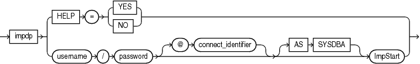

> ```
> impinit ::= 
>  
>  impdp [HELP = {YES | NO}] | username/password [@connect_identifier] [AS SYSDBA] ImpStart
> ```
>
> [Copyright © 1996, 2018, Oracle and/or its affiliates. All rights reserved.](https://docs.oracle.com/cd/E11882_01/dcommon/html/cpyr.htm)
  
  

ImpStart

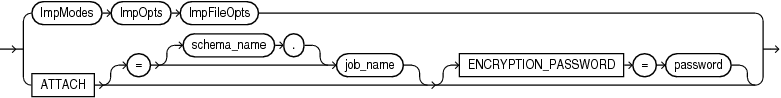

> ```
> impstart ::= 
>  
> ImpModes ImpOpts ImpFileOpts
> | ATTACH [= [schema_name.]job_name] [ENCRYPTION_PASSWORD=password]
> ```
>
> [Copyright © 1996, 2018, Oracle and/or its affiliates. All rights reserved.](https://docs.oracle.com/cd/E11882_01/dcommon/html/cpyr.htm)
  
  

ImpModes

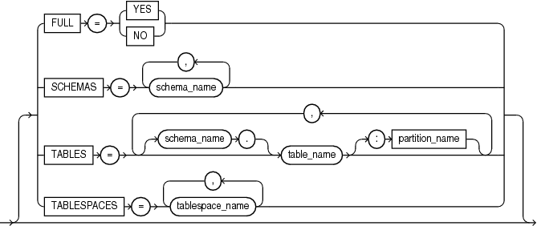

> ```
> impmodes ::= 
>  
> [ FULL = {YES | NO}
> | SCHEMAS = schema_name [,...]
> | TABLES = [schema_name.]table_name[:partition_name] [,...]
> | TABLESPACES = tablespace_name [, ...]
> ```
>
> [Copyright © 1996, 2018, Oracle and/or its affiliates. All rights reserved.](https://docs.oracle.com/cd/E11882_01/dcommon/html/cpyr.htm)
  
  

ImpOpts

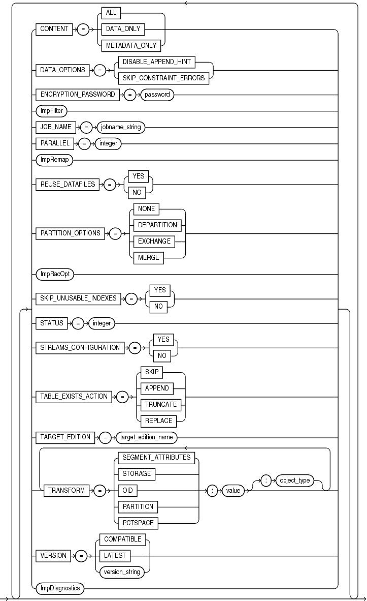

> ```
> impopts ::= 
>  
> [ 
> | CONTENT = {ALL | DATA_ONLY | METADATA_ONLY}
> | DATA_OPTIONS = {DISABLE_APPEND_HINT | SKIP_CONSTRAINT_ERRORS}
> | ENCRYPTION_PASSWORD = password
> | ImpFilter
> | JOB_NAME = jobname_string
> | PARALLEL = integer
> | ImpRacOpt
> | ImpRemap
> | REUSE_DATAFILES  = {YES | NO}
> | PARTITION_OPTIONS = {NONE | DEPARTITION | EXCHANGE | MERGE}
> | SKIP_UNUSABLE_INDEXES  = {YES | NO}
> | STATUS = [integer]
> | STREAMS_CONFIGURATION  = {YES | NO}
> | TABLE_EXISTS_ACTION = {SKIP | APPEND | TRUNCATE | REPLACE}
> | TARGET_EDITION = target_edition_name
> | TRANSFORM = {SEGMENT_ATTRIBUTES | STORAGE | OID | PARTITION | PCTSPACE}:value[:object_type]
> | VERSION = {COMPATIBLE | LATEST | version_string}
> | ImpDiagnostics
> ]
> ```
  
  

ImpFilter

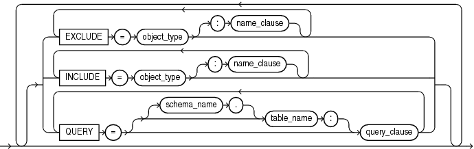

> ```
> impfilter ::= 
>  
> [ 
> | EXCLUDE = object_type[:name_clause] [,object_type[:name_clause]] [,...]
> | INCLUDE = object_type[:name_clause] [,object_type[:name_clause]] [,...]
> | QUERY = [[schema_name.]table_name:]query_clause
> ]
> ```
>
> [Copyright © 1996, 2018, Oracle and/or its affiliates. All rights reserved.](https://docs.oracle.com/cd/E11882_01/dcommon/html/cpyr.htm)
  
  

ImpRacOpt

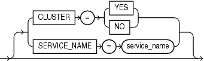

> ```
> impracopt ::=
>
> [
> |CLUSTER = {YES | NO}
> |SERVICE_NAME = service_name
> ]
> ```
>
> [Copyright © 1996, 2018, Oracle and/or its affiliates. All rights reserved.](https://docs.oracle.com/cd/E11882_01/dcommon/html/cpyr.htm)
  
  

ImpRemap

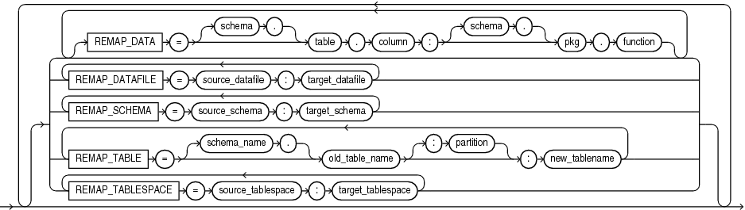

> ```
> impremap ::= 
>  
> [ 
> REMAP_DATA = [[schema.]table.column : [schema.]pkg.function] [,...]
> | REMAP_DATAFILE = source_datafile:target_datafile [,...]
> | REMAP_SCHEMA = source_schema:target_schema [,...]
> | REMAP_TABLE = [schema_name.]old_table_name[:partition]:new_table_name [,...]
> | REMAP_TABLESPACE = source_tablespace:target_tablespace [,...]
> ]
> ```
>
> [Copyright © 1996, 2018, Oracle and/or its affiliates. All rights reserved.](https://docs.oracle.com/cd/E11882_01/dcommon/html/cpyr.htm)
  
  

ImpFileOpts

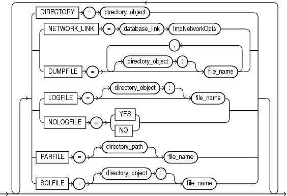

> ```
> impfileopts ::= 
>  
> [ DIRECTORY = directory_object
> | NETWORK_LINK = database_link ImpNetworkOpts
> | DUMPFILE   = [directory_object:]file_name [,[directory_object:]file_name] [,...]
> | LOGFILE = [directory_object:]file_name [,[directory_object:]file_name] [,...] 
> | NOLOGFILE= {YES | NO}
> | PARFILE = [directory_path]file_name
> | SQLFILE = [directory_object:]file_name
> ]
> ```
>
> [Copyright © 1996, 2018, Oracle and/or its affiliates. All rights reserved.](https://docs.oracle.com/cd/E11882_01/dcommon/html/cpyr.htm)
  
  

ImpNetworkOpts

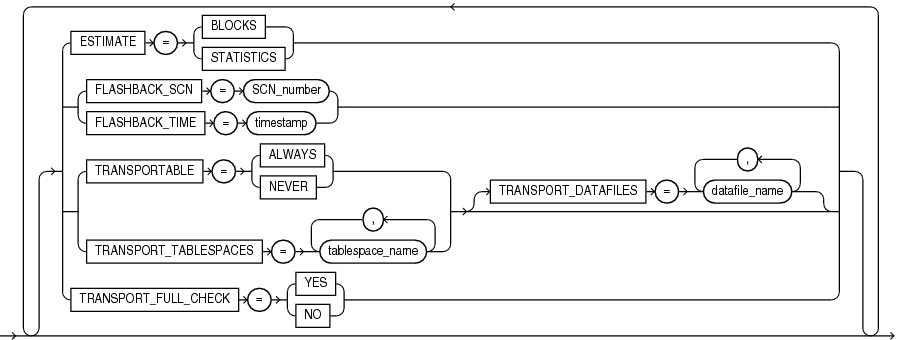

> ```
> impnetopts ::= 
>  
> [ ESTIMATE = {BLOCKS | STATISTICS}
> | { FLASHBACK_SCN = scn_number | FLASHBACK_TIME = timestamp }
> | { TRANSPORTABLE = {ALWAYS | NEVER} | TRANSPORT_TABLESPACES = tablespace_name [,...] }
>    TRANSPORT_DATAFILES=datafile_name
> | [TRANSPORT_FULL_CHECK = {YES | NO}]
> ]
> ```
>
> [Copyright © 1996, 2018, Oracle and/or its affiliates. All rights reserved.](https://docs.oracle.com/cd/E11882_01/dcommon/html/cpyr.htm)
  
  

ImpDynOpts

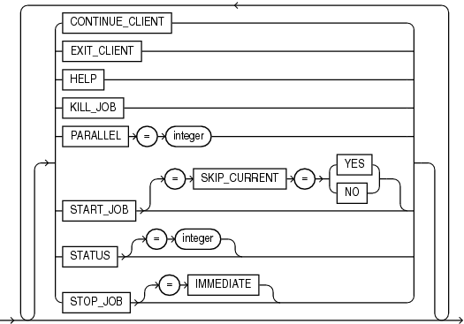

> ```
> impdynopts ::= 
>  
>   CONTINUE_CLIENT
> | EXIT_CLIENT
> | HELP
> | KILL_JOB
> | PARALLEL = integer
> | START_JOB [= SKIP_CURRENT = { YES | NO }]
> | STATUS [= integer]
> | STOP_JOB [= IMMEDIATE]
> ```
>
> [Copyright © 1996, 2018, Oracle and/or its affiliates. All rights reserved.](https://docs.oracle.com/cd/E11882_01/dcommon/html/cpyr.htm)
  
  

ImpDiagnostics

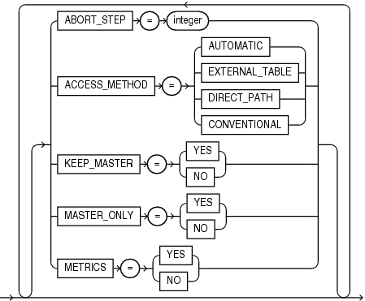

> ```
> impdiagnostics ::= 
>  
> [ 
>  ABORT_STEP = {YES | NO}
> | DATA_ACCESS_METHOD = {EXT_TAB | DIRECT_PATH | CONVENTIONAL}
> | KEEP_MASTER = {YES | NO}
> | MASTER_ONLY = {YES | NO}
> | METRICS = {YES | NO}
> ]
> ```
>
> [Copyright © 1996, 2018, Oracle and/or its affiliates. All rights reserved.](https://docs.oracle.com/cd/E11882_01/dcommon/html/cpyr.htm)
