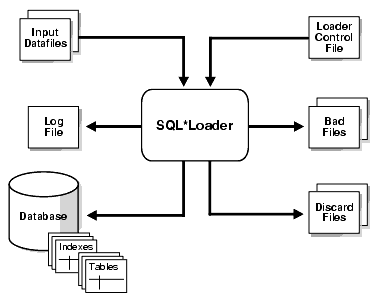

## 7 SQL\*Loader Concepts

This chapter explains the basic concepts of loading data into an Oracle database with SQL\*Loader. This chapter covers the following topics:

## SQL\*Loader Features

SQL\*Loader loads data from external files into tables of an Oracle database. It has a powerful data parsing engine that puts little limitation on the format of the data in the data file. You can use SQL\*Loader to do the following:

- Load data across a network if your data files are on a different system than the database. (See [Loading Data Across a Network](ldr_params.md))
- Load data from multiple data files during the same load session.
- Load data into multiple tables during the same load session.
- Specify the character set of the data.
- Selectively load data (you can load records based on the records' values).
- Manipulate the data before loading it, using SQL functions.
- Generate unique sequential key values in specified columns.
- Use the operating system's file system to access the data files.
- Load data from disk, tape, or named pipe.
- Generate sophisticated error reports, which greatly aid troubleshooting.
- Load arbitrarily complex object-relational data.
- Use secondary data files for loading LOBs and collections.
- Use either conventional or direct path loading. While conventional path loading is very flexible, direct path loading provides superior loading performance. See [Chapter 12](ldr_modes.md).

A typical SQL\*Loader session takes as input a control file, which controls the behavior of SQL\*Loader, and one or more data files. The output of SQL\*Loader is an Oracle database (where the data is loaded), a log file, a bad file, and potentially, a discard file. An example of the flow of a SQL\*Loader session is shown in Figure 7-1.

Figure 7-1 SQL\*Loader Overview



> The figure in sut81088.gif shows SQL\*Loader receiving input datafiles and a SQL\*Loader control file as input.
>
> SQL\*Loader then outputs a log file, bad files, and discard files. Also, the figure shows that the database into which SQL\*Loader loaded the input data now contains tables and indexes.
>
> [Copyright © 1996, 2018, Oracle and/or its affiliates. All rights reserved.](https://docs.oracle.com/cd/E11882_01/dcommon/html/cpyr.htm)
  

## SQL\*Loader Parameters

SQL\*Loader is invoked when you specify the `sqlldr` command and, optionally, parameters that establish session characteristics.

In situations where you always use the same parameters for which the values seldom change, it can be more efficient to specify parameters using the following methods, rather than on the command line:

- Parameters can be grouped together in a parameter file. You could then specify the name of the parameter file on the command line using the `PARFILE` parameter.
- Certain parameters can also be specified within the SQL\*Loader control file by using the `OPTIONS` clause.

Parameters specified on the command line override any parameter values specified in a parameter file or `OPTIONS` clause.

See Also:

- [Chapter 8](ldr_params.md) for descriptions of the SQL\*Loader parameters
- ["PARFILE (parameter file)"](ldr_params.md)
- ["OPTIONS Clause"](ldr_control_file.md)

## SQL\*Loader Control File

The control file is a text file written in a language that SQL\*Loader understands. The control file tells SQL\*Loader where to find the data, how to parse and interpret the data, where to insert the data, and more.

Although not precisely defined, a control file can be said to have three sections.

The first section contains session-wide information, for example:

- Global options such as bindsize, rows, records to skip, and so on
- `INFILE` clauses to specify where the input data is located
- Data to be loaded

The second section consists of one or more `INTO TABLE` blocks. Each of these blocks contains information about the table into which the data is to be loaded, such as the table name and the columns of the table.

The third section is optional and, if present, contains input data.

Some control file syntax considerations to keep in mind are:

- The syntax is free-format (statements can extend over multiple lines).
- It is case insensitive; however, strings enclosed in single or double quotation marks are taken literally, including case.
- In control file syntax, comments extend from the two hyphens (--) that mark the beginning of the comment to the end of the line. The optional third section of the control file is interpreted as data rather than as control file syntax; consequently, comments in this section are not supported.
- The keywords `CONSTANT` and `ZONE` have special meaning to SQL\*Loader and are therefore reserved. To avoid potential conflicts, Oracle recommends that you do not use either `CONSTANT` or `ZONE` as a name for any tables or columns.
	See Also:
	[Chapter 9](ldr_control_file.md) for details about control file syntax and semantics

## Input Data and Data Files

SQL\*Loader reads data from one or more files (or operating system equivalents of files) specified in the control file. From SQL\*Loader's perspective, the data in the data file is organized as records. A particular data file can be in fixed record format, variable record format, or stream record format. The record format can be specified in the control file with the `INFILE` parameter. If no record format is specified, then the default is stream record format.

Note:

If data is specified inside the control file (that is, `INFILE *` was specified in the control file), then the data is interpreted in the stream record format with the default record terminator.

### Fixed Record Format

A file is in fixed record format when all records in a data file are the same byte length. Although this format is the least flexible, it results in better performance than variable or stream format. Fixed format is also simple to specify. For example:

```
INFILE datafile_name "fix n
"
```

This example specifies that SQL\*Loader should interpret the particular data file as being in fixed record format where every record is `n` bytes long.

Example 7-1 shows a control file that specifies a data file (example.dat) to be interpreted in the fixed record format. The data file in the example contains five physical records; each record has fields that contain the number and name of an employee. Each of the five records is 11 bytes long, including spaces. For the purposes of explaining this example, periods are used to represent spaces in the records, but in the actual records there would be no periods. With that in mind, the first physical record is `396,...ty,.` which is exactly eleven bytes (assuming a single-byte character set). The second record is `4922,beth,` followed by the newline character (`\n`) which is the eleventh byte, and so on. (Newline characters are not required with the fixed record format; it is simply used here to illustrate that if used, it counts as a byte in the record length.)

Note that the length is always interpreted in bytes, even if character-length semantics are in effect for the file. This is necessary because the file could contain a mix of fields, some of which are processed with character-length semantics and others which are processed with byte-length semantics. See ["Character-Length Semantics"](ldr_control_file.md).

Example 7-1 Loading Data in Fixed Record Format

```
load data
infile 'example.dat'  "fix 11"
into table example
fields terminated by ',' optionally enclosed by '"'
(col1, col2)
```

example.dat:

```
396,...ty,.4922,beth,\n
68773,ben,.
1,.."dave",
5455,mike,.
```

### Variable Record Format

A file is in variable record format when the length of each record in a character field is included at the beginning of each record in the data file. This format provides some added flexibility over the fixed record format and a performance advantage over the stream record format. For example, you can specify a data file that is to be interpreted as being in variable record format as follows:

```
INFILE "datafile_name" "var n
"
```

In this example, `n` specifies the number of bytes in the record length field. If `n` is not specified, then SQL\*Loader assumes a length of 5 bytes. Specifying `n` larger than 40 will result in an error.

Example 7-2 shows a control file specification that tells SQL\*Loader to look for data in the data file `example`.`dat` and to expect variable record format where the record length fields are 3 bytes long. The `example.dat` data file consists of three physical records. The first is specified to be 009 (that is, 9) bytes long, the second is 010 bytes long (that is, 10, including a 1-byte newline), and the third is 012 bytes long (also including a 1-byte newline). Note that newline characters are not required with the variable record format. This example also assumes a single-byte character set for the data file.

The lengths are always interpreted in bytes, even if character-length semantics are in effect for the file. This is necessary because the file could contain a mix of fields, some processed with character-length semantics and others processed with byte-length semantics. See ["Character-Length Semantics"](ldr_control_file.md).

Example 7-2 Loading Data in Variable Record Format

```
load data
infile 'example.dat'  "var 3"
into table example
fields terminated by ',' optionally enclosed by '"'
(col1 char(5),
 col2 char(7))

example.dat:
009hello,cd,010world,im,
012my,name is,
```

### Stream Record Format

A file is in stream record format when the records are not specified by size; instead SQL\*Loader forms records by scanning for the record terminator. Stream record format is the most flexible format, but there can be a negative effect on performance. The specification of a data file to be interpreted as being in stream record format looks similar to the following:

```
INFILE datafile_name ["str 
terminator_string"
]
```

The `terminator_string` is specified as either `'` `char_string` `'` or `X'hex_string` `'` where:

- `'` `char_string` `'` is a string of characters enclosed in single or double quotation marks
- `X'hex_string` `'` is a byte string in hexadecimal format

When the `terminator_string` contains special (nonprintable) characters, it should be specified as an `X'hex_string` `'`. However, some nonprintable characters can be specified as (`'` `char_string` `'` ) by using a backslash. For example:

- `\n` indicates a line feed
- `\t` indicates a horizontal tab
- `\f` indicates a form feed
- `\v` indicates a vertical tab
- `\r` indicates a carriage return

If the character set specified with the `NLS_LANG` parameter for your session is different from the character set of the data file, then character strings are converted to the character set of the data file. This is done before SQL\*Loader checks for the default record terminator.

Hexadecimal strings are assumed to be in the character set of the data file, so no conversion is performed.

On UNIX-based platforms, if no `terminator_string` is specified, then SQL\*Loader defaults to the line feed character, `\n`.

On Windows NT, if no `terminator_string` is specified, then SQL\*Loader uses either `\n` or `\r\n` as the record terminator, depending on which one it finds first in the data file. This means that if you know that one or more records in your data file has `\n` embedded in a field, but you want `\r\n` to be used as the record terminator, then you must specify it.

Example 7-3 illustrates loading data in stream record format where the terminator string is specified using a character string, `'|\n'`. The use of the backslash character allows the character string to specify the nonprintable line feed character.

Example 7-3 Loading Data in Stream Record Format

```
load data
infile 'example.dat'  "str '|\n'"
into table example
fields terminated by ',' optionally enclosed by '"'
(col1 char(5),
 col2 char(7))

example.dat:
hello,world,|
james,bond,|
```

### Logical Records

SQL\*Loader organizes the input data into physical records, according to the specified record format. By default a physical record is a logical record, but for added flexibility, SQL\*Loader can be instructed to combine several physical records into a logical record.

SQL\*Loader can be instructed to follow one of the following logical record-forming strategies:

- Combine a fixed number of physical records to form each logical record.
- Combine physical records into logical records while a certain condition is true.
	See Also:
	- ["Assembling Logical Records from Physical Records"](ldr_control_file.md)
	- Case study 4, Loading Combined Physical Records (see "SQL\*Loader Case Studies" for information on how to access case studies)

### Data Fields

Once a logical record is formed, field setting on the logical record is done. Field setting is a process in which SQL\*Loader uses control-file field specifications to determine which parts of logical record data correspond to which control-file fields. It is possible for two or more field specifications to claim the same data. Also, it is possible for a logical record to contain data that is not claimed by any control-file field specification.

Most control-file field specifications claim a particular part of the logical record. This mapping takes the following forms:

- The byte position of the data field's beginning, end, or both, can be specified. This specification form is not the most flexible, but it provides high field-setting performance.
- The strings delimiting (enclosing and/or terminating) a particular data field can be specified. A delimited data field is assumed to start where the last data field ended, unless the byte position of the start of the data field is specified.
- The byte offset and/or the length of the data field can be specified. This way each field starts a specified number of bytes from where the last one ended and continues for a specified length.
- Length-value datatypes can be used. In this case, the first `n` number of bytes of the data field contain information about how long the rest of the data field is.
	See Also:
	- ["Specifying the Position of a Data Field"](ldr_field_list.md)
	- ["Specifying Delimiters"](ldr_field_list.md)

## LOBFILEs and Secondary Data Files (SDFs)

LOB data can be lengthy enough that it makes sense to load it from a LOBFILE. In LOBFILEs, LOB data instances are still considered to be in fields (predetermined size, delimited, length-value), but these fields are not organized into records (the concept of a record does not exist within LOBFILEs). Therefore, the processing overhead of dealing with records is avoided. This type of organization of data is ideal for LOB loading.

For example, you might use LOBFILEs to load employee names, employee IDs, and employee resumes. You could read the employee names and IDs from the main data files and you could read the resumes, which can be quite lengthy, from LOBFILEs.

You might also use LOBFILEs to facilitate the loading of XML data. You can use `XML` columns to hold data that models structured and semistructured data. Such data can be quite lengthy.

Secondary data files (SDFs) are similar in concept to primary data files. Like primary data files, SDFs are a collection of records, and each record is made up of fields. The SDFs are specified on a per control-file-field basis. Only a `collection_fld_spec` can name an SDF as its data source.

SDFs are specified using the `SDF` parameter. The `SDF` parameter can be followed by either the file specification string, or a `FILLER` field that is mapped to a data field containing one or more file specification strings.

See Also:

- ["Loading LOB Data from LOBFILEs"](ldr_loading.md)
- ["Secondary Data Files (SDFs)"](ldr_loading.md)

## Data Conversion and Datatype Specification

During a conventional path load, data fields in the data file are converted into columns in the database (direct path loads are conceptually similar, but the implementation is different). There are two conversion steps:

1. SQL\*Loader uses the field specifications in the control file to interpret the format of the data file, parse the input data, and populate the bind arrays that correspond to a SQL `INSERT` statement using that data.
2. The Oracle database accepts the data and executes the `INSERT` statement to store the data in the database.

The Oracle database uses the datatype of the column to convert the data into its final, stored form. Keep in mind the distinction between a field in a data file and a column in the database. Remember also that the field datatypes defined in a SQL\*Loader control file are not the same as the column datatypes.

## Discarded and Rejected Records

Records read from the input file might not be inserted into the database. Such records are placed in either a bad file or a discard file.

### The Bad File

The bad file contains records that were rejected, either by SQL\*Loader or by the Oracle database. If you do not specify a bad file and there are rejected records, then SQL\*Loader automatically creates one. It will have the same name as the data file, with a.bad extension. Some of the possible reasons for rejection are discussed in the next sections.

#### SQL\*Loader Rejects

Data file records are rejected by SQL\*Loader when the input format is invalid. For example, if the second enclosure delimiter is missing, or if a delimited field exceeds its maximum length, then SQL\*Loader rejects the record. Rejected records are placed in the bad file.

#### Oracle Database Rejects

After a data file record is accepted for processing by SQL\*Loader, it is sent to the Oracle database for insertion into a table as a row. If the Oracle database determines that the row is valid, then the row is inserted into the table. If the row is determined to be invalid, then the record is rejected and SQL\*Loader puts it in the bad file. The row may be invalid, for example, because a key is not unique, because a required field is null, or because the field contains invalid data for the Oracle datatype.

See Also:

- ["Specifying the Bad File"](ldr_control_file.md)
- Case study 4, Loading Combined Physical Records (see "SQL\*Loader Case Studies" for information on how to access case studies)

### The Discard File

As SQL\*Loader executes, it may create a file called the discard file. This file is created only when it is needed, and only if you have specified that a discard file should be enabled. The discard file contains records that were filtered out of the load because they did not match any record-selection criteria specified in the control file.

The discard file therefore contains records that were not inserted into any table in the database. You can specify the maximum number of such records that the discard file can accept. Data written to any database table is not written to the discard file.

See Also:

- Case study 4, Loading Combined Physical Records (see "SQL\*Loader Case Studies" for information on how to access case studies)
- ["Specifying the Discard File"](ldr_control_file.md)

## Log File and Logging Information

When SQL\*Loader begins execution, it creates a log file. If it cannot create a log file, then execution terminates. The log file contains a detailed summary of the load, including a description of any errors that occurred during the load.

## Conventional Path Loads, Direct Path Loads, and External Table Loads

SQL\*Loader provides the following methods to load data:

- Conventional Path Loads
- Direct Path Loads
- External Table Loads

### Conventional Path Loads

During conventional path loads, the input records are parsed according to the field specifications, and each data field is copied to its corresponding bind array. When the bind array is full (or no more data is left to read), an array insert is executed.

See Also:

- ["Data Loading Methods"](ldr_modes.md)
- ["Bind Arrays and Conventional Path Loads"](ldr_control_file.md)

SQL\*Loader stores LOB fields after a bind array insert is done. Thus, if there are any errors in processing the LOB field (for example, the LOBFILE could not be found), then the LOB field is left empty. Note also that because LOB data is loaded after the array insert has been performed, `BEFORE` and `AFTER` row triggers may not work as expected for LOB columns. This is because the triggers fire before SQL\*Loader has a chance to load the LOB contents into the column. For instance, suppose you are loading a LOB column, `C1`, with data and you want a `BEFORE` row trigger to examine the contents of this LOB column and derive a value to be loaded for some other column, `C2`, based on its examination. This is not possible because the LOB contents will not have been loaded at the time the trigger fires.

### Direct Path Loads

A direct path load parses the input records according to the field specifications, converts the input field data to the column datatype, and builds a column array. The column array is passed to a block formatter, which creates data blocks in Oracle database block format. The newly formatted database blocks are written directly to the database, bypassing much of the data processing that normally takes place. Direct path load is much faster than conventional path load, but entails several restrictions.

See Also:

["Direct Path Load"](ldr_modes.md)

#### Parallel Direct Path

A parallel direct path load allows multiple direct path load sessions to concurrently load the same data segments (allows intrasegment parallelism). Parallel direct path is more restrictive than direct path.

See Also:

["Parallel Data Loading Models"](ldr_modes.md)

### External Table Loads

External tables are defined as tables that do not reside in the database, and can be in any format for which an access driver is provided. Oracle Database provides two access drivers: `ORACLE_LOADER` and `ORACLE_DATAPUMP`. By providing the database with metadata describing an external table, the database is able to expose the data in the external table as if it were data residing in a regular database table.

An external table load creates an external table for data that is contained in a data file. The load executes `INSERT` statements to insert the data from the data file into the target table.

The advantages of using external table loads over conventional path and direct path loads are as follows:

- If a data file is big enough, then an external tables load attempts to load that file in parallel.
- An external table load allows modification of the data being loaded by using SQL functions and PL/SQL functions as part of the `INSERT` statement that is used to create the external table.

Note:

An external table load is not supported using a named pipe on Windows NT.

See Also:

- [Chapter 14, "The ORACLE\_LOADER Access Driver"](et_params.md)
- [Chapter 15, "The ORACLE\_DATAPUMP Access Driver"](et_dp_driver.md)
- [Oracle Database Administrator's Guide](https://docs.oracle.com/cd/E11882_01/server.112/e25494/tables.htm#ADMIN01507) for information about creating and managing external tables

### Choosing External Tables Versus SQL\*Loader

The record parsing of external tables and SQL\*Loader is very similar, so normally there is not a major performance difference for the same record format. However, due to the different architecture of external tables and SQL\*Loader, there are situations in which one method may be more appropriate than the other.

Use external tables for the best load performance in the following situations:

- You want to transform the data as it is being loaded into the database
- You want to use transparent parallel processing without having to split the external data first

Use SQL\*Loader for the best load performance in the following situations:

- You want to load data remotely
- Transformations are not required on the data, and the data does not need to be loaded in parallel
- You want to load data, and additional indexing of the staging table is required

### Behavior Differences Between SQL\*Loader and External Tables

This section describes important differences between loading data with external tables, using the `ORACLE_LOADER` access driver, as opposed to loading data with SQL\*Loader conventional and direct path loads. This information does not apply to the `ORACLE_DATAPUMP` access driver.

#### Multiple Primary Input Data Files

If there are multiple primary input data files with SQL\*Loader loads, then a bad file and a discard file are created for each input data file. With external table loads, there is only one bad file and one discard file for all input data files. If parallel access drivers are used for the external table load, then each access driver has its own bad file and discard file.

#### Syntax and Datatypes

The following are not supported with external table loads:

- Use of `CONTINUEIF` or `CONCATENATE` to combine multiple physical records into a single logical record.
- Loading of the following SQL\*Loader datatypes: `GRAPHIC`, `GRAPHIC EXTERNAL`, and `VARGRAPHIC`
- Use of the following database column types: `LONG` s, nested tables, `VARRAY` s, `REF` s, primary key `REF` s, and `SID` s

#### Byte-Order Marks

With SQL\*Loader, if a primary data file uses a Unicode character set (UTF8 or UTF16) and it also contains a byte-order mark (BOM), then the byte-order mark is written at the beginning of the corresponding bad and discard files. With external table loads, the byte-order mark is not written at the beginning of the bad and discard files.

#### Default Character Sets, Date Masks, and Decimal Separator

For fields in a data file, the settings of NLS environment variables on the client determine the default character set, date mask, and decimal separator. For fields in external tables, the database settings of the NLS parameters determine the default character set, date masks, and decimal separator.

#### Use of the Backslash Escape Character

In SQL\*Loader, you can use the backslash (\\) escape character to mark a single quotation mark as a single quotation mark, as follows:

```
FIELDS TERMINATED BY ',' OPTIONALLY ENCLOSED BY '\''
```

In external tables, the use of the backslash escape character within a string will raise an error. The workaround is to use double quotation marks to mark the separation string, as follows:

```
TERMINATED BY ',' ENCLOSED BY "'"
```

## Loading Objects, Collections, and LOBs

You can use SQL\*Loader to bulk load objects, collections, and LOBs. It is assumed that you are familiar with the concept of objects and with Oracle's implementation of object support as described in [Oracle Database Concepts](https://docs.oracle.com/cd/E11882_01/server.112/e40540/toc.htm) and in the [Oracle Database Administrator's Guide](https://docs.oracle.com/cd/E11882_01/server.112/e25494/toc.htm).

### Supported Object Types

SQL\*Loader supports loading of the following two object types:

#### column objects

When a column of a table is of some object type, the objects in that column are referred to as column objects. Conceptually such objects are stored in their entirety in a single column position in a row. These objects do not have object identifiers and cannot be referenced.

If the object type of the column object is declared to be nonfinal, then SQL\*Loader allows a derived type (or subtype) to be loaded into the column object.

#### row objects

These objects are stored in tables, known as object tables, that have columns corresponding to the attributes of the object. The object tables have an additional system-generated column, called `SYS_NC_OID$,` that stores system-generated unique identifiers (OIDs) for each of the objects in the table. Columns in other tables can refer to these objects by using the OIDs.

If the object type of the object table is declared to be nonfinal, then SQL\*Loader allows a derived type (or subtype) to be loaded into the row object.

See Also:

- ["Loading Column Objects"](ldr_loading.md)
- ["Loading Object Tables"](ldr_loading.md)

### Supported Collection Types

SQL\*Loader supports loading of the following two collection types:

#### Nested Tables

A nested table is a table that appears as a column in another table. All operations that can be performed on other tables can also be performed on nested tables.

#### VARRAYs

`VARRAY` s are variable sized arrays. An array is an ordered set of built-in types or objects, called elements. Each array element is of the same type and has an index, which is a number corresponding to the element's position in the `VARRAY.`

When creating a `VARRAY` type, you must specify the maximum size. Once you have declared a `VARRAY` type, it can be used as the datatype of a column of a relational table, as an object type attribute, or as a PL/SQL variable.

See Also:

["Loading Collections (Nested Tables and VARRAYs)"](ldr_loading.md) for details on using SQL\*Loader control file data definition language to load these collection types

### Supported LOB Types

A LOB is a large object type. This release of SQL\*Loader supports loading of four LOB types:

- `BLOB`: a LOB containing unstructured binary data
- `CLOB`: a LOB containing character data
- `NCLOB`: a LOB containing characters in a database national character set
- `BFILE`: a `BLOB` stored outside of the database tablespaces in a server-side operating system file

LOBs can be column datatypes, and except for `NCLOB`, they can be an object's attribute datatypes. LOBs can have an actual value, they can be `null`, or they can be "empty."

See Also:

["Loading LOBs"](ldr_loading.md) for details on using SQL\*Loader control file data definition language to load these LOB types

## Partitioned Object Support

SQL\*Loader supports loading partitioned objects in the database. A partitioned object in an Oracle database is a table or index consisting of partitions (pieces) that have been grouped, typically by common logical attributes. For example, sales data for the year 2000 might be partitioned by month. The data for each month is stored in a separate partition of the sales table. Each partition is stored in a separate segment of the database and can have different physical attributes.

SQL\*Loader partitioned object support enables SQL\*Loader to load the following:

- A single partition of a partitioned table
- All partitions of a partitioned table
- A nonpartitioned table

## Application Development: Direct Path Load API

Oracle provides a direct path load API for application developers. See the [Oracle Call Interface Programmer's Guide](https://docs.oracle.com/cd/E11882_01/appdev.112/e10646/toc.htm) for more information.

## SQL\*Loader Case Studies

SQL\*Loader features are illustrated in a variety of case studies. The case studies are based upon the Oracle demonstration database tables, `emp` and `dept`, owned by the user `scott`. (In some case studies, additional columns have been added.)The case studies are numbered 1 through 11, starting with the simplest scenario and progressing in complexity.

Note:

Files for use in the case studies are located in the `$ORACLE_HOME/rdbms/demo` directory. These files are installed when you install the Oracle Database 11g Examples (formerly Companion) media. See Table 7-1 for the names of the files.

The following is a summary of the case studies:

- Case Study 1: Loading Variable-Length Data - Loads stream format records in which the fields are terminated by commas and may be enclosed by quotation marks. The data is found at the end of the control file.
- Case Study 2: Loading Fixed-Format Fields - Loads data from a separate data file.
- Case Study 3: Loading a Delimited, Free-Format File - Loads data from stream format records with delimited fields and sequence numbers. The data is found at the end of the control file.
- Case Study 4: Loading Combined Physical Records - Combines multiple physical records into one logical record corresponding to one database row.
- Case Study 5: Loading Data into Multiple Tables - Loads data into multiple tables in one run.
- Case Study 6: Loading Data Using the Direct Path Load Method - Loads data using the direct path load method.
- Case Study 7: Extracting Data from a Formatted Report - Extracts data from a formatted report.
- Case Study 8: Loading Partitioned Tables - Loads partitioned tables.
- Case Study 9: Loading LOBFILEs (CLOBs) - Adds a `CLOB` column called `resume` to the table `emp`, uses a `FILLER` field (`res_file`), and loads multiple LOBFILEs into the `emp` table.
- Case Study 10: REF Fields and VARRAYs - Loads a customer table that has a primary key as its OID and stores order items in a `VARRAY`. Loads an order table that has a reference to the customer table and the order items in a `VARRAY`.
- Case Study 11: Loading Data in the Unicode Character Set - Loads data in the Unicode character set, UTF16, in little-endian byte order. This case study uses character-length semantics.

### Case Study Files

Generally, each case study is comprised of the following types of files:

- Control files (for example, `ulcase5.ctl`)
- Data files (for example, `ulcase5.dat`)
- Setup files (for example, `ulcase5.sql`)

These files are installed when you install the Oracle Database 11g Examples (formerly Companion) media. They are installed in the `$ORACLE_HOME/rdbms/demo` directory.

If the sample data for the case study is contained within the control file, then there will be no.`dat` file for that case.

Case study 2 does not require any special set up, so there is no.`sql` script for that case. Case study 7 requires that you run both a starting (setup) script and an ending (cleanup) script.

Table 7-1 lists the files associated with each case.

Table 7-1 Case Studies and Their Related Files

| Case | `.ctl` | `.dat` | `.sql` |
| --- | --- | --- | --- |
| 1 | ulcase1.ctl | N/A | ulcase1.sql |
| 2 | ulcase2.ctl | ulcase2.dat | N/A |
| 3 | ulcase3.ctl | N/A | ulcase3.sql |
| 4 | ulcase4.ctl | ulcase4.dat | ulcase4.sql |
| 5 | ulcase5.ctl | ulcase5.dat | ulcase5.sql |
| 6 | ulcase6.ctl | ulcase6.dat | ulcase6.sql |
| 7 | ulcase7.ctl | ulcase7.dat | ulcase7s.sql  ulcase7e.sql |
| 8 | ulcase8.ctl | ulcase8.dat | ulcase8.sql |
| 9 | ulcase9.ctl | ulcase9.dat | ulcase9.sql |
| 10 | ulcase10.ctl | N/A | ulcase10.sql |
| 11 | ulcase11.ctl | ulcase11.dat | ulcase11.sql |

### Running the Case Studies

In general, you use the following steps to run the case studies (be sure you are in the `$ORACLE_HOME/rdbms/demo` directory, which is where the case study files are located):

1. At the system prompt, type `sqlplus` and press Enter to start SQL\*Plus. At the user-name prompt, enter `scott`. At the password prompt, enter `tiger`.
	The SQL prompt is displayed.
2. At the SQL prompt, execute the SQL script for the case study. For example, to execute the SQL script for case study 1, enter the following:
	```
	SQL> @ulcase1
	```
	This prepares and populates tables for the case study and then returns you to the system prompt.
3. At the system prompt, invoke SQL\*Loader and run the case study, as follows:
	```
	sqlldr USERID=scott CONTROL=ulcase1.ctl
	 LOG=ulcase1.log
	```
	Substitute the appropriate control file name and log file name for the `CONTROL` and `LOG` parameters and press Enter. When you are prompted for a password, type `tiger` and then press Enter.

Be sure to read the control file for each case study before you run it. The beginning of the control file contains information about what is being demonstrated in the case study and any other special information you need to know. For example, case study 6 requires that you add `DIRECT=TRUE` to the SQL\*Loader command line.

### Case Study Log Files

Log files for the case studies are not provided in the `$ORACLE_HOME/rdbms/demo` directory. This is because the log file for each case study is produced when you execute the case study, provided that you use the `LOG` parameter. If you do not want to produce a log file, then omit the `LOG` parameter from the command line.

### Checking the Results of a Case Study

To check the results of running a case study, start SQL\*Plus and perform a select operation from the table that was loaded in the case study. This is done, as follows:

1. At the system prompt, type `sqlplus` and press Enter to start SQL\*Plus. At the user-name prompt, enter `scott`. At the password prompt, enter `tiger`.
	The SQL prompt is displayed.
2. At the SQL prompt, use the `SELECT` statement to select all rows from the table that the case study loaded. For example, if the table `emp` was loaded, then enter:
	```
	SQL> SELECT * FROM emp;
	```
	The contents of each row in the `emp` table will be displayed.