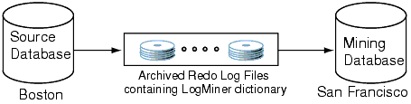
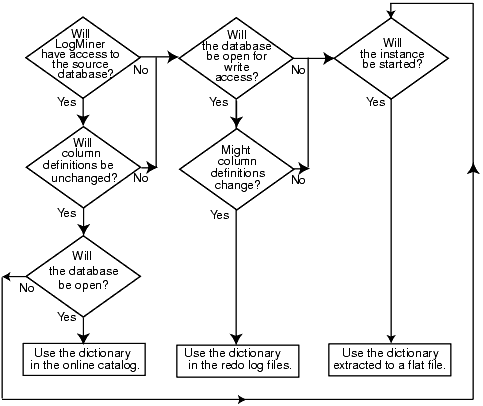

## 19 Using LogMiner to Analyze Redo Log Files

Oracle LogMiner, which is part of Oracle Database, enables you to query online and archived redo log files through a SQL interface. Redo log files contain information about the history of activity on a database.

This chapter contains the following sections:

This chapter describes LogMiner as it is used from the command line. You can also access LogMiner through the Oracle LogMiner Viewer graphical user interface. Oracle LogMiner Viewer is a part of Oracle Enterprise Manager. See the Oracle Enterprise Manager online Help for more information about Oracle LogMiner Viewer.

## LogMiner Benefits

All changes made to user data or to the database dictionary are recorded in the Oracle redo log files so that database recovery operations can be performed.

Because LogMiner provides a well-defined, easy-to-use, and comprehensive relational interface to redo log files, it can be used as a powerful data auditing tool, and also as a sophisticated data analysis tool. The following list describes some key capabilities of LogMiner:

- Pinpointing when a logical corruption to a database, such as errors made at the application level, may have begun. These might include errors such as those where the wrong rows were deleted because of incorrect values in a `WHERE` clause, rows were updated with incorrect values, the wrong index was dropped, and so forth. For example, a user application could mistakenly update a database to give all employees 100 percent salary increases rather than 10 percent increases, or a database administrator (DBA) could accidently delete a critical system table. It is important to know exactly when an error was made so that you know when to initiate time-based or change-based recovery. This enables you to restore the database to the state it was in just before corruption. See "Querying V$LOGMNR\_CONTENTS Based on Column Values" for details about how you can use LogMiner to accomplish this.
- Determining what actions you would have to take to perform fine-grained recovery at the transaction level. If you fully understand and take into account existing dependencies, then it may be possible to perform a table-specific undo operation to return the table to its original state. This is achieved by applying table-specific reconstructed SQL statements that LogMiner provides in the reverse order from which they were originally issued. See "Scenario 1: Using LogMiner to Track Changes Made by a Specific User" for an example.
	Normally you would have to restore the table to its previous state, and then apply an archived redo log file to roll it forward.
- Performance tuning and capacity planning through trend analysis. You can determine which tables get the most updates and inserts. That information provides a historical perspective on disk access statistics, which can be used for tuning purposes. See "Scenario 2: Using LogMiner to Calculate Table Access Statistics" for an example.
- Performing postauditing. LogMiner can be used to track any data manipulation language (DML) and data definition language (DDL) statements executed on the database, the order in which they were executed, and who executed them. (However, to use LogMiner for such a purpose, you need to have an idea when the event occurred so that you can specify the appropriate logs for analysis; otherwise you might have to mine a large number of redo log files, which can take a long time. Consider using LogMiner as a complementary activity to auditing database use. See the [Oracle Database Administrator's Guide](https://docs.oracle.com/cd/E11882_01/server.112/e25494/toc.htm) for information about database auditing.)

## Introduction to LogMiner

The following sections provide a brief introduction to LogMiner, including the following topics:

- LogMiner Configuration
- Directing LogMiner Operations and Retrieving Data of Interest

The remaining sections in this chapter describe these concepts and related topics in more detail.

### LogMiner Configuration

There are four basic objects in a LogMiner configuration that you should be familiar with: the source database, the mining database, the LogMiner dictionary, and the redo log files containing the data of interest:

- The source database is the database that produces all the redo log files that you want LogMiner to analyze.
- The mining database is the database that LogMiner uses when it performs the analysis.
- The LogMiner dictionary allows LogMiner to provide table and column names, instead of internal object IDs, when it presents the redo log data that you request.
	LogMiner uses the dictionary to translate internal object identifiers and datatypes to object names and external data formats. Without a dictionary, LogMiner returns internal object IDs and presents data as binary data.
	For example, consider the following SQL statement:
	```
	INSERT INTO HR.JOBS(JOB_ID, JOB_TITLE, MIN_SALARY, MAX_SALARY)  VALUES('IT_WT','Technical Writer', 4000, 11000);
	```
	Without the dictionary, LogMiner will display:
	```
	insert into "UNKNOWN"."OBJ# 45522"("COL 1","COL 2","COL 3","COL 4") values
	(HEXTORAW('45465f4748'),HEXTORAW('546563686e6963616c20577269746572'),
	HEXTORAW('c229'),HEXTORAW('c3020b'));
	```
- The redo log files contain the changes made to the database or database dictionary.

#### Sample Configuration

Figure 19-1 shows a sample LogMiner configuration. In this figure, the source database in Boston generates redo log files that are archived and shipped to a database in San Francisco. A LogMiner dictionary has been extracted to these redo log files. The mining database, where LogMiner will actually analyze the redo log files, is in San Francisco. The Boston database is running Oracle9i, and the San Francisco database is running Oracle Database 10g.

Figure 19-1 Sample LogMiner Database Configuration



> This is a text description of remote\_config.gif. This image is described in the text preceding the image.
>
> [Copyright © 1996, 2018, Oracle and/or its affiliates. All rights reserved.](https://docs.oracle.com/cd/E11882_01/dcommon/html/cpyr.htm)
  

Figure 19-1 shows just one valid LogMiner configuration. Other valid configurations are those that use the same database for both the source and mining database, or use another method for providing the data dictionary. These other data dictionary options are described in "LogMiner Dictionary Options".

#### Requirements

The following are requirements for the source and mining database, the data dictionary, and the redo log files that LogMiner will mine:

- Source and mining database
	- Both the source database and the mining database must be running on the same hardware platform.
		- The mining database can be the same as, or completely separate from, the source database.
		- The mining database must run the same release or a later release of the Oracle Database software as the source database.
		- The mining database must use the same character set (or a superset of the character set) used by the source database.
- LogMiner dictionary
	- The dictionary must be produced by the same source database that generates the redo log files that LogMiner will analyze.
- All redo log files:
	- Must be produced by the same source database.
		- Must be associated with the same database `RESETLOGS SCN`.
		- Must be from a release 8.0 or later Oracle Database. However, several of the LogMiner features introduced as of release 9.0.1 work only with redo log files produced on an Oracle9i or later database. See "Supported Databases and Redo Log File Versions".

LogMiner does not allow you to mix redo log files from different databases or to use a dictionary from a different database than the one that generated the redo log files to be analyzed.

Note:

You must enable supplemental logging before generating log files that will be analyzed by LogMiner.

When you enable supplemental logging, additional information is recorded in the redo stream that is needed to make the information in the redo log files useful to you. Therefore, at the very least, you must enable minimal supplemental logging, as the following SQL statement shows:

```
ALTER DATABASE ADD SUPPLEMENTAL LOG DATA;
```

To determine whether supplemental logging is enabled, query the `V$DATABASE` view, as the following SQL statement shows:

```
SELECT SUPPLEMENTAL_LOG_DATA_MIN FROM V$DATABASE;
```

If the query returns a value of `YES` or `IMPLICIT`, then minimal supplemental logging is enabled. See "Supplemental Logging" for complete information about supplemental logging.

### Directing LogMiner Operations and Retrieving Data of Interest

You direct LogMiner operations using the `DBMS_LOGMNR` and `DBMS_LOGMNR_D` PL/SQL packages, and retrieve data of interest using the `V$LOGMNR_CONTENTS` view, as follows:

1. Specify a LogMiner dictionary.
	Use the `DBMS_LOGMNR_D.BUILD` procedure or specify the dictionary when you start LogMiner (in Step 3), or both, depending on the type of dictionary you plan to use.
2. Specify a list of redo log files for analysis.
	Use the `DBMS_LOGMNR.ADD_LOGFILE` procedure, or direct LogMiner to create a list of log files for analysis automatically when you start LogMiner (in Step 3).
3. Start LogMiner.
	Use the `DBMS_LOGMNR.START_LOGMNR` procedure.
4. Request the redo data of interest.
	Query the `V$LOGMNR_CONTENTS` view. (You must have the `SELECT ANY TRANSACTION` privilege to query this view.)
5. End the LogMiner session.
	Use the `DBMS_LOGMNR.END_LOGMNR` procedure.

You must have been granted the `EXECUTE_CATALOG_ROLE` role to use the LogMiner PL/SQL packages and to query the `V$LOGMNR_CONTENTS` view.

Note:

When mining a specified time or SCN range of interest within archived logs generated by an Oracle RAC database, you must ensure that you have specified all archived logs from all redo threads that were active during that time or SCN range. If you fail to do this, then any queries of `V$LOGMNR_CONTENTS` return only partial results (based on the archived logs specified to LogMiner through the `DBMS_LOGMNR.ADD_LOGFILE` procedure). This restriction is also in effect when you are mining the archived logs at the source database using the `CONTINUOUS_MINE` option. You should only use `CONTINUOUS_MINE` on an Oracle RAC database if no thread is being enabled or disabled.

See Also:

"Steps in a Typical LogMiner Session" for an example of using LogMiner

## LogMiner Dictionary Files and Redo Log Files

Before you begin using LogMiner, it is important to understand how LogMiner works with the LogMiner dictionary file (or files) and redo log files. This will help you to get accurate results and to plan the use of your system resources.

The following concepts are discussed in this section:

- LogMiner Dictionary Options
- Redo Log File Options

### LogMiner Dictionary Options

LogMiner requires a dictionary to translate object IDs into object names when it returns redo data to you. LogMiner gives you three options for supplying the dictionary:

- Using the Online Catalog
	Oracle recommends that you use this option when you will have access to the source database from which the redo log files were created and when no changes to the column definitions in the tables of interest are anticipated. This is the most efficient and easy-to-use option.
- Extracting a LogMiner Dictionary to the Redo Log Files
	Oracle recommends that you use this option when you do not expect to have access to the source database from which the redo log files were created, or if you anticipate that changes will be made to the column definitions in the tables of interest.
- Extracting the LogMiner Dictionary to a Flat File
	This option is maintained for backward compatibility with previous releases. This option does not guarantee transactional consistency. Oracle recommends that you use either the online catalog or extract the dictionary from redo log files instead.

Figure 19-2 shows a decision tree to help you select a LogMiner dictionary, depending on your situation.

Figure 19-2 Decision Tree for Choosing a LogMiner Dictionary



> This is a text description of decision\_tree.gif, which shows a flow chart that is designed to help you decide on the type of LogMiner dictionary to use. The flow chart indicates that if your answer to each of the following questions is yes, then you should use the LogMiner dictionary in the online catalog:
>
> - Will LogMiner have access to the source database?
> - Will column definitions will be unchanged?
> - Will the database be open?
>
> If your answer to the first or second of the preceding questions is no, then the flow chart poses these questions:
>
> - Will the database be open for write access?
> - Might column definitions change?
>
> If your answer to both of these question is yes, then the flow chart indicates that you should use the dictionary in the redo log files. If the answer to either of these questions is no, or if the answer to the question "Will the database be open" is no, then the flow chart poses this question:
>
> Will the instance be started?
>
> If the answer to this question is yes, then you should use the dictionary extracted to a flat file.
>
> If the answer to this question is no, then you cannot use LogMiner.
  

The following sections provide instructions on how to specify each of the available dictionary options.

#### Using the Online Catalog

To direct LogMiner to use the dictionary currently in use for the database, specify the online catalog as your dictionary source when you start LogMiner, as follows:

```
EXECUTE DBMS_LOGMNR.START_LOGMNR(-
   OPTIONS => DBMS_LOGMNR.DICT_FROM_ONLINE_CATALOG);
```

In addition to using the online catalog to analyze online redo log files, you can use it to analyze archived redo log files, if you are on the same system that generated the archived redo log files.

The online catalog contains the latest information about the database and may be the fastest way to start your analysis. Because DDL operations that change important tables are somewhat rare, the online catalog generally contains the information you need for your analysis.

Remember, however, that the online catalog can only reconstruct SQL statements that are executed on the latest version of a table. As soon as a table is altered, the online catalog no longer reflects the previous version of the table. This means that LogMiner will not be able to reconstruct any SQL statements that were executed on the previous version of the table. Instead, LogMiner generates nonexecutable SQL (including hexadecimal-to-raw formatting of binary values) in the `SQL_REDO` column of the `V$LOGMNR_CONTENTS` view similar to the following example:

```
insert into HR.EMPLOYEES(col#1, col#2) values (hextoraw('4a6f686e20446f65'),
hextoraw('c306'));"
```

The online catalog option requires that the database be open.

The online catalog option is not valid with the `DDL_DICT_TRACKING` option of `DBMS_LOGMNR.START_LOGMNR`.

#### Extracting a LogMiner Dictionary to the Redo Log Files

To extract a LogMiner dictionary to the redo log files, the database must be open and in `ARCHIVELOG` mode and archiving must be enabled. While the dictionary is being extracted to the redo log stream, no DDL statements can be executed. Therefore, the dictionary extracted to the redo log files is guaranteed to be consistent (whereas the dictionary extracted to a flat file is not).

To extract dictionary information to the redo log files, execute the PL/SQL `DBMS_LOGMNR_D.BUILD` procedure with the `STORE_IN_REDO_LOGS` option. Do not specify a file name or location.

```
EXECUTE DBMS_LOGMNR_D.BUILD( -
   OPTIONS=> DBMS_LOGMNR_D.STORE_IN_REDO_LOGS);
```

See Also:

- [Oracle Database Backup and Recovery User's Guide](https://docs.oracle.com/cd/E11882_01/backup.112/e10642/toc.htm) for more information about `ARCHIVELOG` mode
- [Oracle Database PL/SQL Packages and Types Reference](https://docs.oracle.com/cd/E11882_01/appdev.112/e40758/toc.htm) for a complete description of `DBMS_LOGMNR_D.BUILD`

The process of extracting the dictionary to the redo log files does consume database resources, but if you limit the extraction to off-peak hours, then this should not be a problem, and it is faster than extracting to a flat file. Depending on the size of the dictionary, it may be contained in multiple redo log files. If the relevant redo log files have been archived, then you can find out which redo log files contain the start and end of an extracted dictionary. To do so, query the `V$ARCHIVED_LOG` view, as follows:

```
SELECT NAME FROM V$ARCHIVED_LOG WHERE DICTIONARY_BEGIN='YES';
SELECT NAME FROM V$ARCHIVED_LOG WHERE DICTIONARY_END='YES';
```

Specify the names of the start and end redo log files, and possibly other logs in between them, with the `ADD_LOGFILE` procedure when you are preparing to begin a LogMiner session.

Oracle recommends that you periodically back up the redo log files so that the information is saved and available at a later date. Ideally, this will not involve any extra steps because if your database is being properly managed, then there should already be a process in place for backing up and restoring archived redo log files. Again, because of the time required, it is good practice to do this during off-peak hours.

#### Extracting the LogMiner Dictionary to a Flat File

When the LogMiner dictionary is in a flat file, fewer system resources are used than when it is contained in the redo log files. Oracle recommends that you regularly back up the dictionary extract to ensure correct analysis of older redo log files.

To extract database dictionary information to a flat file, use the `DBMS_LOGMNR_D.BUILD` procedure with the `STORE_IN_FLAT_FILE` option.

Be sure that no DDL operations occur while the dictionary is being built.

The following steps describe how to extract a dictionary to a flat file. Steps 1 and 2 are preparation steps. You only need to do them once, and then you can extract a dictionary to a flat file as many times as you want to.

1. The `DBMS_LOGMNR_D.BUILD` procedure requires access to a directory where it can place the dictionary file. Because PL/SQL procedures do not normally access user directories, you must specify a directory for use by the `DBMS_LOGMNR_D.BUILD` procedure or the procedure will fail. To specify a directory, set the initialization parameter, `UTL_FILE_DIR`, in the initialization parameter file.
	For example, to set `UTL_FILE_DIR` to use `/oracle/database` as the directory where the dictionary file is placed, place the following in the initialization parameter file:
	```
	UTL_FILE_DIR = /oracle/database
	```
	Remember that for the changes to the initialization parameter file to take effect, you must stop and restart the database.
2. If the database is closed, then use SQL\*Plus to mount and open the database whose redo log files you want to analyze. For example, entering the SQL `STARTUP` command mounts and opens the database:
	```
	STARTUP
	```
3. Execute the PL/SQL procedure `DBMS_LOGMNR_D.BUILD`. Specify a file name for the dictionary and a directory path name for the file. This procedure creates the dictionary file. For example, enter the following to create the file `dictionary.ora` in `/oracle/database`:
	```
	EXECUTE DBMS_LOGMNR_D.BUILD('dictionary.ora', - 
	   '/oracle/database/', -
	    DBMS_LOGMNR_D.STORE_IN_FLAT_FILE);
	```
	You could also specify a file name and location without specifying the `STORE_IN_FLAT_FILE` option. The result would be the same.

### Redo Log File Options

To mine data in the redo log files, LogMiner needs information about which redo log files to mine. Changes made to the database that are found in these redo log files are delivered to you through the `V$LOGMNR_CONTENTS` view.

You can direct LogMiner to automatically and dynamically create a list of redo log files to analyze, or you can explicitly specify a list of redo log files for LogMiner to analyze, as follows:

- Automatically
	If LogMiner is being used on the source database, then you can direct LogMiner to find and create a list of redo log files for analysis automatically. Use the `CONTINUOUS_MINE` option when you start LogMiner with the `DBMS_LOGMNR.START_LOGMNR` procedure, and specify a time or SCN range. Although this example specifies the dictionary from the online catalog, any LogMiner dictionary can be used.
	Note:
	The `CONTINUOUS_MINE` option requires that the database be mounted and that archiving be enabled.
	LogMiner will use the database control file to find and add redo log files that satisfy your specified time or SCN range to the LogMiner redo log file list. For example:
	```
	ALTER SESSION SET NLS_DATE_FORMAT = 'DD-MON-YYYY HH24:MI:SS';
	EXECUTE DBMS_LOGMNR.START_LOGMNR( -
	   STARTTIME => '01-Jan-2003 08:30:00', -
	   ENDTIME => '01-Jan-2003 08:45:00', -
	   OPTIONS => DBMS_LOGMNR.DICT_FROM_ONLINE_CATALOG + -
	   DBMS_LOGMNR.CONTINUOUS_MINE);
	```
	(To avoid the need to specify the date format in the PL/SQL call to the `DBMS_LOGMNR.START_LOGMNR` procedure, this example uses the SQL `ALTER` `SESSION SET` `NLS_DATE_FORMAT` statement first.)
	You can also direct LogMiner to automatically build a list of redo log files to analyze by specifying just one redo log file using `DBMS_LOGMNR.ADD_LOGFILE`, and then specifying the `CONTINUOUS_MINE` option when you start LogMiner. The previously described method is more typical, however.
- Manually
	Use the `DBMS_LOGMNR.ADD_LOGFILE` procedure to manually create a list of redo log files before you start LogMiner. After the first redo log file has been added to the list, each subsequently added redo log file must be from the same database and associated with the same database RESETLOGS SCN. When using this method, LogMiner need not be connected to the source database.
	For example, to start a new list of redo log files, specify the `NEW` option of the `DBMS_LOGMNR.ADD_LOGFILE` PL/SQL procedure to signal that this is the beginning of a new list. For example, enter the following to specify `/oracle/logs/log1.f`:
	```
	EXECUTE DBMS_LOGMNR.ADD_LOGFILE( -
	   LOGFILENAME => '/oracle/logs/log1.f', -
	   OPTIONS => DBMS_LOGMNR.NEW);
	```
	If desired, add more redo log files by specifying the `ADDFILE` option of the `PL/SQL DBMS_LOGMNR.ADD_LOGFILE` procedure. For example, enter the following to add `/oracle/logs/log2.f`:
	```
	EXECUTE DBMS_LOGMNR.ADD_LOGFILE( -
	   LOGFILENAME => '/oracle/logs/log2.f', -
	   OPTIONS => DBMS_LOGMNR.ADDFILE);
	```
	To determine which redo log files are being analyzed in the current LogMiner session, you can query the `V$LOGMNR_LOGS` view, which contains one row for each redo log file.

## Starting LogMiner

You call the `DBMS_LOGMNR.START_LOGMNR` procedure to start LogMiner. Because the options available with the `DBMS_LOGMNR.START_LOGMNR` procedure allow you to control output to the `V$LOGMNR_CONTENTS` view, you must call `DBMS_LOGMNR.START_LOGMNR` before querying the `V$LOGMNR_CONTENTS` view.

When you start LogMiner, you can:

- Specify how LogMiner should filter data it returns (for example, by starting and ending time or SCN value)
- Specify options for formatting the data returned by LogMiner
- Specify the LogMiner dictionary to use

The following list is a summary of LogMiner settings that you can specify with the `OPTIONS` parameter to `DBMS_LOGMNR.START_LOGMNR` and where to find more information about them.

- `DICT_FROM_ONLINE_CATALOG` — See "Using the Online Catalog"
- `DICT_FROM_REDO_LOGS` — See "Start LogMiner"
- `CONTINUOUS_MINE` — See "Redo Log File Options"
- `COMMITTED_DATA_ONLY` — See "Showing Only Committed Transactions"
- `SKIP_CORRUPTION` — See "Skipping Redo Corruptions"
- `NO_SQL_DELIMITER` — See "Formatting Reconstructed SQL Statements for Re-execution"
- `PRINT_PRETTY_SQL` — See "Formatting the Appearance of Returned Data for Readability"
- `NO_ROWID_IN_STMT` — See "Formatting Reconstructed SQL Statements for Re-execution"
- `DDL_DICT_TRACKING` — See "Tracking DDL Statements in the LogMiner Dictionary"

When you execute the `DBMS_LOGMNR.START_LOGMNR` procedure, LogMiner checks to ensure that the combination of options and parameters that you have specified is valid and that the dictionary and redo log files that you have specified are available. However, the `V$LOGMNR_CONTENTS` view is not populated until you query the view, as described in "How the V$LOGMNR\_CONTENTS View Is Populated".

Note that parameters and options are not persistent across calls to `DBMS_LOGMNR.START_LOGMNR`. You must specify all desired parameters and options (including SCN and time ranges) each time you call `DBMS_LOGMNR.START_LOGMNR`.

## Querying V$LOGMNR\_CONTENTS for Redo Data of Interest

You access the redo data of interest by querying the `V$LOGMNR_CONTENTS` view. (Note that you must have the `SELECT ANY TRANSACTION` privilege to query `V$LOGMNR_CONTENTS`.) This view provides historical information about changes made to the database, including (but not limited to) the following:

- The type of change made to the database: `INSERT`, `UPDATE`, `DELETE`, or `DDL` (`OPERATION` column).
- The SCN at which a change was made (`SCN` column).
- The SCN at which a change was committed (`COMMIT_SCN` column).
- The transaction to which a change belongs (`XIDUSN`, `XIDSLT`, and `XIDSQN` columns).
- The table and schema name of the modified object (`SEG_NAME` and `SEG_OWNER` columns).
- The name of the user who issued the DDL or DML statement to make the change (`USERNAME` column).
- If the change was due to a SQL DML statement, the reconstructed SQL statements showing SQL DML that is equivalent (but not necessarily identical) to the SQL DML used to generate the redo records (`SQL_REDO` column).
- If a password is part of the statement in a `SQL_REDO` column, then the password is encrypted. `SQL_REDO` column values that correspond to DDL statements are always identical to the SQL DDL used to generate the redo records.
- If the change was due to a SQL DML change, the reconstructed SQL statements showing the SQL DML statements needed to undo the change (`SQL_UNDO` column).
	`SQL_UNDO` columns that correspond to DDL statements are always `NULL`. The `SQL_UNDO` column may be `NULL` also for some datatypes and for rolled back operations.

Note:

LogMiner supports Oracle Advanced Security transparent data encryption (TDE) in that `V$LOGMNR_CONTENTS` shows DML operations performed on tables with encrypted columns (including the encrypted columns being updated), provided the LogMiner data dictionary contains the metadata for the object in question and provided the appropriate master key is in the Oracle wallet. The wallet must be open or `V$LOGMNR_CONTENTS` cannot interpret the associated redo records. TDE support is not available if the database is not open (either read-only or read-write). See [Oracle Database Advanced Security Administrator's Guide](https://docs.oracle.com/cd/E11882_01/network.112/e40393/asotrans.htm#ASOAG600) for more information about transparent data encryption.

Example of Querying V$LOGMNR\_CONTENTS

Suppose you wanted to find out about any delete operations that a user named Ron had performed on the `oe.orders` table. You could issue a SQL query similar to the following:

```
SELECT OPERATION, SQL_REDO, SQL_UNDO
   FROM V$LOGMNR_CONTENTS
   WHERE SEG_OWNER = 'OE' AND SEG_NAME = 'ORDERS' AND
   OPERATION = 'DELETE' AND USERNAME = 'RON';
```

The following output would be produced. The formatting may be different on your display than that shown here.

```
OPERATION   SQL_REDO                        SQL_UNDO

DELETE      delete from "OE"."ORDERS"       insert into "OE"."ORDERS"        
            where "ORDER_ID" = '2413'       ("ORDER_ID","ORDER_MODE",
            and "ORDER_MODE" = 'direct'      "CUSTOMER_ID","ORDER_STATUS",
            and "CUSTOMER_ID" = '101'        "ORDER_TOTAL","SALES_REP_ID",
            and "ORDER_STATUS" = '5'         "PROMOTION_ID")
            and "ORDER_TOTAL" = '48552'      values ('2413','direct','101',
            and "SALES_REP_ID" = '161'       '5','48552','161',NULL);     
            and "PROMOTION_ID" IS NULL  
            and ROWID = 'AAAHTCAABAAAZAPAAN';

DELETE      delete from "OE"."ORDERS"        insert into "OE"."ORDERS"
            where "ORDER_ID" = '2430'        ("ORDER_ID","ORDER_MODE",
            and "ORDER_MODE" = 'direct'       "CUSTOMER_ID","ORDER_STATUS",
            and "CUSTOMER_ID" = '101'         "ORDER_TOTAL","SALES_REP_ID",
            and "ORDER_STATUS" = '8'          "PROMOTION_ID")
            and "ORDER_TOTAL" = '29669.9'     values('2430','direct','101',
            and "SALES_REP_ID" = '159'        '8','29669.9','159',NULL);
            and "PROMOTION_ID" IS NULL 
            and ROWID = 'AAAHTCAABAAAZAPAAe';
```

This output shows that user Ron deleted two rows from the `oe.orders` table. The reconstructed SQL statements are equivalent, but not necessarily identical, to the actual statement that Ron issued. The reason for this is that the original `WHERE` clause is not logged in the redo log files, so LogMiner can only show deleted (or updated or inserted) rows individually.

Therefore, even though a single `DELETE` statement may have been responsible for the deletion of both rows, the output in `V$LOGMNR_CONTENTS` does not reflect that. Thus, the actual `DELETE` statement may have been `DELETE FROM OE.ORDERS WHERE CUSTOMER_ID ='101` ' or it might have been `DELETE FROM OE.ORDERS WHERE PROMOTION_ID = NULL.`

### How the V$LOGMNR\_CONTENTS View Is Populated

The `V$LOGMNR_CONTENTS` fixed view is unlike other views in that it is not a selective presentation of data stored in a table. Instead, it is a relational presentation of the data that you request from the redo log files. LogMiner populates the view only in response to a query against it. You must successfully start LogMiner before you can query `V$LOGMNR_CONTENTS.`

When a SQL select operation is executed against the `V$LOGMNR_CONTENTS` view, the redo log files are read sequentially. Translated information from the redo log files is returned as rows in the `V$LOGMNR_CONTENTS` view. This continues until either the filter criteria specified at startup are met or the end of the redo log file is reached.

In some cases, certain columns in `V$LOGMNR_CONTENTS` may not be populated. For example:

- The `TABLE_SPACE` column is not populated for rows where the value of the `OPERATION` column is `DDL`. This is because a DDL may operate on more than one tablespace. For example, a table can be created with multiple partitions spanning multiple table spaces; hence it would not be accurate to populate the column.
- LogMiner does not generate SQL redo or SQL undo for temporary tables. The `SQL_REDO` column will contain the string `"/* No SQL_REDO for temporary tables */"` and the `SQL_UNDO` column will contain the string `"/* No SQL_UNDO for temporary tables */"`.

LogMiner returns all the rows in SCN order unless you have used the `COMMITTED_DATA_ONLY` option to specify that only committed transactions should be retrieved. SCN order is the order normally applied in media recovery.

See Also:

"Showing Only Committed Transactions" for more information about the `COMMITTED_DATA_ONLY` option to `DBMS_LOGMNR.START_LOGMNR`

Note:

Because LogMiner populates the `V$LOGMNR_CONTENTS` view only in response to a query and does not store the requested data in the database, the following is true:
- Every time you query `V$LOGMNR_CONTENTS`, LogMiner analyzes the redo log files for the data you request.
- The amount of memory consumed by the query is not dependent on the number of rows that must be returned to satisfy a query.
- The time it takes to return the requested data is dependent on the amount and type of redo log data that must be mined to find that data.

For the reasons stated in the previous note, Oracle recommends that you create a table to temporarily hold the results from a query of `V$LOGMNR_CONTENTS` if you need to maintain the data for further analysis, particularly if the amount of data returned by a query is small in comparison to the amount of redo data that LogMiner must analyze to provide that data.

### Querying V$LOGMNR\_CONTENTS Based on Column Values

LogMiner lets you make queries based on column values. For instance, you can perform a query to show all updates to the `hr.employees` table that increase `salary` more than a certain amount. Data such as this can be used to analyze system behavior and to perform auditing tasks.

LogMiner data extraction from redo log files is performed using two mine functions: `DBMS_LOGMNR.MINE_VALUE` and `DBMS_LOGMNR.COLUMN_PRESENT`. Support for these mine functions is provided by the `REDO_VALUE` and `UNDO_VALUE` columns in the `V$LOGMNR_CONTENTS` view.

The following is an example of how you could use the `MINE_VALUE` function to select all updates to `hr.employees` that increased the `salary` column to more than twice its original value:

```
SELECT SQL_REDO FROM V$LOGMNR_CONTENTS
   WHERE
   SEG_NAME = 'EMPLOYEES' AND
   SEG_OWNER = 'HR' AND
   OPERATION = 'UPDATE' AND
   DBMS_LOGMNR.MINE_VALUE(REDO_VALUE, 'HR.EMPLOYEES.SALARY') >
   2*DBMS_LOGMNR.MINE_VALUE(UNDO_VALUE, 'HR.EMPLOYEES.SALARY');
```

As shown in this example, the `MINE_VALUE` function takes two arguments:

- The first one specifies whether to mine the redo (`REDO_VALUE`) or undo (`UNDO_VALUE`) portion of the data. The redo portion of the data is the data that is in the column after an insert, update, or delete operation; the undo portion of the data is the data that was in the column before an insert, update, or delete operation. It may help to think of the `REDO_VALUE` as the new value and the `UNDO_VALUE` as the old value.
- The second argument is a string that specifies the fully qualified name of the column to be mined (in this case, `hr.employees.salary`). The `MINE_VALUE` function always returns a string that can be converted back to the original datatype.

#### The Meaning of NULL Values Returned by the MINE\_VALUE Function

If the `MINE_VALUE` function returns a `NULL` value, then it can mean either:

- The specified column is not present in the redo or undo portion of the data.
- The specified column is present and has a null value.

To distinguish between these two cases, use the `DBMS_LOGMNR`.`COLUMN_PRESENT` function which returns a `1` if the column is present in the redo or undo portion of the data. Otherwise, it returns a `0`. For example, suppose you wanted to find out the increment by which the values in the `salary` column were modified and the corresponding transaction identifier. You could issue the following SQL query:

```
SELECT 
  (XIDUSN || '.' || XIDSLT || '.' || XIDSQN) AS XID,
  (DBMS_LOGMNR.MINE_VALUE(REDO_VALUE, 'HR.EMPLOYEES.SALARY') -
   DBMS_LOGMNR.MINE_VALUE(UNDO_VALUE, 'HR.EMPLOYEES.SALARY')) AS INCR_SAL
   FROM V$LOGMNR_CONTENTS
   WHERE
   OPERATION = 'UPDATE' AND
   DBMS_LOGMNR.COLUMN_PRESENT(REDO_VALUE, 'HR.EMPLOYEES.SALARY') = 1 AND
   DBMS_LOGMNR.COLUMN_PRESENT(UNDO_VALUE, 'HR.EMPLOYEES.SALARY') = 1;
```

#### Usage Rules for the MINE\_VALUE and COLUMN\_PRESENT Functions

The following usage rules apply to the `MINE_VALUE` and `COLUMN_PRESENT` functions:

- They can only be used within a LogMiner session.
- They must be invoked in the context of a select operation from the `V$LOGMNR_CONTENTS` view.
- They do not support `LONG`, `LONG RAW,` `CLOB,` `BLOB,` `NCLOB`, `ADT`, or `COLLECTION` datatypes.

### Querying V$LOGMNR\_CONTENTS Based on XMLType Columns and Tables

LogMiner supports redo generated for `XMLType` columns. `XMLType` data stored as `CLOB` is supported when redo is generated at a compatibility setting of 11.0.0.0 or higher. `XMLType` data stored as object-relational and binary XML is supported for redo generated at a compatibility setting of 11.2.0.3 and higher.

LogMiner presents the `SQL_REDO` in `V$LOGMNR_CONTENTS` in different ways depending on the `XMLType` storage. In all cases, the contents of the `SQL_REDO` column, in combination with the `STATUS` column, require careful scrutiny, and usually require reassembly before a SQL or PL/SQL statement can be generated to redo the change. There may be cases when it is not possible to use the `SQL_REDO` data to construct such a change. The examples in the following subsections are based on `XMLType` stored as `CLOB` which is generally the simplest to use for reconstruction of the complete row change.

Querying V$LOGMNR\_CONTENTS For Changes to Tables With XMLType Columns

The example in this section is for a table named `XML_CLOB_COL_TAB` that has the following columns:

- f1 `NUMBER`
- f2 `VARCHAR2(100)`
- f3 `XMLTYPE`
- f4 `XMLTYPE`
- f5 `VARCHAR2(10)`

Assume that a LogMiner session has been started with the logs and with the `COMMITED_DATA_ONLY` option. The following query is executed against `V$LOGMNR_CONTENTS` for changes to the `XML_CLOB_COL_TAB` table.

```
SELECT OPERATION, STATUS, SQL_REDO FROM V$LOGMNR_CONTENTS 
  WHERE SEG_OWNER = 'SCOTT' AND TABLE_NAME = 'XML_CLOB_COL_TAB';
```

The query output looks similar to the following:

```
OPERATION         STATUS  SQL_REDO

INSERT            0       insert into "SCOTT"."XML_CLOB_COL_TAB"("F1","F2","F5") values
                             ('5010','Aho40431','PETER')
         
XML DOC BEGIN     5       update "SCOTT"."XML_CLOB_COL_TAB" a set a."F3" = XMLType(:1)
                             where a."F1" = '5010' and a."F2" = 'Aho40431' and a."F5" = 'PETER'

XML DOC WRITE     5       XML Data

XML DOC WRITE     5       XML Data

XML DOC WRITE     5       XML Data

XML DOC END       5
```

In the `SQL_REDO` columns for the `XML DOC WRITE` operations there will be actual data for the XML document. It will not be the string 'XML Data'.

This output shows that the general model for an insert into a table with an `XMLType` column is the following:

1. An initial insert with all of the scalar columns.
2. An `XML DOC BEGIN` operation with an update statement that sets the value for one `XMLType` column using a bind variable.
3. One or more `XML DOC WRITE` operations with the data for the XML document.
4. An `XML DOC END` operation to indicate that all of the data for that XML document has been seen.
5. If there is more than one `XMLType` column in the table, then steps 2 through 4 will be repeated for each `XMLType` column that is modified by the original DML.

If the XML document is not stored as an out-of-line column, then there will be no `XML DOC BEGIN`, `XML DOC WRITE`, or `XML DOC END` operations for that column. The document will be included in an update statement similar to the following:

```
OPERATION   STATUS         SQL_REDO

UPDATE      0              update "SCOTT"."XML_CLOB_COL_TAB" a
                           set a."F3" = XMLType('<?xml version="1.0"?>
                           <PO pono="1">
                           <PNAME>Po_99</PNAME> 
                           <CUSTNAME>Dave Davids</CUSTNAME> 
                           </PO>') 
                           where a."F1" = '5006' and a."F2" = 'Janosik' and a."F5" = 'MMM'
```

Queries V$LOGMNR\_CONTENTS For Changes to XMLType Tables

DMLs to `XMLType` tables are slightly different from DMLs to `XMLType` columns. The XML document represents the value for the row in the `XMLType` table. Unlike the `XMLType` column case, an initial insert cannot be done which is then followed by an update containing the XML document. Rather, the whole document must be assembled before anything can be inserted into the table.

Another difference for `XMLType` tables is the presence of the `OBJECT_ID` column. An object identifier is used to uniquely identify every object in an object table. For `XMLType` tables stored as CLOBs, this value is generated by Oracle Database when the row is inserted into the table. The `OBJECT_ID` value cannot be directly inserted into the table using SQL. Therefore, LogMiner cannot generate `SQL_REDO` which is executable that includes this value.

The `V$LOGMNR_CONTENTS` view has a new `OBJECT_ID` column which is populated for changes to `XMLType` tables. This value is the object identifier from the original table. However, even if this same XML document is inserted into the same `XMLType` table, a new object identifier will be generated. The `SQL_REDO` for subsequent DMLs, such as updates and deletes, on the `XMLType` table will include the object identifier in the `WHERE` clause to uniquely identify the row from the original table.

The following shows an example of mining changes to an `XMLType` table stored as CLOB:

```
select operation, status, object_id, sql_redo from v$logmnr_contents 
where  seg_owner = 'SCOTT' and table_name = 'XML_TYPE_CLOB_TAB';
```
```
OPERATION     STATUS   OBJECT_ID                         SQL_REDO

INSERT          2      300A9394B0F7B2D0E040578CF5025CC3  insert into "SCOTT"."XML_TYPE_CLOB_TAB"
                                                           values(EMPTY_CLOB()) 

XML DOC BEGIN   5      300A9394B0F7B2D0E040578CF5025CC3  insert into "SCOTT"."XML_TYPE_CLOB_TAB"
                                                           values (XMLType(:1)

XML DOC WRITE   5      300A9394B0F7B2D0E040578CF5025CC3  XML Data

XML DOC WRITE   5      300A9394B0F7B2D0E040578CF5025CC3  XML Data

XML DOC WRITE   5      300A9394B0F7B2D0E040578CF5025CC3  XML Data

XML DOC END     5
```

The general pattern is very similar to `XMLType` columns. However, there are a few key differences. The first is that now the `OBJECT_ID` column is populated. The second difference is that there is an initial insert, but its status is 2 for `INVALID_SQL`. This indicates that this record occurs in the redo as a placeholder for the change to come, but that the SQL generated for this change should not be applied. The `SQL_REDO` from the `XML DOC BEGIN` operation reflects the changes that were made to the row when used with the assembled XML document.

If the XML document is not stored as an out-of-line column, then there will be no `XML DOC BEGIN`, `XML DOC WRITE`, or `XML DOC END` operations for that document. The document will be included in an `INSERT` statement similar to the following:

```
OPERATION   STATUS  OBJECT_ID                           SQL_REDO

INSERT      2       300AD8CECBA75ACAE040578CF502640C    insert into "SCOTT"."XML_TYPE_CLOB_TAB"
                                                           values (EMPTY_CLOB())

INSERT      0       300AD8CECBA75ACAE040578CF502640C    insert into "SCOTT"."XML_TYPE_CLOB_TAB"
                                                           values (XMLType(
                                                           '<?xml version="1.0"?>
                                                           <PO pono="1">
                                                           <PNAME>Po_99</PNAME>
                                                           <CUSTNAME>
                                                           Dave Davids
                                                           </CUSTNAME>
                                                           </PO>'))
```

#### Restrictions When Using LogMiner With XMLType Data

Mining `XMLType` data should only be done when using the `DBMS_LOGMNR.COMMITTED_DATA_ONLY` option. Otherwise, incomplete changes could be displayed or changes which should be displayed as XML might be displayed as CLOB changes due to missing parts of the row change. This can lead to incomplete and invalid `SQL_REDO` for these SQL DML statements.

The `SQL_UNDO` column is not populated for changes to `XMLType` data.

#### Example of a PL/SQL Procedure for Assembling XMLType Data

The example presented in this section shows a procedure that can be used to mine and assemble XML redo for tables that contain out of line XML data. This shows how to assemble the XML data using a temporary LOB. Once the XML document is assembled, it can be used in a meaningful way. This example queries the assembled document for the `EmployeeName` element and then stores the returned name, the XML document and the `SQL_REDO` for the original DML in the `EMPLOYEE_XML_DOCS` table.

Note:

This procedure is an example only and is simplified. It is only intended to illustrate that DMLs to tables with XMLType data can be mined and assembled using LogMiner.

Before calling this procedure, all of the relevant logs must be added to a LogMiner session and `DBMS_LOGMNR.START_LOGMNR()` must be called with the `COMMITTED_DATA_ONLY` option. The `MINE_AND_ASSEMBLE()` procedure can then be called with the schema and table name of the table that has XML data to be mined.

```
-- table to store assembled XML documents
create table employee_xml_docs  (
  employee_name         varchar2(100),
  sql_stmt                     varchar2(4000),
  xml_doc                     SYS.XMLType);
        
-- procedure to assemble the XML documents
create or replace procedure mine_and_assemble(
  schemaname        in varchar2,
  tablename         in varchar2)
AS
  loc_c      CLOB; 
  row_op     VARCHAR2(100); 
  row_status NUMBER; 
  stmt       VARCHAR2(4000);
  row_redo   VARCHAR2(4000);
  xml_data   VARCHAR2(32767 CHAR); 
  data_len   NUMBER; 
  xml_lob    clob;
  xml_doc    XMLType;
BEGIN 
 
-- Look for the rows in V$LOGMNR_CONTENTS that are for the appropriate schema 
-- and table name but limit it to those that are valid sql or that need assembly
-- because they are XML documents.
 
 For item in ( SELECT operation, status, sql_redo  FROM v$logmnr_contents
 where seg_owner = schemaname and table_name = tablename
 and status IN (DBMS_LOGMNR.VALID_SQL, DBMS_LOGMNR.ASSEMBLY_REQUIRED_SQL))
 LOOP
    row_op := item.operation;
    row_status := item.status;
    row_redo := item.sql_redo;
 
     CASE row_op 
 
          WHEN 'XML DOC BEGIN' THEN 
             BEGIN 
               -- save statement and begin assembling XML data 
               stmt := row_redo; 
               xml_data := ''; 
               data_len := 0; 
               DBMS_LOB.CreateTemporary(xml_lob, TRUE);
             END; 
 
          WHEN 'XML DOC WRITE' THEN 
             BEGIN 
               -- Continue to assemble XML data
               xml_data := xml_data || row_redo; 
               data_len := data_len + length(row_redo); 
               DBMS_LOB.WriteAppend(xml_lob, length(row_redo), row_redo);
             END; 
 
          WHEN 'XML DOC END' THEN 
             BEGIN 
               -- Now that assembly is complete, we can use the XML document 
              xml_doc := XMLType.createXML(xml_lob);
              insert into employee_xml_docs values
                        (extractvalue(xml_doc, '/EMPLOYEE/NAME'), stmt, xml_doc);
              commit;
 
              -- reset
              xml_data := ''; 
              data_len := 0; 
              xml_lob := NULL;
             END; 
 
          WHEN 'INSERT' THEN 
             BEGIN 
                stmt := row_redo;
             END; 
 
          WHEN 'UPDATE' THEN 
             BEGIN 
                stmt := row_redo;
             END; 
 
          WHEN 'INTERNAL' THEN 
             DBMS_OUTPUT.PUT_LINE('Skip rows marked INTERNAL'); 
 
          ELSE 
             BEGIN 
                stmt := row_redo;
                DBMS_OUTPUT.PUT_LINE('Other - ' || stmt); 
                IF row_status != DBMS_LOGMNR.VALID_SQL then 
                   DBMS_OUTPUT.PUT_LINE('Skip rows marked non-executable'); 
                ELSE 
                   dbms_output.put_line('Status : ' || row_status);
                END IF; 
             END; 
 
     END CASE;
 
 End LOOP; 
 
End;
/
 
show errors;
```

This procedure can then be called to mine the changes to the `SCOTT.XML_DATA_TAB` and apply the DMLs.

```
EXECUTE MINE_AND_ASSEMBLE ('SCOTT', 'XML_DATA_TAB');
```

As a result of this procedure, the `EMPLOYEE_XML_DOCS` table will have a row for each out-of-line XML column that was changed. The `EMPLOYEE_NAME` column will have the value extracted from the XML document and the `SQL_STMT` column and the `XML_DOC` column reflect the original row change.

The following is an example query to the resulting table that displays only the employee name and SQL statement:

```
SELECT EMPLOYEE_NAME, SQL_STMT FROM EMPLOYEE_XML_DOCS;
                
EMPLOYEE_NAME          SQL_STMT                                                                                           
 
Scott Davis          update "SCOTT"."XML_DATA_TAB" a set a."F3" = XMLType(:1) 
                         where a."F1" = '5000' and a."F2" = 'Chen' and a."F5" = 'JJJ'
        
Richard Harry        update "SCOTT"."XML_DATA_TAB" a set a."F4" = XMLType(:1)  
                         where a."F1" = '5000' and a."F2" = 'Chen' and a."F5" = 'JJJ'
        
Margaret Sally       update "SCOTT"."XML_DATA_TAB" a set a."F4" = XMLType(:1)  
                         where a."F1" = '5006' and a."F2" = 'Janosik' and a."F5" = 'MMM'
```

## Filtering and Formatting Data Returned to V$LOGMNR\_CONTENTS

LogMiner can potentially deal with large amounts of information. You can limit the information that is returned to the `V$LOGMNR_CONTENTS` view, and the speed at which it is returned. The following sections demonstrate how to specify these limits and their impact on the data returned when you query `V$LOGMNR_CONTENTS`.

- Showing Only Committed Transactions
- Skipping Redo Corruptions
- Filtering Data by Time
- Filtering Data by SCN

In addition, LogMiner offers features for formatting the data that is returned to `V$LOGMNR_CONTENTS`, as described in the following sections:

- Formatting Reconstructed SQL Statements for Re-execution
- Formatting the Appearance of Returned Data for Readability

You request each of these filtering and formatting features using parameters or options to the `DBMS_LOGMNR.START_LOGMNR` procedure.

### Showing Only Committed Transactions

When you use the `COMMITTED_DATA_ONLY` option to `DBMS_LOGMNR.START_LOGMNR`, only rows belonging to committed transactions are shown in the `V$LOGMNR_CONTENTS` view. This enables you to filter out rolled back transactions, transactions that are in progress, and internal operations.

To enable this option, specify it when you start LogMiner, as follows:

```
EXECUTE DBMS_LOGMNR.START_LOGMNR(OPTIONS => -
  DBMS_LOGMNR.COMMITTED_DATA_ONLY);
```

When you specify the `COMMITTED_DATA_ONLY` option, LogMiner groups together all DML operations that belong to the same transaction. Transactions are returned in the order in which they were committed.

Note:

If the `COMMITTED_DATA_ONLY` option is specified and you issue a query, then LogMiner stages all redo records within a single transaction in memory until LogMiner finds the commit record for that transaction. Therefore, it is possible to exhaust memory, in which case an "Out of Memory" error will be returned. If this occurs, then you must restart LogMiner without the `COMMITTED_DATA_ONLY` option specified and reissue the query.

The default is for LogMiner to show rows corresponding to all transactions and to return them in the order in which they are encountered in the redo log files.

For example, suppose you start LogMiner without specifying the `COMMITTED_DATA_ONLY` option and you execute the following query:

```
SELECT (XIDUSN || '.' || XIDSLT || '.' || XIDSQN) AS XID, 
   USERNAME, SQL_REDO FROM V$LOGMNR_CONTENTS WHERE USERNAME != 'SYS' 
   AND SEG_OWNER IS NULL OR SEG_OWNER NOT IN ('SYS', 'SYSTEM');
```

The output is as follows. Both committed and uncommitted transactions are returned and rows from different transactions are interwoven.

```
XID         USERNAME  SQL_REDO

1.15.3045   RON       set transaction read write;
1.15.3045   RON       insert into "HR"."JOBS"("JOB_ID","JOB_TITLE",
                      "MIN_SALARY","MAX_SALARY") values ('9782',
                      'HR_ENTRY',NULL,NULL);
1.18.3046   JANE      set transaction read write;
1.18.3046   JANE      insert into "OE"."CUSTOMERS"("CUSTOMER_ID",
                      "CUST_FIRST_NAME","CUST_LAST_NAME",
                      "CUST_ADDRESS","PHONE_NUMBERS","NLS_LANGUAGE",
                      "NLS_TERRITORY","CREDIT_LIMIT","CUST_EMAIL",
                      "ACCOUNT_MGR_ID") values ('9839','Edgar',
                      'Cummings',NULL,NULL,NULL,NULL,
                       NULL,NULL,NULL);
1.9.3041    RAJIV      set transaction read write;
1.9.3041    RAJIV      insert into "OE"."CUSTOMERS"("CUSTOMER_ID",
                       "CUST_FIRST_NAME","CUST_LAST_NAME","CUST_ADDRESS",
                       "PHONE_NUMBERS","NLS_LANGUAGE","NLS_TERRITORY",
                       "CREDIT_LIMIT","CUST_EMAIL","ACCOUNT_MGR_ID") 
                       values ('9499','Rodney','Emerson',NULL,NULL,NULL,NULL,
                       NULL,NULL,NULL);
1.15.3045    RON       commit;
1.8.3054     RON       set transaction read write;
1.8.3054     RON       insert into "HR"."JOBS"("JOB_ID","JOB_TITLE",
                       "MIN_SALARY","MAX_SALARY") values ('9566',
                       'FI_ENTRY',NULL,NULL);
1.18.3046    JANE      commit;
1.11.3047    JANE      set transaction read write;
1.11.3047    JANE      insert into "OE"."CUSTOMERS"("CUSTOMER_ID",
                       "CUST_FIRST_NAME","CUST_LAST_NAME",
                       "CUST_ADDRESS","PHONE_NUMBERS","NLS_LANGUAGE",
                       "NLS_TERRITORY","CREDIT_LIMIT","CUST_EMAIL",
                       "ACCOUNT_MGR_ID") values ('8933','Ronald',
                       'Frost',NULL,NULL,NULL,NULL,NULL,NULL,NULL);
1.11.3047    JANE      commit;
1.8.3054     RON       commit;
```

Now suppose you start LogMiner, but this time you specify the `COMMITTED_DATA_ONLY` option. If you execute the previous query again, then the output is as follows:

```
1.15.3045   RON       set transaction read write;
1.15.3045   RON       insert into "HR"."JOBS"("JOB_ID","JOB_TITLE",
                      "MIN_SALARY","MAX_SALARY") values ('9782',
                      'HR_ENTRY',NULL,NULL);
1.15.3045    RON       commit;
1.18.3046   JANE      set transaction read write;
1.18.3046   JANE      insert into "OE"."CUSTOMERS"("CUSTOMER_ID",
                      "CUST_FIRST_NAME","CUST_LAST_NAME",
                      "CUST_ADDRESS","PHONE_NUMBERS","NLS_LANGUAGE",
                      "NLS_TERRITORY","CREDIT_LIMIT","CUST_EMAIL",
                      "ACCOUNT_MGR_ID") values ('9839','Edgar',
                      'Cummings',NULL,NULL,NULL,NULL,
                       NULL,NULL,NULL);
1.18.3046    JANE      commit;
1.11.3047    JANE      set transaction read write;
1.11.3047    JANE      insert into "OE"."CUSTOMERS"("CUSTOMER_ID",
                       "CUST_FIRST_NAME","CUST_LAST_NAME",
                       "CUST_ADDRESS","PHONE_NUMBERS","NLS_LANGUAGE",
                       "NLS_TERRITORY","CREDIT_LIMIT","CUST_EMAIL",
                       "ACCOUNT_MGR_ID") values ('8933','Ronald',
                       'Frost',NULL,NULL,NULL,NULL,NULL,NULL,NULL);
1.11.3047    JANE      commit;
1.8.3054     RON       set transaction read write;
1.8.3054     RON       insert into "HR"."JOBS"("JOB_ID","JOB_TITLE",
                       "MIN_SALARY","MAX_SALARY") values ('9566',
                       'FI_ENTRY',NULL,NULL);
1.8.3054     RON       commit;
```

Because the `COMMIT` statement for the 1.15.3045 transaction was issued before the `COMMIT` statement for the 1.18.3046 transaction, the entire 1.15.3045 transaction is returned first. This is true even though the 1.18.3046 transaction started before the 1.15.3045 transaction. None of the 1.9.3041 transaction is returned because a `COMMIT` statement was never issued for it.

See Also:

See "Examples Using LogMiner" for a complete example that uses the `COMMITTED_DATA_ONLY` option

### Skipping Redo Corruptions

When you use the `SKIP_CORRUPTION` option to `DBMS_LOGMNR.START_LOGMNR`, any corruptions in the redo log files are skipped during select operations from the `V$LOGMNR_CONTENTS` view. For every corrupt redo record encountered, a row is returned that contains the value `CORRUPTED_BLOCKS` in the `OPERATION` column, `1343` in the `STATUS` column, and the number of blocks skipped in the `INFO` column.

Be aware that the skipped records may include changes to ongoing transactions in the corrupted blocks; such changes will not be reflected in the data returned from the `V$LOGMNR_CONTENTS` view.

The default is for the select operation to terminate at the first corruption it encounters in the redo log file.

The following SQL example shows how this option works:

```
-- Add redo log files of interest.
--
EXECUTE DBMS_LOGMNR.ADD_LOGFILE(-
   logfilename => '/usr/oracle/data/db1arch_1_16_482701534.log' -
   options => DBMS_LOGMNR.NEW);

-- Start LogMiner
--
EXECUTE DBMS_LOGMNR.START_LOGMNR();

-- Select from the V$LOGMNR_CONTENTS view. This example shows corruptions are -- in the redo log files.
-- 
SELECT rbasqn, rbablk, rbabyte, operation, status, info 
   FROM V$LOGMNR_CONTENTS;

ERROR at line 3:
ORA-00368: checksum error in redo log block 
ORA-00353: log corruption near block 6 change 73528 time 11/06/2002 11:30:23 
ORA-00334: archived log: /usr/oracle/data/dbarch1_16_482701534.log

-- Restart LogMiner. This time, specify the SKIP_CORRUPTION option.
-- 
EXECUTE DBMS_LOGMNR.START_LOGMNR(-
   options => DBMS_LOGMNR.SKIP_CORRUPTION);

-- Select from the V$LOGMNR_CONTENTS view again. The output indicates that 
-- corrupted blocks were skipped: CORRUPTED_BLOCKS is in the OPERATION 
-- column, 1343 is in the STATUS column, and the number of corrupt blocks 
-- skipped is in the INFO column.
--
SELECT rbasqn, rbablk, rbabyte, operation, status, info 
   FROM V$LOGMNR_CONTENTS;

RBASQN  RBABLK RBABYTE  OPERATION        STATUS  INFO
13      2        76     START              0
13      2        76     DELETE             0
13      3       100     INTERNAL           0
13      3       380     DELETE             0
13      0         0     CORRUPTED_BLOCKS   1343  corrupt blocks 4 to 19 skipped
13      20      116     UPDATE             0
```

### Filtering Data by Time

To filter data by time, set the `STARTTIME` and `ENDTIME` parameters in the `DBMS_LOGMNR.START_LOGMNR` procedure.

To avoid the need to specify the date format in the call to the PL/SQL `DBMS_LOGMNR.START_LOGMNR` procedure, you can use the SQL `ALTER` `SESSION` `SET NLS_DATE_FORMAT` statement first, as shown in the following example.

```
ALTER SESSION SET NLS_DATE_FORMAT = 'DD-MON-YYYY HH24:MI:SS';
EXECUTE DBMS_LOGMNR.START_LOGMNR( -
   DICTFILENAME => '/oracle/database/dictionary.ora', -
   STARTTIME => '01-Jan-2008 08:30:00', -
   ENDTIME => '01-Jan-2008 08:45:00'-
   OPTIONS => DBMS_LOGMNR.CONTINUOUS_MINE);
```

The timestamps should not be used to infer ordering of redo records. You can infer the order of redo records by using the SCN.

See Also:

- "Examples Using LogMiner" for a complete example of filtering data by time
- [Oracle Database PL/SQL Packages and Types Reference](https://docs.oracle.com/cd/E11882_01/appdev.112/e40758/toc.htm) for information about what happens if you specify starting and ending times and they are not found in the LogMiner redo log file list, and for information about how these parameters interact with the `CONTINUOUS_MINE` option

### Filtering Data by SCN

To filter data by SCN (system change number), use the `STARTSCN` and `ENDSCN` parameters to the PL/SQL `DBMS_LOGMNR.START_LOGMNR` procedure, as shown in this example:

```
EXECUTE DBMS_LOGMNR.START_LOGMNR(-
   STARTSCN => 621047, -
   ENDSCN   => 625695, -
   OPTIONS  => DBMS_LOGMNR.DICT_FROM_ONLINE_CATALOG + -
               DBMS_LOGMNR.CONTINUOUS_MINE);
```

The `STARTSCN` and `ENDSCN` parameters override the `STARTTIME` and `ENDTIME` parameters in situations where all are specified.

See Also:

- "Examples Using LogMiner" for a complete example of filtering data by SCN
- [Oracle Database PL/SQL Packages and Types Reference](https://docs.oracle.com/cd/E11882_01/appdev.112/e40758/toc.htm) for information about what happens if you specify starting and ending SCN values and they are not found in the LogMiner redo log file list and for information about how these parameters interact with the `CONTINUOUS_MINE` option

### Formatting Reconstructed SQL Statements for Re-execution

By default, a `ROWID` clause is included in the reconstructed `SQL_REDO` and `SQL_UNDO` statements and the statements are ended with a semicolon.

However, you can override the default settings, as follows:

- Specify the `NO_ROWID_IN_STMT` option when you start LogMiner.
	This excludes the `ROWID` clause from the reconstructed statements. Because row IDs are not consistent between databases, if you intend to re-execute the `SQL_REDO` or `SQL_UNDO` statements against a different database than the one against which they were originally executed, then specify the `NO_ROWID_IN_STMT` option when you start LogMiner.
- Specify the `NO_SQL_DELIMITER` option when you start LogMiner.
	This suppresses the semicolon from the reconstructed statements. This is helpful for applications that open a cursor and then execute the reconstructed statements.

Note that if the `STATUS` field of the `V$LOGMNR_CONTENTS` view contains the value `2` (`invalid sql)`, then the associated SQL statement cannot be executed.

### Formatting the Appearance of Returned Data for Readability

Sometimes a query can result in a large number of columns containing reconstructed SQL statements, which can be visually busy and hard to read. LogMiner provides the `PRINT_PRETTY_SQL` option to address this problem. The `PRINT_PRETTY_SQL` option to the `DBMS_LOGMNR.START_LOGMNR` procedure formats the reconstructed SQL statements as follows, which makes them easier to read:

```
insert into "HR"."JOBS"
 values
    "JOB_ID" = '9782',
    "JOB_TITLE" = 'HR_ENTRY',
    "MIN_SALARY" IS NULL,
    "MAX_SALARY" IS NULL;
  update "HR"."JOBS"
  set
    "JOB_TITLE" = 'FI_ENTRY'
  where
    "JOB_TITLE" = 'HR_ENTRY' and
    ROWID = 'AAAHSeAABAAAY+CAAX';

update "HR"."JOBS"
  set
    "JOB_TITLE" = 'FI_ENTRY'
  where
    "JOB_TITLE" = 'HR_ENTRY' and
    ROWID = 'AAAHSeAABAAAY+CAAX';

delete from "HR"."JOBS"
 where
    "JOB_ID" = '9782' and
    "JOB_TITLE" = 'FI_ENTRY' and
    "MIN_SALARY" IS NULL and
    "MAX_SALARY" IS NULL and
    ROWID = 'AAAHSeAABAAAY+CAAX';
```

SQL statements that are reconstructed when the `PRINT_PRETTY_SQL` option is enabled are not executable, because they do not use standard SQL syntax.

See Also:

"Examples Using LogMiner" for a complete example of using the `PRINT_PRETTY_SQL` option

## Reapplying DDL Statements Returned to V$LOGMNR\_CONTENTS

Be aware that some DDL statements issued by a user cause Oracle to internally execute one or more other DDL statements. If you want to reapply SQL DDL from the `SQL_REDO` or `SQL_UNDO` columns of the `V$LOGMNR_CONTENTS` view as it was originally applied to the database, then you should not execute statements that were executed internally by Oracle.

Note:

If you execute DML statements that were executed internally by Oracle, then you may corrupt your database. See Step 5 of "Example 4: Using the LogMiner Dictionary in the Redo Log Files" for an example.

To differentiate between DDL statements that were issued by a user from those that were issued internally by Oracle, query the `INFO` column of `V$LOGMNR_CONTENTS`. The value of the `INFO` column indicates whether the DDL was executed by a user or by Oracle.

If you want to reapply SQL DDL as it was originally applied, then you should only re-execute the DDL SQL contained in the `SQL_REDO` or `SQL_UNDO` column of `V$LOGMNR_CONTENTS` if the `INFO` column contains the value `USER_DDL.`

## Calling DBMS\_LOGMNR.START\_LOGMNR Multiple Times

Even after you have successfully called `DBMS_LOGMNR.START_LOGMNR` and selected from the `V$LOGMNR_CONTENTS` view, you can call `DBMS_LOGMNR.START_LOGMNR` again without ending the current LogMiner session and specify different options and time or SCN ranges. The following list presents reasons why you might want to do this:

- You want to limit the amount of redo data that LogMiner has to analyze.
- You want to specify different options. For example, you might decide to specify the `PRINT_PRETTY_SQL` option or that you only want to see committed transactions (so you specify the `COMMITTED_DATA_ONLY` option).
- You want to change the time or SCN range to be analyzed.

The following examples illustrate situations where it might be useful to call `DBMS_LOGMNR.START_LOGMNR` multiple times.

Example 1 Mining Only a Subset of the Data in the Redo Log Files

Suppose the list of redo log files that LogMiner has to mine include those generated for an entire week. However, you want to analyze only what happened from 12:00 to 1:00 each day. You could do this most efficiently by:

1. Calling `DBMS_LOGMNR.START_LOGMNR` with this time range for Monday.
2. Selecting changes from the `V$LOGMNR_CONTENTS` view.
3. Repeating Steps 1 and 2 for each day of the week.

If the total amount of redo data is large for the week, then this method would make the whole analysis much faster, because only a small subset of each redo log file in the list would be read by LogMiner.

Example 1 Adjusting the Time Range or SCN Range

Suppose you specify a redo log file list and specify a time (or SCN) range when you start LogMiner. When you query the `V$LOGMNR_CONTENTS` view, you find that only part of the data of interest is included in the time range you specified. You can call `DBMS_LOGMNR.START_LOGMNR` again to expand the time range by an hour (or adjust the SCN range).

Example 2 Analyzing Redo Log Files As They Arrive at a Remote Database

Suppose you have written an application to analyze changes or to replicate changes from one database to another database. The source database sends its redo log files to the mining database and drops them into an operating system directory. Your application:

1. Adds all redo log files currently in the directory to the redo log file list
2. Calls `DBMS_LOGMNR.START_LOGMNR` with appropriate settings and selects from the `V$LOGMNR_CONTENTS` view
3. Adds additional redo log files that have newly arrived in the directory
4. Repeats Steps 2 and 3, indefinitely

## Supplemental Logging

Redo log files are generally used for instance recovery and media recovery. The data needed for such operations is automatically recorded in the redo log files. However, a redo-based application may require that additional columns be logged in the redo log files. The process of logging these additional columns is called supplemental logging.

By default, Oracle Database does not provide any supplemental logging, which means that by default LogMiner is not usable. Therefore, you must enable at least minimal supplemental logging before generating log files which will be analyzed by LogMiner.

The following are examples of situations in which additional columns may be needed:

- An application that applies reconstructed SQL statements to a different database must identify the update statement by a set of columns that uniquely identify the row (for example, a primary key), not by the `ROWID` shown in the reconstructed SQL returned by the `V$LOGMNR_CONTENTS` view, because the `ROWID` of one database will be different and therefore meaningless in another database.
- An application may require that the before-image of the whole row be logged, not just the modified columns, so that tracking of row changes is more efficient.

A supplemental log group is the set of additional columns to be logged when supplemental logging is enabled. There are two types of supplemental log groups that determine when columns in the log group are logged:

- Unconditional supplemental log groups: The before-images of specified columns are logged any time a row is updated, regardless of whether the update affected any of the specified columns. This is sometimes referred to as an ALWAYS log group.
- Conditional supplemental log groups: The before-images of all specified columns are logged only if at least one of the columns in the log group is updated.

Supplemental log groups can be system-generated or user-defined.

In addition to the two types of supplemental logging, there are two levels of supplemental logging, as described in the following sections:

- Database-Level Supplemental Logging
- Table-Level Supplemental Logging
	See Also:
	"Querying Views for Supplemental Logging Settings"

### Database-Level Supplemental Logging

There are two types of database-level supplemental logging: minimal supplemental logging and identification key logging, as described in the following sections. Minimal supplemental logging does not impose significant overhead on the database generating the redo log files. However, enabling database-wide identification key logging can impose overhead on the database generating the redo log files. Oracle recommends that you at least enable minimal supplemental logging for LogMiner.

#### Minimal Supplemental Logging

Minimal supplemental logging logs the minimal amount of information needed for LogMiner to identify, group, and merge the redo operations associated with DML changes. It ensures that LogMiner (and any product building on LogMiner technology) has sufficient information to support chained rows and various storage arrangements, such as cluster tables and index-organized tables. To enable minimal supplemental logging, execute the following SQL statement:

```
ALTER DATABASE ADD SUPPLEMENTAL LOG DATA;
```

Note:

In Oracle Database release 9.0.1, minimal supplemental logging was the default behavior in LogMiner. In release 9.2 and later, the default is no supplemental logging. Supplemental logging must be specifically enabled.

#### Database-Level Identification Key Logging

Identification key logging is necessary when redo log files will not be mined at the source database instance, for example, when the redo log files will be mined at a logical standby database.

Using database identification key logging, you can enable database-wide before-image logging for all updates by specifying one or more of the following options to the SQL `ALTER` `DATABASE` `ADD` `SUPPLEMENTAL` `LOG` statement:

- `ALL` system-generated unconditional supplemental log group
	This option specifies that when a row is updated, all columns of that row (except for LOBs, `LONGS`, and `ADT` s) are placed in the redo log file.
	To enable all column logging at the database level, execute the following statement:
	```
	SQL> ALTER DATABASE ADD SUPPLEMENTAL LOG DATA (ALL) COLUMNS;
	```
- `PRIMARY KEY` system-generated unconditional supplemental log group
	This option causes the database to place all columns of a row's primary key in the redo log file whenever a row containing a primary key is updated (even if no value in the primary key has changed).
	If a table does not have a primary key, but has one or more non-null unique index key constraints or index keys, then one of the unique index keys is chosen for logging as a means of uniquely identifying the row being updated.
	If the table has neither a primary key nor a non-null unique index key, then all columns except `LONG` and LOB are supplementally logged; this is equivalent to specifying `ALL` supplemental logging for that row. Therefore, Oracle recommends that when you use database-level primary key supplemental logging, all or most tables be defined to have primary or unique index keys.
	To enable primary key logging at the database level, execute the following statement:
	```
	SQL> ALTER DATABASE ADD SUPPLEMENTAL LOG DATA (PRIMARY KEY) COLUMNS;
	```
- UNIQUE system-generated conditional supplemental log group
	This option causes the database to place all columns of a row's composite unique key or bitmap index in the redo log file if any column belonging to the composite unique key or bitmap index is modified. The unique key can be due to either a unique constraint or a unique index.
	To enable unique index key and bitmap index logging at the database level, execute the following statement:
	```
	SQL> ALTER DATABASE ADD SUPPLEMENTAL LOG DATA (UNIQUE) COLUMNS;
	```
- `FOREIGN KEY` system-generated conditional supplemental log group
	This option causes the database to place all columns of a row's foreign key in the redo log file if any column belonging to the foreign key is modified.
	To enable foreign key logging at the database level, execute the following SQL statement:
	```
	ALTER DATABASE ADD SUPPLEMENTAL LOG DATA (FOREIGN KEY) COLUMNS;
	```
	Note:
	Regardless of whether identification key logging is enabled, the SQL statements returned by LogMiner always contain the `ROWID` clause. You can filter out the `ROWID` clause by using the `NO_ROWID_IN_STMT` option to the `DBMS_LOGMNR.START_LOGMNR` procedure call. See "Formatting Reconstructed SQL Statements for Re-execution" for details.

Keep the following in mind when you use identification key logging:

- If the database is open when you enable identification key logging, then all DML cursors in the cursor cache are invalidated. This can affect performance until the cursor cache is repopulated.
- When you enable identification key logging at the database level, minimal supplemental logging is enabled implicitly.
- Supplemental logging statements are cumulative. If you issue the following SQL statements, then both primary key and unique key supplemental logging is enabled:
	```
	ALTER DATABASE ADD SUPPLEMENTAL LOG DATA (PRIMARY KEY) COLUMNS;
	ALTER DATABASE ADD SUPPLEMENTAL LOG DATA (UNIQUE) COLUMNS;
	```

### Disabling Database-Level Supplemental Logging

You disable database-level supplemental logging using the SQL `ALTER DATABASE` statement with the `DROP SUPPLEMENTAL LOGGING` clause. You can drop supplemental logging attributes incrementally. For example, suppose you issued the following SQL statements, in the following order:

```
ALTER DATABASE ADD SUPPLEMENTAL LOG DATA (PRIMARY KEY) COLUMNS;
ALTER DATABASE ADD SUPPLEMENTAL LOG DATA (UNIQUE) COLUMNS;
ALTER DATABASE DROP SUPPLEMENTAL LOG DATA (PRIMARY KEY) COLUMNS;
ALTER DATABASE DROP SUPPLEMENTAL LOG DATA;
```

The statements would have the following effects:

- After the first statement, primary key supplemental logging is enabled.
- After the second statement, primary key and unique key supplemental logging are enabled.
- After the third statement, only unique key supplemental logging is enabled.
- After the fourth statement, all supplemental logging is not disabled. The following error is returned: `ORA-32589: unable to drop minimal supplemental logging`.

To disable all database supplemental logging, you must first disable any identification key logging that has been enabled, then disable minimal supplemental logging. The following example shows the correct order:

```
ALTER DATABASE ADD SUPPLEMENTAL LOG DATA (PRIMARY KEY) COLUMNS;
ALTER DATABASE ADD SUPPLEMENTAL LOG DATA (UNIQUE) COLUMNS;
ALTER DATABASE DROP SUPPLEMENTAL LOG DATA (PRIMARY KEY) COLUMNS;
ALTER DATABASE DROP SUPPLEMENTAL LOG DATA (UNIQUE) COLUMNS;
ALTER DATABASE DROP SUPPLEMENTAL LOG DATA;
```

Dropping minimal supplemental log data is allowed only if no other variant of database-level supplemental logging is enabled.

### Table-Level Supplemental Logging

Table-level supplemental logging specifies, at the table level, which columns are to be supplementally logged. You can use identification key logging or user-defined conditional and unconditional supplemental log groups to log supplemental information, as described in the following sections.

#### Table-Level Identification Key Logging

Identification key logging at the table level offers the same options as those provided at the database level: all, primary key, foreign key, and unique key. However, when you specify identification key logging at the table level, only the specified table is affected. For example, if you enter the following SQL statement (specifying database-level supplemental logging), then whenever a column in any database table is changed, the entire row containing that column (except columns for LOBs, `LONG` s, and `ADT` s) will be placed in the redo log file:

```
ALTER DATABASE ADD SUPPLEMENTAL LOG DATA (ALL) COLUMNS;
```

However, if you enter the following SQL statement (specifying table-level supplemental logging) instead, then only when a column in the `employees` table is changed will the entire row (except for LOB, `LONG` s, and `ADT` s) of the table be placed in the redo log file. If a column changes in the `departments` table, then only the changed column will be placed in the redo log file.

```
ALTER TABLE HR.EMPLOYEES ADD SUPPLEMENTAL LOG DATA (ALL) COLUMNS;
```

Keep the following in mind when you use table-level identification key logging:

- If the database is open when you enable identification key logging on a table, then all DML cursors for that table in the cursor cache are invalidated. This can affect performance until the cursor cache is repopulated.
- Supplemental logging statements are cumulative. If you issue the following SQL statements, then both primary key and unique index key table-level supplemental logging is enabled:
	```
	ALTER TABLE HR.EMPLOYEES 
	  ADD SUPPLEMENTAL LOG DATA (PRIMARY KEY) COLUMNS;
	ALTER TABLE HR.EMPLOYEES 
	  ADD SUPPLEMENTAL LOG DATA (UNIQUE) COLUMNS;
	```

See "Database-Level Identification Key Logging" for a description of each of the identification key logging options.

#### Table-Level User-Defined Supplemental Log Groups

In addition to table-level identification key logging, Oracle supports user-defined supplemental log groups. With user-defined supplemental log groups, you can specify which columns are supplementally logged. You can specify conditional or unconditional log groups, as follows:

- User-defined unconditional log groups
	To enable supplemental logging that uses user-defined unconditional log groups, use the `ALWAYS` clause as shown in the following example:
	```
	ALTER TABLE HR.EMPLOYEES
	   ADD SUPPLEMENTAL LOG GROUP emp_parttime (EMPLOYEE_ID, LAST_NAME, 
	   DEPARTMENT_ID) ALWAYS;
	```
	This creates a log group named `emp_parttime` on the `hr.employees` table that consists of the columns `employee_id`, `last_name`, and `department_id`. These columns will be logged every time an `UPDATE` statement is executed on the `hr.employees` table, regardless of whether the update affected these columns. (If you want to have the entire row image logged any time an update was made, then use table-level `ALL` identification key logging, as described previously).
	Note:
	LOB, `LONG`, and `ADT` columns cannot be supplementally logged.
- User-defined conditional supplemental log groups
	To enable supplemental logging that uses user-defined conditional log groups, omit the `ALWAYS` clause from the SQL `ALTER` `TABLE` statement, as shown in the following example:
	```
	ALTER TABLE HR.EMPLOYEES
	   ADD SUPPLEMENTAL LOG GROUP emp_fulltime (EMPLOYEE_ID, LAST_NAME, 
	   DEPARTMENT_ID);
	```
	This creates a log group named `emp_fulltime` on table `hr.employees`. Just like the previous example, it consists of the columns `employee_id`, `last_name`, and `department_id`. But because the `ALWAYS` clause was omitted, before-images of the columns will be logged only if at least one of the columns is updated.

For both unconditional and conditional user-defined supplemental log groups, you can explicitly specify that a column in the log group be excluded from supplemental logging by specifying the `NO` `LOG` option. When you specify a log group and use the `NO` `LOG` option, you must specify at least one column in the log group without the `NO` `LOG` option, as shown in the following example:

```
ALTER TABLE HR.EMPLOYEES
   ADD SUPPLEMENTAL LOG GROUP emp_parttime(
   DEPARTMENT_ID NO LOG, EMPLOYEE_ID);
```

This enables you to associate this column with other columns in the named supplemental log group such that any modification to the `NO` `LOG` column causes the other columns in the supplemental log group to be placed in the redo log file. This might be useful, for example, if you want to log certain columns in a group if a `LONG` column changes. You cannot supplementally log the `LONG` column itself; however, you can use changes to that column to trigger supplemental logging of other columns in the same row.

#### Usage Notes for User-Defined Supplemental Log Groups

Keep the following in mind when you specify user-defined supplemental log groups:

- A column can belong to more than one supplemental log group. However, the before-image of the columns gets logged only once.
- If you specify the same columns to be logged both conditionally and unconditionally, then the columns are logged unconditionally.

### Tracking DDL Statements in the LogMiner Dictionary

LogMiner automatically builds its own internal dictionary from the LogMiner dictionary that you specify when you start LogMiner (either an online catalog, a dictionary in the redo log files, or a flat file). This dictionary provides a snapshot of the database objects and their definitions.

If your LogMiner dictionary is in the redo log files or is a flat file, then you can use the `DDL_DICT_TRACKING` option to the PL/SQL `DBMS_LOGMNR.START_LOGMNR` procedure to direct LogMiner to track data definition language (DDL) statements. DDL tracking enables LogMiner to successfully track structural changes made to a database object, such as adding or dropping columns from a table. For example:

```
EXECUTE DBMS_LOGMNR.START_LOGMNR(OPTIONS => -
   DBMS_LOGMNR.DDL_DICT_TRACKING + DBMS_LOGMNR.DICT_FROM_REDO_LOGS);
```

See "Example 5: Tracking DDL Statements in the Internal Dictionary" for a complete example.

With this option set, LogMiner applies any DDL statements seen in the redo log files to its internal dictionary.

Note:

In general, it is a good idea to keep supplemental logging and the DDL tracking feature enabled, because if they are not enabled and a DDL event occurs, then LogMiner returns some of the redo data as binary data. Also, a metadata version mismatch could occur.

When you enable `DDL_DICT_TRACKING,` data manipulation language (DML) operations performed on tables created after the LogMiner dictionary was extracted can be shown correctly.

For example, if a table `employees` is updated through two successive DDL operations such that column `gender` is added in one operation, and column `commission_pct` is dropped in the next, then LogMiner will keep versioned information for `employees` for each of these changes. This means that LogMiner can successfully mine redo log files that are from before and after these DDL changes, and no binary data will be presented for the `SQL_REDO` or `SQL_UNDO` columns.

Because LogMiner automatically assigns versions to the database metadata, it will detect and notify you of any mismatch between its internal dictionary and the dictionary in the redo log files. If LogMiner detects a mismatch, then it generates binary data in the `SQL_REDO` column of the `V$LOGMNR_CONTENTS` view, the `INFO` column contains the string "Dictionary Version Mismatch", and the `STATUS` column will contain the value `2`.

Note:

It is important to understand that the LogMiner internal dictionary is not the same as the LogMiner dictionary contained in a flat file, in redo log files, or in the online catalog. LogMiner does update its internal dictionary, but it does not update the dictionary that is contained in a flat file, in redo log files, or in the online catalog.

The following list describes the requirements for specifying the `DDL_DICT_TRACKING` option with the `DBMS_LOGMNR.START_LOGMNR` procedure.

- The `DDL_DICT_TRACKING` option is not valid with the `DICT_FROM_ONLINE_CATALOG` option.
- The `DDL_DICT_TRACKING` option requires that the database be open.
- Supplemental logging must be enabled database-wide, or log groups must have been created for the tables of interest.

### DDL\_DICT\_TRACKING and Supplemental Logging Settings

Note the following interactions that occur when various settings of dictionary tracking and supplemental logging are combined:

- If `DDL_DICT_TRACKING` is enabled, but supplemental logging is not enabled and:
	- A DDL transaction is encountered in the redo log file, then a query of `V$LOGMNR_CONTENTS` will terminate with the ORA-01347 error.
		- A DML transaction is encountered in the redo log file, then LogMiner will not assume that the current version of the table (underlying the DML) in its dictionary is correct, and columns in `V$LOGMNR_CONTENTS` will be set as follows:
		- The `SQL_REDO` column will contain binary data.
				- The `STATUS` column will contain a value of `2` (which indicates that the SQL is not valid).
				- The `INFO` column will contain the string 'Dictionary Mismatch'.
- If `DDL_DICT_TRACKING` is not enabled and supplemental logging is not enabled, and the columns referenced in a DML operation match the columns in the LogMiner dictionary, then LogMiner assumes that the latest version in its dictionary is correct, and columns in `V$LOGMNR_CONTENTS` will be set as follows:
	- LogMiner will use the definition of the object in its dictionary to generate values for the `SQL_REDO` and `SQL_UNDO` columns.
		- The status column will contain a value of `3` (which indicates that the SQL is not guaranteed to be accurate).
		- The `INFO` column will contain the string 'no supplemental log data found'.
- If `DDL_DICT_TRACKING` is not enabled and supplemental logging is not enabled and there are more modified columns in the redo log file for a table than the LogMiner dictionary definition for the table defines, then:
	- The `SQL_REDO` and `SQL_UNDO` columns will contain the string 'Dictionary Version Mismatch'.
		- The `STATUS` column will contain a value of `2` (which indicates that the SQL is not valid).
		- The `INFO` column will contain the string 'Dictionary Mismatch'.
	Also be aware that it is possible to get unpredictable behavior if the dictionary definition of a column indicates one type but the column is really another type.

### DDL\_DICT\_TRACKING and Specified Time or SCN Ranges

Because LogMiner must not miss a DDL statement if it is to ensure the consistency of its dictionary, LogMiner may start reading redo log files before your requested starting time or SCN (as specified with `DBMS_LOGMNR.START_LOGMNR`) when the `DDL_DICT_TRACKING` option is enabled. The actual time or SCN at which LogMiner starts reading redo log files is referred to as the required starting time or the required starting SCN.

No missing redo log files (based on sequence numbers) are allowed from the required starting time or the required starting SCN.

LogMiner determines where it will start reading redo log data as follows:

- After the dictionary is loaded, the first time that you call `DBMS_LOGMNR.START_LOGMNR`, LogMiner begins reading as determined by one of the following, whichever causes it to begin earlier:
	- Your requested starting time or SCN value
		- The commit SCN of the dictionary dump
- On subsequent calls to `DBMS_LOGMNR.START_LOGMNR`, LogMiner begins reading as determined for one of the following, whichever causes it to begin earliest:
	- Your requested starting time or SCN value
		- The start of the earliest DDL transaction where the `COMMIT` statement has not yet been read by LogMiner
		- The highest SCN read by LogMiner

The following scenario helps illustrate this:

Suppose you create a redo log file list containing five redo log files. Assume that a dictionary is contained in the first redo file, and the changes that you have indicated you want to see (using `DBMS_LOGMNR.START_LOGMNR`) are recorded in the third redo log file. You then do the following:

1. Call `DBMS_LOGMNR.START_LOGMNR`. LogMiner will read:
	1. The first log file to load the dictionary
		2. The second redo log file to pick up any possible DDLs contained within it
		3. The third log file to retrieve the data of interest
2. Call `DBMS_LOGMNR.START_LOGMNR` again with the same requested range.
	LogMiner will begin with redo log file 3; it no longer needs to read redo log file 2, because it has already processed any DDL statements contained within it.
3. Call `DBMS_LOGMNR.START_LOGMNR` again, this time specifying parameters that require data to be read from redo log file 5.
	LogMiner will start reading from redo log file 4 to pick up any DDL statements that may be contained within it.

Query the `REQUIRED_START_DATE` or the `REQUIRED_START_SCN` columns of the `V$LOGMNR_PARAMETERS` view to see where LogMiner will actually start reading. Regardless of where LogMiner starts reading, only rows in your requested range will be returned from the `V$LOGMNR_CONTENTS` view.

## Accessing LogMiner Operational Information in Views

LogMiner operational information (as opposed to redo data) is contained in the following views. You can use SQL to query them as you would any other view.

- `V$LOGMNR_DICTIONARY`
	Shows information about a LogMiner dictionary file that was created using the `STORE_IN_FLAT_FILE` option to `DBMS_LOGMNR.START_LOGMNR`. The information shown includes information about the database from which the LogMiner dictionary was created.
- `V$LOGMNR_LOGS`
	Shows information about specified redo log files, as described in "Querying V$LOGMNR\_LOGS".
- `V$LOGMNR_PARAMETERS`
	Shows information about optional LogMiner parameters, including starting and ending system change numbers (SCNs) and starting and ending times.
- `V$DATABASE`, `DBA_LOG_GROUPS`, `ALL_LOG_GROUPS`, `USER_LOG_GROUPS`, `DBA_LOG_GROUP_COLUMN` S, `ALL_LOG_GROUP_COLUMNS`, `USER_LOG_GROUP_COLUMN` S
	Shows information about the current settings for supplemental logging, as described in "Querying Views for Supplemental Logging Settings".

### Querying V$LOGMNR\_LOGS

You can query the `V$LOGMNR_LOGS` view to determine which redo log files have been manually or automatically added to the list of redo log files for LogMiner to analyze. This view contains one row for each redo log file. It provides valuable information about each of the redo log files including file name, sequence #, SCN and time ranges, and whether it contains all or part of the LogMiner dictionary.

After a successful call to `DBMS_LOGMNR.START_LOGMNR`, the `STATUS` column of the `V$LOGMNR_LOGS` view contains one of the following values:

- `0`
	Indicates that the redo log file will be processed during a query of the `V$LOGMNR_CONTENTS` view.
- `1`
	Indicates that this will be the first redo log file to be processed by LogMiner during a select operation against the `V$LOGMNR_CONTENTS` view.
- `2`
	Indicates that the redo log file has been pruned and therefore will not be processed by LogMiner during a query of the `V$LOGMNR_CONTENTS` view. It has been pruned because it is not needed to satisfy your requested time or SCN range.
- `4`
	Indicates that a redo log file (based on sequence number) is missing from the LogMiner redo log file list.

The `V$LOGMNR_LOGS` view contains a row for each redo log file that is missing from the list, as follows:

- The `FILENAME` column will contain the consecutive range of sequence numbers and total SCN range gap.
	For example: 'Missing log file(s) for thread number 1, sequence number(s) 100 to 102'.
- The `INFO` column will contain the string 'MISSING\_LOGFILE'.

Information about files missing from the redo log file list can be useful for the following reasons:

- The `DDL_DICT_TRACKING` and `CONTINUOUS_MINE` options that can be specified when you call `DBMS_LOGMNR.START_LOGMNR` will not allow redo log files to be missing from the LogMiner redo log file list for the requested time or SCN range. If a call to `DBMS_LOGMNR.START_LOGMNR` fails, then you can query the `STATUS` column in the `V$LOGMNR_LOGS` view to determine which redo log files are missing from the list. You can then find and manually add these redo log files and attempt to call `DBMS_LOGMNR.START_LOGMNR` again.
- Although all other options that can be specified when you call `DBMS_LOGMNR.START_LOGMNR` allow files to be missing from the LogMiner redo log file list, you may not want to have missing files. You can query the `V$LOGMNR_LOGS` view before querying the `V$LOGMNR_CONTENTS` view to ensure that all required files are in the list. If the list is left with missing files and you query the `V$LOGMNR_CONTENTS` view, then a row is returned in `V$LOGMNR_CONTENTS` with the following column values:
	- In the `OPERATION` column, a value of 'MISSING\_SCN'
		- In the `STATUS` column, a value of `1291`
		- In the `INFO` column, a string indicating the missing SCN range (for example, 'Missing SCN 100 - 200')

### Querying Views for Supplemental Logging Settings

You can query several views to determine the current settings for supplemental logging, as described in the following list:

- `V$DATABASE` view
	- `SUPPLEMENTAL_LOG_DATA_FK` column
		This column contains one of the following values:
		- `NO` - if database-level identification key logging with the `FOREIGN KEY` option is not enabled
				- `YES` - if database-level identification key logging with the `FOREIGN KEY` option is enabled
		- `SUPPLEMENTAL_LOG_DATA_ALL` column
		This column contains one of the following values:
		- `NO` - if database-level identification key logging with the `ALL` option is not enabled
				- `YES` - if database-level identification key logging with the `ALL` option is enabled
		- `SUPPLEMENTAL_LOG_DATA_UI` column
		- `NO` - if database-level identification key logging with the `UNIQUE` option is not enabled
				- `YES` - if database-level identification key logging with the `UNIQUE` option is enabled
		- `SUPPLEMENTAL_LOG_DATA_MIN` column
		This column contains one of the following values:
		- `NO` - if no database-level supplemental logging is enabled
				- `IMPLICIT` - if minimal supplemental logging is enabled because database-level identification key logging options is enabled
				- `YES` - if minimal supplemental logging is enabled because the SQL `ALTER` `DATABASE` `ADD` `SUPPLEMENTAL` `LOG` `DATA` statement was issued
- `DBA_LOG_GROUPS`, `ALL_LOG_GROUPS`, and `USER_LOG_GROUPS` views
	- `ALWAYS` column
		This column contains one of the following values:
		- `ALWAYS` - indicates that the columns in this log group will be supplementally logged if any column in the associated row is updated
				- `CONDITIONAL` - indicates that the columns in this group will be supplementally logged only if a column in the log group is updated
		- `GENERATED` column
		This column contains one of the following values:
		- `GENERATED NAME` - if the LOG\_GROUP name was system-generated
				- `USER NAME` - if the LOG\_GROUP name was user-defined
		- `LOG_GROUP_TYPES` column
		This column contains one of the following values to indicate the type of logging defined for this log group. `USER LOG GROUP` indicates that the log group was user-defined (as opposed to system-generated).
		- ALL COLUMN LOGGING
				- FOREIGN KEY LOGGING
				- PRIMARY KEY LOGGING
				- UNIQUE KEY LOGGING
				- USER LOG GROUP
- `DBA_LOG_GROUP_COLUMNS`, `ALL_LOG_GROUP_COLUMNS`, and `USER_LOG_GROUP_COLUMNS` views
	- The `LOGGING_PROPERTY` column
		This column contains one of the following values:
		- `LOG` - indicates that this column in the log group will be supplementally logged
				- `NO` `LOG` - indicates that this column in the log group will not be supplementally logged

## Steps in a Typical LogMiner Session

This section describes the steps in a typical LogMiner session. Each step is described in its own subsection.

1. Enable Supplemental Logging
2. Extract a LogMiner Dictionary (unless you plan to use the online catalog)
3. Specify Redo Log Files for Analysis
4. Start LogMiner
5. Query V$LOGMNR\_CONTENTS
6. End the LogMiner Session

To run LogMiner, you use the `DBMS_LOGMNR` PL/SQL package. Additionally, you might also use the `DBMS_LOGMNR_D` package if you choose to extract a LogMiner dictionary rather than use the online catalog.

The `DBMS_LOGMNR` package contains the procedures used to initialize and run LogMiner, including interfaces to specify names of redo log files, filter criteria, and session characteristics. The `DBMS_LOGMNR_D` package queries the database dictionary tables of the current database to create a LogMiner dictionary file.

The LogMiner PL/SQL packages are owned by the `SYS` schema. Therefore, if you are not connected as user `SYS`, then:

- You must include `SYS` in your call. For example:
	```
	EXECUTE SYS.DBMS_LOGMNR.END_LOGMNR;
	```
- You must have been granted the `EXECUTE_CATALOG_ROLE` role.
	See Also:
	- [Oracle Database PL/SQL Packages and Types Reference](https://docs.oracle.com/cd/E11882_01/appdev.112/e40758/toc.htm) for details about syntax and parameters for these LogMiner packages
	- [Oracle Database Advanced Application Developer's Guide](https://docs.oracle.com/cd/E11882_01/appdev.112/e41502/toc.htm) for information about executing PL/SQL procedures

### Enable Supplemental Logging

Enable the type of supplemental logging you want to use. At the very least, you must enable minimal supplemental logging, as follows:

```
ALTER DATABASE ADD SUPPLEMENTAL LOG DATA;
```

See "Supplemental Logging" for more information.

### Extract a LogMiner Dictionary

To use LogMiner, you must supply it with a dictionary by doing one of the following:

- Specify use of the online catalog by using the `DICT_FROM_ONLINE_CATALOG` option when you start LogMiner. See "Using the Online Catalog".
- Extract database dictionary information to the redo log files. See "Extracting a LogMiner Dictionary to the Redo Log Files".
- Extract database dictionary information to a flat file. See "Extracting the LogMiner Dictionary to a Flat File".

### Specify Redo Log Files for Analysis

Before you can start LogMiner, you must specify the redo log files that you want to analyze. To do so, execute the `DBMS_LOGMNR.ADD_LOGFILE` procedure, as demonstrated in the following steps. You can add and remove redo log files in any order.

Note:

If you will be mining in the database instance that is generating the redo log files, then you only need to specify the `CONTINUOUS_MINE` option and one of the following when you start LogMiner:
- The `STARTSCN` parameter
- The `STARTTIME` parameter

For more information, see "Redo Log File Options".

1. Use SQL\*Plus to start an Oracle instance, with the database either mounted or unmounted. For example, enter the `STARTUP` statement at the SQL prompt:
	```
	STARTUP
	```
2. Create a list of redo log files. Specify the `NEW` option of the `DBMS_LOGMNR.ADD_LOGFILE` PL/SQL procedure to signal that this is the beginning of a new list. For example, enter the following to specify the `/oracle/logs/log1.f` redo log file:
	```
	EXECUTE DBMS_LOGMNR.ADD_LOGFILE( -
	   LOGFILENAME => '/oracle/logs/log1.f', -
	   OPTIONS => DBMS_LOGMNR.NEW);
	```
3. If desired, add more redo log files by specifying the `ADDFILE` option of the `DBMS_LOGMNR.ADD_LOGFILE` PL/SQL procedure. For example, enter the following to add the `/oracle/logs/log2.f` redo log file:
	```
	EXECUTE DBMS_LOGMNR.ADD_LOGFILE( -
	   LOGFILENAME => '/oracle/logs/log2.f', -
	   OPTIONS => DBMS_LOGMNR.ADDFILE);
	```
	The `OPTIONS` parameter is optional when you are adding additional redo log files. For example, you could simply enter the following:
	```
	EXECUTE DBMS_LOGMNR.ADD_LOGFILE( -
	   LOGFILENAME=>'/oracle/logs/log2.f');
	```
4. If desired, remove redo log files by using the `DBMS_LOGMNR.REMOVE_LOGFILE` PL/SQL procedure. For example, enter the following to remove the `/oracle/logs/log2.f` redo log file:
	```
	EXECUTE DBMS_LOGMNR.REMOVE_LOGFILE( -
	   LOGFILENAME => '/oracle/logs/log2.f');
	```

### Start LogMiner

After you have created a LogMiner dictionary file and specified which redo log files to analyze, you must start LogMiner. Take the following steps:

1. Execute the `DBMS_LOGMNR.START_LOGMNR` procedure to start LogMiner.
	Oracle recommends that you specify a LogMiner dictionary option. If you do not, then LogMiner cannot translate internal object identifiers and datatypes to object names and external data formats. Therefore, it would return internal object IDs and present data as binary data. Additionally, the `MINE_VALUE` and `COLUMN_PRESENT` functions cannot be used without a dictionary.
	If you are specifying the name of a flat file LogMiner dictionary, then you must supply a fully qualified file name for the dictionary file. For example, to start LogMiner using `/oracle/database/dictionary.ora`, issue the following statement:
	```
	EXECUTE DBMS_LOGMNR.START_LOGMNR( -
	   DICTFILENAME =>'/oracle/database/dictionary.ora');
	```
	If you are not specifying a flat file dictionary name, then use the `OPTIONS` parameter to specify either the `DICT_FROM_REDO_LOGS` or `DICT_FROM_ONLINE_CATALOG` option.
	If you specify `DICT_FROM_REDO_LOGS`, then LogMiner expects to find a dictionary in the redo log files that you specified with the `DBMS_LOGMNR.ADD_LOGFILE` procedure. To determine which redo log files contain a dictionary, look at the `V$ARCHIVED_LOG` view. See "Extracting a LogMiner Dictionary to the Redo Log Files" for an example.
	Note:
	If you add additional redo log files after LogMiner has been started, you must restart LogMiner. LogMiner will not retain options that were included in the previous call to `DBMS_LOGMNR.START_LOGMNR`; you must respecify the options you want to use. However, LogMiner will retain the dictionary specification from the previous call if you do not specify a dictionary in the current call to `DBMS_LOGMNR.START_LOGMNR`.
	For more information about the `DICT_FROM_ONLINE_CATALOG` option, see "Using the Online Catalog".
2. Optionally, you can filter your query by time or by SCN. See "Filtering Data by Time" or "Filtering Data by SCN".
3. You can also use the `OPTIONS` parameter to specify additional characteristics of your LogMiner session. For example, you might decide to use the online catalog as your LogMiner dictionary and to have only committed transactions shown in the `V$LOGMNR_CONTENTS` view, as follows:
	```
	EXECUTE DBMS_LOGMNR.START_LOGMNR(OPTIONS => -
	   DBMS_LOGMNR.DICT_FROM_ONLINE_CATALOG + -
	   DBMS_LOGMNR.COMMITTED_DATA_ONLY);
	```
	For more information about `DBMS_LOGMNR.START_LOGMNR` options, see [Oracle Database PL/SQL Packages and Types Reference](https://docs.oracle.com/cd/E11882_01/appdev.112/e40758/d_logmnr.htm#ARPLS022).
	You can execute the `DBMS_LOGMNR`.`START_LOGMNR` procedure multiple times, specifying different options each time. This can be useful, for example, if you did not get the desired results from a query of `V$LOGMNR_CONTENTS`, and want to restart LogMiner with different options. Unless you need to respecify the LogMiner dictionary, you do not need to add redo log files if they were already added with a previous call to `DBMS_LOGMNR`.`START_LOGMNR`.

### Query V$LOGMNR\_CONTENTS

At this point, LogMiner is started and you can perform queries against the `V$LOGMNR_CONTENTS` view. See "Filtering and Formatting Data Returned to V$LOGMNR\_CONTENTS" for examples of this.

### End the LogMiner Session

To properly end a LogMiner session, use the `DBMS_LOGMNR.END_LOGMNR` PL/SQL procedure, as follows:

```
EXECUTE DBMS_LOGMNR.END_LOGMNR;
```

This procedure closes all the redo log files and allows all the database and system resources allocated by LogMiner to be released.

If this procedure is not executed, then LogMiner retains all its allocated resources until the end of the Oracle session in which it was invoked. It is particularly important to use this procedure to end the LogMiner session if either the `DDL_DICT_TRACKING` option or the `DICT_FROM_REDO_LOGS` option was used.

## Examples Using LogMiner

This section provides several examples of using LogMiner in each of the following general categories:

- Examples of Mining by Explicitly Specifying the Redo Log Files of Interest
- Examples of Mining Without Specifying the List of Redo Log Files Explicitly
- Example Scenarios
	Note:
	All examples in this section assume that minimal supplemental logging has been enabled:
	```
	SQL> ALTER DATABASE ADD SUPPLEMENTAL LOG DATA;
	```
	See "Supplemental Logging" for more information.
	All examples, except "Example 2: Mining the Redo Log Files in a Given SCN Range" and the "Example Scenarios", assume that the `NLS_DATE_FORMAT` parameter has been set as follows:
	```
	SQL>  ALTER SESSION SET NLS_DATE_FORMAT = 'dd-mon-yyyy hh24:mi:ss';
	```
	Because LogMiner displays date data using the setting for the `NLS_DATE_FORMAT` parameter that is active for the user session, this step is optional. However, setting the parameter explicitly lets you predict the date format.

### Examples of Mining by Explicitly Specifying the Redo Log Files of Interest

The following examples demonstrate how to use LogMiner when you know which redo log files contain the data of interest. This section contains the following list of examples; these examples are best read sequentially, because each example builds on the example or examples that precede it:

- Example 1: Finding All Modifications in the Last Archived Redo Log File
- Example 2: Grouping DML Statements into Committed Transactions
- Example 3: Formatting the Reconstructed SQL
- Example 4: Using the LogMiner Dictionary in the Redo Log Files
- Example 5: Tracking DDL Statements in the Internal Dictionary
- Example 6: Filtering Output by Time Range

The SQL output formatting may be different on your display than that shown in these examples.

#### Example 1: Finding All Modifications in the Last Archived Redo Log File

The easiest way to examine the modification history of a database is to mine at the source database and use the online catalog to translate the redo log files. This example shows how to do the simplest analysis using LogMiner.

This example finds all modifications that are contained in the last archived redo log generated by the database (assuming that the database is not an Oracle Real Application Clusters (Oracle RAC) database).

Step 1 Determine which redo log file was most recently archived.

This example assumes that you know you want to mine the redo log file that was most recently archived.

```
SELECT NAME FROM V$ARCHIVED_LOG
   WHERE FIRST_TIME = (SELECT MAX(FIRST_TIME) FROM V$ARCHIVED_LOG);

NAME                            
-------------------------------------------
/usr/oracle/data/db1arch_1_16_482701534.dbf
```

Step 2 Specify the list of redo log files to be analyzed.

Specify the redo log file that was returned by the query in Step 1. The list will consist of one redo log file.

```
EXECUTE DBMS_LOGMNR.ADD_LOGFILE( -
  LOGFILENAME => '/usr/oracle/data/db1arch_1_16_482701534.dbf', -
  OPTIONS => DBMS_LOGMNR.NEW);
```

Step 3 Start LogMiner.

Start LogMiner and specify the dictionary to use.

```
EXECUTE DBMS_LOGMNR.START_LOGMNR( -
   OPTIONS => DBMS_LOGMNR.DICT_FROM_ONLINE_CATALOG);
```

Step 4 Query the V$LOGMNR\_CONTENTS view.

Note that there are four transactions (two of them were committed within the redo log file being analyzed, and two were not). The output shows the DML statements in the order in which they were executed; thus transactions interleave among themselves.

```
SELECT username AS USR, (XIDUSN || '.' || XIDSLT || '.' ||  XIDSQN) AS XID, 
   SQL_REDO, SQL_UNDO FROM V$LOGMNR_CONTENTS WHERE username IN ('HR', 'OE');

USR    XID          SQL_REDO                        SQL_UNDO
----   ---------  ----------------------------------------------------
HR     1.11.1476  set transaction read write;

HR     1.11.1476  insert into "HR"."EMPLOYEES"(     delete from "HR"."EMPLOYEES" 
                  "EMPLOYEE_ID","FIRST_NAME",       where "EMPLOYEE_ID" = '306'
                  "LAST_NAME","EMAIL",              and "FIRST_NAME" = 'Nandini'
                  "PHONE_NUMBER","HIRE_DATE",       and "LAST_NAME" = 'Shastry'
                  "JOB_ID","SALARY",                and "EMAIL" = 'NSHASTRY'
                  "COMMISSION_PCT","MANAGER_ID",    and "PHONE_NUMBER" = '1234567890'
                  "DEPARTMENT_ID") values           and "HIRE_DATE" = TO_DATE('10-JAN-2003
                  ('306','Nandini','Shastry',       13:34:43', 'dd-mon-yyyy hh24:mi:ss') 
                  'NSHASTRY', '1234567890',         and "JOB_ID" = 'HR_REP' and 
                  TO_DATE('10-jan-2003 13:34:43',   "SALARY" = '120000' and 
                  'dd-mon-yyyy hh24:mi:ss'),         "COMMISSION_PCT" = '.05' and
                  'HR_REP','120000', '.05',         "DEPARTMENT_ID" = '10' and
                  '105','10');                      ROWID = 'AAAHSkAABAAAY6rAAO';
     
OE     1.1.1484   set transaction read write;

OE     1.1.1484   update "OE"."PRODUCT_INFORMATION"  update "OE"."PRODUCT_INFORMATION" 
                  set "WARRANTY_PERIOD" =            set "WARRANTY_PERIOD" = 
                  TO_YMINTERVAL('+05-00') where      TO_YMINTERVAL('+01-00') where
                  "PRODUCT_ID" = '1799' and          "PRODUCT_ID" = '1799' and
                  "WARRANTY_PERIOD" =                "WARRANTY_PERIOD" = 
                  TO_YMINTERVAL('+01-00') and        TO_YMINTERVAL('+05-00') and
                  ROWID = 'AAAHTKAABAAAY9mAAB';      ROWID = 'AAAHTKAABAAAY9mAAB'; 
                                                                                
OE     1.1.1484   update "OE"."PRODUCT_INFORMATION"  update "OE"."PRODUCT_INFORMATION"
                  set "WARRANTY_PERIOD" =            set "WARRANTY_PERIOD" =
                  TO_YMINTERVAL('+05-00') where      TO_YMINTERVAL('+01-00') where
                  "PRODUCT_ID" = '1801' and          "PRODUCT_ID" = '1801' and
                  "WARRANTY_PERIOD" =                "WARRANTY_PERIOD" = 
                  TO_YMINTERVAL('+01-00') and        TO_YMINTERVAL('+05-00') and
                  ROWID = 'AAAHTKAABAAAY9mAAC';      ROWID ='AAAHTKAABAAAY9mAAC';

HR     1.11.1476  insert into "HR"."EMPLOYEES"(     delete from "HR"."EMPLOYEES"
                  "EMPLOYEE_ID","FIRST_NAME",       "EMPLOYEE_ID" = '307' and 
                  "LAST_NAME","EMAIL",              "FIRST_NAME" = 'John' and
                  "PHONE_NUMBER","HIRE_DATE",       "LAST_NAME" = 'Silver' and
                  "JOB_ID","SALARY",                "EMAIL" = 'JSILVER' and 
                  "COMMISSION_PCT","MANAGER_ID",    "PHONE_NUMBER" = '5551112222'
                  "DEPARTMENT_ID") values           and "HIRE_DATE" = TO_DATE('10-jan-2003
                  ('307','John','Silver',           13:41:03', 'dd-mon-yyyy hh24:mi:ss') 
                   'JSILVER', '5551112222',         and "JOB_ID" ='105' and "DEPARTMENT_ID" 
                  TO_DATE('10-jan-2003 13:41:03',   = '50' and ROWID = 'AAAHSkAABAAAY6rAAP'; 
                  'dd-mon-yyyy hh24:mi:ss'),
                  'SH_CLERK','110000', '.05',
                  '105','50');                

OE     1.1.1484   commit;

HR     1.15.1481   set transaction read write;

HR     1.15.1481  delete from "HR"."EMPLOYEES"      insert into "HR"."EMPLOYEES"(
                  where "EMPLOYEE_ID" = '205' and   "EMPLOYEE_ID","FIRST_NAME",
                  "FIRST_NAME" = 'Shelley' and      "LAST_NAME","EMAIL","PHONE_NUMBER",
                  "LAST_NAME" = 'Higgins' and       "HIRE_DATE", "JOB_ID","SALARY",
                  "EMAIL" = 'SHIGGINS' and          "COMMISSION_PCT","MANAGER_ID",
                  "PHONE_NUMBER" = '515.123.8080'   "DEPARTMENT_ID") values
                  and "HIRE_DATE" = TO_DATE(        ('205','Shelley','Higgins',
                  '07-jun-1994 10:05:01',           and     'SHIGGINS','515.123.8080',
                  'dd-mon-yyyy hh24:mi:ss')         TO_DATE('07-jun-1994 10:05:01',
                  and "JOB_ID" = 'AC_MGR'           'dd-mon-yyyy hh24:mi:ss'),
                  and "SALARY"= '12000'            'AC_MGR','12000',NULL,'101','110'); 
                  and "COMMISSION_PCT" IS NULL 
                  and "MANAGER_ID" 
                  = '101' and "DEPARTMENT_ID" = 
                  '110' and ROWID = 
                  'AAAHSkAABAAAY6rAAM';

OE     1.8.1484   set transaction read write;

OE     1.8.1484   update "OE"."PRODUCT_INFORMATION"  update "OE"."PRODUCT_INFORMATION"
                  set "WARRANTY_PERIOD" =            set "WARRANTY_PERIOD" = 
                  TO_YMINTERVAL('+12-06') where      TO_YMINTERVAL('+20-00') where
                  "PRODUCT_ID" = '2350' and          "PRODUCT_ID" = '2350' and
                  "WARRANTY_PERIOD" =                "WARRANTY_PERIOD" =
                  TO_YMINTERVAL('+20-00') and        TO_YMINTERVAL('+20-00') and
                  ROWID = 'AAAHTKAABAAAY9tAAD';       ROWID ='AAAHTKAABAAAY9tAAD'; 

HR     1.11.1476  commit;
```

Step 5 End the LogMiner session.

```
SQL> EXECUTE DBMS_LOGMNR.END_LOGMNR();
```

#### Example 2: Grouping DML Statements into Committed Transactions

As shown in the first example, "Example 1: Finding All Modifications in the Last Archived Redo Log File", LogMiner displays all modifications it finds in the redo log files that it analyzes by default, regardless of whether the transaction has been committed or not. In addition, LogMiner shows modifications in the same order in which they were executed. Because DML statements that belong to the same transaction are not grouped together, visual inspection of the output can be difficult. Although you can use SQL to group transactions, LogMiner provides an easier way. In this example, the latest archived redo log file will again be analyzed, but it will return only committed transactions.

Step 1 Determine which redo log file was most recently archived by the database.

This example assumes that you know you want to mine the redo log file that was most recently archived.

```
SELECT NAME FROM V$ARCHIVED_LOG
   WHERE FIRST_TIME = (SELECT MAX(FIRST_TIME) FROM V$ARCHIVED_LOG);

NAME                            
-------------------------------------------
/usr/oracle/data/db1arch_1_16_482701534.dbf
```

Step 2 Specify the list of redo log files to be analyzed.

Specify the redo log file that was returned by the query in Step 1. The list will consist of one redo log file.

```
EXECUTE DBMS_LOGMNR.ADD_LOGFILE( -
   LOGFILENAME => '/usr/oracle/data/db1arch_1_16_482701534.dbf', -
   OPTIONS => DBMS_LOGMNR.NEW);
```

Step 3 Start LogMiner.

Start LogMiner by specifying the dictionary to use and the `COMMITTED_DATA_ONLY` option.

```
EXECUTE DBMS_LOGMNR.START_LOGMNR( -
   OPTIONS => DBMS_LOGMNR.DICT_FROM_ONLINE_CATALOG + -
   DBMS_LOGMNR.COMMITTED_DATA_ONLY);
```

Step 4 Query the V$LOGMNR\_CONTENTS view.

Although transaction 1.11.1476 was started before transaction 1.1.1484 (as revealed in "Example 1: Finding All Modifications in the Last Archived Redo Log File"), it committed after transaction 1.1.1484 committed. In this example, therefore, transaction 1.1.1484 is shown in its entirety before transaction 1.11.1476. The two transactions that did not commit within the redo log file being analyzed are not returned.

```
SELECT username AS USR, (XIDUSN || '.' || XIDSLT || '.' ||  XIDSQN) AS XID, SQL_REDO, 
   SQL_UNDO FROM V$LOGMNR_CONTENTS WHERE username IN ('HR', 'OE');
;
USR    XID          SQL_REDO                        SQL_UNDO
----   ---------    ------------------------------- ---------------------------------
     
OE     1.1.1484   set transaction read write;

OE     1.1.1484   update "OE"."PRODUCT_INFORMATION"  update "OE"."PRODUCT_INFORMATION" 
                  set "WARRANTY_PERIOD" =            set "WARRANTY_PERIOD" = 
                  TO_YMINTERVAL('+05-00') where      TO_YMINTERVAL('+01-00') where
                  "PRODUCT_ID" = '1799' and          "PRODUCT_ID" = '1799' and
                  "WARRANTY_PERIOD" =                "WARRANTY_PERIOD" = 
                  TO_YMINTERVAL('+01-00') and        TO_YMINTERVAL('+05-00') and
                  ROWID = 'AAAHTKAABAAAY9mAAB';      ROWID = 'AAAHTKAABAAAY9mAAB'; 
                                                                                
OE     1.1.1484   update "OE"."PRODUCT_INFORMATION"  update "OE"."PRODUCT_INFORMATION"
                  set "WARRANTY_PERIOD" =            set "WARRANTY_PERIOD" =
                  TO_YMINTERVAL('+05-00') where      TO_YMINTERVAL('+01-00') where
                  "PRODUCT_ID" = '1801' and          "PRODUCT_ID" = '1801' and
                  "WARRANTY_PERIOD" =                "WARRANTY_PERIOD" = 
                  TO_YMINTERVAL('+01-00') and        TO_YMINTERVAL('+05-00') and
                  ROWID = 'AAAHTKAABAAAY9mAAC';      ROWID ='AAAHTKAABAAAY9mAAC';

OE     1.1.1484   commit;
                            
HR     1.11.1476  set transaction read write;

HR     1.11.1476  insert into "HR"."EMPLOYEES"(     delete from "HR"."EMPLOYEES" 
                  "EMPLOYEE_ID","FIRST_NAME",       where "EMPLOYEE_ID" = '306'
                  "LAST_NAME","EMAIL",              and "FIRST_NAME" = 'Nandini'
                  "PHONE_NUMBER","HIRE_DATE",       and "LAST_NAME" = 'Shastry'
                  "JOB_ID","SALARY",                and "EMAIL" = 'NSHASTRY'
                  "COMMISSION_PCT","MANAGER_ID",    and "PHONE_NUMBER" = '1234567890'
                  "DEPARTMENT_ID") values           and "HIRE_DATE" = TO_DATE('10-JAN-2003
                  ('306','Nandini','Shastry',       13:34:43', 'dd-mon-yyyy hh24:mi:ss') 
                  'NSHASTRY', '1234567890',         and "JOB_ID" = 'HR_REP' and 
                  TO_DATE('10-jan-2003 13:34:43',   "SALARY" = '120000' and 
                  'dd-mon-yyy hh24:mi:ss'),         "COMMISSION_PCT" = '.05' and
                  'HR_REP','120000', '.05',         "DEPARTMENT_ID" = '10' and
                  '105','10');                      ROWID = 'AAAHSkAABAAAY6rAAO';

HR     1.11.1476  insert into "HR"."EMPLOYEES"(     delete from "HR"."EMPLOYEES"
                  "EMPLOYEE_ID","FIRST_NAME",       "EMPLOYEE_ID" = '307' and 
                  "LAST_NAME","EMAIL",              "FIRST_NAME" = 'John' and
                  "PHONE_NUMBER","HIRE_DATE",       "LAST_NAME" = 'Silver' and
                  "JOB_ID","SALARY",                "EMAIL" = 'JSILVER' and 
                  "COMMISSION_PCT","MANAGER_ID",    "PHONE_NUMBER" = '5551112222'
                  "DEPARTMENT_ID") values           and "HIRE_DATE" = TO_DATE('10-jan-2003
                  ('307','John','Silver',           13:41:03', 'dd-mon-yyyy hh24:mi:ss') 
                   'JSILVER', '5551112222',         and "JOB_ID" ='105' and "DEPARTMENT_ID" 
                  TO_DATE('10-jan-2003 13:41:03',   = '50' and ROWID = 'AAAHSkAABAAAY6rAAP'; 
                  'dd-mon-yyyy hh24:mi:ss'),
                  'SH_CLERK','110000', '.05',
                  '105','50');                

HR     1.11.1476  commit;
```

Step 5 End the LogMiner session.

```
EXECUTE DBMS_LOGMNR.END_LOGMNR();
```

#### Example 3: Formatting the Reconstructed SQL

As shown in "Example 2: Grouping DML Statements into Committed Transactions", using the `COMMITTED_DATA_ONLY` option with the dictionary in the online redo log file is an easy way to focus on committed transactions. However, one aspect remains that makes visual inspection difficult: the association between the column names and their respective values in an `INSERT` statement are not apparent. This can be addressed by specifying the `PRINT_PRETTY_SQL` option. Note that specifying this option will make some of the reconstructed SQL statements nonexecutable.

Step 1 Determine which redo log file was most recently archived.

This example assumes that you know you want to mine the redo log file that was most recently archived.

```
SELECT NAME FROM V$ARCHIVED_LOG
   WHERE FIRST_TIME = (SELECT MAX(FIRST_TIME) FROM V$ARCHIVED_LOG);

NAME                            
-------------------------------------------
/usr/oracle/data/db1arch_1_16_482701534.dbf
```

Step 2 Specify the list of redo log files to be analyzed.

Specify the redo log file that was returned by the query in Step 1. The list will consist of one redo log file.

```
EXECUTE DBMS_LOGMNR.ADD_LOGFILE( -
   LOGFILENAME => '/usr/oracle/data/db1arch_1_16_482701534.dbf', -
   OPTIONS => DBMS_LOGMNR.NEW);
```

Step 3 Start LogMiner.

Start LogMiner by specifying the dictionary to use and the `COMMITTED_DATA_ONLY` and `PRINT_PRETTY_SQL` options.

```
EXECUTE DBMS_LOGMNR.START_LOGMNR(-
   OPTIONS => DBMS_LOGMNR.DICT_FROM_ONLINE_CATALOG + -
              DBMS_LOGMNR.COMMITTED_DATA_ONLY + -
              DBMS_LOGMNR.PRINT_PRETTY_SQL);
```

The `DBMS_LOGMNR.PRINT_PRETTY_SQL` option changes only the format of the reconstructed SQL, and therefore is useful for generating reports for visual inspection.

Step 4 Query the V$LOGMNR\_CONTENTS view for SQL\_REDO statements.

```
SELECT username AS USR, (XIDUSN || '.' || XIDSLT || '.' ||  XIDSQN) AS XID, SQL_REDO 
   FROM V$LOGMNR_CONTENTS;

USR    XID          SQL_REDO                     
----   ---------  -----------------------------------------------------

OE     1.1.1484   set transaction read write;

OE     1.1.1484   update "OE"."PRODUCT_INFORMATION"  
                    set 
                      "WARRANTY_PERIOD" = TO_YMINTERVAL('+05-00') 
                    where
                      "PRODUCT_ID" = '1799' and          
                      "WARRANTY_PERIOD" = TO_YMINTERVAL('+01-00') and        
                      ROWID = 'AAAHTKAABAAAY9mAAB';  
                                                                                
OE     1.1.1484   update "OE"."PRODUCT_INFORMATION"
                    set 
                      "WARRANTY_PERIOD" = TO_YMINTERVAL('+05-00') 
                    where
                      "PRODUCT_ID" = '1801' and
                      "WARRANTY_PERIOD" = TO_YMINTERVAL('+01-00') and   
                      ROWID = 'AAAHTKAABAAAY9mAAC'; 

OE     1.1.1484   commit;
                            
HR     1.11.1476  set transaction read write;

HR     1.11.1476  insert into "HR"."EMPLOYEES"
                   values
                     "EMPLOYEE_ID" = 306,
                     "FIRST_NAME" = 'Nandini',
                     "LAST_NAME" = 'Shastry',
                     "EMAIL" = 'NSHASTRY',
                     "PHONE_NUMBER" = '1234567890',
                     "HIRE_DATE" = TO_DATE('10-jan-2003 13:34:43', 
                     'dd-mon-yyyy hh24:mi:ss',
                     "JOB_ID" = 'HR_REP',
                     "SALARY" = 120000,
                     "COMMISSION_PCT" = .05,
                     "MANAGER_ID" = 105,
                     "DEPARTMENT_ID" = 10;

HR     1.11.1476   insert into "HR"."EMPLOYEES"
                    values
                       "EMPLOYEE_ID" = 307,
                       "FIRST_NAME" = 'John',
                       "LAST_NAME" = 'Silver',
                       "EMAIL" = 'JSILVER',
                       "PHONE_NUMBER" = '5551112222',
                       "HIRE_DATE" = TO_DATE('10-jan-2003 13:41:03',
                       'dd-mon-yyyy hh24:mi:ss'),
                       "JOB_ID" = 'SH_CLERK',
                       "SALARY" = 110000,
                       "COMMISSION_PCT" = .05,
                       "MANAGER_ID" = 105,
                       "DEPARTMENT_ID" = 50;
HR     1.11.1476    commit;
```

Step 5 Query the V$LOGMNR\_CONTENTS view for reconstructed SQL\_UNDO statements.

```
SELECT username AS USR, (XIDUSN || '.' || XIDSLT || '.' ||  XIDSQN) AS XID, SQL_UNDO 
   FROM V$LOGMNR_CONTENTS;

USR   XID        SQL_UNDO                     
----   ---------  -----------------------------------------------------

     
OE     1.1.1484   set transaction read write;

OE     1.1.1484   update "OE"."PRODUCT_INFORMATION"  
                    set 
                      "WARRANTY_PERIOD" = TO_YMINTERVAL('+01-00') 
                    where
                      "PRODUCT_ID" = '1799' and          
                      "WARRANTY_PERIOD" = TO_YMINTERVAL('+05-00') and        
                      ROWID = 'AAAHTKAABAAAY9mAAB';  
                                                                                
OE     1.1.1484   update "OE"."PRODUCT_INFORMATION"
                    set 
                      "WARRANTY_PERIOD" = TO_YMINTERVAL('+01-00') 
                    where
                      "PRODUCT_ID" = '1801' and
                      "WARRANTY_PERIOD" = TO_YMINTERVAL('+05-00') and   
                      ROWID = 'AAAHTKAABAAAY9mAAC'; 

OE     1.1.1484   commit;
                            
HR     1.11.1476  set transaction read write;

HR     1.11.1476  delete from "HR"."EMPLOYEES"
                  where
                     "EMPLOYEE_ID" = 306 and
                     "FIRST_NAME" = 'Nandini' and
                     "LAST_NAME" = 'Shastry' and
                     "EMAIL" = 'NSHASTRY' and
                     "PHONE_NUMBER" = '1234567890' and
                     "HIRE_DATE" = TO_DATE('10-jan-2003 13:34:43',
                     'dd-mon-yyyy hh24:mi:ss') and
                     "JOB_ID" = 'HR_REP' and 
                     "SALARY" = 120000 and
                     "COMMISSION_PCT" = .05 and
                     "MANAGER_ID" = 105 and
                     "DEPARTMENT_ID" = 10 and
                     ROWID = 'AAAHSkAABAAAY6rAAO';

HR     1.11.1476   delete from "HR"."EMPLOYEES"
                   where
                       "EMPLOYEE_ID" = 307 and
                       "FIRST_NAME" = 'John' and
                       "LAST_NAME" = 'Silver' and
                       "EMAIL" = 'JSILVER' and
                       "PHONE_NUMBER" = '555122122' and
                       "HIRE_DATE" = TO_DATE('10-jan-2003 13:41:03',
                       'dd-mon-yyyy hh24:mi:ss') and
                       "JOB_ID" = 'SH_CLERK' and
                       "SALARY" = 110000 and
                       "COMMISSION_PCT" = .05 and
                       "MANAGER_ID" = 105 and
                       "DEPARTMENT_ID" = 50 and
                       ROWID = 'AAAHSkAABAAAY6rAAP'; 
HR     1.11.1476    commit;
```

Step 6 End the LogMiner session.

```
EXECUTE DBMS_LOGMNR.END_LOGMNR();
```

#### Example 4: Using the LogMiner Dictionary in the Redo Log Files

This example shows how to use the dictionary that has been extracted to the redo log files. When you use the dictionary in the online catalog, you must mine the redo log files in the same database that generated them. Using the dictionary contained in the redo log files enables you to mine redo log files in a different database.

Step 1 Determine which redo log file was most recently archived by the database.

This example assumes that you know you want to mine the redo log file that was most recently archived.

```
SELECT NAME, SEQUENCE# FROM V$ARCHIVED_LOG
   WHERE FIRST_TIME = (SELECT MAX(FIRST_TIME) FROM V$ARCHIVED_LOG);

NAME                                           SEQUENCE#
--------------------------------------------   --------------
/usr/oracle/data/db1arch_1_210_482701534.dbf   210
```

Step 2 Find the redo log files containing the dictionary.

The dictionary may be contained in more than one redo log file. Therefore, you need to determine which redo log files contain the start and end of the dictionary. Query the `V$ARCHIVED_LOG` view, as follows:

1. Find a redo log file that contains the end of the dictionary extract. This redo log file must have been created before the redo log file that you want to analyze, but should be as recent as possible.
	```
	SELECT NAME, SEQUENCE#, DICTIONARY_BEGIN d_beg, DICTIONARY_END d_end
	   FROM V$ARCHIVED_LOG
	   WHERE SEQUENCE# = (SELECT MAX (SEQUENCE#) FROM V$ARCHIVED_LOG
	   WHERE DICTIONARY_END = 'YES' and SEQUENCE# <= 210);
	NAME                                           SEQUENCE#    D_BEG  D_END
	--------------------------------------------   ----------   -----  ------
	/usr/oracle/data/db1arch_1_208_482701534.dbf   208          NO     YES
	```
2. Find the redo log file that contains the start of the data dictionary extract that matches the end of the dictionary found in the previous step:
	```
	SELECT NAME, SEQUENCE#, DICTIONARY_BEGIN d_beg, DICTIONARY_END d_end
	   FROM V$ARCHIVED_LOG
	   WHERE SEQUENCE# = (SELECT MAX (SEQUENCE#) FROM V$ARCHIVED_LOG
	   WHERE DICTIONARY_BEGIN = 'YES' and SEQUENCE# <= 208);
	NAME                                           SEQUENCE#    D_BEG  D_END
	--------------------------------------------   ----------   -----  ------
	/usr/oracle/data/db1arch_1_207_482701534.dbf   207          YES     NO
	```
3. Specify the list of the redo log files of interest. Add the redo log files that contain the start and end of the dictionary and the redo log file that you want to analyze. You can add the redo log files in any order.
	```
	EXECUTE DBMS_LOGMNR.ADD_LOGFILE(-
	   LOGFILENAME => '/usr/oracle/data/db1arch_1_210_482701534.dbf', -
	       OPTIONS => DBMS_LOGMNR.NEW);
	EXECUTE DBMS_LOGMNR.ADD_LOGFILE(-
	   LOGFILENAME => '/usr/oracle/data/db1arch_1_208_482701534.dbf');
	EXECUTE DBMS_LOGMNR.ADD_LOGFILE(-
	   LOGFILENAME => '/usr/oracle/data/db1arch_1_207_482701534.dbf');
	```
4. Query the `V$LOGMNR_LOGS` view to display the list of redo log files to be analyzed, including their timestamps.
	In the output, LogMiner flags a missing redo log file. LogMiner lets you proceed with mining, provided that you do not specify an option that requires the missing redo log file for proper functioning.
```
SQL> SELECT FILENAME AS name, LOW_TIME, HIGH_TIME FROM V$LOGMNR_LOGS;
 NAME                                  LOW_TIME              HIGH_TIME
-------------------------------------   --------------------  --------------------
/usr/data/db1arch_1_207_482701534.dbf   10-jan-2003 12:01:34  10-jan-2003 13:32:46

/usr/data/db1arch_1_208_482701534.dbf   10-jan-2003 13:32:46  10-jan-2003 15:57:03

Missing logfile(s) for thread number 1, 10-jan-2003 15:57:03  10-jan-2003 15:59:53 
sequence number(s) 209 to 209

/usr/data/db1arch_1_210_482701534.dbf   10-jan-2003 15:59:53  10-jan-2003 16:07:41
```

Step 3 Start LogMiner.

Start LogMiner by specifying the dictionary to use and the `COMMITTED_DATA_ONLY` and `PRINT_PRETTY_SQL` options.

```
EXECUTE DBMS_LOGMNR.START_LOGMNR(-
   OPTIONS => DBMS_LOGMNR.DICT_FROM_REDO_LOGS + -
              DBMS_LOGMNR.COMMITTED_DATA_ONLY + -
              DBMS_LOGMNR.PRINT_PRETTY_SQL);
```

Step 4 Query the V$LOGMNR\_CONTENTS view.

To reduce the number of rows returned by the query, exclude from the query all DML statements done in the `SYS` or `SYSTEM` schemas. (This query specifies a timestamp to exclude transactions that were involved in the dictionary extraction.)

The output shows three transactions: two DDL transactions and one DML transaction. The DDL transactions, 1.2.1594 and 1.18.1602, create the table `oe.product_tracking` and create a trigger on table `oe.product_information`, respectively. In both transactions, the DML statements done to the system tables (tables owned by `SYS`) are filtered out because of the query predicate.

The DML transaction, 1.9.1598, updates the `oe.product_information` table. The update operation in this transaction is fully translated. However, the query output also contains some untranslated reconstructed SQL statements. Most likely, these statements were done on the `oe.product_tracking` table that was created after the data dictionary was extracted to the redo log files.

(The next example shows how to run LogMiner with the `DDL_DICT_TRACKING` option so that all SQL statements are fully translated; no binary data is returned.)

```
SELECT USERNAME AS usr, SQL_REDO FROM V$LOGMNR_CONTENTS 
   WHERE SEG_OWNER IS NULL OR SEG_OWNER NOT IN ('SYS', 'SYSTEM') AND
   TIMESTAMP > '10-jan-2003 15:59:53';

USR             XID         SQL_REDO
---             --------    -----------------------------------
SYS             1.2.1594    set transaction read write;
SYS             1.2.1594    create table oe.product_tracking (product_id number not null,
                            modified_time date,
                            old_list_price number(8,2),
                            old_warranty_period interval year(2) to month);
SYS             1.2.1594    commit;

SYS             1.18.1602   set transaction read write;
SYS             1.18.1602   create or replace trigger oe.product_tracking_trigger
                            before update on oe.product_information
                            for each row
                            when (new.list_price <> old.list_price or
                                  new.warranty_period <> old.warranty_period)
                            declare
                            begin
                            insert into oe.product_tracking values 
                               (:old.product_id, sysdate,
                                :old.list_price, :old.warranty_period);
                            end;
SYS             1.18.1602   commit;

OE              1.9.1598    update "OE"."PRODUCT_INFORMATION"
                              set
                                "WARRANTY_PERIOD" = TO_YMINTERVAL('+08-00'),
                                "LIST_PRICE" = 100
                              where
                                "PRODUCT_ID" = 1729 and
                                "WARRANTY_PERIOD" = TO_YMINTERVAL('+05-00') and
                                "LIST_PRICE" = 80 and
                                ROWID = 'AAAHTKAABAAAY9yAAA';

OE              1.9.1598    insert into "UNKNOWN"."OBJ# 33415"
                              values
                                "COL 1" = HEXTORAW('c2121e'),
                                "COL 2" = HEXTORAW('7867010d110804'),
                                "COL 3" = HEXTORAW('c151'),
                                "COL 4" = HEXTORAW('800000053c');

OE              1.9.1598    update "OE"."PRODUCT_INFORMATION"
                              set
                                "WARRANTY_PERIOD" = TO_YMINTERVAL('+08-00'),
                                "LIST_PRICE" = 92
                              where
                                "PRODUCT_ID" = 2340 and
                                "WARRANTY_PERIOD" = TO_YMINTERVAL('+05-00') and
                                "LIST_PRICE" = 72 and
                                ROWID = 'AAAHTKAABAAAY9zAAA';

OE              1.9.1598    insert into "UNKNOWN"."OBJ# 33415"
                              values
                                "COL 1" = HEXTORAW('c21829'),
                                "COL 2" = HEXTORAW('7867010d110808'),
                                "COL 3" = HEXTORAW('c149'),
                                "COL 4" = HEXTORAW('800000053c');

OE              1.9.1598     commit;
```

Step 5 Issue additional queries, if desired.

Display all the DML statements that were executed as part of the `CREATE TABLE` DDL statement. This includes statements executed by users and internally by Oracle.

Note:

If you choose to reapply statements displayed by a query such as the one shown here, then reapply DDL statements only. Do not reapply DML statements that were executed internally by Oracle, or you risk corrupting your database. In the following output, the only statement that you should use in a reapply operation is the `CREATE TABLE OE.PRODUCT_TRACKING` statement.

```
SELECT SQL_REDO FROM V$LOGMNR_CONTENTS
   WHERE XIDUSN  = 1 and XIDSLT = 2 and XIDSQN = 1594;

SQL_REDO
--------------------------------------------------------------------------------
set transaction read write;

insert into "SYS"."OBJ$"
 values
    "OBJ#" = 33415,
    "DATAOBJ#" = 33415,
    "OWNER#" = 37,
    "NAME" = 'PRODUCT_TRACKING',
    "NAMESPACE" = 1,
    "SUBNAME" IS NULL,
    "TYPE#" = 2,
    "CTIME" = TO_DATE('13-jan-2003 14:01:03', 'dd-mon-yyyy hh24:mi:ss'),
    "MTIME" = TO_DATE('13-jan-2003 14:01:03', 'dd-mon-yyyy hh24:mi:ss'),
    "STIME" = TO_DATE('13-jan-2003 14:01:03', 'dd-mon-yyyy hh24:mi:ss'),
    "STATUS" = 1,
    "REMOTEOWNER" IS NULL,
    "LINKNAME" IS NULL,
    "FLAGS" = 0,
    "OID$" IS NULL,
    "SPARE1" = 6,
    "SPARE2" = 1,
    "SPARE3" IS NULL,
    "SPARE4" IS NULL,
    "SPARE5" IS NULL,
    "SPARE6" IS NULL;

insert into "SYS"."TAB$"
 values
    "OBJ#" = 33415,
    "DATAOBJ#" = 33415,
    "TS#" = 0,
    "FILE#" = 1,
    "BLOCK#" = 121034,
    "BOBJ#" IS NULL,
    "TAB#" IS NULL,
    "COLS" = 5,
    "CLUCOLS" IS NULL,
    "PCTFREE$" = 10,
    "PCTUSED$" = 40,
    "INITRANS" = 1,
    "MAXTRANS" = 255,
    "FLAGS" = 1,
    "AUDIT$" = '--------------------------------------',
    "ROWCNT" IS NULL,
    "BLKCNT" IS NULL,
    "EMPCNT" IS NULL,
    "AVGSPC" IS NULL,
    "CHNCNT" IS NULL,
    "AVGRLN" IS NULL,
    "AVGSPC_FLB" IS NULL,
    "FLBCNT" IS NULL,
    "ANALYZETIME" IS NULL,
    "SAMPLESIZE" IS NULL,
    "DEGREE" IS NULL,
    "INSTANCES" IS NULL,
    "INTCOLS" = 5,
    "KERNELCOLS" = 5,
    "PROPERTY" = 536870912,
    "TRIGFLAG" = 0,
    "SPARE1" = 178,
    "SPARE2" IS NULL,
    "SPARE3" IS NULL,
    "SPARE4" IS NULL,
    "SPARE5" IS NULL,
    "SPARE6" = TO_DATE('13-jan-2003 14:01:05', 'dd-mon-yyyy hh24:mi:ss'),

insert into "SYS"."COL$"
 values
    "OBJ#" = 33415,
    "COL#" = 1,
    "SEGCOL#" = 1,
    "SEGCOLLENGTH" = 22,
    "OFFSET" = 0,
    "NAME" = 'PRODUCT_ID',
    "TYPE#" = 2,
    "LENGTH" = 22,
    "FIXEDSTORAGE" = 0,
    "PRECISION#" IS NULL,
    "SCALE" IS NULL,
    "NULL$" = 1,
    "DEFLENGTH" IS NULL,
    "SPARE6" IS NULL,
    "INTCOL#" = 1,
    "PROPERTY" = 0,
    "CHARSETID" = 0,
    "CHARSETFORM" = 0,
    "SPARE1" = 0,
    "SPARE2" = 0,
    "SPARE3" = 0,
    "SPARE4" IS NULL,
    "SPARE5" IS NULL,
    "DEFAULT$" IS NULL;

insert into "SYS"."COL$"
 values
    "OBJ#" = 33415,
    "COL#" = 2,
    "SEGCOL#" = 2,
    "SEGCOLLENGTH" = 7,
    "OFFSET" = 0,
    "NAME" = 'MODIFIED_TIME',
    "TYPE#" = 12,
    "LENGTH" = 7,
    "FIXEDSTORAGE" = 0,
    "PRECISION#" IS NULL,
    "SCALE" IS NULL,
    "NULL$" = 0,
    "DEFLENGTH" IS NULL,
    "SPARE6" IS NULL,
    "INTCOL#" = 2,
    "PROPERTY" = 0,
    "CHARSETID" = 0,
    "CHARSETFORM" = 0,
    "SPARE1" = 0,
    "SPARE2" = 0,
    "SPARE3" = 0,
    "SPARE4" IS NULL,
    "SPARE5" IS NULL,
    "DEFAULT$" IS NULL;

insert into "SYS"."COL$"
 values
    "OBJ#" = 33415,
    "COL#" = 3,
    "SEGCOL#" = 3,
    "SEGCOLLENGTH" = 22,
    "OFFSET" = 0,
    "NAME" = 'OLD_LIST_PRICE',
    "TYPE#" = 2,
    "LENGTH" = 22,
    "FIXEDSTORAGE" = 0,
    "PRECISION#" = 8,
    "SCALE" = 2,
    "NULL$" = 0,
    "DEFLENGTH" IS NULL,
    "SPARE6" IS NULL,
    "INTCOL#" = 3,
    "PROPERTY" = 0,
    "CHARSETID" = 0,
    "CHARSETFORM" = 0,
    "SPARE1" = 0,
    "SPARE2" = 0,
    "SPARE3" = 0,
    "SPARE4" IS NULL,
    "SPARE5" IS NULL,
    "DEFAULT$" IS NULL;

insert into "SYS"."COL$"
 values
    "OBJ#" = 33415,
    "COL#" = 4,
    "SEGCOL#" = 4,
    "SEGCOLLENGTH" = 5,
    "OFFSET" = 0,
    "NAME" = 'OLD_WARRANTY_PERIOD',
    "TYPE#" = 182,
    "LENGTH" = 5,
    "FIXEDSTORAGE" = 0,
    "PRECISION#" = 2,
    "SCALE" = 0,
    "NULL$" = 0,
    "DEFLENGTH" IS NULL,
    "SPARE6" IS NULL,
    "INTCOL#" = 4,
    "PROPERTY" = 0,
    "CHARSETID" = 0,
    "CHARSETFORM" = 0,
    "SPARE1" = 0,
    "SPARE2" = 2,
    "SPARE3" = 0,
    "SPARE4" IS NULL,
    "SPARE5" IS NULL,
    "DEFAULT$" IS NULL;

insert into "SYS"."CCOL$"
 values
    "OBJ#" = 33415,
    "CON#" = 2090,
    "COL#" = 1,
    "POS#" IS NULL,
    "INTCOL#" = 1,
    "SPARE1" = 0,
    "SPARE2" IS NULL,
    "SPARE3" IS NULL,
    "SPARE4" IS NULL,
    "SPARE5" IS NULL,
    "SPARE6" IS NULL;

insert into "SYS"."CDEF$"
 values
    "OBJ#" = 33415,
    "CON#" = 2090,
    "COLS" = 1,
    "TYPE#" = 7,
    "ROBJ#" IS NULL,
    "RCON#" IS NULL,
    "RRULES" IS NULL,
    "MATCH#" IS NULL,
    "REFACT" IS NULL,
    "ENABLED" = 1,
    "CONDLENGTH" = 24,
    "SPARE6" IS NULL,
    "INTCOLS" = 1,
    "MTIME" = TO_DATE('13-jan-2003 14:01:08', 'dd-mon-yyyy hh24:mi:ss'),
    "DEFER" = 12,
    "SPARE1" = 6,
    "SPARE2" IS NULL,
    "SPARE3" IS NULL,
    "SPARE4" IS NULL,
    "SPARE5" IS NULL,
    "CONDITION" = '"PRODUCT_ID" IS NOT NULL';

create table oe.product_tracking (product_id number not null,
  modified_time date,
  old_product_description varchar2(2000),
  old_list_price number(8,2),
  old_warranty_period interval year(2) to month);

update "SYS"."SEG$"
  set
    "TYPE#" = 5,
    "BLOCKS" = 5,
    "EXTENTS" = 1,
    "INIEXTS" = 5,
    "MINEXTS" = 1,
    "MAXEXTS" = 121,
    "EXTSIZE" = 5,
    "EXTPCT" = 50,
    "USER#" = 37,
    "LISTS" = 0,
    "GROUPS" = 0,
    "CACHEHINT" = 0,
    "HWMINCR" = 33415,
    "SPARE1" = 1024
  where
    "TS#" = 0 and
    "FILE#" = 1 and
    "BLOCK#" = 121034 and
    "TYPE#" = 3 and
    "BLOCKS" = 5 and
    "EXTENTS" = 1 and
    "INIEXTS" = 5 and
    "MINEXTS" = 1 and
    "MAXEXTS" = 121 and
    "EXTSIZE" = 5 and
    "EXTPCT" = 50 and
    "USER#" = 37 and
    "LISTS" = 0 and
    "GROUPS" = 0 and
    "BITMAPRANGES" = 0 and
    "CACHEHINT" = 0 and
    "SCANHINT" = 0 and
    "HWMINCR" = 33415 and
    "SPARE1" = 1024 and
    "SPARE2" IS NULL and
    ROWID = 'AAAAAIAABAAAdMOAAB';

insert into "SYS"."CON$"
 values
    "OWNER#" = 37,
    "NAME" = 'SYS_C002090',
    "CON#" = 2090,
    "SPARE1" IS NULL,
    "SPARE2" IS NULL,
    "SPARE3" IS NULL,
    "SPARE4" IS NULL,
    "SPARE5" IS NULL,
    "SPARE6" IS NULL;

commit;
```

Step 6 End the LogMiner session.

```
EXECUTE DBMS_LOGMNR.END_LOGMNR();
```

#### Example 5: Tracking DDL Statements in the Internal Dictionary

By using the `DBMS_LOGMNR.DDL_DICT_TRACKING` option, this example ensures that the LogMiner internal dictionary is updated with the DDL statements encountered in the redo log files.

Step 1 Determine which redo log file was most recently archived by the database.

This example assumes that you know you want to mine the redo log file that was most recently archived.

```
SELECT NAME, SEQUENCE# FROM V$ARCHIVED_LOG 
   WHERE FIRST_TIME = (SELECT MAX(FIRST_TIME) FROM V$ARCHIVED_LOG);

NAME                                           SEQUENCE#
--------------------------------------------   --------------
/usr/oracle/data/db1arch_1_210_482701534.dbf   210
```

Step 2 Find the dictionary in the redo log files.

Because the dictionary may be contained in more than one redo log file, you need to determine which redo log files contain the start and end of the data dictionary. Query the `V$ARCHIVED_LOG` view, as follows:

1. Find a redo log that contains the end of the data dictionary extract. This redo log file must have been created before the redo log files that you want to analyze, but should be as recent as possible.
	```
	SELECT NAME, SEQUENCE#, DICTIONARY_BEGIN d_beg, DICTIONARY_END d_end
	   FROM V$ARCHIVED_LOG
	   WHERE SEQUENCE# = (SELECT MAX (SEQUENCE#) FROM V$ARCHIVED_LOG
	   WHERE DICTIONARY_END = 'YES' and SEQUENCE# < 210);
	NAME                                           SEQUENCE#    D_BEG  D_END
	--------------------------------------------   ----------   -----  ------
	/usr/oracle/data/db1arch_1_208_482701534.dbf   208          NO     YES
	```
2. Find the redo log file that contains the start of the data dictionary extract that matches the end of the dictionary found by the previous SQL statement:
	```
	SELECT NAME, SEQUENCE#, DICTIONARY_BEGIN d_beg, DICTIONARY_END d_end
	   FROM V$ARCHIVED_LOG
	   WHERE SEQUENCE# = (SELECT MAX (SEQUENCE#) FROM V$ARCHIVED_LOG
	   WHERE DICTIONARY_BEGIN = 'YES' and SEQUENCE# <= 208);
	NAME                                           SEQUENCE#    D_BEG  D_END
	--------------------------------------------   ----------   -----  ------
	/usr/oracle/data/db1arch_1_208_482701534.dbf   207          YES     NO
	```

Step 3 Ensure that you have a complete list of redo log files.

To successfully apply DDL statements encountered in the redo log files, ensure that all files are included in the list of redo log files to mine. The missing log file corresponding to sequence# 209 must be included in the list. Determine the names of the redo log files that you need to add to the list by issuing the following query:

```
SELECT NAME FROM V$ARCHIVED_LOG
   WHERE SEQUENCE# >= 207 AND SEQUENCE# <= 210 
   ORDER BY SEQUENCE# ASC;

NAME                                           
--------------------------------------------   
/usr/oracle/data/db1arch_1_207_482701534.dbf  
/usr/oracle/data/db1arch_1_208_482701534.dbf  
/usr/oracle/data/db1arch_1_209_482701534.dbf  
/usr/oracle/data/db1arch_1_210_482701534.dbf
```

Step 4 Specify the list of the redo log files of interest.

Include the redo log files that contain the beginning and end of the dictionary, the redo log file that you want to mine, and any redo log files required to create a list without gaps. You can add the redo log files in any order.

```
EXECUTE DBMS_LOGMNR.ADD_LOGFILE(-
   LOGFILENAME => '/usr/oracle/data/db1arch_1_210_482701534.dbf', -
```
```
OPTIONS => DBMS_LOGMNR.NEW);
```
```
EXECUTE DBMS_LOGMNR.ADD_LOGFILE(-
   LOGFILENAME => '/usr/oracle/data/db1arch_1_209_482701534.dbf');
EXECUTE DBMS_LOGMNR.ADD_LOGFILE(-
   LOGFILENAME => '/usr/oracle/data/db1arch_1_208_482701534.dbf');
EXECUTE DBMS_LOGMNR.ADD_LOGFILE(-
   LOGFILENAME => '/usr/oracle/data/db1arch_1_207_482701534.dbf');
```

Step 5 Start LogMiner.

Start LogMiner by specifying the dictionary to use and the `DDL_DICT_TRACKING`, `COMMITTED_DATA_ONLY`, and `PRINT_PRETTY_SQL` options.

```
EXECUTE DBMS_LOGMNR.START_LOGMNR(-
   OPTIONS => DBMS_LOGMNR.DICT_FROM_REDO_LOGS + -
              DBMS_LOGMNR.DDL_DICT_TRACKING + -
              DBMS_LOGMNR.COMMITTED_DATA_ONLY + -
              DBMS_LOGMNR.PRINT_PRETTY_SQL);
```

Step 6 Query the V$LOGMNR\_CONTENTS view.

To reduce the number of rows returned, exclude from the query all DML statements done in the `SYS` or `SYSTEM` schemas. (This query specifies a timestamp to exclude transactions that were involved in the dictionary extraction.)

The query returns all the reconstructed SQL statements correctly translated and the insert operations on the `oe.product_tracking` table that occurred because of the trigger execution.

```
SELECT USERNAME AS usr,(XIDUSN || '.' || XIDSLT || '.' || XIDSQN) as XID, SQL_REDO FROM  
   V$LOGMNR_CONTENTS 
   WHERE SEG_OWNER IS NULL OR SEG_OWNER NOT IN ('SYS', 'SYSTEM') AND
   TIMESTAMP > '10-jan-2003 15:59:53';

USR             XID         SQL_REDO
-----------     --------    -----------------------------------
SYS             1.2.1594    set transaction read write;
SYS             1.2.1594    create table oe.product_tracking (product_id number not null,
                            modified_time date,
                            old_list_price number(8,2),
                            old_warranty_period interval year(2) to month);
SYS             1.2.1594    commit;

SYS             1.18.1602   set transaction read write;
SYS             1.18.1602   create or replace trigger oe.product_tracking_trigger
                            before update on oe.product_information
                            for each row
                            when (new.list_price <> old.list_price or
                                  new.warranty_period <> old.warranty_period)
                            declare
                            begin
                            insert into oe.product_tracking values 
                               (:old.product_id, sysdate,
                                :old.list_price, :old.warranty_period);
                            end;
SYS             1.18.1602   commit;

OE              1.9.1598    update "OE"."PRODUCT_INFORMATION"
                              set
                                "WARRANTY_PERIOD" = TO_YMINTERVAL('+08-00'),
                                "LIST_PRICE" = 100
                              where
                                "PRODUCT_ID" = 1729 and
                                "WARRANTY_PERIOD" = TO_YMINTERVAL('+05-00') and
                                "LIST_PRICE" = 80 and
                                ROWID = 'AAAHTKAABAAAY9yAAA';
OE              1.9.1598    insert into "OE"."PRODUCT_TRACKING"
                              values
                                "PRODUCT_ID" = 1729,
                                "MODIFIED_TIME" = TO_DATE('13-jan-2003 16:07:03', 
                                'dd-mon-yyyy hh24:mi:ss'),
                                "OLD_LIST_PRICE" = 80,
                                "OLD_WARRANTY_PERIOD" = TO_YMINTERVAL('+05-00');

OE              1.9.1598    update "OE"."PRODUCT_INFORMATION"
                              set
                                "WARRANTY_PERIOD" = TO_YMINTERVAL('+08-00'),
                                "LIST_PRICE" = 92
                              where
                                "PRODUCT_ID" = 2340 and
                                "WARRANTY_PERIOD" = TO_YMINTERVAL('+05-00') and
                                "LIST_PRICE" = 72 and
                                ROWID = 'AAAHTKAABAAAY9zAAA';

OE              1.9.1598    insert into "OE"."PRODUCT_TRACKING"
                              values
                                "PRODUCT_ID" = 2340,
                                "MODIFIED_TIME" = TO_DATE('13-jan-2003 16:07:07', 
                                'dd-mon-yyyy hh24:mi:ss'),
                                "OLD_LIST_PRICE" = 72,
                                "OLD_WARRANTY_PERIOD" = TO_YMINTERVAL('+05-00');

OE              1.9.1598     commit;
```

Step 7 End the LogMiner session.

```
EXECUTE DBMS_LOGMNR.END_LOGMNR();
```

#### Example 6: Filtering Output by Time Range

In the previous two examples, rows were filtered by specifying a timestamp-based predicate (timestamp > '10-jan-2003 15:59:53') in the query. However, a more efficient way to filter out redo records based on timestamp values is by specifying the time range in the `DBMS_LOGMNR.START_LOGMNR` procedure call, as shown in this example.

Step 1 Create a list of redo log files to mine.

Suppose you want to mine redo log files generated since a given time. The following procedure creates a list of redo log files based on a specified time. The subsequent SQL `EXECUTE` statement calls the procedure and specifies the starting time as 2 p.m. on Jan-13-2003.

```
--
-- my_add_logfiles
-- Add all archived logs generated after a specified start_time.
--
CREATE OR REPLACE PROCEDURE my_add_logfiles (in_start_time  IN DATE) AS
  CURSOR  c_log IS 
    SELECT NAME FROM V$ARCHIVED_LOG 
      WHERE FIRST_TIME >= in_start_time;

count      pls_integer := 0;
my_option  pls_integer := DBMS_LOGMNR.NEW;

BEGIN
  FOR c_log_rec IN c_log
  LOOP
    DBMS_LOGMNR.ADD_LOGFILE(LOGFILENAME => c_log_rec.name, 
                            OPTIONS => my_option);
    my_option := DBMS_LOGMNR.ADDFILE;
    DBMS_OUTPUT.PUT_LINE('Added logfile ' || c_log_rec.name);
  END LOOP;
END;
/

EXECUTE my_add_logfiles(in_start_time => '13-jan-2003 14:00:00');
```

Step 2 Query the V$LOGMNR\_LOGS to see the list of redo log files.

This example includes the size of the redo log files in the output.

```
SELECT FILENAME name, LOW_TIME start_time, FILESIZE bytes 
    FROM V$LOGMNR_LOGS;

NAME                                START_TIME            BYTES
----------------------------------- --------------------  ----------------
/usr/orcl/arch1_310_482932022.dbf    13-jan-2003 14:02:35  23683584
/usr/orcl/arch1_311_482932022.dbf    13-jan-2003 14:56:35  2564096
/usr/orcl/arch1_312_482932022.dbf    13-jan-2003 15:10:43  23683584
/usr/orcl/arch1_313_482932022.dbf    13-jan-2003 15:17:52  23683584
/usr/orcl/arch1_314_482932022.dbf    13-jan-2003 15:23:10  23683584
/usr/orcl/arch1_315_482932022.dbf    13-jan-2003 15:43:22  23683584
/usr/orcl/arch1_316_482932022.dbf    13-jan-2003 16:03:10  23683584
/usr/orcl/arch1_317_482932022.dbf    13-jan-2003 16:33:43  23683584
/usr/orcl/arch1_318_482932022.dbf    13-jan-2003 17:23:10  23683584
```

Step 3 Adjust the list of redo log files.

Suppose you realize that you want to mine just the redo log files generated between 3 p.m. and 4 p.m.

You could use the query predicate (`timestamp > '13-jan-2003 15:00:00' and timestamp < '13-jan-2003 16:00:00'`) to accomplish this. However, the query predicate is evaluated on each row returned by LogMiner, and the internal mining engine does not filter rows based on the query predicate. Thus, although you only wanted to get rows out of redo log files `arch1_311_482932022.dbf` to `arch1_315_482932022.dbf,` your query would result in mining all redo log files registered to the LogMiner session.

Furthermore, although you could use the query predicate and manually remove the redo log files that do not fall inside the time range of interest, the simplest solution is to specify the time range of interest in the `DBMS_LOGMNR.START_LOGMNR` procedure call.

Although this does not change the list of redo log files, LogMiner will mine only those redo log files that fall in the time range specified.

```
EXECUTE DBMS_LOGMNR.START_LOGMNR(-
   STARTTIME => '13-jan-2003 15:00:00', -
   ENDTIME   => '13-jan-2003 16:00:00', -
   OPTIONS   => DBMS_LOGMNR.DICT_FROM_ONLINE_CATALOG + -
                DBMS_LOGMNR.COMMITTED_DATA_ONLY + -
                DBMS_LOGMNR.PRINT_PRETTY_SQL);
```

Step 4 Query the V$LOGMNR\_CONTENTS view.

```
SELECT TIMESTAMP, (XIDUSN || '.' || XIDSLT || '.' || XIDSQN) AS XID,
```
```
SQL_REDO FROM V$LOGMNR_CONTENTS WHERE SEG_OWNER = 'OE';

TIMESTAMP              XID          SQL_REDO
---------------------  -----------  --------------------------------
13-jan-2003 15:29:31   1.17.2376    update "OE"."PRODUCT_INFORMATION"
                                      set
                                        "WARRANTY_PERIOD" = TO_YMINTERVAL('+05-00')
                                      where
                                        "PRODUCT_ID" = 3399 and
                                        "WARRANTY_PERIOD" = TO_YMINTERVAL('+02-00') and
                                        ROWID = 'AAAHTKAABAAAY9TAAE';
13-jan-2003 15:29:34   1.17.2376      insert into "OE"."PRODUCT_TRACKING"
                                        values
                                        "PRODUCT_ID" = 3399,
                                        "MODIFIED_TIME" = TO_DATE('13-jan-2003 15:29:34', 
                                        'dd-mon-yyyy hh24:mi:ss'),
                                        "OLD_LIST_PRICE" = 815,
                                        "OLD_WARRANTY_PERIOD" = TO_YMINTERVAL('+02-00');

13-jan-2003 15:52:43   1.15.1756      update "OE"."PRODUCT_INFORMATION"
                                        set
                                          "WARRANTY_PERIOD" = TO_YMINTERVAL('+05-00')
                                        where
                                          "PRODUCT_ID" = 1768 and
                                          "WARRANTY_PERIOD" = TO_YMINTERVAL('+02-00') and
                                          ROWID = 'AAAHTKAABAAAY9UAAB';

13-jan-2003 15:52:43   1.15.1756      insert into "OE"."PRODUCT_TRACKING"
                                        values
                                        "PRODUCT_ID" = 1768,
                                        "MODIFIED_TIME" = TO_DATE('13-jan-2003 16:52:43', 
                                        'dd-mon-yyyy hh24:mi:ss'),
                                        "OLD_LIST_PRICE" = 715,
                                        "OLD_WARRANTY_PERIOD" = TO_YMINTERVAL('+02-00');
```

Step 5 End the LogMiner session.

```
EXECUTE DBMS_LOGMNR.END_LOGMNR();
```

### Examples of Mining Without Specifying the List of Redo Log Files Explicitly

The previous set of examples explicitly specified the redo log file or files to be mined. However, if you are mining in the same database that generated the redo log files, then you can mine the appropriate list of redo log files by just specifying the time (or SCN) range of interest. To mine a set of redo log files without explicitly specifying them, use the `DBMS_LOGMNR.CONTINUOUS_MINE` option to the `DBMS_LOGMNR.START_LOGMNR` procedure, and specify either a time range or an SCN range of interest.

This section contains the following list of examples; these examples are best read in sequential order, because each example builds on the example or examples that precede it:

- Example 1: Mining Redo Log Files in a Given Time Range
- Example 2: Mining the Redo Log Files in a Given SCN Range
- Example 3: Using Continuous Mining to Include Future Values in a Query

The SQL output formatting may be different on your display than that shown in these examples.

#### Example 1: Mining Redo Log Files in a Given Time Range

This example is similar to "Example 4: Using the LogMiner Dictionary in the Redo Log Files", except the list of redo log files are not specified explicitly. This example assumes that you want to use the data dictionary extracted to the redo log files.

Step 1 Determine the timestamp of the redo log file that contains the start of the data dictionary.

```
SELECT NAME, FIRST_TIME FROM V$ARCHIVED_LOG
```
```
WHERE SEQUENCE# = (SELECT MAX(SEQUENCE#) FROM V$ARCHIVED_LOG 
    WHERE DICTIONARY_BEGIN = 'YES');

NAME                                          FIRST_TIME
--------------------------------------------  --------------------
/usr/oracle/data/db1arch_1_207_482701534.dbf  10-jan-2003 12:01:34
```

Step 2 Display all the redo log files that have been generated so far.

This step is not required, but is included to demonstrate that the `CONTINUOUS_MINE` option works as expected, as will be shown in Step 4.

```
SELECT FILENAME name FROM V$LOGMNR_LOGS
   WHERE LOW_TIME > '10-jan-2003 12:01:34';

NAME
----------------------------------------------
/usr/oracle/data/db1arch_1_207_482701534.dbf
/usr/oracle/data/db1arch_1_208_482701534.dbf
/usr/oracle/data/db1arch_1_209_482701534.dbf
/usr/oracle/data/db1arch_1_210_482701534.dbf
```

Step 3 Start LogMiner.

Start LogMiner by specifying the dictionary to use and the `COMMITTED_DATA_ONLY`, `PRINT_PRETTY_SQL,` `and CONTINUOUS_MINE` options.

```
EXECUTE DBMS_LOGMNR.START_LOGMNR(-
   STARTTIME => '10-jan-2003 12:01:34', -
     ENDTIME => SYSDATE, -
     OPTIONS => DBMS_LOGMNR.DICT_FROM_REDO_LOGS + -
                DBMS_LOGMNR.COMMITTED_DATA_ONLY + -
                DBMS_LOGMNR.PRINT_PRETTY_SQL + -
                    DBMS_LOGMNR.CONTINUOUS_MINE);
```

Step 4 Query the V$LOGMNR\_LOGS view.

This step shows that the `DBMS_LOGMNR.START_LOGMNR` procedure with the `CONTINUOUS_MINE` option includes all of the redo log files that have been generated so far, as expected. (Compare the output in this step to the output in Step 2.)

```
SELECT FILENAME name FROM V$LOGMNR_LOGS;

NAME
------------------------------------------------------
/usr/oracle/data/db1arch_1_207_482701534.dbf
/usr/oracle/data/db1arch_1_208_482701534.dbf
/usr/oracle/data/db1arch_1_209_482701534.dbf
/usr/oracle/data/db1arch_1_210_482701534.dbf
```

Step 5 Query the V$LOGMNR\_CONTENTS view.

To reduce the number of rows returned by the query, exclude all DML statements done in the `SYS` or `SYSTEM` schema. (This query specifies a timestamp to exclude transactions that were involved in the dictionary extraction.)

Note that all reconstructed SQL statements returned by the query are correctly translated.

```
SELECT USERNAME AS usr,(XIDUSN || '.' || XIDSLT || '.' || XIDSQN) as XID, 
   SQL_REDO FROM V$LOGMNR_CONTENTS 
   WHERE SEG_OWNER IS NULL OR SEG_OWNER NOT IN ('SYS', 'SYSTEM') AND
   TIMESTAMP > '10-jan-2003 15:59:53';

USR             XID         SQL_REDO
-----------     --------    -----------------------------------
SYS             1.2.1594    set transaction read write;
SYS             1.2.1594    create table oe.product_tracking (product_id number not null,
                            modified_time date,
                            old_list_price number(8,2),
                            old_warranty_period interval year(2) to month);
SYS             1.2.1594    commit;

SYS             1.18.1602   set transaction read write;
SYS             1.18.1602   create or replace trigger oe.product_tracking_trigger
                            before update on oe.product_information
                            for each row
                            when (new.list_price <> old.list_price or
                                  new.warranty_period <> old.warranty_period)
                            declare
                            begin
                            insert into oe.product_tracking values 
                               (:old.product_id, sysdate,
                                :old.list_price, :old.warranty_period);
                            end;
SYS             1.18.1602   commit;

OE              1.9.1598    update "OE"."PRODUCT_INFORMATION"
                              set
                                "WARRANTY_PERIOD" = TO_YMINTERVAL('+08-00'),
                                "LIST_PRICE" = 100
                              where
                                "PRODUCT_ID" = 1729 and
                                "WARRANTY_PERIOD" = TO_YMINTERVAL('+05-00') and
                                "LIST_PRICE" = 80 and
                                ROWID = 'AAAHTKAABAAAY9yAAA';
OE              1.9.1598    insert into "OE"."PRODUCT_TRACKING"
                              values
                                "PRODUCT_ID" = 1729,
                                "MODIFIED_TIME" = TO_DATE('13-jan-2003 16:07:03', 
                                'dd-mon-yyyy hh24:mi:ss'),
                                "OLD_LIST_PRICE" = 80,
                                "OLD_WARRANTY_PERIOD" = TO_YMINTERVAL('+05-00');

OE              1.9.1598    update "OE"."PRODUCT_INFORMATION"
                              set
                                "WARRANTY_PERIOD" = TO_YMINTERVAL('+08-00'),
                                "LIST_PRICE" = 92
                              where
                                "PRODUCT_ID" = 2340 and
                                "WARRANTY_PERIOD" = TO_YMINTERVAL('+05-00') and
                                "LIST_PRICE" = 72 and
                                ROWID = 'AAAHTKAABAAAY9zAAA';

OE              1.9.1598    insert into "OE"."PRODUCT_TRACKING"
                              values
                                "PRODUCT_ID" = 2340,
                                "MODIFIED_TIME" = TO_DATE('13-jan-2003 16:07:07', 
                                'dd-mon-yyyy hh24:mi:ss'),
                                "OLD_LIST_PRICE" = 72,
                                "OLD_WARRANTY_PERIOD" = TO_YMINTERVAL('+05-00');

OE              1.9.1598     commit;
```

Step 6 End the LogMiner session.

```
EXECUTE DBMS_LOGMNR.END_LOGMNR();
```

#### Example 2: Mining the Redo Log Files in a Given SCN Range

This example shows how to specify an SCN range of interest and mine the redo log files that satisfy that range. You can use LogMiner to see all committed DML statements whose effects have not yet been made permanent in the data files.

Note that in this example (unlike the other examples) it is not assumed that you have set the `NLS_DATE_FORMAT` parameter.

Step 1 Determine the SCN of the last checkpoint taken.

```
SELECT CHECKPOINT_CHANGE#, CURRENT_SCN FROM V$DATABASE;
```
```
CHECKPOINT_CHANGE#  CURRENT_SCN
------------------  ---------------
          56453576         56454208
```

Step 2 Start LogMiner and specify the CONTINUOUS\_MINE option.

```
EXECUTE DBMS_LOGMNR.START_LOGMNR(-
```
```
STARTSCN => 56453576, -
ENDSCN   => 56454208, -
OPTIONS  => DBMS_LOGMNR.DICT_FROM_ONLINE_CATALOG + -
            DBMS_LOGMNR.COMMITTED_DATA_ONLY + -
            DBMS_LOGMNR.PRINT_PRETTY_SQL + -
            DBMS_LOGMNR.CONTINUOUS_MINE);
```

Step 3 Display the list of archived redo log files added by LogMiner.

```
SELECT FILENAME name, LOW_SCN, NEXT_SCN FROM V$LOGMNR_LOGS;
```
```
NAME                                           LOW_SCN   NEXT_SCN
--------------------------------------------   --------  --------
/usr/oracle/data/db1arch_1_215_482701534.dbf   56316771  56453579
```

Note that the redo log file that LogMiner added does not contain the whole SCN range. When you specify the `CONTINUOUS_MINE` option, LogMiner adds only archived redo log files when you call the `DBMS_LOGMNR.START_LOGMNR` procedure. LogMiner will add the rest of the SCN range contained in the online redo log files automatically, as needed during the query execution. Use the following query to determine whether the redo log file added is the latest archived redo log file produced.

```
SELECT NAME FROM V$ARCHIVED_LOG 
   WHERE SEQUENCE# = (SELECT MAX(SEQUENCE#) FROM V$ARCHIVED_LOG);

NAME
-------------------------------------------- 
/usr/oracle/data/db1arch_1_215_482701534.dbf
```

Step 4 Query the V$LOGMNR\_CONTENTS view for changes made to the user tables.

The following query does not return the `SET TRANSACTION READ WRITE` and `COMMIT` statements associated with transaction 1.6.1911 because these statements do not have a segment owner (`SEG_OWNER`) associated with them.

Note that the default `NLS_DATE_FORMAT`, 'DD-MON-RR', is used to display the column `MODIFIED_TIME` of type `DATE`.

```
SELECT SCN, (XIDUSN || '.' || XIDSLT || '.' ||  XIDSQN) as XID, SQL_REDO 
    FROM V$LOGMNR_CONTENTS
    WHERE SEG_OWNER NOT IN ('SYS', 'SYSTEM');

SCN        XID        SQL_REDO
---------- ---------- -------------
56454198   1.6.1911   update "OE"."PRODUCT_INFORMATION"
                        set
                          "WARRANTY_PERIOD" = TO_YMINTERVAL('+05-00')
                        where
                          "PRODUCT_ID" = 2430 and
                          "WARRANTY_PERIOD" = TO_YMINTERVAL('+02-00') and
                          ROWID = 'AAAHTKAABAAAY9AAAC';

56454199   1.6.1911   insert into "OE"."PRODUCT_TRACKING"
                        values
                          "PRODUCT_ID" = 2430,
                          "MODIFIED_TIME" = TO_DATE('17-JAN-03', 'DD-MON-RR'),
                          "OLD_LIST_PRICE" = 175,
                          "OLD_WARRANTY_PERIOD" = TO_YMINTERVAL('+02-00');

56454204   1.6.1911    update "OE"."PRODUCT_INFORMATION"
                         set
                           "WARRANTY_PERIOD" = TO_YMINTERVAL('+05-00')
                         where
                           "PRODUCT_ID" = 2302 and
                           "WARRANTY_PERIOD" = TO_YMINTERVAL('+02-00') and
                           ROWID = 'AAAHTKAABAAAY9QAAA';
56454206   1.6.1911    insert into "OE"."PRODUCT_TRACKING"
                         values
                           "PRODUCT_ID" = 2302,
                           "MODIFIED_TIME" = TO_DATE('17-JAN-03', 'DD-MON-RR'),
                           "OLD_LIST_PRICE" = 150,
                           "OLD_WARRANTY_PERIOD" = TO_YMINTERVAL('+02-00');
```

Step 5 End the LogMiner session.

```
EXECUTE DBMS_LOGMNR.END_LOGMNR();
```

#### Example 3: Using Continuous Mining to Include Future Values in a Query

To specify that a query not finish until some future time occurs or SCN is reached, use the `CONTINUOUS_MINE` option and set either the `ENDTIME` or `ENDSCN` option in your call to the `DBMS_LOGMNR.START_LOGMNR` procedure to a time in the future or to an SCN value that has not yet been reached.

This examples assumes that you want to monitor all changes made to the table `hr.employees` from now until 5 hours from now, and that you are using the dictionary in the online catalog.

Step 1 Start LogMiner.

```
EXECUTE DBMS_LOGMNR.START_LOGMNR(-
```
```
STARTTIME => SYSDATE, -
ENDTIME   => SYSDATE + 5/24, -
OPTIONS   => DBMS_LOGMNR.CONTINUOUS_MINE  + -
             DBMS_LOGMNR.DICT_FROM_ONLINE_CATALOG);
```

Step 2 Query the V$LOGMNR\_CONTENTS view.

This select operation will not complete until it encounters the first redo log file record that is generated after the time range of interest (5 hours from now). You can end the select operation prematurely by entering Ctrl+C.

This example specifies the `SET` `ARRAYSIZE` statement so that rows are displayed as they are entered in the redo log file. If you do not specify the `SET ARRAYSIZE` statement, then rows are not returned until the SQL internal buffer is full.

```
SET ARRAYSIZE 1;
SELECT USERNAME AS usr, SQL_REDO FROM V$LOGMNR_CONTENTS
   WHERE  SEG_OWNER = 'HR' AND TABLE_NAME = 'EMPLOYEES';
```

Step 3 End the LogMiner session.

```
EXECUTE DBMS_LOGMNR.END_LOGMNR();
```

### Example Scenarios

The examples in this section demonstrate how to use LogMiner for typical scenarios. This section includes the following examples:

- Scenario 1: Using LogMiner to Track Changes Made by a Specific User
- Scenario 2: Using LogMiner to Calculate Table Access Statistics

#### Scenario 1: Using LogMiner to Track Changes Made by a Specific User

This example shows how to see all changes made to the database in a specific time range by a single user: `joedevo`. Connect to the database and then take the following steps:

1. Create the LogMiner dictionary file.
	To use LogMiner to analyze `joedevo` 's data, you must either create a LogMiner dictionary file before any table definition changes are made to tables that `joedevo` uses or use the online catalog at LogMiner startup. See "Extract a LogMiner Dictionary" for examples of creating LogMiner dictionaries. This example uses a LogMiner dictionary that has been extracted to the redo log files.
2. Add redo log files.
	Assume that `joedevo` has made some changes to the database. You can now specify the names of the redo log files that you want to analyze, as follows:
	```
	EXECUTE DBMS_LOGMNR.ADD_LOGFILE( -
	   LOGFILENAME => 'log1orc1.ora', -
	   OPTIONS => DBMS_LOGMNR.NEW);
	```
	If desired, add additional redo log files, as follows:
	```
	EXECUTE DBMS_LOGMNR.ADD_LOGFILE( -
	   LOGFILENAME => 'log2orc1.ora', -
	   OPTIONS => DBMS_LOGMNR.ADDFILE);
	```
3. Start LogMiner and limit the search to the specified time range:
	```
	EXECUTE DBMS_LOGMNR.START_LOGMNR( -
	   DICTFILENAME => 'orcldict.ora', -
	   STARTTIME => TO_DATE('01-Jan-1998 08:30:00','DD-MON-YYYY HH:MI:SS'), -
	   ENDTIME => TO_DATE('01-Jan-1998 08:45:00', 'DD-MON-YYYY HH:MI:SS'));
	```
4. Query the `V$LOGMNR_CONTENTS` view.
	At this point, the `V$LOGMNR_CONTENTS` view is available for queries. You decide to find all of the changes made by user `joedevo` to the `salary` table. Execute the following `SELECT` statement:
	```
	SELECT SQL_REDO, SQL_UNDO FROM V$LOGMNR_CONTENTS 
	   WHERE USERNAME = 'joedevo' AND SEG_NAME = 'salary';
	```
	For both the `SQL_REDO` and `SQL_UNDO` columns, two rows are returned (the format of the data display will be different on your screen). You discover that `joedevo` requested two operations: he deleted his old salary and then inserted a new, higher salary. You now have the data necessary to undo this operation.
	```
	SQL_REDO                              SQL_UNDO
	--------                              --------
	delete from SALARY                    insert into SALARY(NAME, EMPNO, SAL)
	where EMPNO = 12345                    values ('JOEDEVO', 12345, 500)
	and NAME='JOEDEVO'
	and SAL=500;
	insert into SALARY(NAME, EMPNO, SAL)  delete from SALARY
	values('JOEDEVO',12345, 2500)         where EMPNO = 12345
	                                      and NAME = 'JOEDEVO'
	2 rows selected                       and SAL = 2500;
	```
5. End the LogMiner session.
	Use the `DBMS_LOGMNR.END_LOGMNR` procedure to finish the LogMiner session properly:
	```
	DBMS_LOGMNR.END_LOGMNR( );
	```

#### Scenario 2: Using LogMiner to Calculate Table Access Statistics

In this example, assume you manage a direct marketing database and want to determine how productive the customer contacts have been in generating revenue for a 2-week period in January. Assume that you have already created the LogMiner dictionary and added the redo log files that you want to search (as demonstrated in the previous example). Take the following steps:

1. Start LogMiner and specify a range of times:
	```
	EXECUTE DBMS_LOGMNR.START_LOGMNR( -
	   STARTTIME => TO_DATE('07-Jan-2003 08:30:00','DD-MON-YYYY HH:MI:SS'), -
	   ENDTIME => TO_DATE('21-Jan-2003 08:45:00','DD-MON-YYYY HH:MI:SS'), -
	   DICTFILENAME => '/usr/local/dict.ora');
	```
2. Query the `V$LOGMNR_CONTENTS` view to determine which tables were modified in the time range you specified, as shown in the following example. (This query filters out system tables that traditionally have a `$` in their name.)
	```
	SELECT SEG_OWNER, SEG_NAME, COUNT(*) AS Hits FROM
	   V$LOGMNR_CONTENTS WHERE SEG_NAME NOT LIKE '%$' GROUP BY
	   SEG_OWNER, SEG_NAME ORDER BY Hits DESC;
	```
3. The following data is displayed. (The format of your display may be different.)
	```
	SEG_OWNER          SEG_NAME          Hits
	---------          --------          ----
	CUST               ACCOUNT            384
	UNIV               EXECDONOR          325
	UNIV               DONOR              234
	UNIV               MEGADONOR           32
	HR                 EMPLOYEES           12
	SYS                DONOR               12
	```
	The values in the `Hits` column show the number of times that the named table had an insert, delete, or update operation performed on it during the 2-week period specified in the query. In this example, the `cust.account` table was modified the most during the specified 2-week period, and the `hr.employees` and `sys.donor` tables were modified the least during the same time period.
4. End the LogMiner session.
	Use the `DBMS_LOGMNR.END_LOGMNR` procedure to finish the LogMiner session properly:
	```
	DBMS_LOGMNR.END_LOGMNR( );
	```

## Supported Datatypes, Storage Attributes, and Database and Redo Log File Versions

The following sections provide information about datatype and storage attribute support and the releases of the database and redo log files supported:

- Supported Datatypes and Table Storage Attributes
- Unsupported Datatypes and Table Storage Attributes
- Supported Databases and Redo Log File Versions

### Supported Datatypes and Table Storage Attributes

LogMiner supports the following datatypes and table storage attributes. As described in information following this list, some datatypes are supported only in certain releases.

- `CHAR`
- `NCHAR`
- `VARCHAR2` and `VARCHAR`
- `NVARCHAR2`
- `NUMBER`
- `DATE`
- `TIMESTAMP`
- `TIMESTAMP WITH TIME ZONE`
- `TIMESTAMP WITH LOCAL TIME ZONE`
- `INTERVAL YEAR TO MONTH`
- `INTERVAL DAY TO SECOND`
- `RAW`
- `CLOB`
- `NCLOB`
- `BLOB`
- `LONG`
- `LONG RAW`
- `BINARY_FLOAT`
- `BINARY_DOUBLE`
- Index-organized tables (IOTs), including those with overflows or LOB columns
- Function-based indexes
- Tables using basic table compression and OLTP table compression
- `XMLType` data stored in `CLOB` format
- `XMLType` data stored in object-relational format. The contents of the `SQL_REDO` column for the XML data-related operations is never valid SQL or PL/SQL.
- `XMLType` data stored as binary XML. The contents of the `SQL_REDO` column for the XML data-related operations is never valid SQL or PL/SQL.
- Hybrid Columnar Compression (Support depends on the underlying storage system. See [Oracle Database Concepts](https://docs.oracle.com/cd/E11882_01/server.112/e40540/tablecls.htm#CNCPT89198) for more information about Hybrid Columnar Compression. Compatibility must be set to 11.2.)

Support for multibyte `CLOB` s is available only for redo logs generated by a database with compatibility set to a value of 10.1 or higher.

Support for LOB and LONG datatypes is available only for redo logs generated by a database with compatibility set to a value of 9.2.0.0 or higher.

Support for index-organized tables without overflow segment or with no LOB columns in them is available only for redo logs generated by a database with compatibility set to 10.0.0.0 or higher. Support for index-organized tables with overflow segment or with LOB columns is available only for redo logs generated by a database with compatibility set to 10.2.0.0 or higher.

Support for `XMLType` data stored as binary XML is available only on Oracle Database 11g Release 2 (11.2.0.3) or higher with a redo compatibility setting of 11.2.0.3 or higher.

Support for `XMLType` data stored in object-relational format is available only on Oracle Database 11g Release 2 (11.2.0.3) or higher with a redo compatibility setting of 11.2.0.3 or higher.

### Unsupported Datatypes and Table Storage Attributes

LogMiner does not support the following data types and table storage attributes. If a table contains columns having any of these unsupported data types, then the entire table is ignored by LogMiner.

- `BFILE` datatype
- Simple and nested abstract datatypes (`ADT` s)
- Collections (nested tables and `VARRAY` s)
- Object refs
- SecureFiles (unless database compatibility is set to 11.2 or higher)

See Also:

"SecureFiles LOB Considerations"

### Supported Databases and Redo Log File Versions

LogMiner runs only on databases of release 8.1 or later, but you can use it to analyze redo log files from release 8.0 databases. However, the information that LogMiner is able to retrieve from a redo log file depends on the version of the log, not the release of the database in use. For example, redo log files for Oracle9i can be augmented to capture additional information when supplemental logging is enabled. This allows LogMiner functionality to be used to its fullest advantage. Redo log files created with older releases of Oracle will not have that additional data and may therefore have limitations on the operations and datatypes supported by LogMiner.

See Also:

"Steps in a Typical LogMiner Session" and "Supplemental Logging"

### SecureFiles LOB Considerations

SecureFiles LOBs are supported when database compatibility is set to 11.2 or higher. Only `SQL_REDO` columns can be filled in for SecureFiles LOB columns; `SQL_UNDO` columns are not filled in.

Transparent data encryption and data compression can be enabled on SecureFiles LOB columns at the primary database.

De-duplication of SecureFiles LOB columns, fragment-based operations on SecureFiles LOB columns, and SecureFiles Database File System (DBFS) operations are not supported. Specifically, the following operations contained within the `DBMS_LOB` PL/SQL package are not supported on SecureFiles LOB columns:

`FRAGMENT_DELETE`, `FRAGMENT_INSERT`, `FRAGMENT_MOVE`, `FRAGMENT_REPLACE`, `COPY_FROM_DBFS_LINK`, `MOVE_TO_DBFS_LINK`, `SET_DBFS_LINK`, `COPY_DBFS_LINK`, and `SETCONTENTTYPE`.

If LogMiner encounters redo generated by any of these operations, then it generates rows with the `OPERATION` column set to `UNSUPPORTED`. No `SQL_REDO` or `SQL_UNDO` will be generated for these redo records.